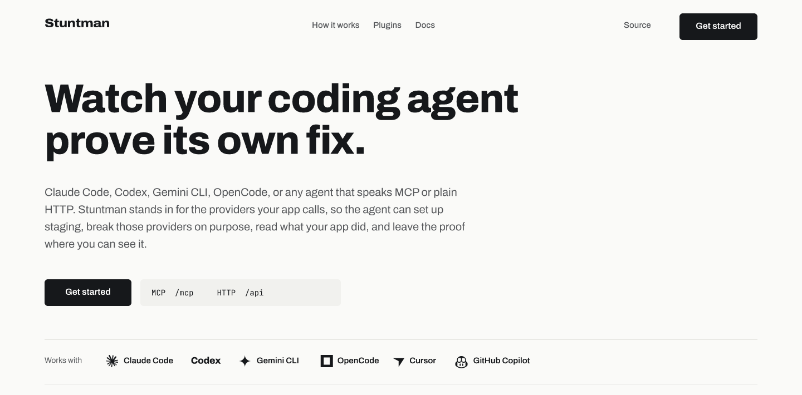
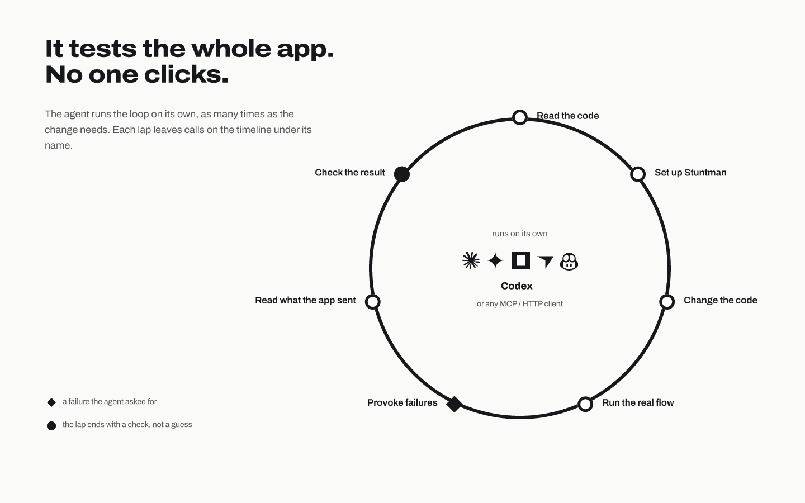
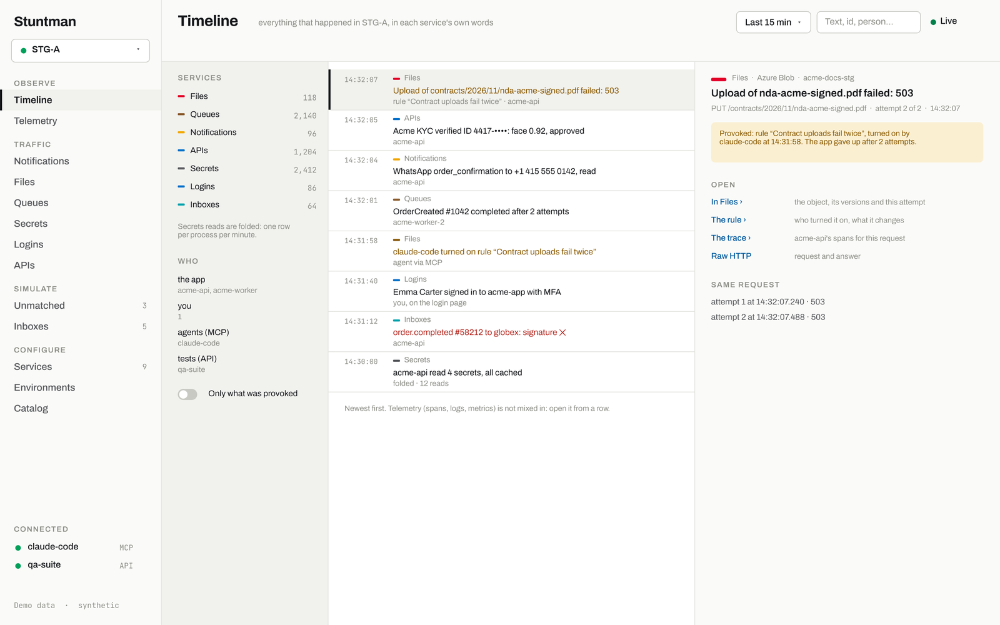
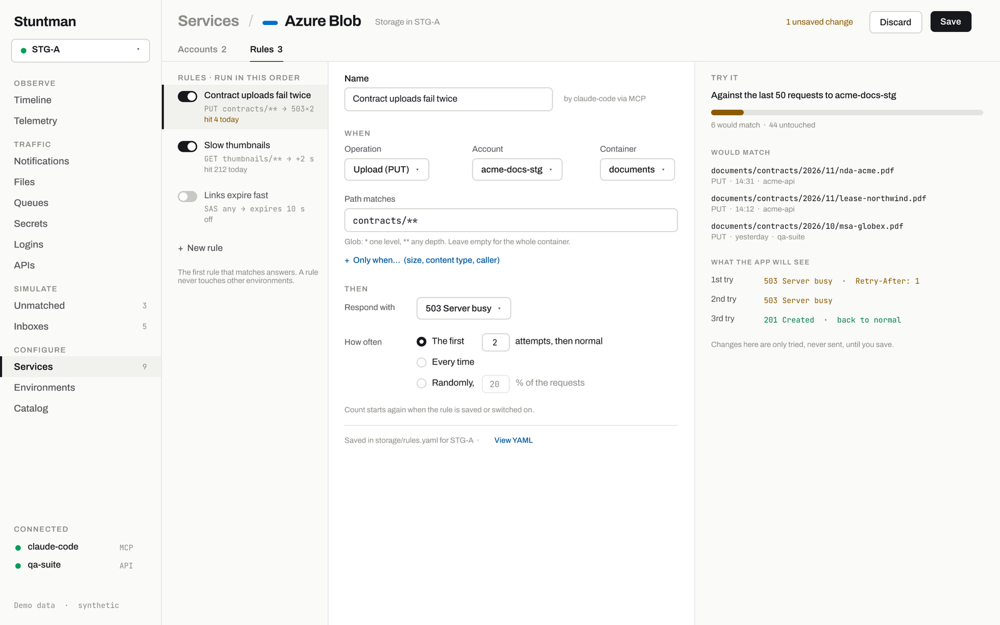
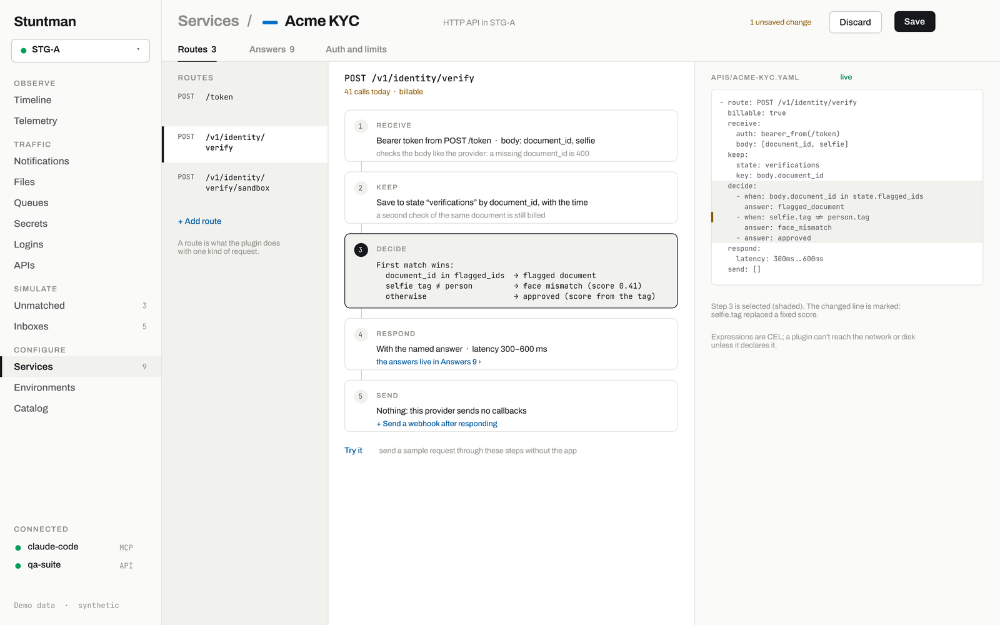
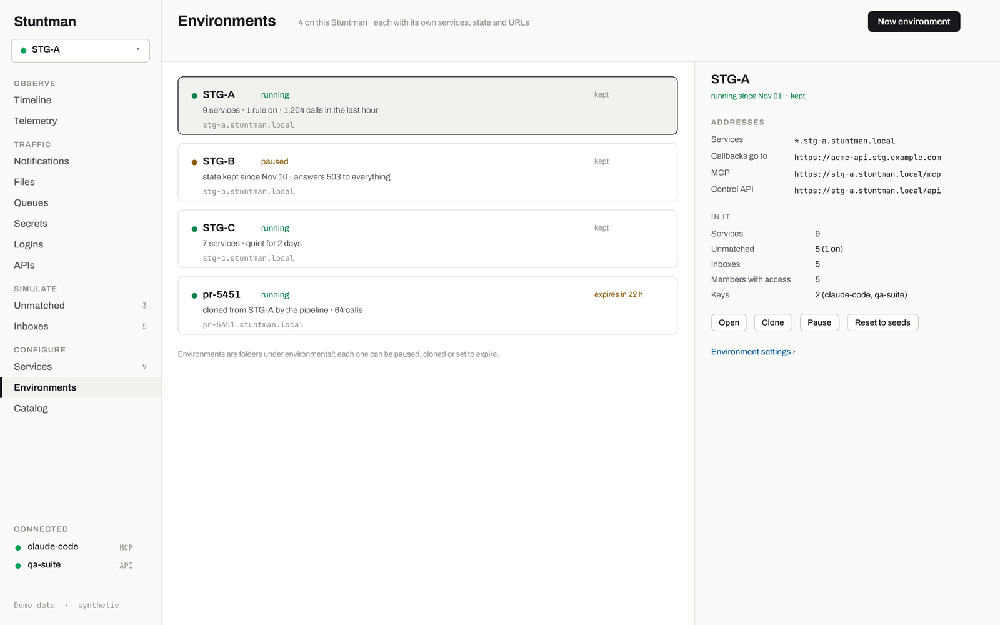

<p align="center">
  
</p>

<h1 align="center">Stuntman</h1>

<p align="center">
  <strong>The stunt double for every provider your app calls.</strong><br>
  SMS, WhatsApp, e-mail, storage, queues, identity, secrets, webhooks and any HTTP API,<br>
  answering like the real thing, so you and your coding agents can test the hard cases end to end.
</p>

<p align="center">
  <a href="docs/getting-started.md">Get started</a> ·
  <a href="docs/agents.md">Agents</a> ·
  <a href="docs/providers.md">Providers</a> ·
  <a href="docs/failures.md">Failures on cue</a> ·
  <a href="docs/plugins.md">Plugins</a> ·
  <a href="docs/reference/tools.md">Tool reference</a>
</p>

> **Status: early.** Stuntman is a working name. It runs and is used every day against a real product's staging,
> but the plugin format may still change and there is **no sign-in yet**. Read [Security](docs/security.md)
> before you put it anywhere other people can reach.

## Set it up with one prompt

Paste this into your coding agent (Claude Code, Codex, Gemini CLI, OpenCode, Cursor, GitHub Copilot…):

```text
Set up Stuntman for this project: read https://edivanteixeira.github.io/stuntman/agent-setup.md and follow it step by step.
```

The agent asks which language you prefer, starts Stuntman with Docker, finds every provider your project calls,
shows you each change before making it, points your local configuration at Stuntman, proves nothing still reaches a
real provider, and ends with every link ready. The guide it follows is [open to read](site/static/agent-setup.md).

---

## Why

Staging talks to providers you do not control. That costs money, sends real messages, and, worst of all,
never shows you the cases that break production: the SMS that never arrives, the user who answers on WhatsApp,
the upload that fails twice, the token that expires mid-flow.

Stuntman takes the providers' place. Your app keeps its code and its settings; only the base URLs change.
Stuntman answers with the provider's own paths, bodies and status codes, keeps their state, sends their
callbacks back, and **fails exactly when you ask it to**.

## Built for agents that test their own work

<p align="center"></p>

Every action in Stuntman is a tool: **293 of them**, each one both an **MCP tool** and an **HTTP route**.
Claude Code, Codex, Gemini CLI, OpenCode, Cursor, GitHub Copilot or a plain test script can:

1. **Set it up.** Find the providers your app calls, install the matching plugins, point the base URLs at Stuntman.
2. **Provoke.** Make the next send fail with a 500, bounce an e-mail, expire every token, answer as the user.
3. **Read.** See every call your app made, in the provider's words, with its retries and callbacks.
4. **Check.** Confirm against the timeline, not against the agent's summary, and confirm nothing leaked to a real provider.

```text
you    Make contract uploads fail twice with a 503, then tell me whether acme-api recovers.
agent  create_rule        {"when": {"op": "put", "path": "contracts/**"}, "then": {"respond": "503"}, "how_often": {"first": 2}}
agent  wait_for_object    {"container": "documents", "prefix": "contracts/nda-acme"}   → 408: nothing stored
agent  Two 503s, then acme-api gave up. The retry limit is the bug. Fixing it and running again.
agent  wait_for_object    → nda-acme-signed.pdf stored, on the third attempt
agent  set_rule_enabled   {"enabled": false}
```

<sub>Illustrative session with synthetic data. Tool names and argument shapes are real; some arguments are left out.</sub>

→ [Connect your agent](docs/agents.md)

## Quick start

```sh
docker run -d --name stuntman \
  -p 127.0.0.1:8025:8025 -p 127.0.0.1:2525:2525 -p 127.0.0.1:8028:8028 \
  -v stuntman-data:/data edivanteixeira/stuntman

open http://localhost:8025          # the screen; the HTTP API is /api, MCP is /mcp
```

The image is on Docker Hub as [`edivanteixeira/stuntman`](https://hub.docker.com/r/edivanteixeira/stuntman)
(`linux/amd64` and `linux/arm64`). Publish more ports for more lines (all of them are in
[Configuration](docs/configuration.md#ports)), or run every port at once with Docker Compose:
`cd engine && docker compose up -d`.

Point your app's provider URLs at it (examples):

| Provider | Point it at |
|---|---|
| WhatsApp Cloud API (Meta Graph) | `http://localhost:8025/whatsapp` |
| SendGrid | `http://localhost:8025/sendgrid` |
| SMTP | `localhost:2525` |
| Any HTTP API (plugins) | `http://localhost:8028/<service>` |
| Azure Blob | `http://127.0.0.1:10000/<account>` |
| Amazon S3 | `http://127.0.0.1:9000` (path style) |
| OpenTelemetry | `http://localhost:4318` (or gRPC `:4317`) |

Connect Claude Code:

```sh
claude mcp add --transport http stuntman http://localhost:8025/mcp
```

→ [Full getting started guide](docs/getting-started.md) · [Configuration and ports](docs/configuration.md)

## What it stands in for

| Line | Providers today | You can provoke |
|---|---|---|
| **HTTP APIs** | Any REST API, described as a YAML plugin: OAuth2 client credentials, Basic, session cookies, mTLS, browser steps | named answers, latency, 5xx, reset, timeout, expired tokens, billing and rate limits |
| **SMS** | Zenvia API v2 | 500, 400, reset, empty reply, timeout; the person texts back, STOP / START |
| **WhatsApp** | Meta WhatsApp Cloud API (Graph) | 500, 400, connection failures, expired tokens, user replies, badly signed or replayed webhooks |
| **E-mail** | SMTP (STARTTLS) and SendGrid v3, signed event webhook | bounce, defer, drop, hold; open, click, spam report, unsubscribe events |
| **Storage** | Azure Blob (SharedKey, SAS) and Amazon S3 (SigV4) | 503 on the first N attempts, 403/404, slow reads, bad MD5, expired or tampered links, lost or duplicated events |
| **Messaging** | Azure Service Bus and RabbitMQ over AMQP | lost locks, duplicates, held, dropped, dead-lettered or out-of-order messages, refused or busy namespace |
| **Identity** | OIDC / OAuth2: Microsoft Entra ID, Google, Okta, generic OIDC | MFA, consent, user cancels, wrong tenant, expired tokens, bad signature, IdP down, broken discovery or JWKS |
| **Secrets** | Azure Key Vault (secrets, keys, certificates) and managed identity | 403, 404, 429, disabled, slow, expired or untrusted certificates, wrong signatures |
| **Webhook inboxes** | Endpoints your app sends its own webhooks to | 200, 500, timeout, hang, delay, fail N times then succeed, signature checks |
| **Telemetry** | OpenTelemetry (OTLP logs, traces, metrics) | a collector that refuses, rejects, throttles, slows down or drops half |

→ [Providers in detail](docs/providers.md) · [Every failure you can provoke](docs/failures.md)

## See it

| | |
|---|---|
|  **Timeline.** Every call as a sentence, who made it, and what was provoked. |  **Rules.** Which requests, what to answer, how often. Tried before saved. |
|  **Plugins.** Edit a route on screen; the YAML beside it stays the source of truth. |  **Environments.** One process, many environments; clone one per pull request. |

<sub>Screens use synthetic data.</sub>

## Principles

1. **The plugin is the product.** Everything a provider does lives in one installable file.
2. **Text is the source of truth.** The screen is a second way to edit the same YAML, never a separate copy.
3. **The provider's words first.** Raw HTTP is one click away.
4. **Provoking is as easy as watching.**
5. **Safe by default.** A plugin cannot reach the network or the disk unless it declares it.

## Documentation

| Guide | What it covers |
|---|---|
| [Getting started](docs/getting-started.md) | Run it, point your app, connect an agent, ask for the hard case |
| [Agents](docs/agents.md) | MCP and HTTP, client-by-client setup, the loop, tools by intent |
| [Providers](docs/providers.md) | Each line: what it speaks, what it keeps, how to point your app at it |
| [Failures on cue](docs/failures.md) | Rules, forced answers and every provocation, line by line |
| [Timeline and proof](docs/timeline.md) | Reading what your app did; unmatched calls; telemetry |
| [Plugins](docs/plugins.md) | The YAML format, expressions, installing, validating |
| [Environments](docs/environments.md) | One environment per branch: clone, pause, expire, route requests |
| [Configuration](docs/configuration.md) | Environment variables, ports, Docker, data layout |
| [Security](docs/security.md) | What is and is not protected today |
| [Tool reference](docs/reference/tools.md) | All 293 tools, generated from the source |

## How it is built

A single Rust process serves every environment: the screen (Leptos, compiled to WebAssembly), the HTTP API,
MCP over streamable HTTP, and each provider on its own port. State lives in SQLite per environment;
configuration lives in YAML files you can read, diff and commit. Each provider is a crate that implements one
module interface, so adding a provider never touches the others. See [`engine/README.md`](engine/README.md).

```text
engine/
  crates/core       shared: storage, tools (MCP tool = HTTP route), signed callbacks, live events
  crates/server     wires the modules; one router per environment; /api, /mcp, the screen
  crates/apis       the HTTP plugin engine (YAML + expressions) — plugins/ is the catalog
  crates/email      SMTP and SendGrid        crates/sms        SMS (Zenvia)
  crates/whatsapp   WhatsApp Cloud API       crates/storage    Azure Blob and S3
  crates/messaging  Service Bus, RabbitMQ    crates/identity   OIDC / OAuth2
  crates/keyvault   Key Vault, managed id.   crates/webhook    webhook inboxes
  crates/telemetry  OTLP receiver
  web/              the screen (Leptos)
```

## Contributing

The most valuable contribution is a **plugin for a provider you know well**. Start with
[Plugins](docs/plugins.md) and [CONTRIBUTING.md](CONTRIBUTING.md).

## License

Not chosen yet. Until a license is published, all rights are reserved by the authors.
