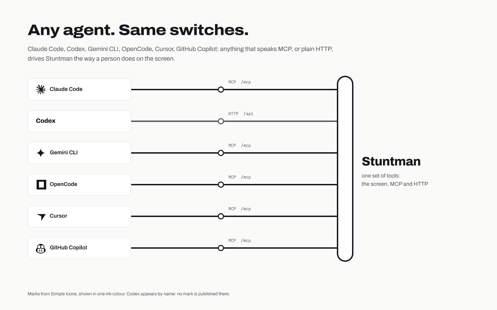
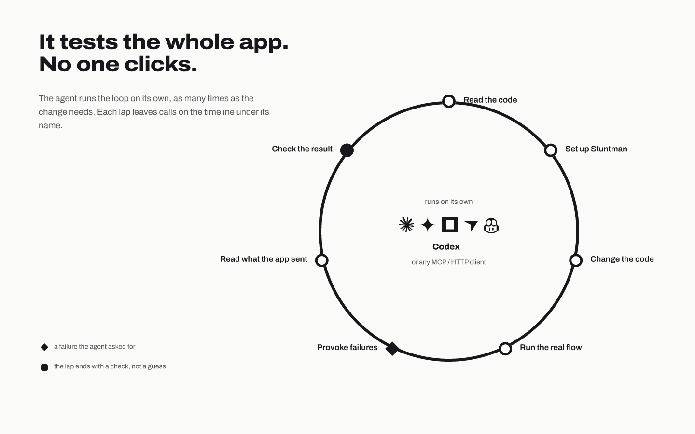
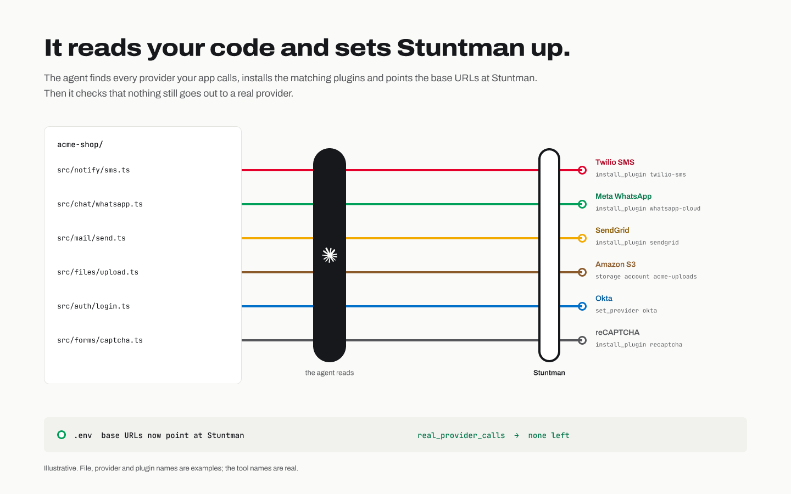

# Agents

Stuntman is built for coding agents that test their own work. Every action in the UI is also an
**MCP tool** and an **HTTP route** with the same name and the same arguments, and the timeline records who acted:
you, an agent over MCP, or a script over HTTP.

<p align="center"></p>

## Set up a project with one prompt

```text
Set up Stuntman for this project: read https://edivanteixeira.github.io/stuntman/agent-setup.md and follow it step by step.
```

[`agent-setup.md`](../site/static/agent-setup.md) is the playbook: language first, then start, connect, discover
providers, configure, point the project, prove, and a welcome with every link. Agents can also read
[`llms.txt`](https://edivanteixeira.github.io/stuntman/llms.txt).

## The loop

<p align="center"></p>

1. **Read the code.** Find every provider the app calls.
2. **Set up Stuntman.** Install the plugins, create inboxes and providers, point the base URLs.
3. **Change the code.** The fix or the feature you asked for.
4. **Run the real flow.** Your app, end to end, against Stuntman.
5. **Provoke failures.** The cases staging never shows: 503s, bounces, expired tokens, user replies.
6. **Read what the app sent.** Calls, retries, callbacks, in the provider's words.
7. **Check the result.** Against the timeline, not a guess. Then turn the provocation off.

## When Stuntman falls short

An agent that hits a gap in Stuntman (a provider behaviour it gets wrong, a missing endpoint or tool, a bug) already
knows the fix. The setup guide and the MCP instructions ask it to say so: what is missing, the change it would make,
and an offer to send it as a pull request (see [Contributing](../CONTRIBUTING.md)). It writes the change only after
you say yes, and keeps your project's code, names and data out of it.

## Connect

MCP runs over **streamable HTTP** at `/mcp` on the main port. Each environment has its own endpoint:
`http://localhost:8025/mcp` for the default one, `http://localhost:8025/e/<env>/mcp` for the others.

> There is **no API key yet**: anyone who reaches the port can use every tool. Keys per agent are designed and
> coming; until then, see [Security](security.md).

### Claude Code

```sh
claude mcp add --transport http stuntman http://localhost:8025/mcp
```

### Codex

```sh
codex mcp add stuntman --url http://localhost:8025/mcp
```

or in `~/.codex/config.toml`:

```toml
[mcp_servers.stuntman]
url = "http://localhost:8025/mcp"
```

### Gemini CLI

`~/.gemini/settings.json` (or `.gemini/settings.json` in the project):

```json
{ "mcpServers": { "stuntman": { "httpUrl": "http://localhost:8025/mcp" } } }
```

### OpenCode

`opencode.json`:

```json
{ "mcp": { "stuntman": { "type": "remote", "url": "http://localhost:8025/mcp" } } }
```

### Cursor

`.cursor/mcp.json`:

```json
{ "mcpServers": { "stuntman": { "url": "http://localhost:8025/mcp" } } }
```

### GitHub Copilot (VS Code)

`.vscode/mcp.json`:

```json
{ "servers": { "stuntman": { "type": "http", "url": "http://localhost:8025/mcp" } } }
```

Client configuration formats change; if one of these does not load, check your client's MCP documentation for
"streamable HTTP" or "remote" servers.

### Without MCP

Every tool is an HTTP route under `/api`. `GET /api/tools` lists them with their routes and parameter schemas.

```sh
curl -s -X POST localhost:8025/api/whatsapp/force \
     -H 'content-type: application/json' -d '{"answer": "500", "count": 1, "by": "codex"}'
```

Pass `by` to name the actor on the timeline.

## Let it set Stuntman up

<p align="center"></p>

A good first prompt:

> *Read this repository, find every external provider it calls, set Stuntman up for each one, point the staging
> base URLs at it, and confirm with `real_provider_calls` that nothing still goes out.*

The tools it will use:

| Step | Tools |
|---|---|
| See what can be installed | `list_plugins`, `get_catalog_plugin` |
| Install | `install_plugin`, `install_collection`, `import_plugin` + `install_import` |
| Providers with their own module | `set_provider` (identity, SAML, LDAP), `create_account` (storage), `create_webhook_inbox`, `set_mailbox`, `set_file_server`, `create_topic`, `create_pubsub_subscription`, `set_activemq`, `set_ai_rule`, `set_event_plan`, and one set per line ([reference](reference/tools.md)) |
| Write a plugin that does not exist | `get_plugin`, `put_plugin`, `validate_plugin` |
| Stand in for a provider from its OpenAPI spec | `import_spec`, `reimport_spec`, `set_route`, `try_route` |
| Record the real provider and make the plugin | `start_recording`, `recording_status`, `stop_recording`, `make_plugin` |
| Stand in for a SOAP provider | `import_wsdl`, `list_operations`, `set_operation`, `try_operation`, `reimport_wsdl`, `send_callback` |
| Reuse WireMock mappings | `import_mocks`, `set_scenario` |
| Prove nothing leaks | `real_provider_calls`, `list_unmatched` |
| See which services the app already uses | `usage` |

## Tools by intent

A sample; the full list of 389 is in the [tool reference](reference/tools.md).

| Intent | Tools |
|---|---|
| **Watch** | `list_sms`, `list_whatsapp_messages`, `list_api_calls`, `list_traces`, `list_deliveries`, `list_ai_calls`, `list_product_events`, `list_transfers`, `list_stream_messages`, `list_pubsub_messages`, `list_activemq_messages`, `wait_for_object`, `wait_for_api_call`, `wait_for_delivery`, `wait_for_ai_call`, `wait_for_event`, `wait_for_file`, `wait_for_pubsub_message`, `wait_for_activemq_ack` |
| **Provoke** | `create_rule`, `set_rule_enabled`, `force_answer`, `force_sms_failure`, `force_whatsapp_failure`, `force_ai_failure`, `force_events_failure`, `expire_tokens`, `send_bad_webhook`, `provoke_sign_in`, `provoke_secret`, `rebalance`, `set_pubsub`, `set_activemq` |
| **Play the people** | `reply_as_user`, `reply_sms_as_user`, `simulate_recipient`, `put_mail`, `put_file`, `produce`, `pubsub_publish`, `activemq_send`, `send_bot_activity` |
| **Move time** | `clock`, `advance_clock` ([the environment's clock](clock.md)) |
| **Set up** | `list_plugins`, `install_plugin`, `install_collection`, `import_spec`, `start_recording`, `import_wsdl`, `put_plugin`, `set_provider`, `create_webhook_inbox`, `create_environment` |
| **Check** | `real_provider_calls`, `validate_plugin`, `list_forced`, `would_fail`, `check_events`, `ai_spend`, `verify_xml_signature` |

## Tips for reliable runs

- **Wait, do not sleep.** `wait_for_object`, `wait_for_api_call`, `wait_for_delivery` and the other `wait_for_*`
  tools block until the thing happens and return it; they fail with a clear timeout when it does not.
- **Provoke a count, not forever.** `count` and `first` turn a failure off by itself, so a crashed run leaves no
  trap behind.
- **Move the clock, do not wait for it.** A webhook due in 30 days goes out with `advance_clock`.
- **Give each pull request its own environment.** See [Environments](environments.md).
- **Ask for evidence.** The timeline keeps every call under the actor's name; a good report points at it.
