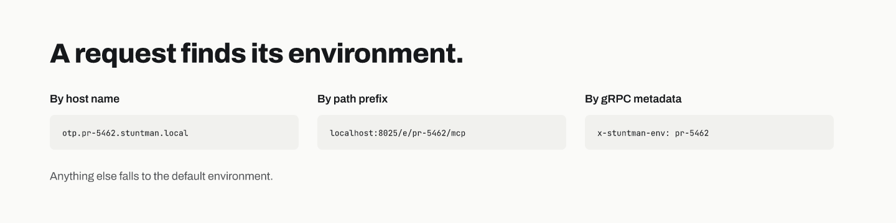
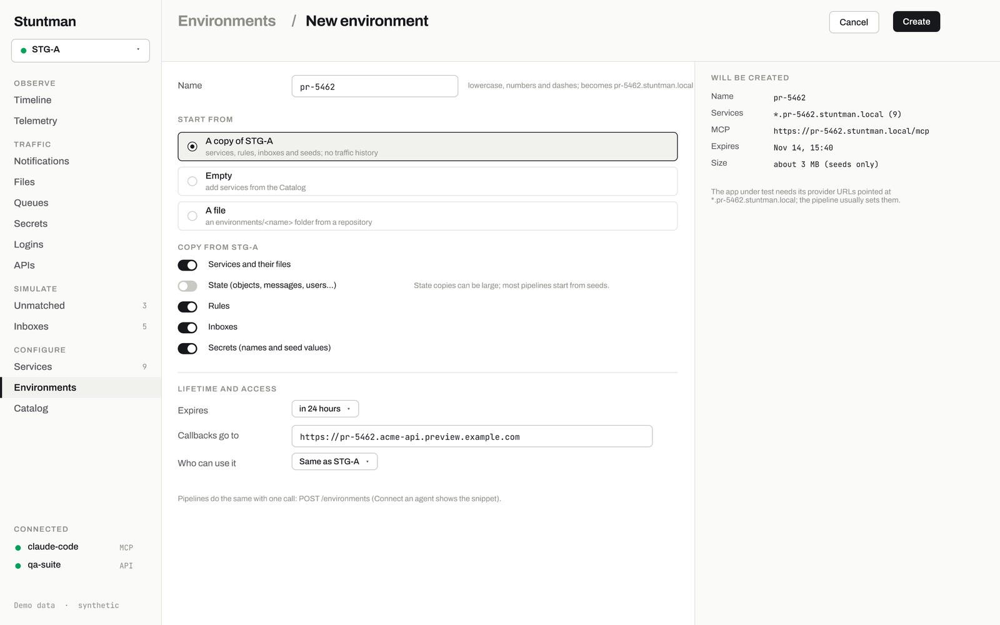

# Environments

One Stuntman serves many environments. Each has its own plugins, state, rules, inboxes, base URLs, callback target
and MCP endpoint. Pause one and its state is kept; clone one for a pull request and let it expire.


## One per branch

<p align="center"></p>

```sh
curl -s -X POST localhost:8025/api/environments -H 'content-type: application/json' \
     -d '{"name": "pr-5462", "from": "stg-a", "expires": "24h"}'
```

| Argument | Meaning |
|---|---|
| `name` | lowercase, digits and dashes, 1 to 40 characters |
| `from` | an environment to copy, a template (`templates/<name>`), `"empty"`, or a folder |
| `vars` | the `${…}` values of a template or folder, e.g. `{"domain": "preview.acme.example"}` |
| `copy` | what the copy takes: services, state, inboxes, secrets… (default: everything but state) |
| `expires` | e.g. `24h`, `72h`; the environment deletes itself afterwards |
| `callbacks` | where provider callbacks go for this environment |
| `base_domain` | apps reach every service by name under it, e.g. `pr-5462.stuntman.svc.local` |
| `public_url` | where browsers open it, e.g. `https://stuntman.example.com/e/pr-5462` |
| `allowed_email_domains` | real e-mail domains identity accepts for people (synthetic only by default) |

The answer lists the new environment's addresses: its MCP endpoint, its API, its host names.

| Action | Tool | Route |
|---|---|---|
| List / read | `list_environments`, `get_environment` | `GET /api/environments[/{name}]` |
| Create or clone | `create_environment` | `POST /api/environments` |
| Change callbacks, lifetime, base domain, public URL, e-mail domains | `set_environment` | `PUT /api/environments/{name}` |
| Push the expiry (default 24 h) | `extend_environment` | `POST /api/environments/{name}/extend` `{"by": "24h"}` |
| Pause or resume | `pause_environment` | `POST /api/environments/{name}/pause` |
| What the app sets (connection strings, URLs, `.env`) | `get_connections` | `GET /api/environments/{name}/connections[?base=…]` |
| Templates and their values | `list_environment_templates` | `GET /api/environments/templates` |
| Delete, with everything in it | `delete_environment` | `DELETE /api/environments/{name}` |

`PUT /api/environments/{name}` with `{"expires": "72h"}` sets the expiry to 72 hours from now; `extend` adds to the
current expiry.

A **paused** environment answers 503 on every service, stores nothing, and keeps its state.

## How a request finds its environment

<p align="center"></p>

| By | Example |
|---|---|
| Host name | `*.pr-5462.stuntman.local` (see `GET /api/environments/{name}/hosts`) |
| Path prefix, on any HTTP port | `http://localhost:8025/e/pr-5462/mcp`, `:8027/e/pr-5462/in/<inbox>`, `:4318/e/pr-5462/v1/traces` |
| gRPC metadata | `x-stuntman-env: pr-5462` |

Anything else falls to the default environment (`STUNTMAN_ENV`, `staging` unless set).

**SMTP.** Several environments can listen on the same SMTP port. On a port only one environment uses, nothing
changes. On a shared port the SMTP login names the environment: user `<env>` (or `<env>/<service>`), any password,
or one of the service's keys when keys are checked; a STARTTLS server name under the environment's base domain also
picks it. Without a login the server answers `530` and lists the environments on the port. A template or a folder
keeps its SMTP port (the environments share it); a copy of an environment still moves its SMTP services to free ports.

Service Bus and Key Vault find the namespace or vault by host name. Give each environment a **base domain** under a
wildcard DNS name that points at the server, e.g. `acme.stuntman.example.com` with `*.stuntman.example.com` → the
host.

An environment with a **base domain of its own** (anything but the automatic `<name>.stuntman.local`) gets addresses
by name everywhere: the Service Bus connection string names `sb://<namespace>.<base domain>`, a webhook inbox is
`http://<base domain>:8027/in/<inbox>`, SendGrid, Zenvia and OTLP use the base domain without a prefix. A
`.localhost` base domain needs no DNS at all.

## Templates

A template is a folder in `templates/` on the server (`/data/templates/<name>` in Docker), laid out like an
environment's folder. Any text in it may hold `${…}` values; `${name}` is always the new environment's name and the
others come in `vars`. A value with no `vars` entry refuses the creation (400, with each value and the files that use
it); nothing is made. The template's `environment.yaml` may set `base_domain`, `public_url`, `callbacks`,
`real_hosts` and `allowed_email_domains`, with values in them.

```sh
curl -s -X POST localhost:8025/api/environments -H 'content-type: application/json' -d '{
  "name": "pr-5462", "from": "acme-preview", "vars": {"domain": "preview.acme.example"}, "expires": "72h" }'
```

## A shared Stuntman, one public address

Set `STUNTMAN_PUBLIC_URL=https://stuntman.example.com` and put one reverse proxy (an Ingress) in front of the main
port. The root lists the environments; everything of one environment lives under `/e/<name>/`: its screens (reload
any page and the same page opens), `/e/<name>/api`, `/e/<name>/mcp` and its identity pages `/e/<name>/login/<tenant>`.

Identity names the address a browser uses. Its issuer, discovery, authorize, token, keys and logout URLs are, in
order: the environment's `public_url`; else `STUNTMAN_PUBLIC_URL/e/<name>`; else the address the call came by
(`X-Forwarded-Proto` and `X-Forwarded-Host` first, then `Host`, plus `/e/<name>` when it came by the prefix). With a
public address set, a token a browser got there is valid for the app that reaches Stuntman inside the network.

A single-page app (MSAL) reads discovery and keys and redeems its code from the browser: those routes answer CORS.
The token endpoint lets a browser in only for an app of type `spa`, and only from the origin of one of its redirect
URIs; any other origin gets `AADSTS9002326`, as Entra answers.

People with real e-mail addresses (the app's database is a copy of staging and only knows them) need their domain in
the environment's `allowed_email_domains`; every other address stays synthetic only.

Azure Blob is on its own port; a SAS link the app hands to a browser also works through the main port, at
`<public url>/blob/<account>/<container>/<blob>?<sas>`. A link made in Stuntman shows it as `publicUrl`.

`GET /api/environments/{name}/connections` lists what the app sets (`?base=http://stuntman.svc` gives the
path-prefix form where a protocol takes it; Blob, Service Bus, Key Vault and SMTP keep host names). `env` in the
answer is the same as `.env` lines.

## Delete and expiry

`DELETE /api/environments/{name}` takes everything at once: the folder (YAML, `duble.sqlite`, `telemetry.sqlite`,
identity keys, vault certificates, secrets), its SMTP listeners and its host names; afterwards the environment
answers 404 and the name is free for a new one, which starts clean. Expiry (checked every 30 s) deletes the same way.

## Upgrades and what is in /data

A new version opens every environment in `/data` as it was, with its state. Database changes are migrations that
only add tables and columns, and new `environment.yaml` keys are optional: an older file reads as before. Pin the
image tag (`edivanteixeira/stuntman:0.9.0`) and read the release notes before you move it.

## On disk

Each environment is a folder you can read, diff and back up:

```text
data/environments/<name>/
  environment.yaml        lifetime, callbacks, base domain, public URL, real hosts, real e-mail domains
  apis/<service>.yaml     HTTP API plugins
  email/services/*.yaml   email services
  email/extractors.yaml
  webhooks/inboxes.yaml   kept webhook inboxes
  storage/rules/*.yaml    storage rules
  telemetry/<name>.yaml
  secrets.yaml
  duble.sqlite            state and history
  telemetry.sqlite        spans, logs, metrics
```

<p align="center"></p>
