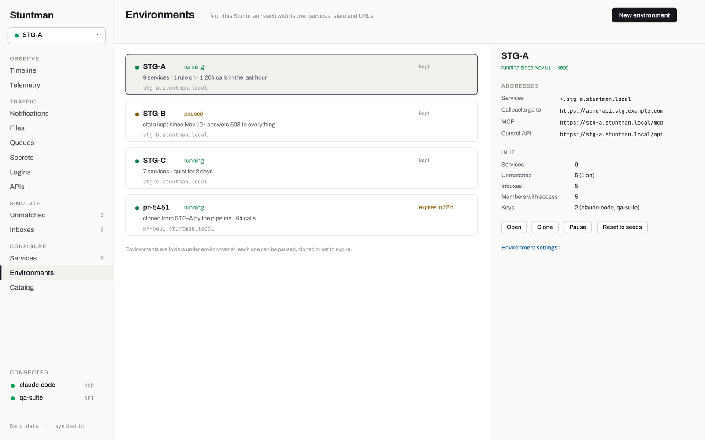
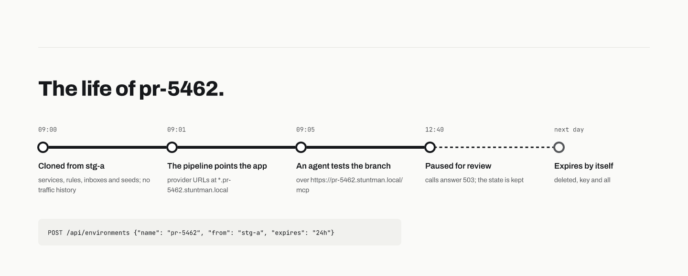

# Environments

One Stuntman serves many environments. Each has its own plugins, state, rules, inboxes, base URLs, callback target
and MCP endpoint. Pause one and its state is kept; clone one for a pull request and let it expire.



## One per branch

<p align="center"></p>

```sh
curl -s -X POST localhost:8025/api/environments -H 'content-type: application/json' \
     -d '{"name": "pr-5462", "from": "stg-a", "expires": "24h"}'
```

| Argument | Meaning |
|---|---|
| `name` | lowercase, digits and dashes |
| `from` | an environment to copy, `"empty"`, or a folder |
| `copy` | what the copy takes: services, state, inboxes, secrets… (default: everything but state) |
| `expires` | e.g. `24h`; the environment deletes itself afterwards |
| `callbacks` | where provider callbacks go for this environment |

The answer lists the new environment's addresses: its MCP endpoint, its API, its host names.

| Action | Tool | Route |
|---|---|---|
| List / read | `list_environments`, `get_environment` | `GET /api/environments[/{name}]` |
| Create or clone | `create_environment` | `POST /api/environments` |
| Change callbacks, lifetime, base domain | `set_environment` | `PUT /api/environments/{name}` |
| Pause or resume | `pause_environment` | `POST /api/environments/{name}/pause` |

A **paused** environment answers 503 on every service, stores nothing, and keeps its state.

## How a request finds its environment

<p align="center"></p>

| By | Example |
|---|---|
| Host name | `*.pr-5462.stuntman.local` (see `GET /api/environments/{name}/hosts`) |
| Path prefix, on any HTTP port | `http://localhost:8025/e/pr-5462/mcp`, `:8027/e/pr-5462/in/<inbox>`, `:4318/e/pr-5462/v1/traces` |
| gRPC metadata | `x-stuntman-env: pr-5462` |

Anything else falls to the default environment (`STUNTMAN_ENV`, `staging` unless set). SMTP ports belong to one
environment; a copy moves its SMTP services to free ports.

Service Bus and Key Vault find the namespace or vault by host name. Give each environment a **base domain** under a
wildcard DNS name that points at the server, e.g. `acme.stuntman.example.com` with `*.stuntman.example.com` → the
host.

## On disk

Each environment is a folder you can read, diff and back up:

```text
data/environments/<name>/
  environment.yaml        lifetime, callbacks, base domain, real hosts
  apis/<service>.yaml     HTTP API plugins
  email/services/*.yaml   email services
  email/extractors.yaml
  webhooks/inboxes.yaml   kept webhook inboxes
  storage/rules/*.yaml    storage rules
  telemetry/<name>.yaml
  secrets.yaml
  duble.sqlite            state and history
  telemetry.sqlite        spans, logs, metrics
```

<p align="center"></p>
