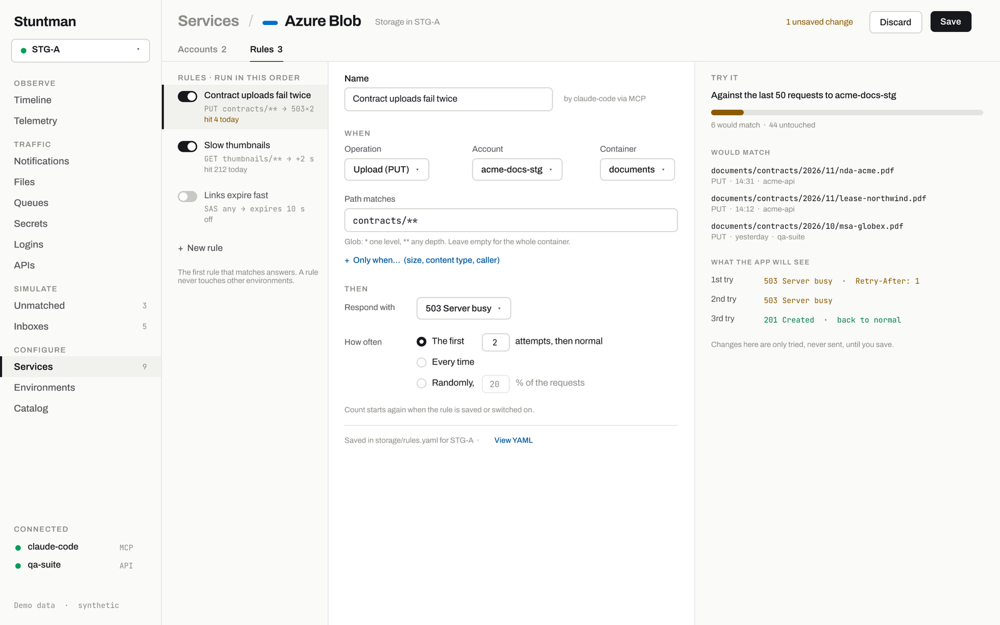
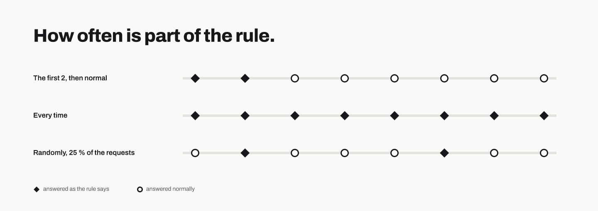
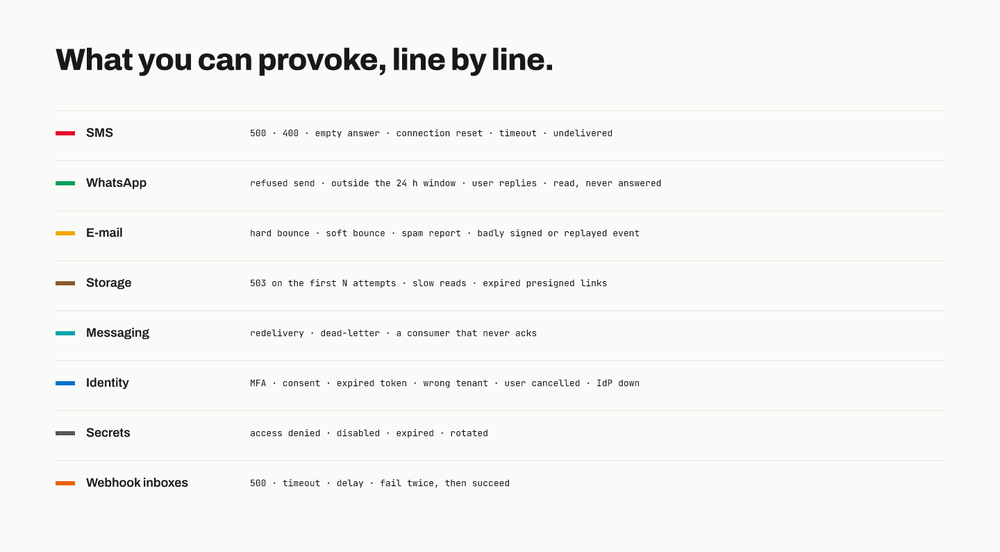

# Failures on cue

Staging never shows you the cases that break production. Stuntman makes them happen on the next call,
exactly as asked, for you, a test suite or an agent, and the timeline marks every answer it changed.

There are three ways to provoke:

| | What it does | Lives in |
|---|---|---|
| **Rules** | Which requests, what to answer, how often. Tried against recent traffic before you save. | `storage/rules/<service>.yaml` |
| **Forced answers** | "The next N calls (or the next 10 minutes) answer like this." Stops by itself. | the timeline and `list_forced` |
| **Acting as the world** | The person replies, the recipient clicks, the IdP goes down, a bad webhook arrives. | the timeline |

## Rules



A rule has three parts: **when** (operation, account, container, path glob, extra conditions), **then** (the answer,
optionally a delay) and **how often**.

<p align="center"></p>

The first rule that matches answers; a rule never touches other environments. The same rule from an agent:

```json
create_rule {
  "service": "azure-blob",
  "name": "Contract uploads fail twice",
  "when": { "op": "put", "container": "documents", "path": "contracts/**" },
  "then": { "respond": "503" },
  "how_often": { "first": 2 }
}
```

Operations: `put`, `get`, `delete`, `list`, `link`, `any`. Answers: `403`, `404`, `409`, `412`, `413`, `503`,
`timeout`, `reset`, `empty`, `slow`, `truncate`, `bad_md5`. How often: `{"first": N}`, `{"random": 25}` or `"every"`.
Rules are saved in `storage/rules/<service>.yaml` for that environment.

Turn it off with `set_rule_enabled`, or let `first` end it. Storage and messaging have rules; HTTP API plugins use
named answers and `force_answer` instead.

## Line by line

<p align="center"></p>

| Line | Tool | Answers |
|---|---|---|
| HTTP APIs | `force_answer` | any named answer of the plugin, or `reset`, `empty`, `timeout`, `500`, `503`, `html` (200 with an HTML page), `503_html` (503 with an HTML page, as a proxy in front answers); `count=N` or `for=10m`; one route or all |
| HTTP APIs (SOAP) | `force_answer`, a `fault:` answer | any fault the WSDL declares or one you add; `500` goes out as a `Receiver` fault; a body that breaks the XSD gets the validation fault; see [SOAP services](soap.md) |
| HTTP APIs (OpenAPI) | `force_answer`, a body that does not match the schema | any response the spec declares; a wrong body gets the spec's 400 or 422 answer; see [OpenAPI specs](openapi.md) |
| HTTP APIs | `expire_tokens` | every token and session cookie becomes invalid; the next call gets 401 |
| HTTP APIs (streams) | `force_answer` | `cut` (half the parts, then the connection breaks), `slow` (2 s more per part) |
| HTTP APIs (MCP) | `force_answer`, `rpc_error` | `session_expired` (404, a new session needed); a JSON-RPC error; `isError` results |
| HTTP APIs (webhooks) | `set_service` with `webhook_provoke` | `wrong_signature`, `old_timestamp`, `no_signature`, `twice`, `out_of_order`; `none` stops it |
| HTTP APIs (SOAP) | `signature.check`, `client_certificate.icp` | a refused XML signature; mTLS refused without a CNPJ, expired or untrusted (`new_test_certificate`) |
| AI models | `force_ai_failure` | `429`, `500`, `529`, `filter`, `length`, `bad_json`, `slow`, `cut`; `none` stops it |
| SMS | `force_sms_failure` | `500`, `400`, `reset`, `empty`, `timeout`; `normal` stops it |
| SMS | `reply_sms_as_user` | the person texts back; STOP-like words opt out, START opts back in |
| WhatsApp | `force_whatsapp_failure` | `500`, `400`, `reset`, `empty`, `timeout` |
| WhatsApp | `expire_whatsapp_tokens` | every Graph call gets 190 "Session has expired" until restored |
| WhatsApp | `reply_as_user` | a text, a template button, an image or a location |
| WhatsApp | `send_bad_webhook` | `wrong_signature`, `missing_signature`, `old_secret`, `replay`; returns your app's status code |
| Email | `decide_held` | `deliver`, `defer`, `bounce` (hard or soft), `drop` |
| Email | `simulate_recipient` | `open`, `click`, `spamreport`, `unsubscribe` |
| Email | `set_access` | an intake that refuses recipients, requires STARTTLS, or is unreachable |
| Mailboxes | `set_mailbox` with `provoke` | `login_refused`, `busy`, `drop_fetch`, `tls_required`, `token_expired`; `none` stops it |
| Files | `set_file_server` with `provoke` | `login_refused`, `disk_full`, `permission_denied`, `drop_mid`, `slow`, `host_key_changed`; `none` stops it |
| Storage | `create_rule` | any status on matching requests, the first N, every time, or a share |
| Storage | `set_next_read` | `403`, `404`, `503`, `slow:5s`, `truncate`, `bad_md5` |
| Storage | `set_next_use` | a link that is `expired`, `bad_signature`, `ip_denied`, `permission`, `not_yet_valid`, `gone` |
| Storage | `set_next_delivery` | an event that is `hold:30s`, `duplicate`, `reorder`, `drop`, `missing_field` |
| Storage | `set_account_reachability` | the whole account: `timeout`, `503`, `401` |
| Messaging | `set_next_delivery` (with `namespace`) | `lose_lock`, `duplicate`, `hold`, `drop`, `dead_letter`, `out_of_order` |
| Messaging | `expire_consumer_locks` | the consumer's next complete fails with MessageLockLost |
| Messaging | `set_namespace_reachability` | `refuse` (new connections only), `timeout`, `401`, `busy`; `down`: a dead broker (open AMQP connections drop without a close, new ones are refused, the RabbitMQ management API answers 503 for the vhost, unacked deliveries go back to their queue); `close`: the same with a forced close first (RabbitMQ 320 CONNECTION_FORCED, Service Bus `amqp:connection:forced`); `ok` brings it back |
| Streams | `set_streams` with `provoke` | `leader_not_available`, `sasl_refused`, `slow_fetch`, `duplicate`, `registry_down`; `none` stops it |
| Streams | `rebalance`, `produce` with `bad_schema` | a consumer-group rebalance; a record with an unknown schema id |
| Messaging (ActiveMQ) | `set_activemq` | `refuse_login` (SecurityException), `drop_after` N dispatches, `slow_dispatch`, `redeliver` (the next N acks are lost), `fail_commits` (the next N commits roll back), `max_redeliveries` and `individual_dlq` for the DLQ; `reset` stops it |
| Messaging (ActiveMQ) | `activemq_send` with `ttl`, `delay`, `cron` | a message that expires (to `ActiveMQ.DLQ` when persistent), a scheduled or repeating delivery; `advance_clock` brings it forward |
| Pub/Sub | `set_pubsub` with `provoke` | `unavailable`, `deadline_exceeded`, `resource_exhausted`, `not_found`, `slow_publish`, `duplicate`, `ack_transient` (exactly-once acks fail and are retried); `times=N`, one `topic`; `none` stops it |
| Identity | `provoke_sign_in` | `mfa_required`, `mfa_fails`, `consent_required`, `user_cancels`, `wrong_tenant`, `expired`, `bad_signature`, `idp_down` |
| Identity | `provoke_idp` | discovery, JWKS or token endpoint failures |
| Identity (LDAP) | `set_provider` with `ldap_provoke` | `busy` (51), `unavailable` (52), `timeout`; `normal` stops it; locked or disabled users answer as Active Directory does |
| Identity (Bot Framework) | `send_bot_activity` with `twist` | `bad_signature`, `expired`, `wrong_audience`, `no_token` |
| Secrets | `provoke_secret` | `403`, `404`, `disabled`, `429`, `503`, `slow` |
| Secrets | `set_vault` with `reachability` | the whole vault: `503` (`ServiceUnavailable` on every call), `timeout` (held), `refused` (connection closed); `for=10m`; `normal` stops it |
| Secrets | `provoke_key` | `disabled`, `403`, `429`, `slow`, `wrong_signature` |
| Secrets | `provoke_certificate` | `missing`, `expired`, `not_yet_valid`, `wrong_password`, `untrusted` |
| Secrets | `provoke_imds` | `500`, `slow`, `no_identity` |
| Webhook inboxes | `set_inbox` | fail N times then succeed, a share, delay, hang, redirect, signature checks |
| Product events | `force_events_failure` | `400`, `413`, `429`, `slow`, `drop_half`; `none` stops it |
| Telemetry | `provoke_collector` | `401`, `403`, `429`, `503`, `refused`, `slow`, `drop_half` |

Arguments for each tool are in the [tool reference](reference/tools.md).

## Callbacks your app must verify

Stuntman signs callbacks the way each provider does: SendGrid's Event Webhook with ECDSA, Meta's webhooks with
your app secret, your own inboxes with HMAC, and plugin webhooks in the Stripe, Svix, GitHub, CloudEvents, Twilio, Slack, Shopify or HubSpot format
([Plugins › Webhook signing](plugins.md#webhook-signing)). Ask for a badly signed, unsigned or replayed one and check that your
app rejects it:

```text
send_bad_webhook {"kind": "wrong_signature"}   → acme-api answered 401
```

## Good habits

- **Bound every provocation.** Use `count`, `first` or `for` so a crashed test leaves no trap behind.
- **Name the actor.** Pass `by` over HTTP; MCP clients are named automatically.
- **Check the effect, not the switch.** Read the timeline or `wait_for_*` to see what your app did with the failure.
