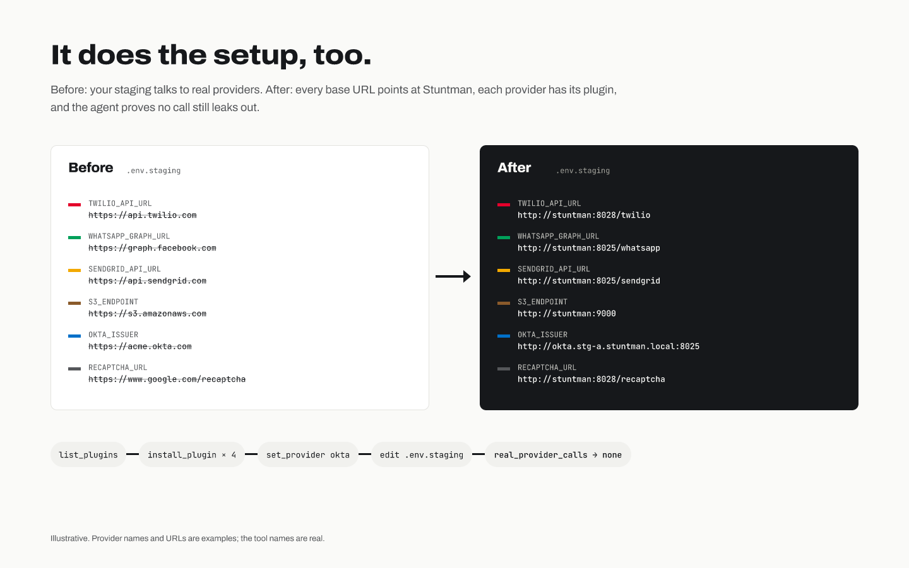
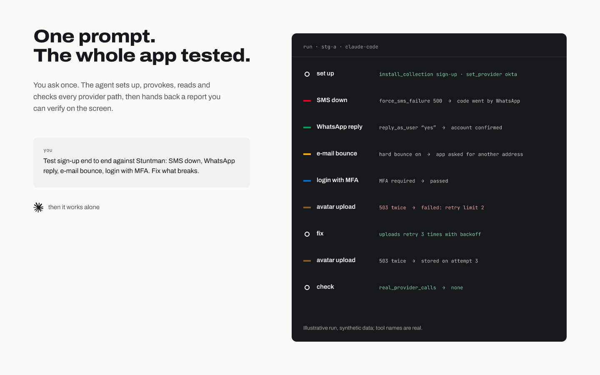

# Getting started

**The fastest way** is one prompt. Paste it into your coding agent and it does everything below for you, asking
before it changes any file:

```text
Set up Stuntman for this project: read https://edivanteixeira.github.io/stuntman/agent-setup.md and follow it step by step.
```

To do it yourself: run Stuntman, point your app at it, connect your agent, ask for the hard case.

<p align="center"></p>

## 1. Run it

### With Docker (recommended)

```sh
docker run -d --name stuntman \
  -p 127.0.0.1:8025:8025 -p 127.0.0.1:2525:2525 -p 127.0.0.1:8027:8027 -p 127.0.0.1:8028:8028 \
  -v stuntman-data:/data edivanteixeira/stuntman
```

The image [`edivanteixeira/stuntman`](https://hub.docker.com/r/edivanteixeira/stuntman) runs on `linux/amd64` and
`linux/arm64`. Publish the ports of the lines you use; the full list is in [Configuration](configuration.md#ports).

To run every port at once, use Docker Compose from a clone of this repository:

```sh
cd engine
docker compose up -d          # add --build to build the image from source
```

One container serves everything: the web UI, the HTTP API (`/api`), MCP (`/mcp`) and every provider on its own port.
Data lives in the `stuntman-data` volume. Open <http://localhost:8025>; the web UI follows your system's light or dark mode, or the one you pick at the foot of its menu (Light, Dark, System). A Calls view is a link you can send:
`/apis/<service>/calls?since=1d&q=<text>` opens that service's last 24 hours filtered by the text.

Every port binds to `127.0.0.1` by default. To reach Stuntman from other machines, read [Security](security.md) first,
then see [Configuration › Docker](configuration.md#docker).

### From source

You need Rust (stable) and [Trunk](https://trunkrs.dev) for the web UI.

```sh
cd engine
cargo build -p stuntman && (cd web && trunk build)
STUNTMAN_DATA=./data STUNTMAN_WEB=./web/dist ./target/debug/stuntman
```

The first line it prints lists the environments and the MCP address.

## 2. Point your app at it

Change **base URLs only**. Your app keeps its code, its SDKs and its settings.

| Provider | Setting in your app | Value |
|---|---|---|
| WhatsApp Cloud API | Graph base URL | `http://localhost:8025/whatsapp` |
| SendGrid | API base URL | `http://localhost:8025/sendgrid` (any key) |
| SMTP | host and port | `localhost:2525` (STARTTLS, any login) |
| SMS (Zenvia API v2) | API URL | `http://localhost:8025/zenvia/v2/channels/{0}/messages` |
| Any HTTP API (a plugin) | base URL | `http://localhost:8028/<service>` |
| Azure Blob | connection string | `DefaultEndpointsProtocol=http;AccountName=<account>;AccountKey=<key>;BlobEndpoint=http://127.0.0.1:10000/<account>;` |
| Amazon S3 / R2 | endpoint | `http://127.0.0.1:9000`, path style; keys from **Services › S3** |
| Service Bus / RabbitMQ | connection | port `5673` (AMQP) or `5671` (AMQPS) — see [Providers](providers.md#messaging) |
| Key Vault | vault URL | `https://<vault>.vault.<base domain>:8444` (trust the Test CA) |
| OIDC / OAuth2 | authority | from **Logins › provider settings** (Entra ID, Google, Okta or generic OIDC) |
| OpenTelemetry | `OTEL_EXPORTER_OTLP_ENDPOINT` | `http://localhost:4318` (or gRPC `:4317`) |
| GELF / StatsD | host and port | `localhost:12201` / `localhost:8125` (UDP) |
| Your own webhooks | target URL | `http://localhost:8027/in/<inbox>` |
| OpenAI / Anthropic / Gemini | SDK base URL | `http://localhost:8025/openai/v1`, `http://localhost:8025/anthropic`, `http://localhost:8025/gemini` (any key); Azure OpenAI, OpenRouter and DeepSeek in [Providers](providers.md#ai-models) |
| PostHog / Segment / Mixpanel / GA4 | SDK host | `http://localhost:8025/posthog`, `/segment`, `/mixpanel`, `/ga4` |
| IMAP / POP3 mailboxes | host and port | `localhost:1143` / `localhost:1110`; the login is the mailbox address |
| FTP / FTPS / SFTP | host and port | `localhost:2121` / `localhost:2222`; users from **Files** |
| Kafka and Schema Registry | `bootstrap.servers`, `schema.registry.url` | `localhost:9092`, `http://localhost:8081` |
| Google Cloud Pub/Sub | `PUBSUB_EMULATOR_HOST` | `localhost:8085` (gRPC, no auth) |
| ActiveMQ (OpenWire) | broker URL | `tcp://localhost:61616` (NMS: `activemq:tcp://localhost:61616`); users from **Queues › ActiveMQ** |
| RabbitMQ management | API URL | `http://localhost:15672` |
| SAML 2.0 | IdP metadata URL | `http://localhost:8025/login/<tenant>/saml/metadata` |
| LDAP / Active Directory | host and port | `localhost:3389`, base DN from **Identity › Protocols** |

The web UI shows each value ready to copy, with your host name filled in.
Azure SDKs need an IP address (`127.0.0.1`) in blob endpoints, as with Azurite.

> **Tip:** ask your agent to do this step. It can read your code, find every provider, install the plugins and
> point the URLs for you. See [Agents › Set it up](agents.md#let-it-set-stuntman-up).

## 3. Connect your agent

```sh
claude mcp add --transport http stuntman http://localhost:8025/mcp
```

Codex, Gemini CLI, OpenCode, Cursor and GitHub Copilot take the same URL; see [Agents](agents.md#connect) for each
one. Anything without MCP uses the same tools over HTTP:

```sh
curl -s localhost:8025/api/tools | jq '.[].name'          # the catalog
curl -s -X POST localhost:8025/api/sms/force \
     -H 'content-type: application/json' -d '{"answer": "500", "count": 1}'
```

## 4. Ask for the hard case

Not the happy path. For example:

> *Make contract uploads fail twice with a 503, then tell me whether acme-api recovers.*

> *Test sign-up end to end against Stuntman: SMS down, a WhatsApp reply, an email bounce, login with MFA.
> Fix what breaks.*

The agent sets up the failure, runs your flow, reads what your app sent and checks the result. Everything it does
appears on the timeline under its name, so you can verify the report instead of trusting it.

<p align="center"></p>

## Next

- [Agents](agents.md) — the loop, client setup, tools by intent
- [Providers](providers.md) — what each line speaks and keeps
- [Failures on cue](failures.md) — every provocation, line by line
