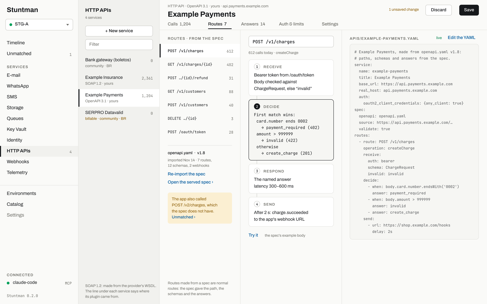

# Services from an OpenAPI spec



Give Stuntman the provider's OpenAPI spec and it answers like the provider's API. It does not need a recording
or a running copy of the provider. Each operation in the spec becomes a route of the plugin, with the usual
steps: receive, keep, decide, respond and send.

What Stuntman takes from the spec:

- **Routes.** Each path and method becomes a route, with the base path of the spec's server in front
  (`POST /v1/charges`). The `operationId` is kept on the route.
- **Answers.** The 2xx response with the lowest code is the route's default answer. Its body is the spec's example,
  or one that Stuntman builds from the schema. Every other response becomes a named answer (`payment_required`,
  `not_found`, `invalid`…) that a rule or `force_answer` can give.
- **Body checks.** A request body is checked against its schema: types, required fields, enums, `allOf`,
  `oneOf`, `additionalProperties: false`, and the `date`, `date-time` and `email` formats. A body that does not match
  the schema gets the spec's 400 or 422 answer, or a 400 that names the field. That answer can show the error with
  `{{ invalid }}`.
- **Auth.** If the spec has the OAuth2 client-credentials flow, Stuntman adds a token route at its `tokenUrl`.
  Routes that use this scheme require a Bearer token from that route. HTTP Basic accepts any user until you add
  users. API keys and other OAuth flows are not checked.
- **Webhooks.** The spec's `webhooks` (3.1) and `callbacks` (3.0) become answers named `webhook_<name>` that hold
  their payloads, ready for a route's `send`.
- **The spec itself**, kept in `apis/<service>.spec/` with the files its `$ref`s point to, and served back.

It reads OpenAPI 3.0 and 3.1, and Swagger 2.0, as YAML or JSON.

## Create one from a spec

You can start from a URL, a file on the machine that runs Stuntman, or the text of the spec. The examples use
[`payments.yaml`](../engine/tests/openapi/payments.yaml), a synthetic payments provider with five operations, an
OAuth token URL, a `$ref` to another file and one webhook.

**In the web UI:** go to **HTTP APIs › + New service** and use **From the provider's spec (OpenAPI or WSDL)**. Paste
the URL or choose a file, name the service, and select **Create service**.

**From an agent (MCP):**

```text
import_spec(service="example-payments", source="https://api.payments.example.com/openapi.yaml")
→ 5 routes, 10 answers, 1 webhook
```

**Over HTTP:**

```sh
curl -X POST http://localhost:8025/api/plugins/spec -H 'Content-Type: application/json' \
  -d '{"service": "example-payments", "source": "https://api.payments.example.com/openapi.yaml"}'
```

`import_spec` also takes a WSDL: Stuntman finds the type of the document, and from a WSDL it makes a
[SOAP service](soap.md). If the service already exists, use `reimport_spec`.

The result lists the routes, the answers, the webhooks and any file that could not be read. If a file that a
`$ref` points to cannot be fetched, Stuntman still creates the service. The parts that refer to that file are empty
(`{}`).

Until you add rules, every route gives its default answer.

## The answers it builds

When the spec has an example, the answer is that example. When it has only a schema, Stuntman fills each field:

| The schema says | The answer has |
|---|---|
| `example`, `default` or `enum` | that value (the first one of an enum) |
| `format: date-time` | `{{ now() }}`, the time of the call |
| `format: email`, `uuid`, `date` | `user@example.com`, `{{ uuid() }}`, `2026-01-01` |
| a field named `id` or `…_id` | an id that changes on every call; the prefix is the first three letters of the name: `customer_id` → `cus_{{ random_id() }}` |
| a top-level field the request also has, with the same type (2xx answers) | what the app sent: `{{ body.amount \| json }}` |
| `integer`, `number`, `boolean` | its `minimum`, or `1`, `1.5`, `true` |
| any other string | the field's name |

A `201` that echoes the amount and the currency the app sent is therefore correct on the first call. Edit an answer to
make it closer to the real provider; **Re-import** keeps your version.

## The plugin

A plugin made from a spec is a normal plugin file with a `spec:` block. A route's `receive.schema` names the
schema that checks the body, and `receive.invalid` names the answer for a body that does not match it.

```yaml
service:
  name: example-payments
  title: Example Payments API
  base_url: https://api.payments.example.com
  real_host: api.payments.example.com
  auth:
    oauth2_client_credentials: {any_client: true}
spec:
  openapi: payments.yaml       # kept in apis/example-payments.spec/
  source: https://api.payments.example.com/openapi.yaml
  version: 3.1.0
  validate: true               # check bodies against the schemas
  schemas:
    ChargeRequest: {type: object, required: [amount, currency, card], properties: {…}}
routes:
  - route: POST /oauth/token
    token: true
  - route: POST /v1/charges
    operation: createCharge
    receive:
      auth: bearer
      schema: ChargeRequest
      invalid: invalid
    decide:
      - when: body.card.number.endsWith('0002')
        answer: payment_required
      - answer: create_charge
answers:
  - name: create_charge
    status: 201
    headers: {content-type: application/json, request-id: req_8Kq2}
    body: |
      {"id": "ch_3Nf0", "amount": {{ body.amount | json }}, "currency": {{ body.currency | json }},
       "status": "succeeded", "created": "{{ now() }}"}
  - name: payment_required
    status: 402
    body: '{"error": {"type": "card_error", "code": "card_declined"}}'
```

The `schemas` block holds the request-body schemas, with their `$ref`s resolved. Each one has the name of its
`$ref`, or `<OperationId>Request`. You can edit it like the rest of the file, or set `validate: false` to stop
checking bodies.

## Point your app at it

| | |
|---|---|
| **Base URL** | `http://localhost:8028/<service>`, for example `http://localhost:8028/example-payments` |
| **The spec** | the same address with the spec's file name: `http://localhost:8028/example-payments/payments.yaml`; the files its `$ref`s point to are at their relative paths (`…/common/errors.yaml`) |
| **The real host** | the host of the spec's server, over HTTPS on `:8443` with the [Test CA](configuration.md#the-stuntman-test-ca) trusted |

## What you can provoke

| What | How |
|---|---|
| Any response the spec declares | a rule in `decide`, or `force_answer` for the next calls |
| The provider's validation error | send a body that does not match the schema |
| An expired or missing token | `expire_tokens`, or call without one |
| A response the spec does not declare | a new answer |
| Slow, reset, empty, timeout, 503, HTML | `force_answer`, or `latency` and `fail_share` with `set_service`, as for any route |
| A path the spec does not have | listed in Unmatched; re-import a spec that has it |

## Re-import the spec

When the provider publishes a new version, select **Re-import the spec** on the Routes tab, or call `reimport_spec`.
New routes start with their default answer, and existing ones keep their steps. Routes the new spec does not have
stay, routes you added by hand too; the result lists them in `notInSpec`. Answers, data and service settings stay as
they are. Schemas are read again from the spec, so edits to a schema the spec still has are replaced.

## Tools

| Tool | What it does |
|---|---|
| `import_spec` | creates a service from an OpenAPI 3.x or Swagger 2.0 spec, or a WSDL (URL, file or text) |
| `reimport_spec` | reads the spec again and keeps your steps |
| `set_route`, `set_answer`, `try_route` | change and try the routes, as for any plugin |

Arguments are in the [tool reference](reference/tools.md#http-apis-plugins).

## Limits

- Bodies are checked when they are JSON. In form bodies, numbers and booleans can be text. Path parameters, query
  strings and headers are not checked.
- The check does not cover `pattern`, lengths, `discriminator` or numeric ranges.
- A relative `$ref` is read from the same place as the spec (its URL or its folder). A spec pasted as text cannot
  follow relative `$ref`s.
- Responses named `default`, `2XX` or `4XX` are skipped. An operation with only those gets a `{}` 200 answer.
- A response that is not JSON (a PDF, an image) gets an empty body. Put the file in `apis/<service>.files/` and set
  `file:` on the answer.
