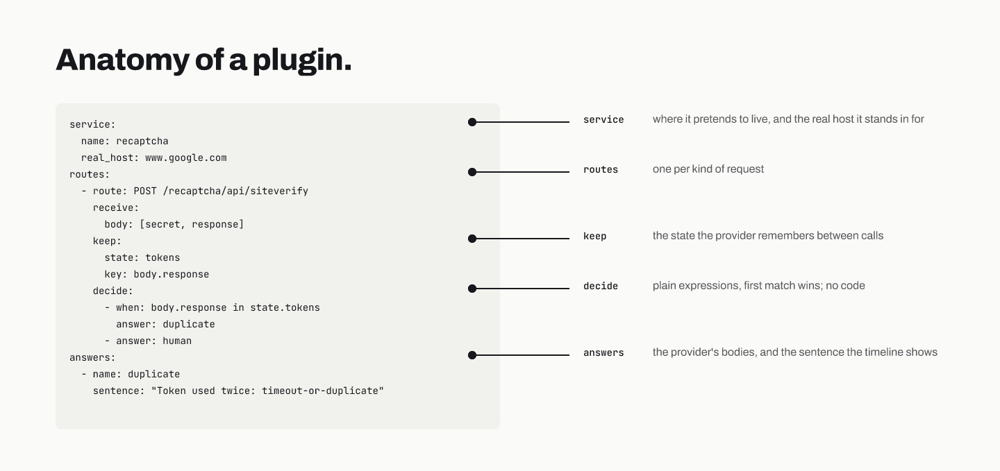
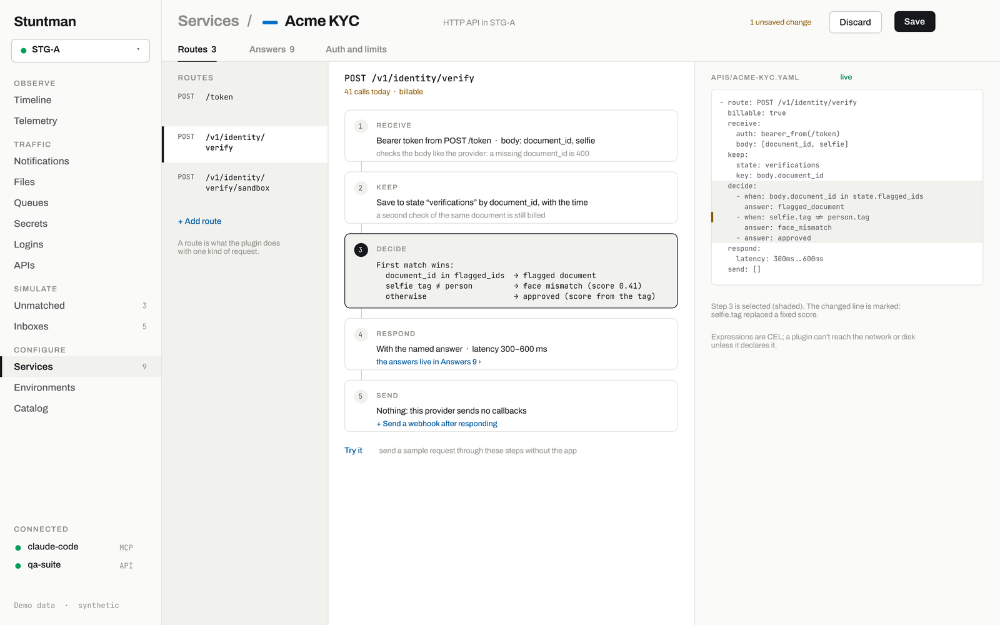

# Plugins

A provider is a plugin. A plugin is one YAML file: the routes, the state they keep, the answers they give, the
callbacks they send and the sentence each call leaves on the timeline. Someone who knows the provider writes it
once; everyone else installs it.

<p align="center"></p>

Plugins power the **HTTP APIs** line. SMS, WhatsApp, email, storage, messaging, identity, secrets, webhooks and
telemetry are built into the engine. You do not have to write a plugin by hand: one can be made from the
provider's [OpenAPI spec](openapi.md), from its [WSDL](soap.md) (SOAP), or by
[recording the real provider](recording.md).

## A complete example

`plugins/recaptcha.yaml`, as it ships:

```yaml
# Google reCAPTCHA siteverify (v2 and v3). A token used twice answers timeout-or-duplicate.
service:
  name: recaptcha
  title: reCAPTCHA
  origin: official
  description: Bot check (siteverify)
  base_url: https://www.google.com
  real_host: www.google.com
routes:
  - route: POST /recaptcha/api/siteverify
    receive:
      body: [secret, response]
      missing: missing_input
    keep:
      state: tokens
      key: body.response
    decide:
      - when: body.response in state.tokens
        answer: duplicate
      - when: body.response.startsWith('bad')
        answer: invalid_token
      - when: body.response.startsWith('bot')
        answer: low_score
      - answer: human
answers:
  - name: human
    sentence: "Verified a token from {{ body.response | default('the form') }}: score 0.9"
    body: '{"success": true, "score": 0.9, "action": "submit", "challenge_ts": "{{ now() }}", "hostname": "stg-a.stuntman.local"}'
  - name: duplicate
    sentence: "Token used twice: timeout-or-duplicate"
    body: '{"success": false, "error-codes": ["timeout-or-duplicate"]}'
  # … low_score, invalid_token, missing_input
```

A test drives each answer by the token it sends: `bad…` is invalid, `bot…` scores 0.1, the same token twice is a
duplicate.

## Format

### `service`

| Key | Meaning |
|---|---|
| `name` | lowercase, digits and dashes; the URL segment: `:8028/<name>` |
| `title`, `description` | shown in the UI |
| `origin` | `official`, `community` or `yours` (default) |
| `region` | optional, for regional providers |
| `base_url`, `real_host` | the provider's real address; `real_host` lets you resolve the real name to Stuntman |
| `auth` | `oauth` (client credentials: `client_id`, `client_secret`, `any_client`, `token_ttl`), `basic` (`users`, `any_user`, `challenge`), `session` (`cookie`, `ttl`, `users`), `client_certificate.required` (mTLS) |
| `billing` | `enabled`, `per_call`, `warn_above`: a counter, never real money |
| `limits` | `latency` (e.g. `300ms..600ms`), `rate`, `fail_share` |
| `cors`, `ignore_case` | request handling |

### `routes`

Each route reads top to bottom: **receive → let → keep → wait → decide → respond → send**.

| Key | Meaning |
|---|---|
| `route` | `METHOD /path`; `{name}` segments are path parameters |
| `receive.auth` | `none`, `bearer` (a token from this service's token route), `basic`, `session` |
| `receive.body` | required body fields (dotted paths); a missing one answers 400, or the answer named by `missing` |
| `receive.schema`, `receive.invalid` | the body is checked against this schema of `spec.schemas`; a body that does not match it gets the answer named by `invalid`, or 400 naming the field (see [OpenAPI](openapi.md)) |
| `operation` | the spec's `operationId`, kept for reference |
| `lets` | named values computed first, e.g. `person: lookup('people', 'id', body.document_id)` |
| `keep` | `state` (a collection) and `key` (an expression): what the provider remembers between calls |
| `wait` | "answer `processing` 3 times, then `done`": counts calls per key |
| `decide` | a list of `when` → `answer`; the first match wins; the last item usually has no `when` |
| `respond.latency` | e.g. `300ms..600ms` |
| `send` | callbacks after answering: `url` (a template), `method`, `body`, `delay`, `secret` (HMAC-SHA256 into `header`) |
| `fail` | a generic failure on this route only: `reset`, `empty`, `timeout`, `401`, `403`, `500`, `503`, `html` |
| `schema` | response fields and their types; answers are checked against it |
| `billable`, `token`, `login`, `grant`, `step` | billing, the OAuth2 token route, the session login route, people grants (authorization code with PKCE), push approvals polled by the app |

### `answers`

| Key | Meaning |
|---|---|
| `name` | what `decide` and `force_answer` refer to |
| `status` | default 200 |
| `headers`, `body` | the body is a template, JSON unless the headers say otherwise |
| `raw` | send exactly as typed, not checked against the schema (malformed on purpose) |
| `file` | a file in `apis/<service>.files/` sent as the body, as is (a PDF, an image); recordings write these |
| `sentence` | the timeline sentence, a template |
| `note` | what this answer means, shown under its name |

### `spec` and `record`

`spec` is set on a service made from an OpenAPI spec: the kept file, where it came from, `validate` and the
`schemas` the routes check bodies against ([OpenAPI](openapi.md)). `record` is set while the service records the
real provider: `upstream`, `mode`, its time and call limits and extra fields to `mask` ([Recording](recording.md)).

### `data` and `pages`

`data` holds tables the answers read (people, flagged documents, selfies…). `pages` are screens Stuntman draws for
the provider, such as an authorize page or a push approval, each with fields, buttons and checks.

## Expressions

Conditions and templates use a small, side-effect-free language (a CEL-like subset).

| | |
|---|---|
| **Read** | `body.x`, `query.x`, `path.x`, `headers.x`, `state.<collection>`, `person.x` |
| **Operators** | `==`, `!=`, `<`, `>`, `&&`, `\|\|`, `!`, `in` |
| **Methods** | `.startsWith()`, `.endsWith()`, `.contains()`, `.matches()`, `.size()`, `.upper()`, `.lower()`, `.digits()`, `.mask()` |
| **Functions** | `size`, `exists`, `default`, `string`, `int`, `double`, `uuid`, `random_id`, `now`, `now_ms`, `matches`, `json`, `lookup` |
| **Template filters** | `{{ value \| default('x') }}`, `mask`, `json`, `round`, `tz` |

Templates use `{{ }}` inside answer bodies, sentences and callback URLs.

## Edit in the UI, keep the YAML



The web UI edits the same file. Every change is validated before it is saved, and the YAML beside the editor shows
the exact lines that changed. Saving from the web UI or a tool rewrites the file, so YAML comments are not kept; edit
by hand when comments matter.

## Install

| From | Tools |
|---|---|
| The catalog | `list_plugins`, `get_catalog_plugin`, `install_plugin`, `install_collection` |
| A folder, a `.zip` or a git URL | `import_plugin` (`path=` inside it, `ref=` branch or tag), then `install_import` |
| Scratch | `install_plugin` with `plugin=empty`, then `put_plugin` |

`validate_plugin` returns schema and expression errors **with line numbers** before anything is saved.
`put_plugin` refuses to overwrite a version that changed since you read it (409).

## Safe by default

A plugin cannot reach the network or the disk unless it declares it. Expressions cannot call out. When an escape
hatch for custom code arrives, it will run sandboxed.

## Contributing a plugin

The catalog lives in [`engine/plugins/`](../engine/plugins). A good plugin:

1. Mirrors the provider's real paths, status codes, error bodies and headers.
2. Names every answer after what it means (`irregular_document`, not `answer3`) and writes a `note`.
3. Writes sentences a person can read on the timeline.
4. Uses synthetic data only (`@example.com`, `acme`, `globex`).
5. Passes `validate_plugin`.

See [CONTRIBUTING.md](../CONTRIBUTING.md).
