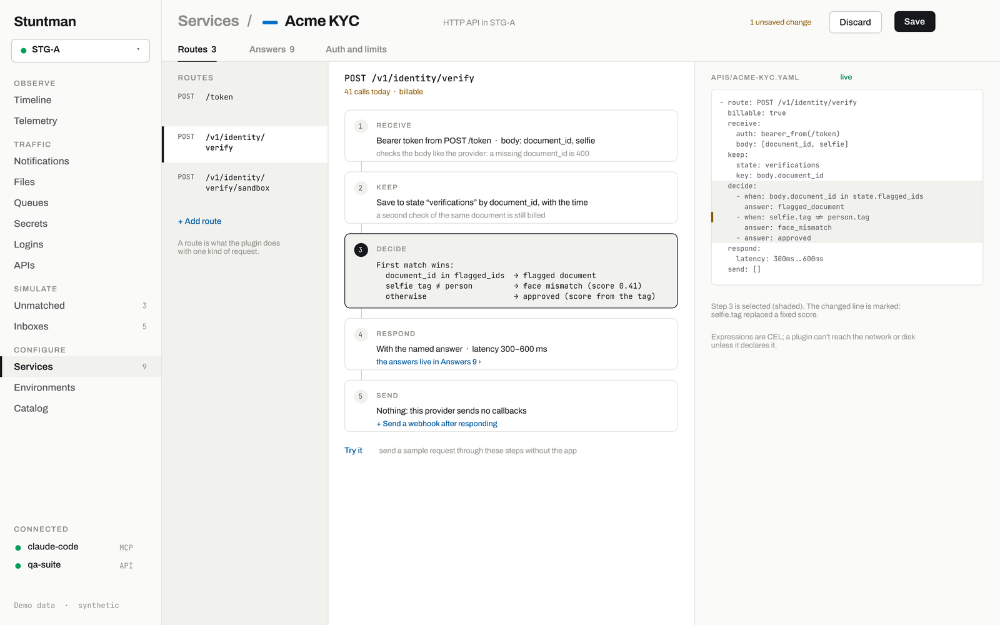
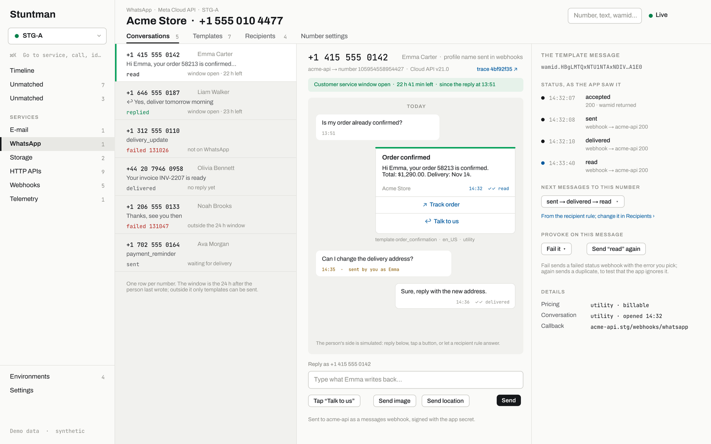
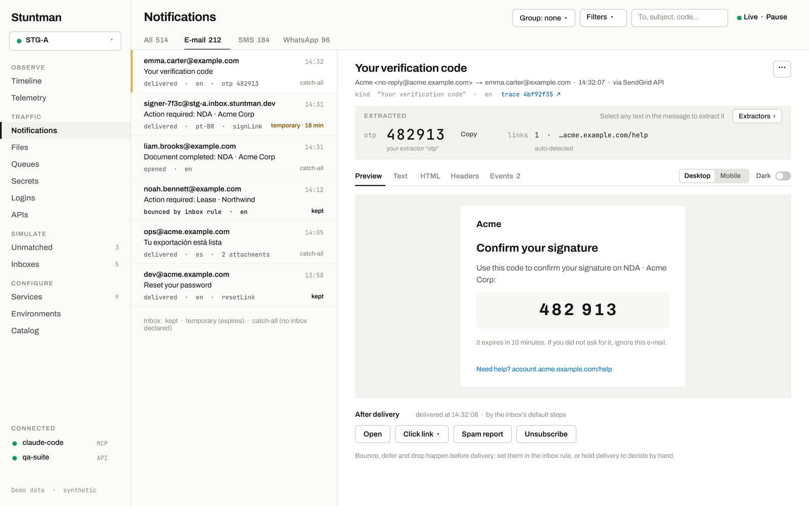
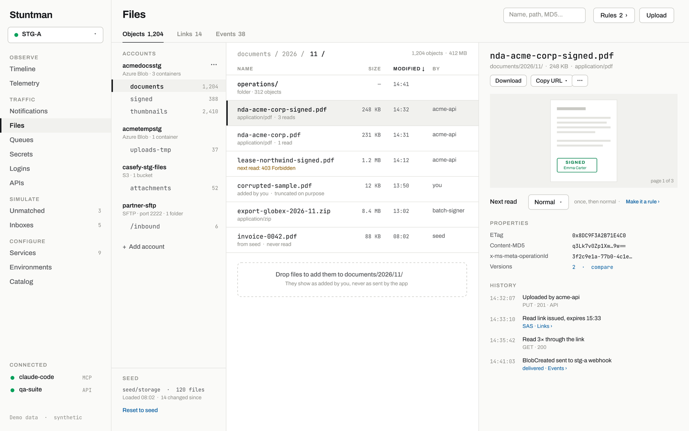
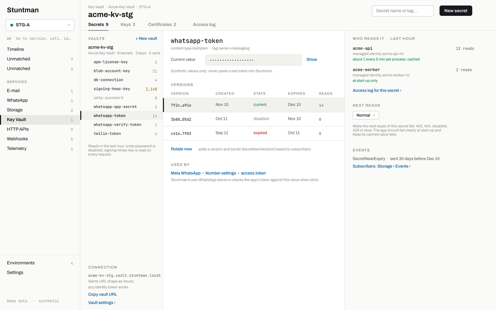
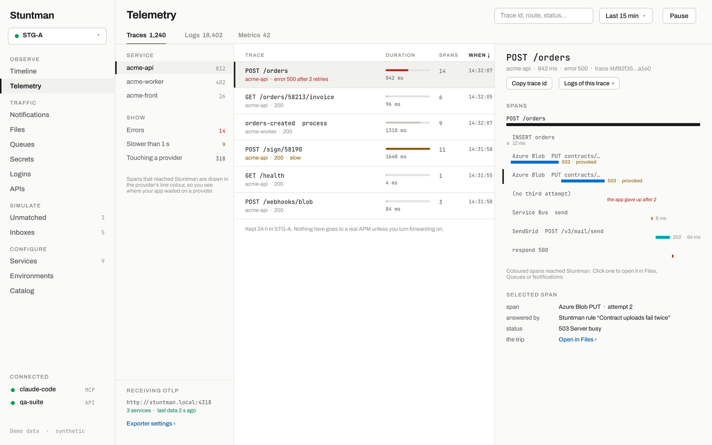

# Providers

Each line is an engine capability; a plugin or a flavor is one provider's version of it. For every line,
Stuntman speaks the provider's protocol, keeps the provider's state, sends the provider's callbacks, and lets you
provoke the provider's failures.

Addresses below assume the default ports on `localhost`. In another environment, add `/e/<env>` after the port
(or use its host names); see [Environments](environments.md). All ports are listed in [Configuration](configuration.md#ports).

- [HTTP APIs](#http-apis) · [SMS](#sms) · [WhatsApp](#whatsapp) · [Email](#email) · [Storage](#storage)
- [Messaging](#messaging) · [Identity](#identity) · [Secrets](#secrets) · [Webhook inboxes](#webhook-inboxes) · [Telemetry](#telemetry)

---

## HTTP APIs

Any REST API, described once as a **plugin**: a YAML file with routes, state, answers, callbacks and the sentence
each call leaves on the timeline.

| | |
|---|---|
| **Point your app at** | `http://localhost:8028/<service>`; HTTPS on `:8443` (any host name, Test CA); or the provider's real host name resolved to Stuntman |
| **Auth it understands** | OAuth2 client credentials (a token route), Basic, session cookies (a login route), mTLS client certificates, browser steps (authorize pages, push approvals) |
| **It keeps** | state collections per route, data tables (people, documents…), every call with its answer and sentence |
| **You can provoke** | any named answer, latency, `reset`, `empty`, `timeout`, `401`, `403`, `500`, `503`, an HTML error page with 200; expired tokens; rate limits; a share of failures |
| **Also** | per-call billing counters, unmatched requests with "create a route from this request" |

Catalog today: `recaptcha`, `turnstile`, `bank-gateway`, `orders-partner`, `partner-portal`, and a regional pack for
Brazil. Writing your own: [Plugins](plugins.md).

## SMS

| | |
|---|---|
| **Speaks** | Zenvia API v2 |
| **Point your app at** | `http://localhost:8025/zenvia/v2/channels/{0}/messages` |
| **It keeps** | messages, delivery status steps per recipient, opt-outs |
| **Callbacks** | Zenvia status and message webhooks to your app |
| **You can provoke** | 500, 400, connection reset, empty reply, timeout (`force_sms_failure`); the person texts back, including STOP / START (`reply_sms_as_user`); per-recipient delivery steps |

## WhatsApp

| | |
|---|---|
| **Speaks** | Meta WhatsApp Cloud API (Graph) |
| **Point your app at** | Graph base URL `http://localhost:8025/whatsapp` |
| **It keeps** | conversations, templates and their review state, the 24-hour customer-service window, simulated recipients |
| **Callbacks** | Meta's messages and status webhooks, signed with your app secret |
| **You can provoke** | 500 (#131000), 400 (#100), reset, empty, timeout (`force_whatsapp_failure`); expired tokens; text, button, image or location replies (`reply_as_user`); webhooks with a wrong, missing or old signature, or a replay (`send_bad_webhook`) |

## Email

| | |
|---|---|
| **Speaks** | SMTP with STARTTLS (any login) and SendGrid v3 `mail/send` (any key) |
| **Point your app at** | SMTP `localhost:2525`; SendGrid base URL `http://localhost:8025/sendgrid` |
| **It keeps** | every message with its HTML, text, attachments and the values extracted from it (codes, links) |
| **Callbacks** | SendGrid's Event Webhook, signed with ECDSA |
| **You can provoke** | hold a message and decide: deliver, defer, bounce (hard or soft), drop; recipient events: open, click, spam report, unsubscribe; an intake that refuses or fails TLS |

## Storage

| | |
|---|---|
| **Speaks** | Azure Blob (SharedKey and SAS) on `:10000`; Amazon S3 / R2 (SigV4, path style) on `:9000` |
| **Point your app at** | Blob: a connection string with `BlobEndpoint=http://127.0.0.1:10000/<account>`; S3: endpoint `http://127.0.0.1:9000` |
| **It keeps** | accounts, containers, objects, block uploads, multipart uploads, presigned links |
| **Callbacks** | Event Grid and S3 notifications for created and deleted objects |
| **You can provoke** | rules per operation and path (503 on the first N attempts, every time, or a share); next read 403, 404, 503, slow, truncated or bad MD5; links expired, badly signed, IP-denied or gone; an unreachable account; events held, duplicated, reordered, dropped or missing a field |

## Messaging

| | |
|---|---|
| **Speaks** | AMQP for Azure Service Bus and RabbitMQ, on `:5673` (and `:5671` with TLS) |
| **Point your app at** | Service Bus: `Endpoint=sb://<namespace>.<env base domain>:5673;…` (any key); RabbitMQ: `<host>:5673`, vhost `<env>/<namespace>` |
| **It keeps** | namespaces, queues, topics, subscriptions, every message with its deliveries, consumers and their locks |
| **You can provoke** | lost locks, duplicates, held, dropped, dead-lettered or out-of-order messages; a namespace that refuses, times out, rejects the key or is busy |

Service Bus finds the namespace by host name: give the environment a base domain under a wildcard DNS name that
points at Stuntman. See [Environments](environments.md#how-a-request-finds-its-environment).

## Identity

| | |
|---|---|
| **Speaks** | OIDC and OAuth2, in the flavor of Microsoft Entra ID (v2), Google, Okta, or generic OIDC |
| **Point your app at** | the authority shown for the provider; discovery, JWKS and token endpoints are served per environment |
| **It keeps** | tenants, app registrations and their redirect URIs, synthetic users with their claims, groups, roles and MFA |
| **You can provoke** | MFA required or failing, consent required, the user cancels, wrong tenant, tokens already expired, bad signatures, IdP down (`provoke_sign_in`); discovery, JWKS or token endpoint failures (`provoke_idp`) |

A person, a test or an agent picks the simulated user on the sign-in page Stuntman serves.

## Secrets

| | |
|---|---|
| **Speaks** | Azure Key Vault over HTTPS on `:8444`, and the managed identity (IMDS) token endpoint |
| **Point your app at** | `https://<vault>.vault.<env base domain>:8444`; trust the Stuntman Test CA |
| **It keeps** | secrets with versions, keys that really sign, verify, wrap and unwrap, certificates, who read what and how often |
| **You can provoke** | 403, 404, 429, disabled, slow reads (`provoke_secret`); wrong signatures (`provoke_key`); missing, expired, not-yet-valid or untrusted certificates; an IMDS that fails or has no identity |

Read counts prove caching: an app that reads a secret on every request shows up immediately.

## Webhook inboxes

Endpoints **your app** sends its own webhooks to, so you can test its retries.

| | |
|---|---|
| **Point your app at** | `http://localhost:8027/in/<inbox>` (its own port, so resets and empty replies are real) |
| **It keeps** | every delivery with its headers, body, signature check and all attempts of the same event |
| **You can provoke** | 200, 500, timeout, hang, delay, fail N times then succeed, a share of failures, redirects; signature checks with HMAC and secret rotation |

Inboxes are kept with the environment or ephemeral: created by a test or an agent, they expire by themselves.

## Telemetry

| | |
|---|---|
| **Speaks** | OpenTelemetry OTLP over HTTP (`:4318`, protobuf or JSON) and gRPC (`:4317`) |
| **Point your app at** | `OTEL_EXPORTER_OTLP_ENDPOINT=http://localhost:4318` |
| **It keeps** | traces, logs and metrics in their own area, joined to the calls that caused them by trace ID |
| **You can provoke** | a collector that answers 401, 403, 429, 503, refuses, slows down or drops half (`provoke_collector`) |
| **Also** | `real_provider_calls`: the hosts your app still calls directly, from its own spans |
