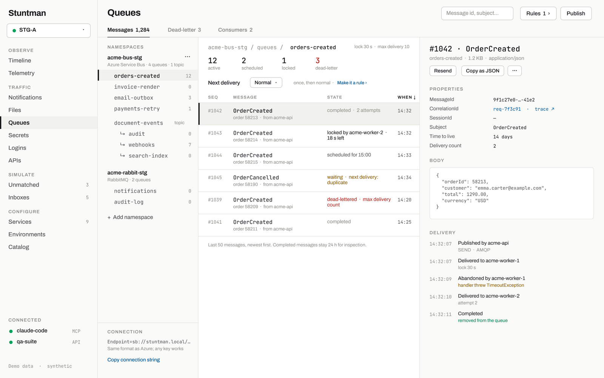
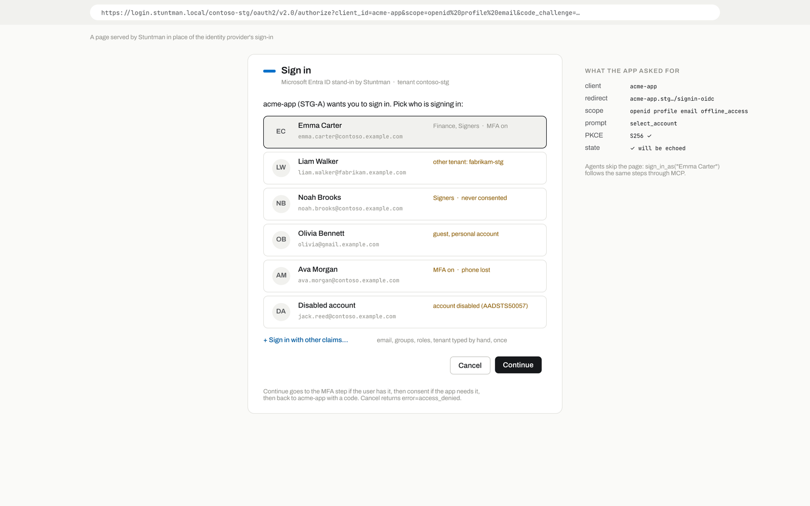
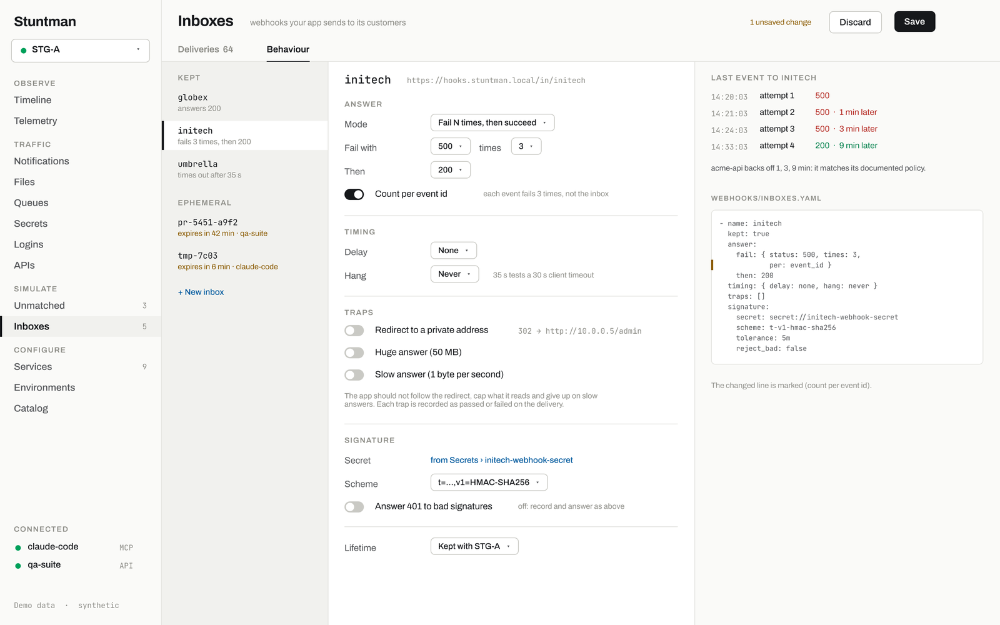

# Providers

Each line is an engine capability; a plugin or a flavor is one provider's version of it. For every line,
Stuntman speaks the provider's protocol, keeps the provider's state, sends the provider's callbacks, and lets you
provoke the provider's failures.

Addresses below assume the default ports on `localhost`. In another environment, add `/e/<env>` after the port
(or use its host names); see [Environments](environments.md). All ports are listed in [Configuration](configuration.md#ports).

- [HTTP APIs](#http-apis) · [AI models](#ai-models) · [SMS](#sms) · [WhatsApp](#whatsapp) · [Email](#email) · [Mailboxes](#mailboxes-imap-and-pop3)
- [Storage](#storage) · [Files](#files-ftp-ftps-and-sftp) · [Messaging](#messaging) · [Streams](#streams-kafka-and-schema-registry) · [Pub/Sub](#pubsub)
- [Identity](#identity) · [Secrets](#secrets) · [Webhook inboxes](#webhook-inboxes) · [Product events](#product-events) · [Telemetry](#telemetry)

---

## HTTP APIs


Any REST or SOAP API, described once as a **plugin**: a YAML file with routes (or SOAP operations), state,
answers, callbacks and the sentence each call leaves on the timeline. You can write it, make it from the
provider's [OpenAPI spec](openapi.md) or [WSDL](soap.md), or [record the real provider](recording.md) and let
Stuntman write it.

| | |
|---|---|
| **Point your app at** | `http://localhost:8028/<service>`; HTTPS on `:8443` (any host name, Test CA); or the provider's real host name resolved to Stuntman |
| **OpenAPI** | OpenAPI 3.x and Swagger 2.0: routes, answers from the examples or the schemas, bodies checked against the schemas, the OAuth token route, the spec served back |
| **Recording** | calls go to the provider's sandbox and back, secrets masked; the review groups them into routes, answers and rules, and writes the plugin |
| **SOAP** | SOAP 1.1 and 1.2 from a WSDL: operations by SOAPAction, bodies checked against the XSD, faults, WS-Security UsernameToken, callbacks, `?wsdl` served back |
| **Auth it understands** | OAuth2 client credentials (a token route), Basic, session cookies (a login route), mTLS client certificates (optionally ICP-Brasil style, with a CNPJ), browser steps (authorize pages, push approvals) |
| **Shapes** | JSON, form and XML bodies; GraphQL routes; streamed answers (SSE, NDJSON, chunks); a plugin can also be an MCP server ([Plugins](plugins.md#mcp-server)) |
| **Webhooks** | sends after answering, signed like the provider: HMAC hex, Stripe, Svix, GitHub or CloudEvents; delays follow the [environment's clock](clock.md) |
| **WireMock** | a folder of WireMock mappings becomes plugins, templates included ([WireMock mocks](mocks.md)) |
| **It keeps** | state collections per route, data tables (people, documents…), every call with its answer and sentence |
| **You can provoke** | any named answer or SOAP fault, latency, `reset`, `empty`, `timeout`, `401`, `403`, `500`, `503`, an HTML error page with 200; expired tokens; rate limits; a share of failures; a stream that is `cut` or `slow`; webhooks badly signed, too old, sent twice or out of order |
| **Also** | per-call billing counters, `Idempotency-Key` replays, unmatched requests with "create a route from this request" |

The catalog, by collection:

| Collection | Plugins |
|---|---|
| General | `recaptcha`, `turnstile`, `bank-gateway`, `orders-partner`, `partner-portal` |
| Brazil · ICP-Brasil | `serpro-datavalid`, `gcc-consent`, `birdid`, `vidaas`, `restpki` |
| Logistics & fiscal | `osrm`, `google-maps`, `nominatim`, `ocr-space`, `receitaws`, `sefaz-nfe`, `comtele` |
| Payments & notifications | `stripe`, `resend`, `onesignal` |
| Workplace & dev tools | `microsoft-graph`, `google-drive`, `calendly`, `lemlist`, `azure-devops`, `newrelic` |

`install_collection` installs a whole row. Writing your own: [Plugins](plugins.md).

## AI models

The model APIs your app calls, answered without a model. Any key works and is never sent anywhere.

| | |
|---|---|
| **Speaks** | OpenAI (chat completions, Responses, embeddings, models), Azure OpenAI (deployments and v1), Anthropic (messages, `count_tokens`), Gemini (`generateContent`, `streamGenerateContent`, `embedContent`, `countTokens`), and the OpenAI-compatible OpenRouter and DeepSeek; streamed or not |
| **Point your app at** | the SDK's base URL: OpenAI `http://localhost:8025/openai/v1`, Anthropic `http://localhost:8025/anthropic`, Azure OpenAI `http://localhost:8025/azure-openai`, Gemini `http://localhost:8025/gemini`, OpenRouter `http://localhost:8025/openrouter`, DeepSeek `http://localhost:8025/deepseek` |
| **It keeps** | every call with its prompt, answer, model, tokens in and out, cost and why it got that answer; rules and prices in `ai/config.yaml` |
| **Rules** | first match wins. When: `provider`, `api`, `model` (a prefix with `*`), `contains` (the last user message), `system_contains`, `tool` (offered). Answer: `text` (`{{ last_user }}` repeats the message), `tool_call` (the model calls a tool first, then answers `text` once the result comes back), `json`, `tokens` (pad to about N), `stop: length`. No rule: "This is a simulated answer from Stuntman." |
| **You can provoke** | the next N calls (`force_ai_failure`): `429` with Retry-After, `500`, `529` overloaded, `filter` (content filtered), `length` (cut by max_tokens), `bad_json` (broken tool arguments), `slow` (40 ms per token), `cut` (the stream stops halfway); each in that provider's error shape |
| **Also** | `ai_spend`: calls, tokens and cost per provider; prices per million tokens are editable (`set_ai_price`) |

```text
set_ai_rule {"name": "refund", "contains": "refund",
             "answer": {"text": "The refund takes 5 days.", "tool_call": {"name": "lookup_order", "arguments": {"order_id": "A-1042"}}}}
force_ai_failure {"provider": "anthropic", "kind": "529", "count": 1}
```

Tools: `list_ai_calls`, `get_ai_call`, `wait_for_ai_call`, `list_ai_rules`, `set_ai_rule`, `delete_ai_rule`,
`force_ai_failure`, `ai_spend`, `set_ai_price`. In the web UI: **AI models**.

## SMS

| | |
|---|---|
| **Speaks** | Zenvia API v2 |
| **Point your app at** | `http://localhost:8025/zenvia/v2/channels/{0}/messages` |
| **It keeps** | messages, delivery status steps per recipient, opt-outs |
| **Callbacks** | Zenvia status and message webhooks to your app |
| **You can provoke** | 500, 400, connection reset, empty reply, timeout (`force_sms_failure`); the person texts back, including STOP / START (`reply_sms_as_user`); per-recipient delivery steps |

## WhatsApp


| | |
|---|---|
| **Speaks** | Meta WhatsApp Cloud API (Graph) |
| **Point your app at** | Graph base URL `http://localhost:8025/whatsapp` |
| **It keeps** | conversations, templates and their review state, the 24-hour customer-service window, simulated recipients |
| **Callbacks** | Meta's messages and status webhooks, signed with your app secret |
| **You can provoke** | 500 (#131000), 400 (#100), reset, empty, timeout (`force_whatsapp_failure`); expired tokens; text, button, image or location replies (`reply_as_user`); webhooks with a wrong, missing or old signature, or a replay (`send_bad_webhook`) |

## Email


| | |
|---|---|
| **Speaks** | SMTP with STARTTLS (any login) and SendGrid v3 `mail/send` (any key) |
| **Point your app at** | SMTP `localhost:2525`; SendGrid base URL `http://localhost:8025/sendgrid` |
| **It keeps** | every message with its HTML, text, attachments and the values extracted from it (codes, links) |
| **Callbacks** | SendGrid's Event Webhook, signed with ECDSA |
| **You can provoke** | hold a message and decide: deliver, defer, bounce (hard or soft), drop; recipient events: open, click, spam report, unsubscribe; an intake that refuses or fails TLS |

## Mailboxes (IMAP and POP3)

Mailboxes **your app reads**: a supplier e-mails an invoice, a customer replies to a ticket. You put the message in;
the app finds it on its next poll.

| | |
|---|---|
| **Speaks** | IMAP4rev1 on `:1143` (STARTTLS, LOGIN, AUTHENTICATE PLAIN and XOAUTH2, SELECT, FETCH with BODYSTRUCTURE and sections, SEARCH, STORE, COPY, MOVE, EXPUNGE, IDLE, UID commands) and POP3 on `:1110` (STLS, USER/PASS, AUTH PLAIN, STAT, LIST, UIDL, RETR, TOP, DELE) |
| **Point your app at** | host `localhost`, port `1143` (IMAP) or `1110` (POP3); the login is the mailbox address; STARTTLS and STLS use a self-signed certificate, as SMTP does |
| **It keeps** | each mailbox with its folders (INBOX first), messages, flags, and every command the app sent (without passwords) |
| **You can provoke** | `set_mailbox` with `provoke`: `login_refused`, `busy` (NO [INUSE]), `drop_fetch` (the connection drops during FETCH or RETR), `tls_required` (plain logins refused before STARTTLS), `token_expired` (XOAUTH2 refused) |

A mailbox with no password takes any password except `wrong`; XOAUTH2 takes any token. One port serves every
environment: logins go to the default one.

```text
set_mailbox {"address": "invoices@acme.example", "password": "s3cret"}
put_mail    {"address": "invoices@acme.example", "from": "billing@globex.example", "subject": "Invoice 1234",
             "text": "Attached.", "attachments": [{"filename": "invoice-1234.xml", "content_type": "application/xml", "text": "<invoice/>"}]}
```

Tools: `list_mailboxes`, `set_mailbox`, `put_mail`, `list_mailbox_messages`. In the web UI: **E-mail › Mailboxes**.

## Storage


| | |
|---|---|
| **Speaks** | Azure Blob (SharedKey and SAS) on `:10000`; Amazon S3 / R2 (SigV4, path style) on `:9000` |
| **Point your app at** | Blob: a connection string with `BlobEndpoint=http://127.0.0.1:10000/<account>`; S3: endpoint `http://127.0.0.1:9000` |
| **It keeps** | accounts, containers, objects, block uploads, multipart uploads, presigned links |
| **Callbacks** | Event Grid and S3 notifications for created and deleted objects |
| **You can provoke** | rules per operation and path (503 on the first N attempts, every time, or a share); next read 403, 404, 503, slow, truncated or bad MD5; links expired, badly signed, IP-denied or gone; an unreachable account; events held, duplicated, reordered, dropped or missing a field |

## Files (FTP, FTPS and SFTP)

The file servers partners and your app drop files on: EDI exchanges, bank remittance files, nightly exports.
Each server is a folder; FTP, FTPS and SFTP all see the same files.

| | |
|---|---|
| **Speaks** | FTP and explicit FTPS (AUTH TLS, PROT P) on `:2121`, passive mode (PASV, EPSV) with the commands EDI clients use (LIST, NLST, MLSD, RETR, STOR, APPE, DELE, MKD, RMD, RNFR/RNTO, SIZE, MDTM, REST); SFTP (SSH with password logins) on `:2222` |
| **Point your app at** | host `localhost`, port `2121` (FTP/FTPS) or `2222` (SFTP); the login is `user` or `user@server`; FTPS uses the [Test CA](configuration.md#the-stuntman-test-ca) |
| **It keeps** | each server's users (`read_only` ones get "permission denied" on writes) and folders under `files/<server>/`, and every login and transfer; servers in `files/servers.yaml` |
| **You can provoke** | `set_file_server` with `provoke`: `login_refused` (530), `disk_full` (552 on uploads), `permission_denied` (550), `drop_mid` (the transfer breaks after 4 KB), `slow` (20 KB/s), `host_key_changed` (SFTP shows another host key) |

A user with no password takes any password except `wrong`. The SFTP host key is kept (`files/ssh_host_ed25519`), so a
client that pinned it keeps trusting it. One port serves every environment: logins go to the default one. In Docker,
passive data connections use ports `30000-30009` (`STUNTMAN_FTP_PASSIVE_PORTS`); see [Configuration](configuration.md).

```text
set_file_server {"name": "edi-acme", "users": [{"user": "edi", "password": "s3cret"}], "folders": ["/in", "/out"]}
put_file        {"server": "edi-acme", "path": "/in/ORDERS_1042.txt", "text": "000GLOBEX ORDERS 1042"}
wait_for_file   {"server": "edi-acme", "path": "/out/*.txt"}    → what the app uploaded
```

Tools: `list_file_servers`, `set_file_server`, `list_files`, `get_file`, `put_file`, `delete_file`,
`list_transfers`, `wait_for_file`. In the web UI: **Files**.

## Messaging



| | |
|---|---|
| **Speaks** | AMQP for Azure Service Bus and RabbitMQ, on `:5673` (and `:5671` with TLS) |
| **Point your app at** | Service Bus: `Endpoint=sb://<namespace>.<env base domain>:5673;…` (any key); RabbitMQ: `<host>:5673`, vhost `<env>/<namespace>` |
| **It keeps** | namespaces, queues, topics, subscriptions, every message with its deliveries, consumers and their locks |
| **You can provoke** | lost locks, duplicates, held, dropped, dead-lettered or out-of-order messages; a namespace that refuses, times out, rejects the key or is busy |

**RabbitMQ management API.** Tools and libraries that create vhosts, queues, exchanges and bindings over HTTP
before they connect (MassTransit, provisioning scripts) find it on `:15672`: `/api/overview`, `/api/whoami`,
`/api/vhosts`, `/api/permissions`, `/api/queues`, `/api/exchanges`, `/api/bindings`, `/api/aliveness-test`. Its vhosts
are the RabbitMQ namespaces of the default environment, so what a script creates there is what the app finds on AMQP.

Service Bus finds the namespace by host name: give the environment a base domain under a wildcard DNS name that
points at Stuntman. See [Environments](environments.md#how-a-request-finds-its-environment).

### ActiveMQ (OpenWire)

| | |
|---|---|
| **Speaks** | ActiveMQ "Classic" OpenWire on `:61616`, version 10 (Apache.NMS.ActiveMQ 1.8 and 2.x and the Java `activemq-client` negotiate down to it), loose encoding |
| **Point your app at** | `activemq:tcp://localhost:61616` (NMS) or `tcp://localhost:61616` (Java), with the user and password you set |
| **It keeps** | queues and topics, every message with its state (scheduled, pending, delivered, acked, dead_letter, expired, rolled_back, discarded) and redelivery count, the consumers connected now with their selectors, durable subscriptions (online or offline), local and XA transactions |
| **You can provoke** | `set_activemq`: `refuse_login` (a SecurityException for everyone), `drop_after` (close the connection after N dispatched messages), `slow_dispatch` (a delay before each dispatch), `redeliver` (the next N acks are lost and those messages come again), `fail_commits` (the next N commits fail and roll back) |

Connections, sessions, producers and consumers work as on a real broker: prefetch, `MessagePull` when the prefetch is 0
(so `Receive(timeout)` returns null on time), auto, client and individual acks, poison acks (to dead_letter), queue
browsers, text, bytes and other message types with their properties. A consumer that leaves gives back what it did not
ack; what the app had already seen comes again as redelivered.

- **Transactions.** A transacted session's sends stay invisible and its acks take no effect until the commit; a
  rollback drops the sends (rolled_back) and the client redelivers what it had received, with the redelivery count up.
  XA works too (Java `XAResource`): start, end, prepare (`XA_RDONLY` when nothing was done), one- and two-phase commit,
  rollback, forget, and recover, which lists the prepared transactions from any connection. A connection that goes
  away rolls back what it left open, except what was prepared.
- **Durable subscriptions.** A consumer with a subscription name and a client ID keeps its copies while it is
  offline; `Unsubscribe` deletes it. A different topic or selector replaces the subscription, as ActiveMQ does. Plain
  topic subscribers get a copy only while connected; with no subscriber at all, the message is kept as discarded.
- **Selectors.** The JMS SQL-92 subset: `=`, `<>`, `<`, `>`, `<=`, `>=`, `AND`, `OR`, `NOT`, `[NOT] IN`,
  `[NOT] LIKE … ESCAPE`, `[NOT] BETWEEN`, `IS [NOT] NULL`, arithmetic, string, number and boolean literals, the
  header fields `JMSType`, `JMSCorrelationID`, `JMSPriority`, `JMSDeliveryMode`, `JMSTimestamp`, `JMSMessageID` (and
  `JMSXGroupID`, `JMSRedelivered`, `JMSXDeliveryCount`) and properties. An invalid one gets an
  `InvalidSelectorException`.
- **Also:** dispatch by `JMSPriority` (9 first), message groups (`JMSXGroupID` sticks to one consumer until it leaves or
  `JMSXGroupSeq` is -1), scheduled delivery (`AMQ_SCHEDULED_DELAY`), expiration (`JMSExpiration`: expired), a
  `ProducerAck` per async send when the producer has a `producerWindowSize`, and compressed bodies inflated on arrival
  (kept and dispatched as plain text or bytes).

With no users set, any user name and password log in. Not implemented: `noLocal`, exclusive consumers, the scheduler's
repeat and cron properties (`AMQ_SCHEDULED_PERIOD`, `AMQ_SCHEDULED_REPEAT`, `AMQ_SCHEDULED_CRON`), blob messages, the
tight encoding and the marshal cache (both negotiated off). Expired and poisoned messages stay on their destination
with their state instead of moving to `ActiveMQ.DLQ`. One port serves every environment: the default one answers.

```text
set_activemq            {"users": {"acme": "s3cret"}}
activemq_send           {"destination": "queue://positions", "text": "{\"truck\": \"TRK-100\"}", "properties": {"region": "north"}}
activemq_send           {"destination": "queue://positions", "text": "later", "delay": "5s", "priority": 9, "ttl": "1m"}
wait_for_activemq_ack   {"destination": "queue://positions"}            → the app consumed and acked it
list_activemq_messages  {"destination": "queue://positions", "state": "acked"}
list_activemq_destinations                                              → durable subscriptions and transactions too
```

Tools: `list_activemq_destinations`, `list_activemq_messages`, `activemq_send`, `set_activemq`, `wait_for_activemq_ack`.

## Streams (Kafka and Schema Registry)

| | |
|---|---|
| **Speaks** | the Kafka protocol on `:9092` (Produce, Fetch, ListOffsets, Metadata, consumer groups with JoinGroup, SyncGroup, Heartbeat and offset commits, CreateTopics, SASL PLAIN and SCRAM-SHA-256/512) and a Confluent-compatible Schema Registry on `:8081` with Avro |
| **Point your app at** | `bootstrap.servers=localhost:9092`; `schema.registry.url=http://localhost:8081` |
| **It keeps** | topics with their partitions and messages (Avro values decoded with their schema), consumer groups with members and lag, schema subjects and versions; settings in `streams/config.yaml` |
| **You can provoke** | `set_streams` with `provoke`: `leader_not_available`, `sasl_refused`, `slow_fetch` (3 s), `duplicate` (each record kept twice), `registry_down` (503); `rebalance` a group; `produce` with `bad_schema=true` (an unknown schema id) |

Topics are made when a client asks for one, unless `auto_create` is off. Clients connect to the host the broker
advertises: `localhost`, or `STUNTMAN_KAFKA_ADVERTISED_HOST` when the app runs in another container. With
`sasl_required`, every client logs in first; with no users listed, any user works and any password except `wrong`.
One port serves every environment: the default one answers.

```text
register_schema {"subject": "shipments-value", "schema": "{\"type\": \"record\", \"name\": \"Shipment\", \"fields\": [{\"name\": \"id\", \"type\": \"string\"}]}"}
produce         {"topic": "shipments", "key": "SH-1042", "value": {"id": "SH-1042"}, "subject": "shipments-value"}
```

Tools: `list_topics`, `create_topic`, `delete_topic`, `list_stream_messages`, `produce`, `list_consumer_groups`,
`rebalance`, `set_streams`, `list_schemas`, `register_schema`. In the web UI: **Streams**.

Limits: one broker node; record batches with no compression or gzip (snappy, lz4 and zstd are refused); only
non-flexible request versions are offered, which current clients still speak; compatibility checks always answer
compatible.

## Pub/Sub

| | |
|---|---|
| **Speaks** | Google Cloud Pub/Sub's `google.pubsub.v1` gRPC on `:8085`, plaintext and without auth, as the official emulator: Publisher (CreateTopic, GetTopic, UpdateTopic, ListTopics, ListTopicSubscriptions, ListTopicSnapshots, DeleteTopic, DetachSubscription, Publish), Subscriber (CreateSubscription, GetSubscription, UpdateSubscription, ListSubscriptions, DeleteSubscription, ModifyPushConfig, Pull, StreamingPull, Acknowledge, ModifyAckDeadline, CreateSnapshot, GetSnapshot, ListSnapshots, UpdateSnapshot, DeleteSnapshot, Seek to a time or a snapshot) and SchemaService (CreateSchema, GetSchema, ListSchemas, ListSchemaRevisions, CommitSchema, RollbackSchema, DeleteSchemaRevision, DeleteSchema, ValidateSchema, ValidateMessage); every List pages with `page_size`/`page_token`; `POST /v1/projects/{p}/topics/{t}:publish` over REST on the same port |
| **Point your app at** | `PUBSUB_EMULATOR_HOST=localhost:8085`; in .NET, `EmulatorDetection = EmulatorDetection.EmulatorOrProduction` on the client builder |
| **It keeps** | topics with labels, schema settings, message retention, message storage policy and KMS key name (the last two kept, no effect); subscriptions of four kinds — pull, push, BigQuery, Cloud Storage — with filter, ack deadline, message ordering, exactly-once delivery, retention and retain-acked, retry policy and dead-letter topic; schemas with their revisions; snapshots; every message with its attributes and ordering key, and each subscription's state of it: pending, outstanding until its ack deadline, acked, dead-lettered; the rows BigQuery subscriptions wrote and the files Cloud Storage subscriptions wrote; settings in `pubsub/config.yaml` |
| **You can provoke** | `set_pubsub` with `provoke` on Publish: `unavailable`, `deadline_exceeded`, `resource_exhausted` (clients retry these), `not_found`, `slow_publish` (`delay_ms`, 3 s), `duplicate` (a message comes again after its first ack); `times` limits it to the next N publishes, `topic` to one topic |

A message goes to the subscriptions its topic has when it is published, unless the subscription's filter
(`attributes.k = "v"`, `!=`, `attributes:k`, `hasPrefix(attributes.k, "x")`, `NOT`, `AND`, `OR`, parentheses) leaves
it out. A nack (ModifyAckDeadline to 0) or a passed ack deadline delivers it again; with message ordering, a key waits
while one of its messages is out. With a dead-letter policy, `delivery_attempt` is filled and a message delivered
`max_delivery_attempts` times moves to the dead-letter topic. With exactly-once delivery, an ack or modack of an
expired ack id fails with INVALID_ARGUMENT and a `google.rpc.ErrorInfo` (`EXACTLY_ONCE_ACKID_FAILURE`, each id mapped to
`PERMANENT_FAILURE_INVALID_ACK_ID`), and StreamingPull confirms acks and modacks; the clients' `ack_with_response`
reads both. Deleting a topic leaves its subscriptions on `_deleted-topic_`; a detached subscription gets nothing more
and cannot be pulled. One port serves every environment: the default one answers, or the one the `x-stuntman-env`
gRPC metadata names.

Schemas: Avro (JSON and binary encodings) and Protocol Buffers (the `.proto` text is parsed: messages, nested
messages and enums, oneofs, maps, repeated and packed fields; binary and proto3 JSON are validated). A topic with
schema settings validates every publish against the revisions in its range, newest first, answers INVALID_ARGUMENT
for a message none accepts, and stamps `googclient_schemaname`, `googclient_schemaencoding` and
`googclient_schemarevisionid` on what subscribers receive.

Push subscriptions POST each message to the endpoint: wrapped (`{"message": {data, attributes, messageId,
publishTime, orderingKey}, "subscription"}`) or unwrapped (the data as the body; with `write_metadata`, the
`x-goog-pubsub-*` headers and the attributes as headers). A 2xx acks; anything else retries with backoff (the retry
policy, else 100 ms doubling to 60 s). With an OIDC token, `Authorization: Bearer` carries a JWT with `aud`, `email`
and `email_verified`, signed RS256 by the environment's identity provider (a `google` flavour one first; its JWKS
verifies it). With no identity provider, the token is an unsigned test token (`alg: none`, `iss:
https://stuntman.invalid/pubsub-test-token`) that a real verifier refuses. BigQuery subscriptions write a row per
message into a table Stuntman keeps (the topic schema's fields with `use_topic_schema`, else `data`; plus
`subscription_name`, `message_id`, `publish_time`, `attributes` with `write_metadata`). Cloud Storage subscriptions
batch messages into text or Avro files when `max_messages`, `max_bytes` or `max_duration` (5 min) is reached, named
`<prefix><date time>_<uuid><suffix>`; when a Stuntman storage account has a container named like the bucket, the file
lands there too. Snapshots keep what was unacked and everything published after; Seek to a snapshot or to a time
replays only what is retained (acked messages need `retain_acked_messages` or topic retention; topic retention reaches
messages published before the subscription existed).

```text
create_pubsub_subscription {"subscription": "shipments-billing", "topic": "shipments", "dead_letter_topic": "shipments-dlq"}
create_pubsub_subscription {"subscription": "shipments-push", "topic": "shipments", "push_endpoint": "http://localhost:5000/pubsub/push", "filter": "attributes.region = \"us-east\""}
set_pubsub_schema          {"schema": "shipment-event", "type": "avro", "definition": {"type": "record", "name": "Shipment", "fields": [{"name": "shipment", "type": "string"}]}, "topic": "shipments"}
pubsub_publish             {"topic": "shipments", "data": {"shipment": "SHP-1041"}, "attributes": {"source": "partner"}}
set_pubsub                 {"provoke": "unavailable", "times": 2}
```

Tools: `list_pubsub_topics` (topics, subscriptions with type and filter, snapshots, schemas), `list_pubsub_messages`,
`pubsub_publish`, `create_pubsub_subscription`, `set_pubsub_schema`, `list_pubsub_bigquery_rows`,
`list_pubsub_storage_files`, `wait_for_pubsub_message`, `set_pubsub`. Short names (`shipments`) find the topic of that
name, else use the `project` of `set_pubsub` (`acme-stg`).

Limits: no Bigtable subscriptions and no ingestion sources (Kinesis, Cloud Storage, Event Hubs, MSK, Confluent) —
both are refused; message transforms (JavaScript UDFs) are kept but not run; KMS key and message storage policy have
no effect; a subscription's expiration policy is kept but subscriptions never expire. BigQuery tables have no table
schema: `use_table_schema` and `drop_unknown_fields` are kept, rows hold what the message has. Cloud Storage Avro
files carry the data as bytes (`use_topic_schema` is not applied) and the minimums Pub/Sub sets on `max_messages` and
`max_duration` are not enforced, so tests can use small batches. Protocol Buffer schemas cannot import (as in Pub/Sub,
so no well-known types), proto2 groups are refused, and unknown fields in binary messages are accepted. The retry
policy paces push and BigQuery retries; a nacked pull message comes back at once. Exactly-once never answers
`TRANSIENT_FAILURE_*`. Flow control counts messages, not bytes.

## Identity



| | |
|---|---|
| **Speaks** | OIDC and OAuth2, in the flavor of Microsoft Entra ID (v2), Google, Okta, or generic OIDC |
| **Point your app at** | the authority shown for the provider; discovery, JWKS and token endpoints are served per environment |
| **It keeps** | tenants, app registrations and their redirect URIs, synthetic users with their claims, groups, roles and MFA |
| **You can provoke** | MFA required or failing, consent required, the user cancels, wrong tenant, tokens already expired, bad signatures, IdP down (`provoke_sign_in`); discovery, JWKS or token endpoint failures (`provoke_idp`) |

A person, a test or an agent picks the simulated user on the sign-in page Stuntman serves.

### Protocols

The same provider, its users and its apps also answer the older ways apps sign people in. Turn each one on with
`set_provider` (in the web UI: **Identity › Protocols**).

| | |
|---|---|
| **SAML 2.0** (`saml: true`) | an identity provider: metadata at `/login/<tenant>/saml/metadata` with its signing certificate, SSO at `/login/<tenant>/saml/sso` by HTTP-Redirect or HTTP-POST, the same sign-in page as OIDC, and a SAMLResponse posted to the app's ACS with the assertion signed (RSA-SHA256, exclusive c14n). The app is an app registration whose ID is its entity ID and whose redirect URIs are its ACS URLs. `saml_sign_response` also signs the response; `saml_name_id` picks `email`, `oid` or `upn` |
| **LDAP** (`ldap: true`) | a directory of the provider's users on `:3389`: simple bind (a DN, `user@domain` or `DOMAIN\user`), search with filters, compare and whoami. People are under `ou=people`, groups under `ou=groups` of the base DN (from the tenant, or `ldap_base_dn`). Wrong passwords, locked and disabled accounts answer as Active Directory does: 49 with `data 52e`, `775` or `533`. `ldap_provoke`: `busy` (51), `unavailable` (52), `timeout`, `normal` to stop. One port serves every environment: binds go to the default one |
| **Password grant** (`password_grant: true`) | `grant_type=password` on the token endpoint, with a user's `password`. A wrong password, a user with MFA or a `locked` user gets the provider's error (`AADSTS50126`, `AADSTS50076`, `AADSTS50053`) |
| **Bot Framework** | what Microsoft Teams does around a bot. The Bot Connector's OpenID metadata and keys at `/botframework/v1/.well-known/openidconfiguration`; `send_bot_activity` posts a message or a card action to the bot's endpoint, signed with the `serviceurl` claim; the bot replies to the connector at `/botframework/connector/v3/…`, and `list_bot_messages` shows both sides. The bot's own token comes from the token endpoint of the tenant `botframework.com` (client credentials). `twist`: `bad_signature`, `expired`, `wrong_audience`, `no_token` |

`provoke_sign_in` applies to SAML too: `bad_signature` signs the assertion wrongly, `user_cancels` answers
`RequestDenied`, and `wrong_audience` names another audience.

## Secrets


| | |
|---|---|
| **Speaks** | Azure Key Vault over HTTPS on `:8444`, and the managed identity (IMDS) token endpoint |
| **Point your app at** | `https://<vault>.vault.<env base domain>:8444`; trust the Stuntman Test CA |
| **It keeps** | secrets with versions, keys that really sign, verify, wrap and unwrap, certificates, who read what and how often |
| **You can provoke** | 403, 404, 429, disabled, slow reads (`provoke_secret`); wrong signatures (`provoke_key`); missing, expired, not-yet-valid or untrusted certificates; an IMDS that fails or has no identity |

Read counts prove caching: an app that reads a secret on every request shows up immediately.

## Webhook inboxes



Endpoints **your app** sends its own webhooks to, so you can test its retries.

| | |
|---|---|
| **Point your app at** | `http://localhost:8027/in/<inbox>` (its own port, so resets and empty replies are real) |
| **It keeps** | every delivery with its headers, body, signature check and all attempts of the same event |
| **You can provoke** | 200, 500, timeout, hang, delay, fail N times then succeed, a share of failures, redirects; signature checks with HMAC and secret rotation |

Inboxes are kept with the environment or ephemeral: created by a test or an agent, they expire by themselves.

## Product events

The analytics your app sends, received and kept per user, so a test proves what the app tracked.

| | |
|---|---|
| **Speaks** | PostHog (`capture`, `batch`, `e`, `decide`, `flags`), Segment (`/v1` track, identify, page, screen, group, alias, batch), Mixpanel (`track`, `import`, `engage`) and the GA4 Measurement Protocol (`/mp/collect` and `/debug/mp/collect`); JSON, gzip or form-encoded bodies, as the SDKs send them |
| **Point your app at** | the SDK's host: `http://localhost:8025/posthog`, `http://localhost:8025/segment`, `http://localhost:8025/mixpanel`, `http://localhost:8025/ga4` |
| **It keeps** | every event with its user, properties and the personal data found in them (e-mail addresses, CPFs, card numbers); tracking plans in `events/plans.yaml` |
| **Plans** | a plan lists the events a flow must send and the properties each needs (`{event, props, min}`). `check_events` compares what arrived with a plan and answers `ok: false` with the missing events and properties, so a CI run can fail on it |
| **You can provoke** | the collector's next answers (`force_events_failure`): `400`, `413`, `429` with Retry-After, `slow` (3 s), `drop_half` (half the events lost, 200 anyway) |

```text
set_event_plan {"name": "signup", "events": ["signup_completed", {"event": "workspace_created", "props": ["plan"]}]}
check_events   {"plan": "signup", "within": "10m"}   → ok: false, missing: ["workspace_created"]
```

Tools: `list_product_events`, `event_people`, `wait_for_event`, `check_events`, `list_event_plans`,
`set_event_plan`, `delete_event_plan`, `force_events_failure`. In the web UI: **Events**.

## Telemetry


| | |
|---|---|
| **Speaks** | OpenTelemetry OTLP over HTTP (`:4318`, protobuf or JSON) and gRPC (`:4317`); GELF (Graylog) over UDP `:12201` (plain, gzip or zlib, chunked) and HTTP `POST /gelf` on `:8025`; StatsD and DogStatsD over UDP `:8125` |
| **Point your app at** | `OTEL_EXPORTER_OTLP_ENDPOINT=http://localhost:4318`; a GELF sink at `localhost:12201` (UDP); a StatsD client at `localhost:8125` |
| **It keeps** | traces, logs and metrics in their own area, joined to the calls that caused them by trace ID |
| **You can provoke** | a collector that answers 401, 403, 429, 503, refuses, slows down or drops half (`provoke_collector`) |
| **Also** | `real_provider_calls`: the hosts your app still calls directly, from its own spans |

GELF messages and StatsD metrics land in the same logs and metrics as OTLP. UDP has no host name, so datagrams go to
the default environment, or to the one a GELF `_stuntman_env` field or a StatsD `stuntman_env` tag names.
