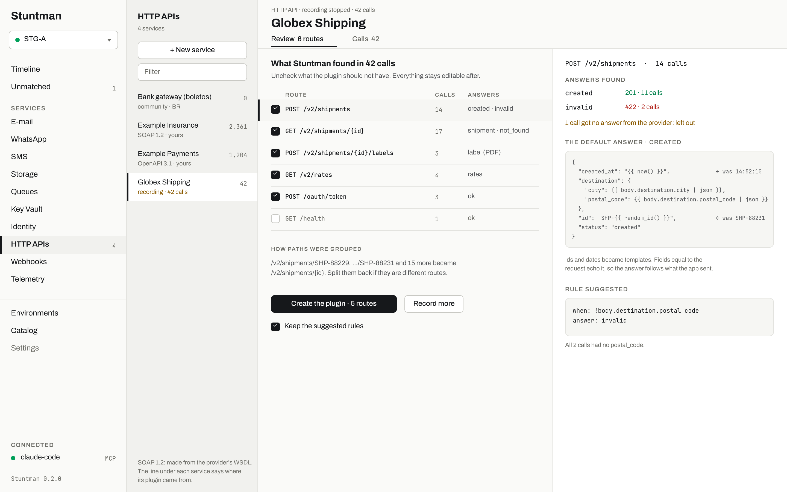

# Record the real provider



If you have no spec and no plugin, record the provider. Each call your app makes goes through Stuntman to the
provider's sandbox (the *upstream*) and back: the app gets the real answer, and Stuntman keeps the request and the
response. When you stop, Stuntman groups the
calls into routes and answers and writes a normal plugin. After that the sandbox is no longer needed.

## How a recording works

1. **Start it** with the sandbox's base URL. The service is created if it does not exist.
2. **Point the app at Stuntman**: `http://localhost:8028/<service>`, or the sandbox's host (set `real_host` for
   another one) with the [Test CA](configuration.md#the-stuntman-test-ca) trusted. Use the app as usual, or run its tests.
3. **Stop and review.** Stuntman shows the routes it found, the answers each gave and the rules that tell them
   apart.
4. **Create the plugin.** Clear each route that the plugin must not have. The other routes become routes and
   answers.

**In the web UI:** go to **HTTP APIs › + New service** and use **Record the real provider**. While it records, every
tab of the service shows a strip with **Pause** and **Stop and review**.

**From an agent (MCP):**

```text
start_recording(service="globex-shipping", upstream="https://sandbox.shipping.globex.example")
… the app's tests run against http://localhost:8028/globex-shipping …
stop_recording(service="globex-shipping")
→ 3 routes, 5 answers, 1 rule suggested
make_plugin(service="globex-shipping")
```

**Over HTTP:**

```sh
curl -X POST http://localhost:8025/api/plugins/globex-shipping/recording -H 'Content-Type: application/json' \
  -d '{"upstream": "https://sandbox.shipping.globex.example", "stop_after": "30m"}'
curl -X DELETE http://localhost:8025/api/plugins/globex-shipping/recording           # stop: the review
curl -X POST http://localhost:8025/api/plugins/globex-shipping/recording/plugin      # write the plugin
```

## What is never kept

The provider gets each call exactly as the app sent it, credentials included. What Stuntman keeps is masked first:

| What | Kept as |
|---|---|
| `Authorization`, `Cookie`, `Set-Cookie`, headers ending in `-key` and headers whose name has `token`, `secret`, `api-key` or `password` | `secret://<service>-<header>` |
| Body fields named `password`, `secret`, `client_secret`, `api_key`, `token`, `access_token`, `refresh_token`, `pin`, `cvv`… and the fields you add with `mask` | `secret://<service>-<field>` |
| E-mail addresses | `user-<hash>@example.com` (`@example.com`, `@example.org` and `@ejemplo.com` addresses stay) |
| Card numbers (13 to 19 digits that pass the Luhn check; those that start with `4242` stay) | `4242424242424242` |
| CPFs with valid check digits | a synthetic CPF, the same for the same input |

The same input always gives the same replacement, so an answer that echoes what the app sent still matches.

**Use a sandbox key, never a production one.** The key goes to the provider as the app sent it, and a recording
reaches a real sandbox, which may count against its quota.

## Modes

| Mode | What goes to the provider |
|---|---|
| `every` (the default for a service with no routes) | every call |
| `unknown` (the default for a service that has routes) | only calls that no route, page or SOAP operation answers; the plugin answers the rest |

Use `unknown` to complete a plugin that is almost finished: record a session, review it, and only the new routes
are added.

A recording stops by itself after `stop_after` (default 30 minutes) or `max` calls (default 500). Once it stops,
calls get the plugin's answers, or 404 "no route". A new `start_recording` with the same upstream adds to the same
recording.

## The review

| Stuntman finds | How |
|---|---|
| **Routes** | calls are grouped by method and path; segments that are numbers, have two digits or more, or are long become parameters: `/v2/shipments/SHP-88229` → `/v2/shipments/{id}`; the next ones are `{id2}`, `{id3}`. Segments like `v2` or `oauth2` stay. Check the grouping in the review |
| **Answers** | one per status a route gave, built from the last call with that status: `created` (201), `invalid` (422), `not_found` (404)… The most frequent success is the default |
| **Templates** | ids change only when two or more calls returned different values in a field named like an id (`id`, `…_id`, `…Id`, `uuid`, `token`, `number`, `protocol`): `SHP-{{ random_id() }}`. Dates become `{{ now() }}`. A value equal to one the app sent is echoed (`{{ body.destination.city \| json }}`); one equal to a path parameter comes from the path (`{{ path.id }}`) |
| **Rules** | for each other answer, a field its calls lacked or a value only they had: `when: !body.destination.postal_code → invalid`. If the error body names a field, the rule uses that field. An answer with no rule is kept, and only `force_answer` gives it (rules do not use path parameters) |
| **Files** | binary answers (a PDF label, an image) up to 5 MB are kept as files next to the plugin and sent as they came |

Calls that got no answer from the provider (a timeout, a refused connection) are listed and left out: the app got a
502, and the generic `timeout` answer can provoke the same.

## The plugin

`make_plugin` writes routes and answers into the service's plugin. Routes the service already has stay as they are.
`routes` keeps only some routes, named as the review names them (`"POST /v2/shipments/{id}/labels"`);
`rules: false` leaves out the suggested rules.

```yaml
routes:
  - route: POST /v2/shipments
    decide:
      - when: '!body.destination.postal_code'
        answer: invalid
      - answer: created
  - route: GET /v2/shipments/{id}
    decide:
      - answer: ok
  - route: POST /v2/shipments/{id}/labels
    decide:
      - answer: labels_ok
answers:
  - name: created
    status: 201
    headers: {content-type: application/json}
    body: |
      {"id": "SHP-{{ random_id() }}", "status": "created", "created_at": "{{ now() }}",
       "destination": {"city": {{ body.destination.city | json }}, "postal_code": {{ body.destination.postal_code | json }}}}
  - name: labels_ok
    status: 200
    headers: {content-type: application/pdf}
    file: labels_ok.pdf          # apis/globex-shipping.files/labels_ok.pdf
```

It is a normal plugin: edit it in the route editor or the YAML, add state with `keep`, force its answers.

## Tools

| Tool | What it does |
|---|---|
| `start_recording` | sends the service's calls to the provider and keeps each pair (`mode`, `stop_after`, `max`, `mask`) |
| `recording_status` | recording, paused, time is up, limit reached or stopped; calls kept; time left; with `review=true`, the review so far |
| `pause_recording` | pauses, or continues with `resume=true` |
| `stop_recording` | stops and returns the review |
| `make_plugin` | writes the plugin from the review (`routes`, `rules`) and ends the recording |

Arguments are in the [tool reference](reference/tools.md#http-apis-plugins).

## Limits

- One recording per service. Its settings are in the plugin's `record:` block, so it survives a restart.
- Request bodies over 64 MB reach the provider empty. The provider has 30 seconds to answer. Redirects go back to
  the app as they came.
- Responses over 5 MB that are not text are not kept as files.
- Only HTTP: no WebSockets or server-sent events.
- Rules look at body fields and the query string, one field at a time. Path parameters and headers are not used.
- State is not inferred: add `keep` and `lookup` by hand when a read must return what was created.
