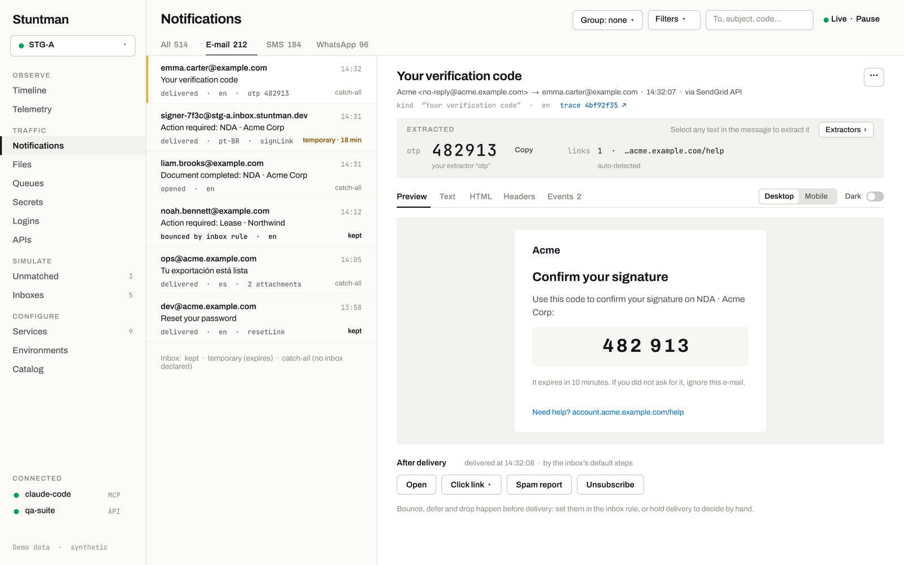

# Email (SMTP and SendGrid)

Stuntman stands in for the provider your app sends e-mail through: an SMTP relay (with STARTTLS and AUTH) and the
SendGrid v3 Mail Send API. Every message is parsed and kept, one copy per recipient, with its HTML, text,
headers, attachments and the values Stuntman extracts from it (a code, a sign link). A simulated recipient then
plays the message's life (delivered, opened, clicked, bounced…) and each step reaches your app as a SendGrid Event
Webhook, signed with ECDSA. Mailboxes your app *reads* (IMAP, POP3) are a separate page: [Mailboxes](mailboxes.md).



## At a glance

| | |
|---|---|
| **Stands in for** | Any SMTP relay (ESMTP with `STARTTLS`, `AUTH PLAIN`, `AUTH LOGIN`); SendGrid v3 `POST /v3/mail/send` and the SendGrid Event Webhook (ECDSA-signed). Tested with Python `smtplib` (STARTTLS + `AUTH PLAIN`, and `AUTH LOGIN` with the user on the same line, as .NET `SmtpClient` sends it) and plain HTTP for SendGrid |
| **Ports** | SMTP `2525` (`STUNTMAN_SMTP_PORT`, STARTTLS on the same port; no implicit-TLS port). SendGrid on the main HTTP port `8025` (`STUNTMAN_PORT`); `8445` is the same over TLS with the Test CA (`STUNTMAN_HTTPS_PORT`) |
| **Point your app at** | SMTP host `localhost`, port `2525`. SendGrid base URL `http://localhost:8025/sendgrid` (the SDK appends `/v3/mail/send`). Another service than the default: `http://localhost:8025/sendgrid/<service>` |
| **It keeps** | Each message per recipient: sender, recipient, subject, kind, language, text, HTML, headers, raw `.eml`, attachments with SHA-256, extracted values, links, `custom_args`, trace id, status, and every event with your app's reply to it. Inboxes with their rules and steps. Service and extractor YAML files |
| **You can provoke** | Hold a message and decide (`decide_held`: deliver, defer, bounce hard or soft, drop). Per-inbox rule on arrival: bounce, defer, hold, drop. Recipient actions: open, click, spam report, unsubscribe (`simulate_recipient` or inbox steps). Intake down: timeout, refused, broken TLS, `503`, `429` (`set_access`). Keys required (`mode: validate`). SMTP `RCPT TO` refused with `550` or `451`. No STARTTLS offered. Rate limit (`limits.rate`), size limit (`limits.messageSize`), catch-all off |
| **Screen** | `/notifications` (messages), `/inboxes` (inboxes, rules, steps), `/services/email` (service: intakes, access, keys, events, limits), `/services/email/extractors` |
| **Tools** | `list_messages`, `get_message`, `wait_for_message`, `expect_no_message`, `simulate_recipient`, `decide_held`, `get_attachment`, `delete_messages`, `delete_message`, `create_inbox`, `list_inboxes`, `get_inbox`, `update_inbox`, `extend_inbox`, `keep_inbox`, `delete_inbox`, `list_services`, `get_service`, `create_service`, `update_service`, `put_service_yaml`, `remove_service`, `set_access`, `create_key`, `revoke_key`, `send_test_event`, `list_extractors`, `get_extractor`, `test_extractor`, `create_extractor`, `update_extractor`, `delete_extractor`, `tune_builtin`, `put_extractors_yaml`, `copy_extractor` |

## Connect your app

### Services

An e-mail **service** is one YAML file, `<environment>/email/services/<name>.yaml`. It holds both intakes (SMTP
and SendGrid), who may send, where events go, and limits. On an empty data folder the first (default) environment
gets one service, `transactional`, default, SMTP on `STUNTMAN_SMTP_PORT`. After that the port in the YAML wins;
changing `STUNTMAN_SMTP_PORT` does not move an existing service.

Other environments do **not** get a service by themselves: a copy brings the source's services, an empty
environment has none. With no service, SendGrid answers `404 {"errors":[{"message":"No e-mail service in this
environment"}]}` and nothing listens for SMTP. Make one with `create_service {"name": "transactional"}`; it takes
the next free SMTP port.

`get_service {"name": "transactional"}` returns what to copy into the app: `sendgridUrl`, `smtpAddress`,
`smtpUser` (only when the port is shared), `smtpSharedWith`, `smtpError` (a bind failure such as a taken port) and
`publicKey` (the events key). `get_connections` (see [Environments](../environments.md)) lists `SMTP_HOST`,
`SMTP_PORT`, `SMTP_USER` (shared ports only) and `SENDGRID_URL` per service.

### SMTP

```text
host: localhost        port: 2525
TLS: STARTTLS (self-signed certificate for localhost and stuntman.local, new at each start: turn verification off)
login: optional (any user and password) unless the intake validates keys
```

Python:

```python
import smtplib, ssl
from email.message import EmailMessage

m = EmailMessage()
m["From"] = "Acme <no-reply@acme.example.com>"; m["To"] = "emma.carter@example.com"; m["Subject"] = "Your verification code"
m.set_content("Use this code: 482 913")
with smtplib.SMTP("localhost", 2525) as s:
    s.starttls(context=ssl._create_unverified_context())
    s.login("api-staging", "any")          # optional while mode is "any"
    s.send_message(m)
```

.NET `SmtpClient` (no TLS, `AUTH LOGIN`) works as is: `new SmtpClient("localhost", 2525) { EnableSsl = false,
Credentials = new NetworkCredential("no-reply@example.com", "x") }`. With `EnableSsl = true` it uses STARTTLS and
needs certificate validation turned off.

Node (nodemailer): `{ host: "localhost", port: 2525, secure: false, tls: { rejectUnauthorized: false } }`.
`secure: true` (implicit TLS) does not work: the port speaks plain SMTP first.

### SendGrid

Set the SDK's base URL (or host) to `http://localhost:8025/sendgrid`. Any `Authorization: Bearer <key>` works
while the intake's mode is `any`; an empty key gets `401`.

```sh
curl -s -i http://localhost:8025/sendgrid/v3/mail/send \
  -H 'Authorization: Bearer SG.anything' -H 'Content-Type: application/json' \
  -d '{"personalizations":[{"to":[{"email":"emma.carter@example.com"}],"custom_args":{"order_id":"58213"}}],
       "from":{"email":"no-reply@acme.example.com","name":"Acme"},
       "subject":"Action required: NDA · Acme Corp",
       "content":[{"type":"text/html","value":"<p>Please sign</p><a href=\"https://acme.example.com/sign/1\">Sign</a>"}]}'
# HTTP/1.1 202 Accepted
# X-Message-Id: 3f2c9e1a77b04c1e9d0a5b
```

`POST /sendgrid/v3/mail/send` goes to the environment's default service. `POST /sendgrid/<service>/v3/mail/send`
names one.

### Docker, host names and environments

| App runs | SMTP host | SendGrid base URL |
|---|---|---|
| On the host, Stuntman in Docker or not | `localhost` | `http://localhost:8025/sendgrid` |
| In a container, Stuntman on the host | `host.docker.internal` | `http://host.docker.internal:8025/sendgrid` |
| In the same compose project | `stuntman` (the service name) | `http://stuntman:8025/sendgrid` |

Publish `2525` and `8025` (`docker-compose.yml` does). The STARTTLS certificate names only `localhost` and
`stuntman.local`: turn certificate checks off in the mail client whatever host name you use.

Other environments ([Environments](../environments.md)):

- **SendGrid**: path prefix `http://localhost:8025/e/<env>/sendgrid`, or the environment's host name. An
  environment with its own base domain uses `http://<base domain>:8025/sendgrid`.
- **SMTP**: each service listens on its own port. When several environments use the same port, the SMTP login
  names the environment: user `<env>` or `<env>/<service>`, or any address at the environment's base domain (or at
  `<env>.localhost`); a STARTTLS server name (SNI) under the base domain also picks it. Without a login the port
  answers `530 5.7.0 Log in first: this port serves <envs>; the SMTP user names the environment`. On a port only one
  environment uses, nothing changes.

### Keys

While an intake's `mode` is `any`, every key and every SMTP login works (and SMTP needs no login at all). To make the
app prove it has the right key:

```text
create_key {"name": "transactional", "intake": "sendgridApi", "label": "acme-api"}
  → {"keyId": "key_…", "secret": "SG.stga.3f2a…", "label": "acme-api"}      (the secret is shown once)
set_access {"name": "transactional", "intake": "sendgridApi", "mode": "validate"}
```

The secret is `SG.<env without dashes>.<32 hex>`; only its SHA-256 and last 4 characters are kept. For SMTP the key
is the AUTH **password** (the user is not checked). `set_access` with `mode: validate` and no keys is refused.
Revoking the last key of a validating intake sets it back to `any`.

## What it supports

### SMTP commands

| Command | Answer |
|---|---|
| greeting | `220 <host> ESMTP Stuntman (stand-in for <service>)` |
| `EHLO` | `250` lines: `<host> hello <name>`, `SIZE <limits.messageSize in bytes>`, `8BITMIME`, `PIPELINING`, `STARTTLS` (when offered and not yet in TLS), `AUTH PLAIN LOGIN` |
| `HELO` | `250 <host>` |
| `STARTTLS` | `220 2.0.0 Ready to start TLS`, then TLS 1.2/1.3 with a self-signed certificate. After it, the session forgets AUTH, sender and recipients (as RFC 3207 says). `502 5.5.1 STARTTLS not offered` when `starttls: false` or already in TLS |
| `AUTH PLAIN [<b64>]` | initial response on the line or after `334 `. `235 2.7.0 Authentication successful` |
| `AUTH LOGIN [<b64 user>]` | user on the line (initial response) or after `334 VXNlcm5hbWU6`; password after `334 UGFzc3dvcmQ6` |
| `AUTH <other>` | `504 5.5.4 Use AUTH PLAIN or LOGIN` (no `CRAM-MD5`, no `XOAUTH2`) |
| `MAIL FROM:<a>` | `250 2.1.0 OK`. Parameters after the address (`SIZE=`, `BODY=`) are ignored |
| `RCPT TO:<a>` | `250 2.1.5 OK`; `503 5.5.1 MAIL first` without `MAIL`; refusals in [How it behaves](#how-it-behaves) |
| `DATA` | `354 End data with <CR><LF>.<CR><LF>`; dot-stuffing undone; `250 2.0.0 OK queued as msg_0001` (the id of the first recipient's copy); `554 5.6.0 <reason>` when the message cannot be parsed. `503 5.5.1 RCPT first` without recipients |
| `RSET` | `250 2.0.0 OK`, clears sender and recipients |
| `NOOP` | `250 2.0.0 OK` |
| `VRFY` | `252 2.1.5 Cannot verify, but will accept` |
| `QUIT` | `221 2.0.0 Bye` |
| anything else (`BDAT`, `EXPN`, `ETRN`…) | `500 5.5.2 Command not recognized` |

Several messages per connection work (`MAIL` again after `DATA`). Addresses are lower-cased.

### SendGrid `POST /v3/mail/send`

| Field | Honoured |
|---|---|
| `from.email`, `from.name` | yes; `from.email` is required |
| `personalizations[]` | yes; each one becomes its own message set. `to` (required), `cc`, `bcc`, `subject`, `headers`, `custom_args` |
| `subject` | yes; a personalization's `subject` wins |
| `content[]` (`type`, `value`) | yes; every part goes into `multipart/alternative` |
| `attachments[]` | `content` (base64), `filename`, `type`, `disposition` (`attachment` or `inline`), `content_id` |
| `reply_to` | yes, as `Reply-To` |
| `headers` (top level and per personalization) | yes, added to the MIME message |
| `custom_args` (top level, merged with the personalization's) | yes; kept with the message and copied into every event, as SendGrid does |
| `template_id` | kept as `X-Template-Id` (and used as the message kind). The template is **not** rendered: with no `content`, the text is `Template <id> rendered by SendGrid, with this data:` followed by `dynamic_template_data` as JSON |
| `traceparent` request header | the trace id, sent back on the Timeline |
| `categories`, `send_at`, `batch_id`, `asm`, `ip_pool_name`, `mail_settings`, `tracking_settings`, `reply_to_list`, `substitutions` | accepted and ignored (`send_at` does not delay) |

`cc` recipients appear in the `Cc` header; `bcc` recipients get a copy but appear in no header. Every recipient
(`to`, `cc`, `bcc`) gets its own stored message. A success is `202 Accepted` with an empty body and
`X-Message-Id`. Only `/v3/mail/send` exists: no other SendGrid endpoint (templates, suppressions, stats, contacts).

### What happens to a message

1. **Parse.** The raw MIME is parsed. Text-only mail keeps an empty HTML; HTML-only mail gets a text made from the
   HTML. Attachments keep name, type, size, SHA-256; an `inline` part with a `Content-ID` counts as inline (not in
   `attachmentCount`).
2. **Kind.** `X-Template-Id`, `X-Stuntman-Kind`, `X-Kind` (or `X-Duble-Kind`) header if set; else the subject with
   numbers as `‹n›`, addresses as `‹email›`, and the part after `": "` split on `" · "` masked as `‹…›`
   (`Action required: NDA · Acme Corp` → `Action required: ‹…› · ‹…›`).
3. **Language.** `Content-Language` if set; else a word vote between `pt-BR`, `es` and `en` (empty when none wins).
4. **Inbox.** The recipient's inbox if one exists and has not expired (`kept` or `temporary`); else `catch-all`.
5. **Extract.** Built-in `code`, `links`, `attachments`, plus your extractors (below).
6. **Store** one message per recipient (`msg_0001`, `msg_0002`… per environment), status `processed`, and send
   the `processed` event.
7. **Arrival rule** of the inbox, then **steps** (below). A message with no inbox uses the service's
   `events.defaultSteps` (default `delivered +1s`).

### Inboxes

An inbox is a recipient address with behaviour. Addresses are case-insensitive.

| Field | Values | Default |
|---|---|---|
| `kind` | `temporary` (expires) or `kept` (stays, survives clones) | `temporary`; `keep: true` makes it kept |
| address | `address` (any domain), or `local_part` + the service domain, or `prefix` + 4 random hex | `inbox-xxxx@<env>.inbox.stuntman.dev` |
| `ttl` | for temporary inboxes | the service's `addresses.temporaryTtl` (`30m`) |
| `on_arrival` | `accept`, `bounce`, `defer`, `hold`, `drop` | `accept` |
| `defer_times` | for `defer`: deferred events, 1 to 20 | `3` |
| `hold_for` | for `hold`: how long before it goes on by itself | `10m` |
| `bounce_kind` | `hard` or `soft` | `hard` |
| `steps` | a list, `"default"` (the service's default steps) or `"none"` | `default` |
| `apply_to` | which messages get the steps: `every`, `first`, `first_n:N`, `subject:<regex>`, `kind:<kind>`, `has:<extractor>`, `from:<address>` | `every` |
| `label` | free text | empty |

`apply_to` filters the **steps** only. The arrival rule applies to every message. A message the steps do not apply
to is delivered at once with no other step. `first` and `first_n` count the earlier messages to that address.

An expired temporary inbox no longer catches mail (messages land as `catch-all`); `extend_inbox` revives it. The
service's `addresses.domain` (default `<env>.inbox.stuntman.dev`) accepts any local part even without an inbox.

### Steps

A step plays one recipient action. Text form (in YAML and over MCP):

```text
<action>[:<link>] +<wait> [±<variation>] [from arrival|previous|delivery|step:N] [off]
```

| Part | Meaning |
|---|---|
| action | `delivered` (alias `deliver`), `opened` (alias `open`), `click`, `spamreport`, `unsubscribe` |
| `:<link>` | for `click`: an extractor name, `first` (default), `any` (random), `re:<regex>`, a 0-based link index, or a URL |
| `+<wait>` | `500ms`, `30s`, `2m`, `1h` (object form: `waitMs`, up to 24 h) |
| `±<variation>` | random spread around the wait |
| `from` | what the wait counts from: `arrival`, `previous` (the step before), `delivery`, `step:N` (1-based, an earlier step only). `delivered` counts from `arrival` by default, the others from `previous` |
| `off` | kept but skipped |

Examples: `delivered +1s`, `opened +30s ±5s`, `click:signLink +500ms`, `opened +2m from step:1`, `spamreport +1h off`.
When the list has no `delivered` step, the message is delivered at once. A `click` step on a name that is neither
`first`, `any`, `re:…` nor a saved extractor is refused when you save it. Steps stop once the message is `bounced`
or `dropped`.

### Recipient actions

| Action | Status after | Event | Notes |
|---|---|---|---|
| deliver | `delivered` | `delivered` with `response: "250 OK"` | |
| open | `opened` (stays `clicked` if already clicked) | `open` with `useragent`, `ip: 127.0.0.1` | |
| click | `clicked` | `click` with `url` | Stuntman also GETs the URL once (5 s timeout), as the recipient's browser would; the answer is in `visited.status`. No link: a `skipped` event, no webhook |
| spamreport | `spamreport` | `spamreport` | |
| unsubscribe | `unsubscribed` | `unsubscribe` | only when one of the message's links contains `unsub`; else `400 Unavailable: this e-mail has no unsubscribe link` |
| bounce | `bounced` | `bounce`, `type: "bounce"`; hard `status: 5.1.1`, `reason: 550 5.1.1 mailbox unavailable`; soft `status: 4.2.2`, `reason: 452 4.2.2 mailbox full` | final |
| drop | `dropped` | `dropped` with `reason` | final |
| defer | `deferred` | `deferred` with `attempt` and `response: 451 4.3.0 try again later`, one per second | |

### Extractors

Built in, on every message:

| Name | What |
|---|---|
| `code` | 4 to 8 digits (spaces and dashes allowed inside, removed in the value) within 120 characters after a marker word: `code`, `código`, `codigo`, `PIN`, `OTP`, `token`, `verification`. With HTML, the smallest `strong`, `b`, `h1`–`h3`, `td`, `div`, `p` or `span` whose whole text is such a number wins first (`prefer_prominent`). Tune with `tune_builtin` (`on`, `min_digits` ≥ 3, `max_digits` ≤ 12, `words`, `prefer_prominent`) |
| `links` | every `http(s)` link: `<a href>` in the HTML, then URLs in the text; no duplicates |
| `attachments` | non-inline attachment names |

Yours, in `<environment>/email/extractors.yaml`:

| Field | Values |
|---|---|
| `name` | letters, digits, `-`, `_`; not `code`, `links` or `attachments` |
| `from` | `subject`, `text`, `html`, `link`, `header`, `attachment` |
| `rule` | a regex (`subject`, `text`, `link`, `attachment`: the first capture group, else the whole match), a CSS selector (`html`: the element's text), or a header name (`header`) |
| `only_on` | `{when, value}` or `"when:value"`: `any`, `subject` (regex), `kind` (exact), `from` (contains), `to` (exact) |
| `follow_redirects` | `link` only: follows up to 5 redirects (HEAD, 3 s) on the first 10 links, matches the final URL |
| `all_matches` | the value is a list |
| `strip` | removes spaces and dashes (`482 913` → `482913`) |

Extractors run when a message arrives. A new or changed extractor does not touch stored messages; check it on them
with `test_extractor` (one `message_id` or the `last` N, default 50; nothing is saved; per message the value or why
not, and for a `link` rule the nearest link). A broken rule answers its parse error (`Unclosed group…`).

`message.extracted` looks like `{"code": {"value": "482913", "by": "built-in"}, "signLink": {"value": "https://…",
"by": "yours", "linkIndex": 0}}`. When `code` equals one of your values it carries `"same": true`.

### Events to your app

| Field in the service | Meaning | Default |
|---|---|---|
| `events.to` | your webhook URL | empty: the environment's default callback (`set_environment` `callbacks`); both empty: nothing is sent, events are still recorded |
| `events.types` | which events are sent | `processed`, `delivered`, `deferred`, `bounce`, `dropped`, `open`, `click`, `spamreport` (not `unsubscribe`) |
| `events.sign` | `ecdsa` or `none` | `ecdsa` |
| `events.format` | `sendgrid` (the only format) | `sendgrid` |
| `events.defaultSteps` | steps for mail outside an inbox with its own steps | `["delivered +1s"]` |

Each event is its own `POST`, a JSON array with one object, `User-Agent: SendGrid Event API (Stuntman)`:

```json
[{"email": "emma.carter@example.com", "timestamp": 1763712000, "smtp-id": "<3f2c…@stuntman>", "event": "delivered",
  "category": [], "sg_event_id": "9b1c…", "sg_message_id": "3f2c….filter0001.stuntman.0",
  "order_id": "58213", "response": "250 OK", "detail": "by the inbox's steps"}]
```

`custom_args` are copied as top-level fields. Signed events carry `X-Twilio-Email-Event-Webhook-Signature` (base64
DER ECDSA P-256 / SHA-256 over `timestamp + body`) and `X-Twilio-Email-Event-Webhook-Timestamp`. The public key is
`publicKey` in `get_service` (base64 DER SubjectPublicKeyInfo, as SendGrid shows it). The key is one per data
folder and survives restarts. Verify like SendGrid's own libraries:

```python
pub = serialization.load_der_public_key(base64.b64decode(public_key))
pub.verify(base64.b64decode(sig), ts.encode() + raw_body, ec.ECDSA(hashes.SHA256()))
```

### Service file

```yaml
kind: Service
plugin: email@1.0
env: stg-a
name: transactional
default: true
intake:
  sendgridApi: { on: true, mode: any }          # mode: any | validate | refuse; how: timeout | refused | tls | 503 | 429
  smtp: { on: true, port: 2525, mode: any, starttls: true, refuseRecipients: none }
addresses: { domain: stg-a.inbox.stuntman.dev, temporaryTtl: 30m, catchAll: true }
events:
  to: https://acme-api.example.com/hooks/sendgrid
  types: [processed, delivered, deferred, bounce, dropped, open, click, spamreport]
  sign: ecdsa
  defaultSteps: [delivered +1s]
limits: { messageSize: 25MB, rate: 600/min, keep: 7d, max: 10000 }
```

`update_service` takes any field (camelCase or snake_case), as `patch` or as top-level arguments, merges it and
returns the `diff`; `new_name` renames (409 if taken); `default: true` makes it the default. `put_service_yaml`
replaces the file. `GET /api/services/{name}/yaml` downloads it. Several services per environment work; each has
its own SMTP port.

## How it behaves

| Situation | SMTP | SendGrid |
|---|---|---|
| Not logged in while `mode: validate` | `530 5.7.0 Authentication required` at `MAIL FROM` | — |
| Wrong key while `mode: validate` | `535 5.7.8 Authentication failed` | `401 {"errors":[{"message":"The provided authorization grant is invalid, expired, or revoked","field":null,"help":null}]}` |
| No key | allowed while `mode: any` | `401`, same message |
| Over `limits.rate` (default 600 per minute per service name) | `451 4.7.1 Rate limit reached, try again later` at `MAIL FROM` | `429` with `Retry-After: 60`, `{"errors":[{"message":"too many requests"}]}` |
| Bad JSON | — | `400 Bad Request` |
| No `from.email` | — | `400`, `field: "from"`, SendGrid's message |
| No `personalizations` | — | `400`, `field: "personalizations"` |
| No `content`, no `template_id`, no subject anywhere | — | `400`, `field: "content"`, `Unless a valid template_id is provided, the content parameter is required.` |
| A personalization without `to` | — | `400`, `field: "personalizations.<i>.to"` |
| Intake off (`on: false`) | no listener: connection refused (unless another environment shares the port) | `503 SendGrid API intake is off for this service` |
| Unknown service in the path | — | `404` |
| `catchAll: false` and the address is neither at the service domain nor an inbox | `550 5.7.1 Relaying denied: catch-all is off` at `RCPT TO` | `202`; the copy is stored and `dropped` with `Catch-all is off: mail to other domains is refused` |
| Message larger than `limits.messageSize` | accepted (`250`); stored (raw kept up to the limit + 64 KB) and `dropped` with `Message larger than 25MB` | accepted (`202`), then `dropped` |
| Environment paused | `421 4.3.2 This environment is paused in Stuntman` | the environment's pause answer |

- **Differences from real providers.** Oversize mail is not refused with `552`; the drop shows as an event.
  `bounce` events are always `type: "bounce"` (no `blocked`, no `bounce_classification`). Every event also carries a
  `detail` field SendGrid does not send. SendGrid's dynamic templates are not rendered.
- **Event webhook.** One attempt, 10 s timeout, **no retries**. Your app's status, time and body (first 2 KB) are
  kept on the message's event.
- **Ordering.** `processed` is sent during the `DATA` / `POST`, before the answer. Steps run in order; a step never
  runs before the one it counts from.
- **Timing.** A `hold` lasts `hold_for` (default 10 m), then the message goes on to its steps. `defer` on arrival
  sends `defer_times` deferred events one second apart, then the steps run (usually delivered). `bounce` on arrival
  bounces after 0.8 s.
- **Clock.** E-mail keeps real time; the environment clock ([Clock](../clock.md)) does not move steps.
- **Restarts.** Messages, inboxes, events and files are kept (SQLite and YAML). Pending step timers live in memory:
  after a restart the remaining steps of in-flight messages do not run, and a held message stays `held` until you
  decide it.
- **Retention.** Every 60 s, messages older than `limits.keep` (`7d`) and beyond the newest `limits.max` (10 000)
  are deleted, with temporary inboxes expired for longer than `keep`.
- **Rate counter.** It is per service name in memory, shared by environments that use the same service name.

## Provoke failures

| Failure | How | What the app sees | Turn it off |
|---|---|---|---|
| Provider times out | `set_access {"name":"transactional","intake":"smtp","mode":"refuse","how":"timeout"}` | SMTP: connection opens, no greeting for 120 s, then closed. SendGrid (`intake: sendgridApi`): no answer for 120 s, then `504` | `set_access` with `"mode":"any"` |
| Connection refused | `how: "refused"` | SMTP: accepted then closed without a greeting. SendGrid: `502` with `X-Stuntman-Note` (a shared HTTP port cannot refuse). For a real `ECONNREFUSED` on SMTP: `set_access {"intake":"smtp","on":false}` | `"mode":"any"` / `"on":true` |
| TLS handshake fails | `how: "tls"` | SMTP: STARTTLS offered and answered `220`, then a TLS alert and close. SendGrid: `502` | `"mode":"any"` |
| Service unavailable | `how: "503"` | SMTP: `421 4.3.2 Service not available, closing transmission channel`. SendGrid: `503` | `"mode":"any"` |
| Too many connections | `how: "429"` | SMTP: `421 4.7.0 Too many connections, try again later`. SendGrid: `429`, `Retry-After: 60` | `"mode":"any"` |
| Key required / revoked | `create_key`, then `set_access … "mode":"validate"`; `revoke_key {"name","intake","key_id"}` | SMTP `535` / `530`; SendGrid `401` | `"mode":"any"` |
| Recipient refused | `set_access {"name":"transactional","intake":"smtp","refuse_recipients":"550"}` (or `"451"`) | `550 5.1.1 Recipient address rejected: mailbox unavailable` / `451 4.3.0 Recipient temporarily unavailable, try again later`: the send call fails | `"refuse_recipients":"none"` |
| No STARTTLS | `set_access {"name":"transactional","intake":"smtp","starttls":false}` | `STARTTLS` missing from `EHLO`; `STARTTLS` gets `502 5.5.1` | `"starttls":true` |
| Bounce, drop, defer, hold every message to an address | `create_inbox` / `update_inbox` with `on_arrival` | `bounce` / `dropped` / `deferred` events; held mail waits | `update_inbox {"address", "on_arrival":"accept"}` |
| Decide a held message | `decide_held {"message_id","action":"bounce","kind":"soft"}`; `defer` with `kind` `1`, `3` (then delivered) or `until` (stays deferred) | the matching event; returns the event and your app's reply | — |
| Recipient opens, clicks, reports spam, unsubscribes | `simulate_recipient {"id","action":"click","link":"signLink"}` | the event webhook | — |
| Your webhook's answer to one event | `send_test_event {"name":"transactional","type":"bounce"}` | one event with `"test": true` to `test@example.com` | — |
| Rate limit | `update_service {"name":"transactional","limits":{"rate":"5/min"}}` | `451` / `429` from the 6th send in the minute | set `rate` back |
| Size limit | `update_service … {"limits":{"messageSize":"1MB"}}` | `SIZE` in `EHLO` changes; bigger mail is dropped | set it back |
| Catch-all off | `update_service … {"addresses":{"catchAll":false}}` | `550 5.7.1` on SMTP, `dropped` on SendGrid | `catchAll: true` |

`simulate_recipient` on a `bounced`, `dropped` or `held` message answers `409 The message was <status>; nobody can
open it`. `decide_held` on a message that is neither `held` nor `deferred` answers `409 <id> is not held (it is <status>)`.

## See what the app did

| Need | Tool | HTTP |
|---|---|---|
| Wait for a message (and a value) | `wait_for_message {"to", "subject", "extract": "code", "timeout": "30s", "since"}` | `GET /api/messages/wait?to=…&extract=code&timeout=5s` |
| Check nothing arrives | `expect_no_message {"to", "within": "10s", "subject"}` | `GET /api/messages/expect-none?to=…` |
| List and filter | `list_messages` (`to`, `subject`, `kind`, `inbox`, `status`, `lang`, `has`, `since`, `before`, `q`, `service`, `limit` 1–1000 default 100, `group: "kind"`) | `GET /api/messages?to=…&status=held` |
| One message: text, HTML, headers, attachments, events | `get_message {"id": "msg_0412"}` | `GET /api/messages/{id}` |
| Raw `.eml` | — | `GET /api/messages/{id}/raw` (`message/rfc822`) |
| An attachment | `get_attachment {"id", "name" or "index"}` (base64 + URL) | `GET /api/messages/{id}/attachments/{index or name}` |
| Inboxes | `list_inboxes`, `get_inbox` (with its last 20 messages) | `GET /api/inboxes`, `GET /api/inboxes/{address}` |
| Start clean | `delete_messages` (same filters), `delete_message`, `delete_inbox` | `DELETE /api/messages?to=…` |

`wait_for_message` looks back 15 s by default (`since` widens it: `15m`, `1h`, `today` or epoch ms), polls on every
new message, returns `{messageId, message}` (plus `value` with `extract`), and caps `timeout` at 5 minutes. A bare
number is seconds. On timeout it answers `408` with `No e-mail to <to> in 30s` or `A message to <to> arrived, but
extractor "<x>" found nothing in it`, and `detail.arrived` lists the last 10 messages that did arrive.
`expect_no_message` answers `409 <to> got "<subject>"` with the message when one came.

Fields that matter on a message: `id`, `status` (`processed`, `delivered`, `deferred`, `held`, `bounced`, `dropped`,
`opened`, `clicked`, `spamreport`, `unsubscribed`), `statusBy` (`step`, `rule`, `you`, `mcp:<client>`,
`smtp:<login>`, `api:<user agent>`), `via` (`smtp` or `sendgrid`), `inbox` (`kept`, `temporary`, `catch-all`),
`kind`, `lang`, `extracted`, `links`, `traceId`, `provoked` (set by a rule or by hand), `reason`, `heldUntil`,
`sgMessageId`, `size`, `attachmentCount`; with `get_message`: `text`, `html`, `headers`, `attachments`, `events`
(`at`, `type`, `by`, `detail`, `reply` with your app's `status`, `ms`, `body`, `error`).

The [Timeline](../timeline.md) shows one row per stored copy (`SMTP <subject> → <to>` or `SendGrid POST
/v3/mail/send …`) with its current status, the sender and the trace id; `timeline {"service": "email"}` filters it.

## Recipes

1. **Read an OTP from the e-mail the app sent.**
   ```text
   wait_for_message {"to": "emma.carter@example.com", "extract": "code", "timeout": "10s"}
     → {"value": "482913", "messageId": "msg_0001", "message": {...}}
   ```
2. **Catch a sign link and click it.**
   ```text
   create_extractor {"name": "signLink", "from": "link", "rule": "/operation/[0-9a-f-]{36}/[^\\s\"]+"}
   create_inbox {"prefix": "signer", "steps": ["delivered +1s", "opened +2s", "click:signLink +500ms"]}
     → {"address": "signer-a83f@stg-a.inbox.stuntman.dev", ...}
   ```
   Have the app send to that address. Stuntman delivers, opens, then clicks: it GETs the link and sends the
   `click` event with `url`.
3. **Make an address bounce.**
   ```text
   create_inbox {"address": "olivia.brooks@example.com", "keep": true, "on_arrival": "bounce", "bounce_kind": "hard"}
   ```
   Every message to it gets a `bounce` event (`status: 5.1.1`). Check the app marks the address as bad.
4. **Hold a message and decide in the test.**
   ```text
   update_inbox {"address": "olivia.brooks@example.com", "on_arrival": "hold", "hold_for": "10m"}
   list_messages {"to": "olivia.brooks@example.com", "status": "held"}
   decide_held {"message_id": "msg_0007", "action": "defer", "kind": "3"}     → 3 deferred, then delivered
   ```
5. **Check the app verifies SendGrid's signature.**
   `get_service {"name": "transactional"}` → give `publicKey` to the app. `update_service {"name":
   "transactional", "events": {"to": "http://host.docker.internal:3000/hooks/sendgrid"}}`, then
   `send_test_event {"name": "transactional", "type": "delivered"}` and read `reply.status`. Set `events.sign` to
   `none` with `update_service` and check the app now rejects the event.
6. **Make the provider unreachable, then back.**
   ```text
   set_access {"name": "transactional", "intake": "smtp", "mode": "refuse", "how": "503"}
   # the app's send fails with 421; check its retry or queue
   set_access {"name": "transactional", "intake": "smtp", "mode": "any"}
   ```
7. **Assert a blocked user gets no e-mail.**
   ```text
   expect_no_message {"to": "liam.walker@example.com", "within": "10s"}     → {"ok": true, "waited": "10s"}
   ```
8. **Start each run clean.** `delete_messages {"to": "emma.carter@example.com"}` (or with `before: "1h"`).

## Errors and troubleshooting

| Symptom or error text | Cause | Fix |
|---|---|---|
| `No e-mail service in this environment` (SendGrid `404`), nothing on port 2525 | an environment made empty has no service | `create_service {"name": "transactional"}` |
| SMTP `530 5.7.0 Log in first: this port serves …` | the port is shared by several environments | log in as `<env>` (or `<env>/<service>`), or use another port (`create_service` picks a free one) |
| SMTP `535 5.7.8 No environment "<user>" on this port` | the login names no environment on that port | use one of the names listed |
| `535 5.7.8 Authentication failed` | intake validates keys; the password is not a current key | `create_key` and use its `secret` as the password, or `set_access … "mode":"any"` |
| TLS error `certificate verify failed` | self-signed STARTTLS certificate | turn certificate checks off in the mail client |
| Client hangs at connect with `secure: true` / SMTPS | implicit TLS is not served | use STARTTLS on the same port (`secure: false`) |
| `smtpError: port 2525: Address already in use` in `get_service` | another program holds the port | free it, or `update_service {"name", "intake": {"smtp": {"port": 2526}}}` |
| `wait_for_message` 408 though the app sent | the message came more than 15 s before the wait started, or to another address | pass `since: "5m"`; check `detail.arrived` |
| No event reaches the app | `events.to` and the environment's default callback are both empty, or the type is not in `events.types` | `update_service … {"events": {"to": "…"}}`; add the type |
| `unsubscribe` answers `Unavailable: this e-mail has no unsubscribe link` | no link with `unsub` in it | add the link to the mail |
| The app never sees `unsubscribe` events | not in the default `events.types` | add `unsubscribe` to `events.types` |
| `Generate a key first: with no keys, every send would get 401` | `mode: validate` with no keys | `create_key` first |
| `Click: no extractor "x"` when saving steps | the step names an extractor that does not exist | `create_extractor` first, or use `first`, `any`, `re:<regex>` |
| `Step 2: it counts from step 3, which runs after it…` | a `from step:N` points forward | count from an earlier step |

## Not done

- No implicit TLS (SMTPS on 465), no `BDAT`/`CHUNKING`, `SMTPUTF8`, `DSN`, `CRAM-MD5` or `XOAUTH2` on SMTP.
- No `552` refusal for oversize mail; the message is accepted and dropped.
- SendGrid: only `POST /v3/mail/send`. Dynamic templates are not rendered; `send_at`, categories, ASM groups and
  mail/tracking settings are ignored. The event webhook is not retried.
- Other e-mail APIs (Amazon SES, Mailgun, Postmark, Mailjet…) are not built in; `events.format` knows only
  `sendgrid`, and `copy_extractor` always answers that no other channel is installed.
- Pending steps do not survive a restart.
- The STARTTLS certificate is not from the Test CA and names only `localhost` and `stuntman.local`.

Missing something? Tell the developer what the fix would be and offer a pull request — see [Contributing](../../CONTRIBUTING.md).

## Tools and routes
<!-- tools: email -->
_Generated by `tools/gen_tool_reference.py` from the engine source; each tool is an MCP tool and the HTTP route shown (under `/api`)._

| Tool | HTTP | Required | Optional | What it does |
|---|---|---|---|---|
| `list_messages` | `GET /api/messages` | — | channel, to, subject, kind, inbox, status, lang, has, since, before, q, limit, group | The list and filters of the Notifications screen. group="kind" also returns the kinds with counts. |
| `get_message` | `GET /api/messages/{id}` | id | — | The message pane: headers, text, HTML, extracted values, links, attachments, events. |
| `wait_for_message` | `GET /api/messages/wait` | to | subject, channel, extract, timeout, since | Blocks until a matching message arrives; with extract, returns the value. Fails on timeout with what did arrive. Looks back 15 s by default (since). For a queue or topic, pass namespace (and entity). |
| `expect_no_message` | `GET /api/messages/expect-none` | to | within, subject | Passes if nothing arrives in time; fails with the message that did. For “blocked address gets no e-mail”. |
| `simulate_recipient` | `POST /api/messages/{id}/events` | id, action | link | action: open \| click \| spamreport \| unsubscribe. Sends the provider's event webhook to your app; returns the event and your app's reply. |
| `get_attachment` | `GET /api/messages/{id}/attachments/{index}/info` | id | name, index | The file, as base64 and a download URL. |
| `delete_messages` | `DELETE /api/messages` | — | to, before, since, status, inbox | Clears messages of this environment, e.g. before a test. Same filters as list_messages. |
| `delete_message` | `DELETE /api/messages/{id}` | id | — | Deletes one message. |
| `decide_held` | `POST /api/messages/{id}/decide` | message_id, action | kind | For a held message: deliver \| defer \| bounce \| drop. kind: hard\|soft for bounce, 1\|3\|until for defer. Returns the event your app received and its reply. |
| `create_inbox` | `POST /api/inboxes` | — | ttl, keep, local_part, prefix, address, on_arrival, defer_times, hold_for, bounce_kind, steps, apply_to, label | A new inbox. Temporary by default (expires by itself); keep=true keeps it with the environment. |
| `list_inboxes` | `GET /api/inboxes` | — | kind, q | Inboxes with rule, steps and message count. |
| `get_inbox` | `GET /api/inboxes/{name}` | address | — | The inbox, plus its last 20 messages. |
| `update_inbox` | `PATCH /api/inboxes/{name}` | address | on_arrival, defer_times, hold_for, bounce_kind, steps, apply_to, label | Change what happens on arrival, the steps or Apply to. |
| `extend_inbox` | `POST /api/inboxes/{name}/extend` | address | by | Adds time to a temporary inbox (also revives an expired one). |
| `keep_inbox` | `POST /api/inboxes/{name}/keep` | address | — | Temporary becomes kept: never expires, survives clones. |
| `delete_inbox` | `DELETE /api/inboxes/{name}` | address | with_messages | Deletes the inbox (and its messages unless with_messages=false). Mail sent there afterwards lands in the catch-all. |
| `list_services` | `GET /api/services` | — | channel | E-mail services with intake, access and event target. |
| `get_service` | `GET /api/services/{name}` | name | — | The YAML, parsed, plus addresses to copy and the events public key. |
| `update_service` | `PATCH /api/services/{name}` | name | patch, new_name | Any field of the YAML (camelCase or snake_case); returns the diff applied. name renames, default=true makes it the default. |
| `put_service_yaml` | `PUT /api/services/{name}` | name, yaml | — | Replaces the whole service file (Edit as YAML). |
| `set_access` | `PUT /api/services/{name}/intake/{intake}/access` | name, intake | mode, how, on, starttls, refuse_recipients | How a test makes the provider unreachable or strict. intake: sendgridApi \| smtp · mode: any \| validate \| refuse · how: timeout \| refused \| tls \| 503 \| 429. For smtp also starttls=false and refuse_recipients=550\|451\|none. |
| `create_key` | `POST /api/services/{name}/intake/{intake}/keys` | name, intake | label | A key the app must use when the intake validates keys. The secret is shown once. |
| `revoke_key` | `DELETE /api/services/{name}/intake/{intake}/keys/{key_id}` | name, intake, key_id | — | Revokes a key; sends with it get 401 (or 535 on SMTP) while keys are validated. |
| `send_test_event` | `POST /api/services/{name}/events/test` | name | type | Sends one event to the app now; returns the body sent and your app's status, time and body. |
| `create_service` | `POST /api/services` | name | channel, copy_from | A new e-mail service, blank or copied from another. |
| `remove_service` | `DELETE /api/services/{name}` | name | — | Removes the service; its messages stay until their retention ends. |
| `list_extractors` | `GET /api/channels/{channel}/extractors` | — | channel | Built-ins and yours, with matches today and the last match. |
| `get_extractor` | `GET /api/channels/{channel}/extractors/{name}` | channel, name | — | The rule, where it is used, and its health. |
| `test_extractor` | `POST /api/channels/{channel}/extractors/test` | from, rule | channel, only_on, follow_redirects, all_matches, strip, message_id, last | Runs a rule on one message (message_id) or the last N (last=50). Per message: value or why not. Nothing is saved. |
| `create_extractor` | `POST /api/channels/{channel}/extractors` | name, from, rule | channel, only_on, follow_redirects, all_matches, strip | Saves a new extractor in email/extractors.yaml. |
| `update_extractor` | `PATCH /api/channels/{channel}/extractors/{name}` | name | channel, new_name, from, rule, only_on, follow_redirects, all_matches, strip | Changes an extractor; returns it. |
| `copy_extractor` | `POST /api/channels/{channel}/extractors/{name}/copy` | name, to_channel | channel | Copies to another channel; sources that do not exist there (HTML, header) are refused. |
| `delete_extractor` | `DELETE /api/channels/{channel}/extractors/{name}` | name | channel | Deletes it; tells you who used it. |
| `tune_builtin` | `PATCH /api/channels/{channel}/extractors/builtin/code` | — | channel, on, min_digits, max_digits, words, prefer_prominent | Settings of the built-in “code” extractor. |
| `put_extractors_yaml` | `PUT /api/channels/{channel}/extractors.yaml` | yaml | channel | Replaces email/extractors.yaml. |
<!-- /tools -->
