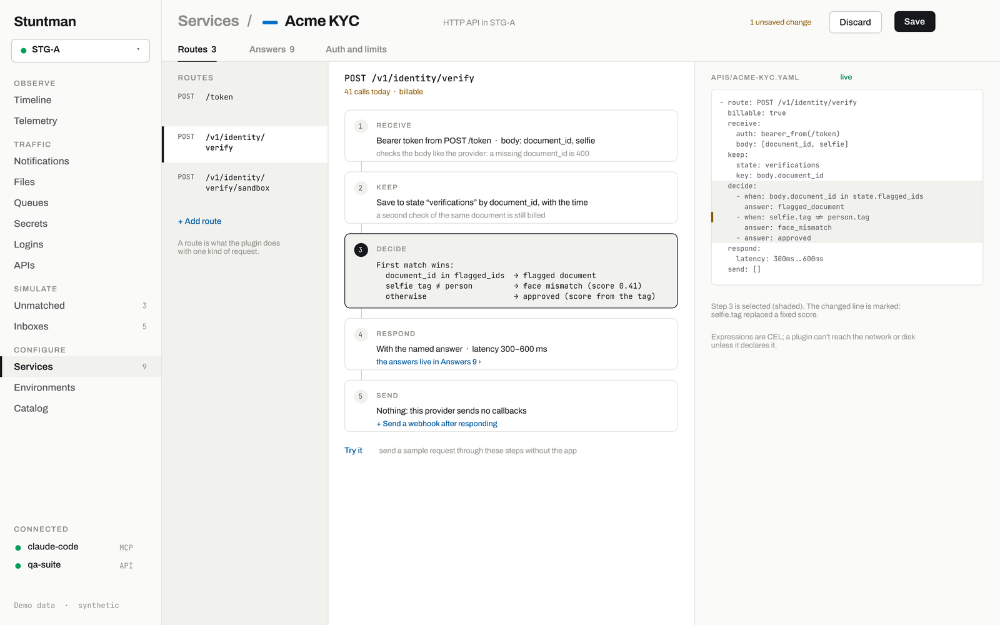

# HTTP APIs

Any REST, GraphQL or SOAP provider your app calls over HTTP, described once as a **plugin**: a YAML file with
routes (or SOAP operations), the state they keep, named answers, callbacks and the sentence each call leaves on
the timeline. The app points its base URL at Stuntman (or resolves the provider's real host name to it, over
HTTPS with the Stuntman Test CA). Stuntman keeps every call with what the app sent, the steps that decided the
answer, what it answered and the webhooks it sent, plus every request no route took.



This page covers the engine: ports, routing, auth, TLS, provocations, calls and the tools. The plugin format
has its own guides:

| Guide | What it covers |
|---|---|
| [Plugins](../plugins.md) | The YAML format (`service`, `routes`, `answers`, `mcp`, `data`, `pages`), the expression language and its functions, regex routes, GraphQL, streamed and compressed answers, MCP servers, webhook signing, idempotency, scenarios, install and validate |
| [OpenAPI](../openapi.md) | A service made from an OpenAPI 3.x or Swagger 2.0 spec: routes, answers from examples or schemas, body validation, the spec served back, re-import |
| [SOAP](../soap.md) | A service made from a WSDL: operations by SOAPAction, XSD checks, faults, WS-Security UsernameToken, `?wsdl` served back, XML signatures and ICP-Brasil style certificates, callbacks |
| [WireMock mocks](../mocks.md) | A folder of WireMock mappings turned into plugins: matchers, response templates, delays, scenarios, and what is not converted |
| [Recording](../recording.md) | Calls proxied to the provider's sandbox and kept (secrets masked), then grouped into routes, answers and rules, and written as a plugin |

## At a glance

| | |
|---|---|
| **Stands in for** | Any HTTP provider, as a plugin. The catalog ships 45 (Stripe, Twilio, PayPal, Adyen, Shopify, Slack, HubSpot, GitHub, Sentry, Auth0, Microsoft Graph, Google Drive, reCAPTCHA, Turnstile, Pix, Mercado Pago, Lacuna REST PKI…). Tested with `curl` and Python HTTP clients (`engine/tests/e2e_apis.py`, `e2e_http_a10.py`, `e2e_encode.py`, `e2e_restpki.py`) |
| **Ports** | `8028` HTTP (`STUNTMAN_APIS_PORT`); `8443` HTTPS with the Test CA, any host name by SNI, mTLS when a plugin requires it (`STUNTMAN_APIS_TLS_PORT`); more HTTPS ports with `STUNTMAN_APIS_TLS_EXTRA_PORTS=5099,9443`. Tools and routes on `8025` (`STUNTMAN_PORT`) under `/api` |
| **Point your app at** | `http://localhost:8028/<service>`; or `http://<service>.<env>.localhost:8028`; or `https://<real host>:8443` with the real host resolved to Stuntman and the Test CA trusted |
| **It keeps** | The plugin YAML in `apis/<service>.yaml`; per service: kept state (`keep`), wait counters, tokens and session cookies, idempotency keys, the scenario, scheduled webhooks; every call (request, steps, answer, sentence, sends); every unmatched request with its closest route; who forced what |
| **You can provoke** | Any named answer of the plugin (`force_answer`), and the generic ones: `reset`, `empty`, `timeout`, `401`, `403`, `429`, `500`, `503`, `html` (an HTML error page with 200), `503_html`, `cut` and `slow` (streams), `session_expired` (MCP); latency; rate limits (429); a share of failures (503); a route that always fails (`fail`); expired tokens (`expire_tokens`); refused TLS handshakes; webhooks badly signed, too old, unsigned, sent twice or out of order |
| **Screen** | `/apis` (calls), `/apis/<service>/routes`, `/answers`, `/pages`, `/tools`, `/auth`, `/settings`, `/review` (recording); `/apis/unmatched`; `/apis/new` |
| **Tools** | `list_api_services`, `list_api_calls`, `list_api_traffic`, `get_api_call`, `wait_for_api_call`, `force_answer`, `list_forced`, `list_unmatched`, `route_from_request`, `list_plugins`, `install_plugin`, `install_collection`, `get_plugin`, `put_plugin`, `set_route`, `set_answer`, `try_route`, `validate_plugin`, `set_service`, `expire_tokens`, `get_test_ca`, `issue_client_certificate`, `clock`, `advance_clock` (full list at the end) |

## Connect your app

### 1. Install a plugin

```text
list_plugins {"query": "stripe"}
install_plugin {"plugin": "stripe"}
install_collection {"name": "Global · payments, commerce and SaaS"}
install_plugin {"plugin": "empty", "service": "acme-partner", "base_url": "https://api.partner.example.com"}
```

`plugin: empty` makes a service that answers `{"ok": true}` on every path and method, so you can start from the
calls the app makes. `install_plugin` with `service` installs a second copy of a catalog plugin under another
name (it drops `real_host`, so only the path prefix reaches it). Your own plugin from a folder, a `.zip` or a git
URL: `import_plugin {"source": "https://github.com/acme/plugins#stripe@v2"}`, then `install_import {"id": "..."}`.
From a spec, a WSDL, WireMock mappings or a recording: see the guides above.

### 2. Point the app at it

Stuntman finds the service for a request in this order:

| Way | Example | Notes |
|---|---|---|
| The provider's real host | `Host: api.stripe.com` → the plugin whose `real_host` (one name or a list) or `base_url` host is that name | The path is passed as is |
| A host whose first label is the service | `recaptcha.staging.localhost:8028`, `recaptcha.pr-9.stuntman.local:8028` | The host must contain a dot |
| A path prefix | `http://localhost:8028/recaptcha/recaptcha/api/siteverify` | The first path segment is the service name; it is removed before the routes match |

```bash
# Path prefix (no DNS needed)
STRIPE_API_BASE=http://localhost:8028/stripe

# Host name, no hosts entry needed: *.localhost resolves to loopback
STRIPE_API_BASE=http://stripe.staging.localhost:8028

# The real host name over HTTPS: resolve it to Stuntman and trust the Test CA
curl --resolve api.stripe.com:8443:127.0.0.1 --cacert stuntman-test-ca.pem https://api.stripe.com:8443/v1/charges
```

For the real host name, add it to `/etc/hosts` (or Docker `extra_hosts`, or the resolver of your test runner) and
pass the port, or publish `8443` as `443` when the client cannot take a port:
`docker run -p 443:8443 …`. A client with a fixed `host:port` (a device that calls `:5099`) gets that port with
`STUNTMAN_APIS_TLS_EXTRA_PORTS=5099`; publish it in Docker too.

| App runs | Base URL |
|---|---|
| On the host | `http://localhost:8028/<service>` |
| In Docker, Stuntman on the host | `http://host.docker.internal:8028/<service>` |
| In the same compose file | `http://stuntman:8028/<service>` |
| Another environment | `http://localhost:8028/e/<env>/<service>`, or `http://<service>.<env>.localhost:8028` |

`list_api_services` and `get_api_service` return each service's `urls`: `local`
(`http://127.0.0.1:8028[/e/<env>]/<service>`), `host` (`http://<service>.<base domain>:8028`), `https`
(`https://<real host or service.base domain>:8443`), `real` and `realBase`.

### 3. Environments

On `8028` the environment is the `/e/<env>/` prefix, else the `Host` header (a host under the environment's base
domain, `<anything>.<env>.localhost`, or a real host the environment lists), else the default environment. On
`8443` the SNI host name picks it the same way. Each environment has its own plugins, state, tokens and calls. A
paused environment answers `503 <env> is paused in Stuntman`. See [Environments](../environments.md).

### 4. Auth

What a plugin accepts is in its `service.auth` and each route's `receive.auth`:

| Auth | What the app does | What Stuntman checks |
|---|---|---|
| None | Nothing | Nothing (the default when the service has no `basic`) |
| OAuth2 client credentials | `POST` to the route marked `token: true` with `grant_type=client_credentials` and `client_id`/`client_secret` in the body or `Authorization: Basic` | `client_id` and `client_secret` (literals, `env:NAME` or `secret://name`), or any client with `any_client: true`. Answer `{"access_token": "dbl_…", "token_type": "Bearer", "expires_in": <token_ttl>, "scope": "default"}`. Refused: `401 {"error": "invalid_client" or "unsupported_grant_type", "error_description": "Bad credentials"}` |
| Bearer | `Authorization: Bearer <token>` on routes with `receive.auth: bearer` | The token was issued by this service and has not expired: else `401 {"message": "Invalid token"}` or `{"message": "Token expired"}` |
| Basic | `Authorization: Basic …` | `users` (name → password), or `any_user`; `challenge` asks for it. `401` with `WWW-Authenticate: Basic realm="<service>"` |
| Session cookie | `POST` to the route marked `login: true` with `username`/`user`/`login`/`usuario` and `password`/`senha`/`pass` | Then the cookie (default name from `session.cookie`) on routes with `receive.auth: session`: `401 {"message": "Not logged in"}` or `{"message": "Session expired"}`. Default `ttl` 30 min |
| Authorization code with PKCE, or password (CPF + OTP) | A route with `grant: authorization_code` or `grant: password`, after a page the plugin draws (see Browser steps) | Code one-time and valid 10 min, `code_verifier` against the S256 challenge; refused: `400 {"error": "invalid_grant", "error_description": …}` |
| Client certificate (mTLS) | Present a certificate signed by the Stuntman Test CA over `8443` | See HTTPS and mTLS |

Token TTL defaults to `60m`, the session TTL to `30m`. `expire_tokens {"service": "x"}` makes every token and
session of the service invalid at once.

## What it supports

### Request handling (port 8028 and 8443)

| Feature | Notes |
|---|---|
| Methods | Any. A route `ANY /path` takes every method; a `GET` route also takes `HEAD` |
| Paths | `{name}` parameters (percent-decoded), a last `{*}` segment (`path.rest`), `~regex` over the whole path with named groups; `service.ignore_case` |
| Bodies | JSON, `application/x-www-form-urlencoded`, `multipart/form-data` (fields in `body`, uploads in `files` with `field`, `filename`, `size`, `contentType`, `sha256`, base64 up to 1 MB), `multipart/related`/`mixed` (the JSON part's fields in `body`, other parts as `part1`, `part2`…), anything else as text. `Content-Encoding: gzip` bodies are decompressed. Up to 64 MB |
| Routes | Tried in file order; GraphQL routes first (by `operationName`, the operation's name, or the first field of the query); `fallthrough` tries the next route with the same path when no rule matched |
| Steps | receive → native → step → let → keep → wait → decide → respond → send ([Plugins](../plugins.md#routes)) |
| CORS | `service.cors: true`: `OPTIONS` answers `204` with `Access-Control-Allow-Origin: *`, and every answer gets that header |
| Browser pages | `pages` drawn at their route (`GET`), posted to `/__stuntman/steps/<id>`; previews at `/<service>/__stuntman/preview/<index>` |
| SOAP | `POST` to the service's endpoint; `GET ?wsdl` and its XSDs ([SOAP](../soap.md)) |
| OpenAPI | A `GET` no route takes may serve the kept spec back ([OpenAPI](../openapi.md)) |
| MCP server | JSON-RPC 2.0 over Streamable HTTP on `/<service>/mcp` (protocol `2025-06-18`): `initialize`, `ping`, `tools/list`, `tools/call`, notifications; `GET` 405, `DELETE` ends the session; `auth: bearer` answers `401` with `WWW-Authenticate: Bearer resource_metadata=…` ([Plugins › MCP server](../plugins.md#mcp-server)) |
| Recording | While `record` is live, calls go to the upstream and back ([Recording](../recording.md)) |
| Streams | `stream` answers in parts: `sse` (`text/event-stream`), `ndjson` (`application/x-ndjson`) or `chunks` (`text/plain`), each part after its `after` |
| Compressed answers | `encode: gzip`, `deflate` (raw DEFLATE) or `zip` (one entry `body.xml`, `body.json` or `body.txt` by the first character): the rendered body (or `file`) goes out compressed, with no `Content-Encoding` and `Content-Type: application/octet-stream` (`application/zip`) unless the answer sets one. Calls keep the text. A stream ignores `encode` |
| Files | `file:` sends `apis/<service>.files/<file>` as the body |
| Templates | `{{ }}` expressions; `template: handlebars` for WireMock-style templates ([WireMock mocks](../mocks.md#response-templates)) |
| Content type | When the answer sets none: `text/html` for a body starting with `<html` or `<!doctype`, `application/xml` for other `<…`, else `application/json` |
| Idempotency | `service.idempotency` (header, default `Idempotency-Key`; `ttl`, default `24h`), on `POST`, `PUT`, `PATCH`, `DELETE`: the same key and the same body replays the first answer with `idempotent-replayed: true` and sends no webhook; the same key with another body answers `409 {"error": {"type": "idempotency_error", "message": "Keys for idempotent requests can only be used with the same parameters they were first used with. Try using a key other than '<key>'."}}`. Answers of 500 or more and network failures are not kept, so a retry runs again |
| Billing | Routes with `billable: true` count when `billing.enabled`; `per_call` is a price for the counter only; `warn_above` like `100/day`. Token answers are never billed |
| Caller | `X-Stuntman-App` header, else the client certificate's name, else the first word of the `User-Agent` (`browser` for `Mozilla…`), else `app` |
| Trace | `traceparent` is kept on the call and groups it on the [Timeline](../timeline.md) |

### HTTPS and mTLS (port 8443)

- The TLS handshake's SNI host name picks the environment and the plugin. Stuntman presents a certificate for
  exactly that name, made on the spot and signed by the **Stuntman Test CA**. No SNI means `localhost`.
- HTTP/1.1 only (ALPN `http/1.1`); no HTTP/2.
- The Test CA is made once in the data folder (`keys/test-ca.pem` and `keys/test-ca.key`) and is valid until 1
  January 2035. Every environment and restart uses the same one.
- A plugin with `service.auth.client_certificate.required: true` (or `set_service {"client_certificate": true}`)
  gets real mTLS: the handshake fails without a client certificate, or with one the Test CA did not sign.
- With `client_certificate.icp: true`, the certificate must also carry a CNPJ (OID 2.16.76.1.3.3), as an
  ICP-Brasil e-CNPJ does. `new_test_certificate` makes one.
- mTLS is enforced only when the SNI name picks the plugin (its `real_host`, `base_url` host, or
  `<service>.<base domain>`). A request that reaches the plugin by path prefix on `https://localhost:8443/<service>`
  is not asked for a certificate.
- Expressions read `client_cert` (the certificate's name: the name given to `issue_client_certificate`, else
  `cert <fingerprint>`) and `client_cnpj`. WireMock templates see `request.scheme` as `https`.
- Refused handshakes are kept on Calls with answer `tls_refused`, status `0` and why in `provoked`:
  "the app does not trust the Stuntman Test CA yet", "no client certificate: the provider requires one (mTLS)",
  "client certificate refused (not signed by the Stuntman Test CA)", "the client certificate has no CNPJ
  (ICP-Brasil e-CNPJ required)", or "TLS handshake failed: …".

Downloads of the Test CA, on port 8025:

| URL | Format |
|---|---|
| `/api/test-ca.pem` (also `/api/keyvault/test-ca.pem`) | PEM |
| `/api/test-ca.crt`, `/api/test-ca.der` | DER (macOS Keychain, Windows store, Android) |
| `/api/test-ca.p12`, `/api/test-ca.pfx` | PKCS#12 with the CA only, password `changeit` (a Java truststore) |
| `/api/ca-bundle.pem` | This machine's public roots plus the Test CA in one file, so the app still trusts the real internet |

`get_test_ca` returns those URLs, the PEM, the fingerprint and how to trust it per runtime:

| Runtime | Per process |
|---|---|
| Node | `NODE_EXTRA_CA_CERTS=stuntman-test-ca.pem` |
| Python | `REQUESTS_CA_BUNDLE=stuntman-test-ca.pem` (requests, Azure SDKs), `SSL_CERT_FILE=stuntman-test-ca.pem` (ssl, httpx, aiohttp) |
| Java | `-Djavax.net.ssl.trustStore=stuntman-test-ca.p12 -Djavax.net.ssl.trustStoreType=PKCS12 -Djavax.net.ssl.trustStorePassword=changeit` |
| Go | `SSL_CERT_FILE=stuntman-test-ca.pem` on Linux; on macOS and Windows load the PEM into `tls.Config.RootCAs` |
| curl | `--cacert stuntman-test-ca.pem` or `CURL_CA_BUNDLE` |
| .NET on Linux | `SSL_CERT_FILE=stuntman-test-ca.pem` |
| .NET on macOS and Windows | A `SocketsHttpHandler` whose `RemoteCertificateValidationCallback` builds an `X509Chain` with `TrustMode = CustomRootTrust` and the CA in `CustomTrustStore` |

Prefer these per-process options. Adding the CA to an OS trust store changes the developer's machine: ask first.

### Certificates for the app

| Tool | What it makes |
|---|---|
| `issue_client_certificate {"name": "acme-billing"}` | A client certificate (CN = name, client auth) and its key, PEM, signed by the Test CA. Calls then show `acme-billing` as the caller |
| `new_test_certificate {"holder": "Acme Transportes Ltda", "cnpj": "11.222.333/0001-81"}` | An ICP-Brasil style A1 certificate (e-CNPJ with `cnpj`, e-CPF with `cpf`), RSA 2048: `.pfx` (base64) and its password, certificate and key PEM. `valid_days` (365), `expired`, `not_yet_valid`, `untrusted` (signed by an unknown CA). Synthetic holders only: names of real public bodies and big banks are refused |
| `list_test_certificates` | The environment's test certificates and their state (`valid`, `expired`, `not yet valid`, `untrusted CA`) |
| `sign_xml {"xml": "...", "id": "<element Id>", "certificate": "<id or holder>"}` | An enveloped `ds:Signature` after the element (`place: inside` puts it inside), RSA-SHA1 by default (`sha256: true`), `exclusive` c14n, `prefix` `ds:` |
| `verify_xml_signature {"xml": "..."}` | Checks every `ds:Signature` (digests and value) with the certificate in `KeyInfo`; returns what was signed and by which CNPJ |
| `issue_person_certificate {"cpf": "...", "not_after": "-1d"}` | Re-issues a person's cloud certificate (BirdID, ViDaaS plugins) with a validity window; every plugin answers it until `clear_person_certificate` |

### Lacuna REST PKI (`restpki` plugin)

The `restpki` catalog plugin runs PAdES signatures natively: `POST /Api/v2/PadesSignatures` (the app starts with
the PDF, page, position in cm and stamp PNG, and gets a token), `POST /__webpki/{token}/start` and
`/__webpki/{token}/signature` (the browser side: certificate, then the signature of the signed attributes), `POST
/Api/v2/PadesSignatures/{token}/SignedBytes` (the signed PDF, a real ETSI.CAdES.detached incremental update), `GET
/Api/system/info`. Keys are matched case-insensitively (the .NET client sends PascalCase). Tools:
`list_restpki_sessions`, `get_restpki_session` (with the certificate model), `fail_restpki {"step": "finish",
"status": 422}` (`start`, `webpki_start`, `webpki_signature`, `finish`; `422` ValidationError or `500`;
`count`), `reset_restpki`.

### Callbacks (`send`)

- Sent after the answer, only when the status is below 500 and the connection did not fail on purpose. Replayed
  idempotent calls send nothing.
- `delay` waits on the [environment's clock](../clock.md): the send is kept and goes when the clock reaches its
  time (checked every 500 ms). `advance_clock {"by": "1d"}` sends the ones due at once. `clock` lists those
  waiting.
- Signed in the provider's format (`service.webhooks.sign`): `hex` (default when a `secret` is set), `hex_ts`,
  `stripe`, `svix`, `github`, `cloudevents`, `twilio`, `slack`, `shopify`, `hubspot` ([Plugins › Webhook
  signing](../plugins.md#webhook-signing)). The timestamp in signatures reads the environment's clock.
- `Content-Type: application/json` unless the send sets its own.
- Each send is kept on the call: URL, status (or `connection refused`, or the error), duration, sign, event, the
  provocation and the headers.
- A SOAP callback (`operation`) wraps the body in an envelope of the call's SOAP version.

## How it behaves

### The order a call goes through

1. The service is found (host, then path prefix). None: `404 {"error": "no route", "stuntman": "Stuntman: no
   plugin answers <host><path>"}` with header `x-stuntman: no route`, kept in Unmatched.
2. CORS preflight, recording, the served spec, browser pages, SOAP and MCP are handled before the routes.
3. The first route whose method and path match. None: `404 {"error": "no route", "stuntman": "Stuntman: <service>
   has no route for <METHOD> <path>"}`, kept in Unmatched with the closest route.
4. An idempotency key seen before replays (or 409) without running the route.
5. `limits.rate` (e.g. `10/s`, a sliding window per environment and service) → `429`.
6. `limits.fail_share` (0 to 1) → `503` at random.
7. A forced answer (`force_answer`).
8. The route's `fail`.
9. Receive: token route, login route, grant route, auth, required `body` fields (`400 {"message": "<field> is
   required"}` or the `missing` answer), schema check (`400` or the `invalid` answer).
10. native, step, let, keep, wait, decide. No rule and no otherwise: `500 {"error": "Stuntman: the route decided
    no answer"}`.
11. Respond: the answer's latency, or the route's `respond.latency`, or `limits.latency` (`300ms..600ms` picks at
    random).
12. `keep` saves only when the answer is below 400.
13. The call is recorded, then the sends go.

A forced answer, a rate limit, a failure share and a route's `fail` skip the auth and receive checks: the app gets
the answer even with a bad token.

### Generic answers

| Name | What the app gets |
|---|---|
| `reset` | The TCP connection is reset (RST) |
| `empty` | The connection closes without an answer |
| `timeout` | No answer for 600 s, then `504` |
| `401` | `401`, `WWW-Authenticate: Bearer`, empty body |
| `403` | `403`, empty body |
| `429` | `429 {"message": "Too Many Requests"}`, `Retry-After: 1` |
| `500` | `500 {"error": "Internal Server Error"}` |
| `503` | `503 {"message": "Service Unavailable"}`, `Retry-After: 5` |
| `html` | `200` with an HTML "Service temporarily unavailable" page |
| `503_html` | `503` with a proxy's HTML page, `Retry-After: 5` |
| `cut` | A streamed answer sends half its parts, then the connection breaks (non-stream answers are unchanged) |
| `slow` | A streamed answer waits 2 s more before each part |
| `session_expired` | MCP: the next request (not `initialize`) gets `404`, so the client must start a new session |

### State and persistence

- The plugin file is the source of truth: the screen, the API and agents change the same YAML. A save from a tool
  or the screen applies to the next call; a file edited by hand is read again within a second. Saving rewrites
  the file, so YAML comments are lost. A file that does not parse is listed under `broken` in
  `list_api_services`.
- `put_plugin`, `set_route` and `set_service` take the `version` you read and answer `409 <file> changed
  elsewhere` (with the current YAML) when it changed.
- State, tokens, counters, idempotency keys and calls are in the environment's SQLite and survive restarts. Calls
  are not pruned.
- `remove_api_service` deletes the YAML, its spec, WSDL, recording and files, and the service's state, tokens,
  wait counters and force. Calls stay.
- Rate-limit windows are in memory: a restart resets them.
- `now()` and `now_ms()` read the [environment's clock](../clock.md); token expiry, idempotency TTL and call times
  use the real clock.

### Forced answers

`force_answer {"service": "stripe", "answer": "card_declined", "count": 3}`:

- One force per service: a new `force_answer` replaces the previous one.
- `count` (default 1) calls, or `for` a duration (`10m`); with `for`, `count` is optional.
- `route` limits it to one route, written as in the plugin: `POST /v1/charges`. The token route is forced only
  when `route` names it.
- `answer: default` stops it.
- Forced calls show `provoked: forced by <who>` and are marked provoked on the Timeline. `list_forced` lists who
  forced what, newest first.

## Provoke failures

| Failure | How | What the app sees | Turn it off |
|---|---|---|---|
| A business error | `force_answer {"service": "stripe", "answer": "card_declined"}` | That named answer | `answer: default`, or after `count` calls |
| Connection reset / empty reply / timeout | `force_answer {"service": "x", "answer": "reset"}` (`empty`, `timeout`) | `ECONNRESET`, empty reply, no answer for 600 s | `answer: default` |
| Gateway errors | `force_answer {"service": "x", "answer": "503_html", "for": "5m"}` | `503` with HTML | `answer: default` |
| Expired tokens | `expire_tokens {"service": "serpro-datavalid"}` | `401 {"message": "Token expired"}` (sessions: `Session expired`) on the next call | The app gets a new token |
| Token endpoint refuses | `force_answer {"service": "x", "answer": "500", "route": "POST /token"}` | `500` on the token route only | `answer: default` |
| Rate limit | `set_service {"service": "x", "rate": "5/s"}` | `429`, `Retry-After: 1` above the rate | `rate: "none"` |
| Random failures | `set_service {"service": "x", "fail_share": "20%"}` | `503`, `Retry-After: 5`, 20 % of calls | `fail_share: 0` |
| Latency | `set_service {"service": "x", "latency": "800ms..2s"}` | Answers after 0.8 to 2 s | `latency: "none"` |
| A route always fails | `fail: reset` on the route (`set_route`) | That failure | Remove `fail` |
| Stream breaks | `force_answer {"service": "x", "answer": "cut"}` | Half the parts, then a broken connection | `answer: default` |
| MCP session gone | `force_answer {"service": "x", "answer": "session_expired"}` | `404` on the next MCP request | Used once |
| Bad webhook signatures | `set_service {"service": "stripe", "webhook_provoke": "wrong_signature"}` (`old_timestamp`, `no_signature`, `twice`, `out_of_order`) | Every send broken that way | `webhook_provoke: "none"` |
| TLS not trusted | Do not pass the Test CA | Handshake fails; Calls shows `tls_refused` | Trust the CA |
| Missing client certificate | `set_service {"service": "x", "client_certificate": true}` | Handshake fails without a Test CA certificate | `client_certificate: false` |
| REST PKI step fails | `fail_restpki {"step": "finish", "status": 422}` | `422` ValidationError on SignedBytes | `status: default` |

## See what the app did

| Need | Tool | HTTP |
|---|---|---|
| Calls, newest first | `list_api_calls {"service": "stripe", "answer": "charge", "since": "15m", "q": "A-1042", "limit": 200}` | `GET /api/apis/calls` |
| Every call in order, matched or not, after a cursor | `list_api_traffic {"after": 0, "limit": 500}` → `next` | `GET /api/apis/traffic?after=<seq>` |
| One call | `get_api_call {"id": "call_…", "raw": true}` | `GET /api/apis/calls/{id}` |
| Wait for a call | `wait_for_api_call {"service": "stripe", "route": "/v1/charges", "answer": "charge", "timeout": "30s"}` | `GET /api/apis/calls/wait` |
| Requests no route took | `list_unmatched {"group": "path", "since": "1h"}` (`service`, `caller`, `host`, `none`) | `GET /api/apis/unmatched` |
| A draft route from one | `route_from_request {"id": "…"}` → YAML; save with `set_route` | `POST /api/apis/unmatched/{id}/route` |
| Hide one | `ignore_unmatched {"id": "…"}` (still answered 404) | `POST /api/apis/unmatched/{id}/ignore` |
| Hosts the app called directly (from telemetry) | `real_provider_calls {"since": "1h"}` | `GET /api/apis/real-provider-calls` |
| Billable calls and repeated inputs | `billing {"service": "x", "since": "1d"}` | `GET /api/apis/billing` |
| Who forced what | `list_forced {"service": "x"}` | `GET /api/apis/forced` |
| Services, counts today, forced answer, URLs | `list_api_services` | `GET /api/apis/services` |
| Kept state | Read it in an expression (`state.<collection>`) or on the screen | |

Call fields: `id`, `service`, `route` (`POST /v1/charges`), `method`, `path` (inside the service), `status` (`0`
for a network failure or a refused handshake), `answer` (the answer name, or `token`, `invalid_client`,
`login_refused`, `replayed`, `idempotency_conflict`, `tls_refused`, `no answer`, the status of a refusal),
`sentence`, `billable`, `caller`, `traceId`, `ms`, `provoked`, `sent` (the required fields received), `answered`
(the first fields of the answer), `steps` (`[{step, text, ok}]`), `sends`. `raw: true` adds the request and the
response with headers and bodies (first 64 KB).

`wait_for_api_call` returns the oldest matching call since `since` (ms; default 2 s before the call), polling
every 200 ms, and answers `408 No call to <service> yet` after `timeout` (default 30 s). `route` is a substring of
`METHOD /path`.

`list_api_traffic` returns `{after, next, count, calls}`, oldest first, each with `seq` and `matched`. Keep `next`
and pass it as `after` at the next step.

`try_route {"service": "x", "method": "POST", "path": "/v1/charges", "request": {"body": {...}}}` runs the steps
on a sample request without keeping, counting, billing or sending anything; `steps` tries an unsaved version.

## Recipes

1. **Stand in for a provider from the catalog and assert one call.**

   ```text
   install_plugin {"plugin": "recaptcha"}
   # app: POST http://localhost:8028/recaptcha/recaptcha/api/siteverify  secret=x&response=bot-1
   wait_for_api_call {"service": "recaptcha", "timeout": "10s"}   → answer "low_score"
   ```

2. **Make the app handle a declined charge, then recover.**

   ```text
   list_answers {"service": "stripe"}
   force_answer {"service": "stripe", "answer": "card_declined", "route": "POST /v1/charges", "count": 1}
   # the first charge is declined, the next one is not
   ```

3. **Call a provider by its real host name over HTTPS.**

   ```text
   get_test_ca {}   → urls.pem
   # curl -o stuntman-test-ca.pem http://localhost:8025/api/test-ca.pem
   # /etc/hosts: 127.0.0.1 api.bank-gateway.example.com
   # NODE_EXTRA_CA_CERTS=stuntman-test-ca.pem BANK_URL=https://api.bank-gateway.example.com:8443
   ```

4. **Test a provider that requires mTLS.**

   ```text
   issue_client_certificate {"name": "acme-billing"}   → certificate, key
   # curl --resolve api.bank-gateway.example.com:8443:127.0.0.1 --cacert ca.pem --cert c.pem --key c.key \
   #      https://api.bank-gateway.example.com:8443/boletos -d '{"valor": "150.00", "pagador": "Globex"}'
   list_api_calls {"service": "bank-gateway"}   → caller "acme-billing"
   ```

   Without the certificate the handshake fails and Calls shows `tls_refused` "no client certificate".

5. **Find the calls no plugin answers and turn one into a route.**

   ```text
   list_unmatched {"group": "path"}
   route_from_request {"id": "<id>"}   → yaml, service
   set_route {"service": "acme-partner", "method": "POST", "path": "/v2/orders", "steps": {"decide": [{"answer": "ok"}]}}
   ```

6. **Test the app's token refresh.**

   ```text
   expire_tokens {"service": "serpro-datavalid"}
   # the next call gets 401 "Token expired"; the app asks POST /token again
   wait_for_api_call {"service": "serpro-datavalid", "answer": "token"}
   ```

7. **Test a renewal webhook that comes 30 days later.**

   ```text
   # the app subscribes; the route's send has delay: 30d
   clock {}   → waiting: [the send]
   advance_clock {"by": "30d"}   → the webhook goes out now
   get_api_call {"id": "<the subscribe call>"}   → sends[0].status
   ```

8. **Check the app replays safely with an Idempotency-Key.**

   ```text
   set_service {"service": "stripe", "idempotency": true}
   # the app retries the same POST with the same key → idempotent-replayed: true, no second webhook
   list_api_calls {"service": "stripe", "answer": "replayed"}
   ```

## Errors and troubleshooting

| Symptom or error text | Cause | Fix |
|---|---|---|
| `404 {"error": "no route", "stuntman": "Stuntman: no plugin answers <host><path>"}` | No plugin for that host, and the first path segment is not a service | `list_api_services`; add `/<service>` to the base URL, or set `real_host` |
| `404 ... "<service> has no route for POST /v4/..."` | The path or method differs from the plugin | `list_unmatched` shows the closest route ("Differs in one segment: v4 here, v5 in the plugin") |
| `404 No Stuntman environment <name>` | Wrong `/e/<env>` prefix | `GET /api/environments` |
| `503 <env> is paused in Stuntman` | Paused environment | Resume it |
| `401 {"message": "Invalid token"}` | The token was not issued by this service in this environment | Ask the token route of the same service and environment |
| `401 {"error": "invalid_client"}` on the token route | Wrong client id or secret | `get_api_service` → `service.auth`; or `set_service {"any_client": true}` |
| `400 {"message": "<field> is required"}` | A required body field is missing (dotted paths) | Send it, or name a `missing` answer |
| `500 {"error": "Stuntman: the route decided no answer"}` | No `decide` rule matched and there is no otherwise | Add a last rule without `when` |
| `{"stuntman": "template error: …"}` in the body | An expression in the answer failed | `validate_plugin` (errors with line numbers); `try_route` |
| `500 Stuntman: template error: …` | A handlebars template failed | Fix the template |
| curl exit 60 / "unable to get local issuer certificate"; Calls: "the app does not trust the Stuntman Test CA yet" | The Test CA is not trusted | Pass the CA (see the runtime table) |
| Calls: "no client certificate: the provider requires one (mTLS)" | mTLS plugin, no client certificate | `issue_client_certificate` |
| Calls: "client certificate refused (not signed by the Stuntman Test CA)" | A certificate from another CA | Use one from `issue_client_certificate` or `new_test_certificate` |
| HTTPS by path prefix works without a client certificate | SNI did not pick the plugin, so mTLS is not asked | Use the real host name or `<service>.<base domain>` |
| `409 <file> changed elsewhere` | The plugin changed since you read its `version` | Read again (`get_plugin`) and merge |
| `409 <service> is already installed` | `install_plugin` twice | `service` for a second copy |
| `400 No answer “x”. Answers: …` from `force_answer` | Unknown answer name | `list_answers` |
| `409 “x” is used by a route; change the route first` | `delete_answer` on a used answer | Change the route first |
| The webhook never arrives | Answer was 500 or more, the send's `when` was false, or `delay` waits on the clock | `get_api_call` → `sends`; `clock` |
| Connection refused on 8028 / 8443 | Port not published, or taken (Stuntman prints `APIs: port 8028: …` or `APIs HTTPS: port 8443: …` on stderr) | Publish the ports; set `STUNTMAN_APIS_PORT` / `STUNTMAN_APIS_TLS_PORT` |

## Not done

- HTTP/2 and gRPC are not served on 8028 or 8443 (HTTP/1.1 only). WebSockets are not served.
- mTLS is checked only when the SNI name picks the plugin, not for a path-prefix request on 8443.
- Client certificate revocation (CRL, OCSP) is not checked.
- One forced answer per service at a time; a second `force_answer` replaces the first.
- Rate-limit windows are in memory and reset on restart.
- Calls and unmatched requests are never pruned.
- Request bodies over 64 MB are cut. Call details keep the first 64 KB of each body.
- The generic `timeout` holds the connection for 600 s; the length is not configurable.
- See each guide's Limits for OpenAPI, SOAP, WireMock and Recording gaps.

Missing something? Tell the developer what the fix would be and offer a pull request — see [Contributing](../../CONTRIBUTING.md).

## Tools and routes

<!-- tools: apis -->
_Generated by `tools/gen_tool_reference.py` from the engine source; each tool is an MCP tool and the HTTP route shown (under `/api`)._

| Tool | HTTP | Required | Optional | What it does |
|---|---|---|---|---|
| `list_api_services` | `GET /api/apis/services` | — | — | HTTP API services (plugins) in this environment: origin, region, calls and billable calls today, forced answer, URLs; broken files with their error. |
| `list_api_calls` | `GET /api/apis/calls` | — | service, answer, since, q, limit | Calls any HTTP plugin answered, newest first: sentence, answer name, status, billable, trace id. |
| `list_api_traffic` | `GET /api/apis/traffic` | — | after, limit | Every call in the order it came, answered by a route or not (matched: false, answered 404 "no route"), after a cursor: pass the last `next` as `after` to get only what came since. One cursor for both lists, so a test reads the calls its step made without cutting by time. |
| `get_api_call` | `GET /api/apis/calls/{id}` | id | raw | What the app sent and what Stuntman answered, the steps and webhooks; raw=true adds headers and bodies. |
| `wait_for_api_call` | `GET /api/apis/calls/wait` | service | route, answer, timeout, since | Waits for the next call to a service (and route, and answer): what a test waits for after acting in the app. |
| `force_answer` | `POST /api/apis/{service}/force` | service, answer | count, for, route | The next calls get this named answer (or reset \| empty \| timeout \| 500 \| 503 \| html): count=N calls or for=10m; route= limits it to one route (the token route is forced only this way); answer=default stops. |
| `billing` | `GET /api/apis/billing` | — | service, since | Billable calls and the counter value per service (price per call is only a counter); repeated inputs point at a retry loop. |
| `list_unmatched` | `GET /api/apis/unmatched` | — | group, since, ignored | Requests that reached Stuntman but no route took (answered 404 “no route”), grouped by path \| service \| caller \| host (or one by one with group=none), with the closest route. |
| `route_from_request` | `POST /api/apis/unmatched/{id}/route` | id | — | A draft route prefilled from an unmatched request (method, path, body fields; the closest route's steps copied). Returns its YAML; set_route saves it. |
| `ignore_unmatched` | `POST /api/apis/unmatched/{id}/ignore` | id | — | Hides an unmatched request (and the same method and path); it is still answered 404. |
| `real_provider_calls` | `GET /api/apis/real-provider-calls` | — | since | Hosts the app called directly, from telemetry: calls that never came through Stuntman. |
| `list_plugins` | `GET /api/plugins` | — | query, region, category, collection | The catalog: plugins you can install (origin, region, badges, installed here, update available) and its collections. Filters: query, region (Global \| Brazil), category (Browser pages), collection. |
| `install_plugin` | `POST /api/plugins` | plugin | service, base_url | Installs a plugin from the catalog (or an empty one that records: plugin=empty, service=<name>) into this environment. |
| `remove_api_service` | `DELETE /api/plugins/{service}` | service | — | Removes a plugin from this environment (calls stay in the history). |
| `get_plugin` | `GET /api/plugins/{service}` | service | — | The plugin YAML: service block, routes, answers, data; and its version (send it back to save over it). |
| `put_plugin` | `PUT /api/plugins/{service}` | service, yaml | version | Replaces the whole plugin YAML; validated before saving (409 if it changed since the version you read). |
| `set_route` | `PUT /api/plugins/{service}/routes` | service, method, path | steps, old_route, version | Creates or replaces a route (method, path, steps: receive, let, keep, wait, decide, respond, send, fail, billable); validated before saving. |
| `delete_route` | `DELETE /api/plugins/{service}/routes` | service, method, path | — | Deletes a route. |
| `try_route` | `POST /api/plugins/{service}/try` | service, method, path | request, steps | Runs a route's steps on a sample request; nothing is kept, counted, billed or sent. steps= tries an unsaved version of the route. |
| `validate_plugin` | `POST /api/plugins/{service}/validate` | service | yaml | Schema and expression errors with line numbers; answers checked against the routes' schema. yaml= checks text before saving. |
| `list_answers` | `GET /api/plugins/{service}/answers` | service | — | Named answers: status, body, and which route step uses each (an answer used by none exists only to be forced). |
| `set_answer` | `PUT /api/plugins/{service}/answers/{name}` | service, name | status, body, headers, raw, encode, stream, stream_format, template, latency, rpc_error, sentence, note, old_name, fault | Creates or replaces a named answer (status, body template, headers, sentence); checked against the schema unless raw=true (malformed on purpose); fault={code, reason} makes it a SOAP fault; stream=[{after, event, data}] sends it in parts (stream_format sse \| ndjson \| chunks); template=handlebars renders WireMock templates; latency waits before answering. |
| `delete_answer` | `DELETE /api/plugins/{service}/answers/{name}` | service, name | — | Deletes a named answer that no route uses. |
| `get_data` | `GET /api/plugins/{service}/data` | service | table | A data table the answers read (irregular_cpfs, people, selfies…), or every table. |
| `set_data` | `PUT /api/plugins/{service}/data/{table}` | service, table, rows | add | Replaces (or with add=true appends to) a data table as the plugin declares it. |
| `synthetic_cpf` | `GET /api/apis/synthetic-cpf` | — | — | A CPF that passes the check digits and is not a real person's (for data tables and tests). |
| `get_api_service` | `GET /api/plugins/{service}/service` | service | — | A service block: base URL and real host, auth (OAuth2 client credentials, Basic), billing, limits; plus Stuntman's URLs. |
| `set_service` | `PUT /api/plugins/{service}/service` | service | any_client, token_ttl, client_certificate, client_certificate_icp, session_ttl, billing, per_call, warn_above, latency, rate, fail_share, base_url, real_host, title, version, webhook_signing, webhook_secret, webhook_header, webhook_tolerance, webhook_provoke, idempotency, xml_signature_check, xml_signature_sign, xml_signature_invalid, xml_signature_sha256 | Changes the service block: any_client, token_ttl, billing (enabled, per_call, warn_above), latency, rate, fail_share, base_url, real_host, title; webhook signing (webhook_signing, webhook_header, webhook_secret, webhook_tolerance, webhook_provoke), idempotency, xml_signature_* and client_certificate_icp. |
| `clock` | `GET /api/clock` | — | — | The environment's clock (real time plus what advance_clock moved) and the webhooks waiting for their time. |
| `advance_clock` | `POST /api/clock/advance` | — | by, reset | Moves the environment's clock forward (1h, 1d, 30d): sends that wait (delay) and now() in templates follow it. reset=true goes back to real time. |
| `set_mcp_tool` | `PUT /api/plugins/{service}/mcp-tools` | service, name | description, input_schema, decide | Adds or changes a tool of a service's MCP server (the service gets an mcp: block on /mcp if it has none). decide: [{when, answer}] like a route; answers are the tool results (status >= 400 gives isError). |
| `get_test_ca` | `GET /api/apis/test-ca` | — | — | The Stuntman Test CA: download URLs (PEM, DER .crt, PKCS#12 truststore/PFX without a key), its file on disk, and how to trust it per runtime and OS (Linux, macOS, Windows; .NET, Node, Python, Java, Go, curl). Prefer the per-process options; ask the developer before adding it to an OS trust store. |
| `issue_client_certificate` | `POST /api/apis/client-certificates` | name | — | A client certificate signed by the Stuntman Test CA, for an app calling a provider that requires mTLS. Returns certificate and key PEM. |
| `issue_person_certificate` | `POST /api/apis/people/{cpf}/certificate` | cpf | name, not_before, not_after | (Re)issues a person's cloud certificate (BirdID, ViDaaS people) by CPF with a validity window, signed by the Stuntman Test CA with the person's own key: expired yesterday by default, or not yet valid. Every plugin answers it until clear_person_certificate. Returns the chain PEM; keys stay in Stuntman. |
| `clear_person_certificate` | `DELETE /api/apis/people/{cpf}/certificate` | cpf | — | The person's certificate is again the plugin's (valid or expired as its people table says). |
| `list_forced` | `GET /api/apis/forced` | — | service, last | Who forced what: every forced answer and its stop, newest first. |
| `expire_tokens` | `POST /api/plugins/{service}/tokens/expire` | service | — | Every token and session cookie issued by this service becomes invalid: the app's next call gets 401 and must ask (or log in) again. |
| `get_catalog_plugin` | `GET /api/catalog/{plugin}` | plugin | — | One catalog plugin before installing it: routes, the pages it draws, its synthetic people, situations you can provoke, permissions and files. |
| `install_collection` | `POST /api/catalog/collections/install` | name | — | Installs the plugins of a collection that this environment does not have yet. |
| `import_plugin` | `POST /api/catalog/imports` | source | path, ref | Reads your own plugin from a folder, a .zip or a git URL (path= inside it, ref= branch or tag) and checks it. Installs nothing: install_import does. |
| `install_import` | `POST /api/catalog/imports/{id}/install` | id | service | Installs a plugin import_plugin read (only if it had no errors); service= installs it under another name. |
| `list_pages` | `GET /api/plugins/{service}/pages` | service | — | The pages a service draws (authorize, push approval): fields, buttons, their YAML and a preview URL. |
| `set_page` | `PUT /api/plugins/{service}/pages/{index}` | service, yaml | index | Replaces one page of a service (its YAML: route, title, ask, fields, buttons, checks, push); validated before saving. index= the page (0 first). |
| `pending_browser_steps` | `GET /api/apis/steps` | — | service, all, limit | Pages and push approvals waiting for a person (all=true: the recent ones too), with the URL to open them. |
| `authorize_as` | `POST /api/apis/steps/authorize` | — | person, otp, deny, step, service | Completes the waiting page as this person (name or CPF), as clicking Authorize; deny=true clicks Deny. Returns where the browser goes (the app's redirect_uri with code and state). |
| `approve_push` | `POST /api/apis/steps/push` | — | answer, step, service | The phone side of a push approval: answer=approve (default) \| reject \| timeout. The app's next poll sees it. |
| `list_restpki_sessions` | `GET /api/apis/{service}/sessions` | — | service | REST PKI signatures, newest first: token, status (started \| prepared \| signed \| finished), page, position (cm), stamp image, signer and thumbprint. |
| `get_restpki_session` | `GET /api/apis/{service}/sessions/{token}` | token | service | One REST PKI signature by token, with the certificate and its chain (base64 DER) once the browser started it. |
| `fail_restpki` | `POST /api/apis/{service}/fail` | step | status, count, service | The next call of a step fails: step=start (the app's POST PadesSignatures) \| webpki_start \| webpki_signature \| finish (SignedBytes); status=422 (ValidationError, default) or 500; count=N calls (default 1). status=default stops. |
| `reset_restpki` | `POST /api/apis/{service}/reset` | — | service | Forgets every REST PKI signature of the service and stops a forced failure (calls stay in the history). |
| `new_test_certificate` | `POST /api/apis/test-certificates` | holder | cnpj, cpf, valid_days, expired, not_yet_valid, untrusted, password | An ICP-Brasil style A1 test certificate: an e-CNPJ (cnpj) or e-CPF (cpf) with an RSA 2048 key, signed by the Stuntman Test CA (or an unknown CA with untrusted=true), valid for valid_days or already expired. Returns the .pfx (base64) and its password, the certificate and key PEM. For mTLS to services with client_certificate_icp and for signing XML. |
| `list_test_certificates` | `GET /api/apis/test-certificates` | — | — | The test certificates made in this environment (holder, CNPJ or CPF, validity, state). Keys are not shown. |
| `sign_xml` | `POST /api/apis/xml/sign` | xml, id, certificate | sha256, exclusive, place, prefix | Signs an XML document's element (by Id) with a test certificate, as an app would sign an NF-e or CT-e: enveloped ds:Signature after the element (or inside it for SAML-like documents), RSA-SHA1 by default. |
| `verify_xml_signature` | `POST /api/apis/xml/verify` | xml | — | Checks every ds:Signature of an XML document: digests and signature value, with the certificate in KeyInfo. Says what was signed and by which CNPJ. |
<!-- /tools -->
