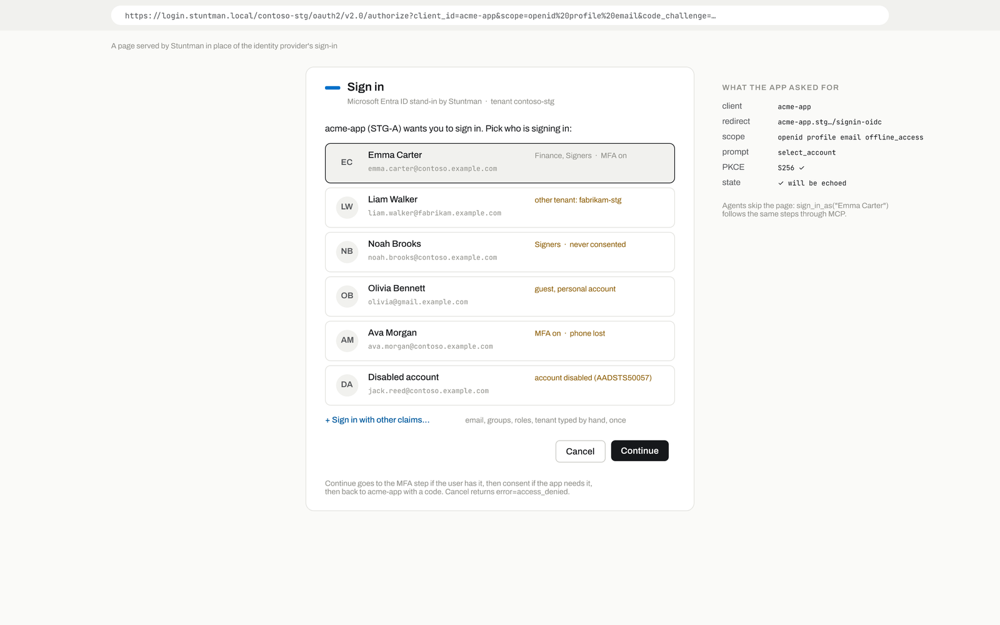

# Identity

Stuntman stands in for an identity provider: Microsoft Entra ID (v2.0) first, with Google, Okta and generic OIDC
as flavours. The app signs people in with OIDC and OAuth2 against Stuntman, and a person, a test or an agent picks
a synthetic user on the sign-in page Stuntman serves. The same provider can also act as a SAML 2.0 identity
provider, an LDAP directory and the Microsoft Teams Bot Framework around a bot. Stuntman keeps the tenant, its
users, the app registrations, the signing keys and every sign-in with its steps, claims and tokens.



## At a glance

| | |
|---|---|
| **Stands in for** | Microsoft Entra ID v2.0 endpoints (OIDC discovery, JWKS, authorize, token, logout, userinfo, a small Microsoft Graph subset); flavours `entra-v2`, `google`, `okta`, `oidc`; SAML 2.0 IdP; an LDAP v3 directory shaped like Active Directory; the Bot Framework connector of Microsoft Teams. Tested with plain HTTP clients (code + PKCE), Python `signxml` (verifies the SAML signature), Python `ldap3`, and a Python bot that checks the Bot Connector JWT |
| **Ports** | main port `8025` (`STUNTMAN_PORT`) for OIDC, OAuth2, SAML, Graph and Bot Framework; `8445` (`STUNTMAN_HTTPS_PORT`, Test CA) for the same over TLS; `3389` (`STUNTMAN_LDAP_PORT`) for LDAP, plain TCP only |
| **Point your app at** | Authority `http://localhost:8025/login/<tenant>` (issuer `…/login/<tenant>/v2.0`); over TLS `https://localhost:8445/login/<tenant>`; SAML metadata `…/login/<tenant>/saml/metadata`; LDAP `ldap://localhost:3389`, base DN from the tenant; Bot Framework OpenID metadata `http://localhost:8025/botframework/v1/.well-known/openidconfiguration` |
| **It keeps** | `identity/<provider>.yaml` (tenant, flavour, users, apps, lifetimes, the provider's provocations, protocol switches); in the database: signing keys, login pages waiting, codes, refresh tokens, sign-ins, bot activities |
| **You can provoke** | MFA asked or failing, consent asked, the person cancels, wrong tenant, tokens already expired, bad signatures, SAML audience wrong, the IdP down (`provoke_sign_in`); discovery 500 / slow / wrong issuer, JWKS unavailable / kid missing / wrong key, token endpoint 500 / slow / `invalid_grant` (`provoke_idp`); key rotation (`rotate_signing_key`); disabled, locked and other-tenant users; LDAP busy / unavailable / timeout (`set_provider ldap_provoke`); bad Bot Connector tokens (`send_bot_activity twist`) |
| **Screen** | `/identity` (sign-ins), `/identity/users`, `/identity/apps`, `/identity/tenant`, `/identity/protocols`, `/oauth-clients` |
| **Tools** | `set_provider`, `set_user`, `set_app`, `sign_in_as`, `list_sign_ins`, `get_sign_in`, `pending_logins`, `provoke_sign_in`, `provoke_idp`, `rotate_signing_key`, `get_tenant`, `set_tenant`, `send_bot_activity`, `list_bot_messages`, `run_client_checks` |

## Connect your app

### Create a provider first

Nothing answers until a provider exists. Every tool is also an HTTP route under `/api` (or `/e/<env>/api`).

```text
set_provider {"name": "entra", "tenant": "contoso-stg", "flavour": "entra-v2", "other_tenants": ["fabrikam-stg"]}
set_user     {"provider": "entra", "user": "emma.carter", "name": "Emma Carter", "email": "emma.carter@contoso.example.com", "groups": ["Finance", "Signers"], "roles": ["Approver"], "mfa": true}
set_app      {"provider": "entra", "app": "acme-app", "type": "web", "redirect_uris": ["http://localhost:5173/signin-oidc"], "optional_claims": ["groups"]}
```

Over HTTP: `PUT /api/identity/providers/entra`, `PUT /api/identity/entra/users/emma.carter`,
`PUT /api/identity/entra/apps/acme-app`.

`set_provider` returns `authority` (the issuer). Provider names and tenants are lowercase letters, digits and
dashes, starting with a letter, at most 32 characters. Without `tenant`, the tenant is `<name>-tenant`.
`tenant_id` (the `tid` claim) is a stable GUID derived from the tenant.

### The Authority and the endpoints

All provider routes live under `/login/<tenant>` on the main port. `<tenant>` may be the tenant, the tenant id
GUID or the provider name. `common`, `organizations`, `consumers` and `botframework.com` go to the first provider
(sorted by name). An unknown tenant gets `400 {"error": "invalid_tenant", "error_description": "AADSTS90002: …"}`.

| What | URL |
|---|---|
| Authority (set this in the app) | `<base>/login/<tenant>` |
| Issuer | `<base>/login/<tenant>/v2.0` |
| Discovery | `<base>/login/<tenant>/v2.0/.well-known/openid-configuration` (also without `/v2.0`) |
| JWKS | `<base>/login/<tenant>/discovery/v2.0/keys` (also `/discovery/keys`) |
| Authorize | `<base>/login/<tenant>/oauth2/v2.0/authorize` |
| Token | `<base>/login/<tenant>/oauth2/v2.0/token` |
| Logout | `<base>/login/<tenant>/oauth2/v2.0/logout` |
| Userinfo | `<base>/login/<tenant>/oidc/userinfo` |
| Graph subset | `<base>/login/<tenant>/v1.0/me`, `/v1.0/users/{id}`, `/v1.0/users/{id}/memberOf`, `POST /v1.0/users/{id}/getMemberObjects` |

`<base>` is, in order: the environment's `public_url`; else `STUNTMAN_PUBLIC_URL/e/<env>`; else the address the
call came by (`X-Forwarded-Proto` / `X-Forwarded-Host`, then `Host`, plus `/e/<env>` when the call used the
prefix); else `http://localhost:8025[/e/<env>]`. The issuer in discovery and in tokens follows the same rule. When
the browser and the app's backend reach Stuntman by different addresses, set `public_url` so both see one issuer
(see [Environments › A shared Stuntman](../environments.md#a-shared-stuntman-one-public-address)).

The Graph subset hangs off the Authority (`<base>/login/<tenant>/v1.0/…`), not off `graph.microsoft.com`. Point
the app's Graph base URL there.

### Generic OIDC settings

```env
OIDC_ISSUER=http://localhost:8025/login/contoso-stg/v2.0
OIDC_CLIENT_ID=acme-app
OIDC_CLIENT_SECRET=<secret>
```

The client secret: a new app of type `web` or `daemon` without `secret` gets a synthetic one, written to the
environment's `secrets.yaml` as `<client_id>-client-secret` (value `demo-…`), and the app's `secret` becomes
`secret://<client_id>-client-secret`. Read it with the Secrets tools, or set your own with `set_app secret`
(a literal or `secret://name`). `any_secret: true` accepts any secret, or none.

### Browser apps (MSAL, single-page apps)

- MSAL takes only an `https` authority. Use `https://localhost:8445/login/<tenant>` and trust the
  [Test CA](../configuration.md#the-stuntman-test-ca) in the browser and OS store.
- Register the app with `type: "spa"`. A `spa` app sends no secret and must use PKCE.
- Discovery, JWKS and userinfo answer `Access-Control-Allow-Origin: *`. The token endpoint answers CORS only for a
  `spa` app and only from the origin (scheme, host, port) of one of its redirect URIs. Any other request that
  carries an `Origin` header gets `AADSTS9002326`, as Entra does.

### Docker and environments

| App runs | Authority |
|---|---|
| On the host | `http://localhost:8025/login/<tenant>` |
| In a container, Stuntman on the host | `http://host.docker.internal:8025/login/<tenant>` |
| In the same compose project | `http://stuntman:8025/login/<tenant>` (service name) |
| Another environment | `http://localhost:8025/e/<env>/login/<tenant>` (or the environment's host name) |

The issuer names the address the call came by, so a backend that reads discovery at `http://stuntman:8025`
expects `iss = http://stuntman:8025/login/<tenant>/v2.0`. The tokens it redeems carry that issuer too. When the
browser uses `localhost` and the backend uses the service name, set `public_url`.

LDAP has no host name or path to pick an environment: port `3389` always serves the default environment
(`STUNTMAN_ENV`).

## What it supports

### Providers and flavours

| Flavour | Label | What changes |
|---|---|---|
| `entra-v2` (default) | Microsoft Entra ID v2.0 | id token has `ver`, `oid`, `tid`, `preferred_username` (UPN), `amr`, `roles`; `idp` for guests; groups when the app has `optional_claims` or for overage |
| `google` | Google | id token has `email_verified: true`, `hd` (the email domain), `azp`; no groups, no roles |
| `okta` | Okta | id token has `preferred_username`, `auth_time`, `groups` always |
| `oidc` | Any OIDC provider | same claims as `okta` |

Only the id token claims change with the flavour. Discovery, the endpoint paths, the error codes (`AADSTS…`) and
the access token stay Entra-shaped for every flavour.

### Discovery document

`issuer`, `authorization_endpoint`, `token_endpoint`, `jwks_uri`, `end_session_endpoint`, `userinfo_endpoint`,
`response_types_supported` (`code`, `id_token`, `code id_token`, `id_token token`), `response_modes_supported`
(`query`, `fragment`, `form_post`), `subject_types_supported` (`pairwise`), `id_token_signing_alg_values_supported`
(`RS256`), `scopes_supported` (`openid profile email offline_access`), `token_endpoint_auth_methods_supported`
(`client_secret_post`, `client_secret_basic`), `code_challenge_methods_supported` (`S256`, `plain`),
`grant_types_supported` (`authorization_code`, `refresh_token`, `client_credentials`), `tenant_region_scope: NA`,
`cloud_instance_name: stuntman.local`, `claims_supported`.

### JWKS and signing keys

| | |
|---|---|
| Algorithm | RS256, 2048-bit RSA |
| Keys published | two: `current` (signs) and `next` (published ahead of rotation). Each JWK has `kid`, `use: sig`, `alg: RS256`, `issuer` |
| `kid` | 8 hex characters, made on first use |
| Rotation | `rotate_signing_key`: next becomes current, a new next is made. A JWKS cached once already holds the new current key; after a second rotation it does not |

### Authorize endpoint

`GET /login/<tenant>/oauth2/v2.0/authorize`

| Parameter | Behaviour |
|---|---|
| `client_id` | must name an app (client id, name, or `app_id_uri`); else error page `AADSTS700016` |
| `redirect_uri` | exact match against the app's `redirect_uris`; else error page `AADSTS50011` (and a refused sign-in is logged). Empty: the app's first redirect URI |
| `response_type` | default `code`. Contains `code` → a code comes back; contains `id_token` → an id token comes back on the redirect. `token` adds nothing |
| `response_mode` | `query`, `fragment`, `form_post` (an auto-submitting HTML form to the redirect URI). Empty: `fragment` when `response_type` contains `id_token`, else `query` |
| `scope` | kept for consent and for the tokens. `offline_access` gives a refresh token |
| `state` | echoed back, also on errors |
| `nonce` | copied into the id token |
| `code_challenge`, `code_challenge_method` | `S256` (default when a challenge is sent) or `plain`; checked at the token endpoint |
| `prompt` | `consent` forces the consent page; other values are ignored |
| `login_hint` | pre-selects the user with that email on the page |
| anything else | ignored |

The page then waits for a person (or `sign_in_as`). Steps, in order:

1. **Pick.** Choose a user, or open "Sign in with other claims…" and type email, name, groups, roles and tenant
   for one sign-in (nothing is saved as a user). Cancel returns `error=access_denied`.
2. **MFA**, when the user has `mfa: true` or `provoke_sign_in` says `mfa_required` / `mfa_fails`. Any 6 digits pass
   except `000000`. `sign_in_as` sends `482913` unless you pass `mfa_code`.
3. **Admin approval**, when the scopes name an API registered in this provider (`api://…/scope`) that has no admin
   consent. The page blocks; `grant_admin_consent` lifts it.
4. **Consent**, when the user has not consented to the app yet (and not every scope has admin consent), when
   `prompt=consent`, or with `provoke_sign_in consent_required`. Accepting is remembered per user and app until
   `revoke_consent`.
5. **Back to the app** with `code` (format `1.<random>`), `id_token` if asked, and `state`.

The page posts its form to the same authorize URL (`POST /login/<tenant>/oauth2/v2.0/authorize`, field `pending`
plus `do=pick|mfa|consent|cancel`). A waiting page lives 30 minutes; after that, or once completed, it answers
`AADSTS50058`.

### Token endpoint

`POST /login/<tenant>/oauth2/v2.0/token`, form-encoded. Client authentication: `client_id` + `client_secret` in the
body, or HTTP Basic. Answers carry `Cache-Control: no-store`.

| Grant | Behaviour |
|---|---|
| `authorization_code` | needs `code`; `redirect_uri` must equal the one used (when sent); `code_verifier` must match the challenge (when one was sent). Returns `token_type`, `scope` (without `openid` and `offline_access`), `expires_in`, `ext_expires_in`, `access_token`, `id_token`, and `refresh_token` when the scope had `offline_access`. A code is single use and lives 10 minutes |
| `refresh_token` | rotates on use: returns a new refresh token, the old one is refused after. Lives `refresh_lifetime` (default 24 h) from issue. Returns new access and id tokens (no nonce, `amr: ["pwd"]`) |
| `client_credentials` | `scope` like `api://acme-api/.default` (a scope without `/.default` gets it appended). Access token: `aud` = the API's `app_id_uri` (else the Graph id `00000003-0000-0000-c000-000000000000`), `roles` = the last path segment of each `admin_consent` scope, `idtyp: app`. Any registered app can use it |
| `password` (ROPC) | only when the provider has `password_grant: true`; `username` (id, name, email or oid) and `password`. Returns access and id tokens, plus a refresh token with `offline_access`. Default scope `openid profile` |
| anything else | `400 unsupported_grant_type`, `AADSTS70003` |

Client checks, before the grant: a `spa` app or an app with `any_secret` needs no secret. Otherwise the secret must
be sent (`AADSTS7000218`), not expired (`AADSTS7000222`, see below) and equal to the stored value
(`AADSTS7000215`).

### Tokens

All tokens are JWTs signed RS256 with the current key (`kid` in the header, `typ: JWT`).

| Token | Claims |
|---|---|
| id token | `iss`, `aud` (client id), `iat`, `nbf`, `exp`, `sub` (the user's `oid`), `name`, `email`, `nonce`; then the flavour's claims (table above); then every key of the user's `extra` |
| access token (user) | `iss`, `aud` (the `app_id_uri` of the API the scopes name, else the Graph id), `iat`, `nbf`, `exp`, `azp`, `tid`, `ver: 2.0`, `sub`, `oid`, `name`, `preferred_username`, `scp` (API scopes without the `api://…/` prefix; for Graph: the non-OIDC scopes plus `openid profile email`), `roles` |
| access token (app) | the above without the user claims; `sub` and `oid` = a GUID derived from the client id, `roles`, `idtyp: app` |

Lifetimes: `id_lifetime` and `access_lifetime` default to `60m`, `refresh_lifetime` to `24h`. `clock_skew` moves
`iat`, `nbf` and `exp` forward by that amount (positive values only).

**Groups.** Entra: `groups` is in the id token when the app has any `optional_claims` entry. With more than 200
groups (`set_user groups: 210` makes `Group 001…Group 210`) the token carries `_claim_names: {"groups": "src1"}` and
`_claim_sources.src1.endpoint = <authority>/v1.0/users/<oid>/getMemberObjects` instead, as Entra does. Okta and
OIDC always put `groups` in the id token.

**Guests** (`guest: true`): `preferred_username` is `<email with @ as _>#EXT#@<tenant>.example.com`, and the id
token gets `idp: live.com`.

### Userinfo, Graph and logout

| Route | Answer |
|---|---|
| `GET /oidc/userinfo` | `sub`, `name`, `email`, `given_name`, `family_name` of the user the bearer token names |
| `GET /v1.0/me` | `id`, `displayName`, `mail`, `userPrincipalName`, `accountEnabled` |
| `GET /v1.0/users/{oid or email}` | same shape; `404 Request_ResourceNotFound` if unknown |
| `GET /v1.0/users/{id}/memberOf`, `POST …/getMemberObjects` | `{"value": [{"@odata.type": "#microsoft.graph.group", "id": <GUID>, "displayName": <group>}]}` |
| `GET /oauth2/v2.0/logout` | redirects to `post_logout_redirect_uri` with `state`; without it, a plain "You signed out" page |

The bearer token is decoded, not verified: Stuntman reads `oid` (or `sub`) and finds the user. A missing token or an
unknown user gets `401 InvalidAuthenticationToken`.

### Users

`set_user` fields: `name`, `email` (synthetic domains only, see below), `tenant` (home tenant), `guest`, `groups` (a
list, a comma string, or a number), `roles`, `mfa`, `phone_lost` (every MFA code fails), `enabled`, `password` (for
LDAP and ROPC; `secret://name` or a literal; empty means any password but `wrong`), `locked`, `extra` (more claims,
e.g. `{"employeeId": "E-10442"}`). The user id is lowercased with spaces turned into dots. `oid` is a stable GUID
from tenant and id.

Email domains allowed: `example.com`, `example.org`, `example.net`, anything under `.example.com`, `.example`,
`.test`, `.localhost`, `.invalid`, `ejemplo.com`, plus the domains in the environment's `allowed_email_domains` (and
their subdomains). Anything else: `Synthetic people only: …`.

### Apps

`set_app` fields: `name`, `type` (`web` secret, `spa` PKCE without secret, `daemon` client credentials, `api`
exposes scopes), `redirect_uris` (exact match), `secret`, `any_secret`, `permissions` (default
`openid profile email offline_access`; `sign_in_as` uses them as the scope when it starts a page), `optional_claims`,
`exposes`, `app_id_uri` (an `api` app gets `api://<client_id>` by default), `multi_tenant` (users of other tenants may
sign in). `grant_admin_consent` adds `scopes` (default: the app's `api://` permissions) to `admin_consent`.

### SAML 2.0 identity provider

Turn on with `set_provider {"name": "acme", "saml": true}`. The answer has `saml.metadata`, `saml.sso` and
`saml.entityId`.

| | |
|---|---|
| Entity ID | `<base>/login/<tenant>/saml` |
| Metadata | `GET <base>/login/<tenant>/saml/metadata`, `Content-Type: application/samlmetadata+xml`: `IDPSSODescriptor` with `WantAuthnRequestsSigned="false"`, the signing certificate, NameID formats `emailAddress` and `persistent`, SSO for HTTP-Redirect and HTTP-POST |
| SSO | `GET <base>/login/<tenant>/saml/sso?SAMLRequest=…&RelayState=…` (deflated + base64) or `POST` the same fields form-encoded (base64, not deflated) |
| Service provider | an app registration whose client id is the SP entity ID (the AuthnRequest `Issuer`), with its ACS URLs as `redirect_uris`. The ACS URL in the request must match one exactly (`AADSTS50011`); without one, the first is used |
| Sign-in | the same page as OIDC (pick, MFA, consent does not apply: the scope is empty) |
| Answer | an auto-submitting form that posts `SAMLResponse` (base64) and `RelayState` to the ACS |
| Signing | RSA-SHA256, exclusive c14n, with the provider's current OIDC key. The certificate is issued by the Test CA (10 years) and kept per key, so it changes after `rotate_signing_key`. The assertion is signed by default (`saml_sign_assertion`); `saml_sign_response: true` also signs the response |
| NameID | `saml_name_id`: `email` (default, format `emailAddress`), `oid` (format `persistent`), `upn` (the email, format `unspecified`) |
| Assertion | `InResponseTo` = the request `ID`; `Conditions` from 1 minute ago to 1 hour ahead; `Audience` = the SP entity ID; `SubjectConfirmation` bearer with `Recipient` = ACS; `AuthnContextClassRef` `PasswordProtectedTransport` |
| Attributes | `…/claims/emailaddress`, `…/claims/name` (the email), `…/identity/claims/displayname`, `…/claims/givenname`, `…/claims/surname`, `…/identity/claims/objectidentifier`, `…/identity/claims/tenantid`, and when set `…/2008/06/identity/claims/groups` and `…/2008/06/identity/claims/role` |

### LDAP directory

Turn on with `set_provider {"name": "acme", "ldap": true}`. The answer has `ldap.url`, `ldap.baseDn` and
`ldap.bindDn` (`uid=<user>,ou=people,<base DN>`).

| | |
|---|---|
| Base DN | `ldap_base_dn`, else from the tenant: split on `.` and `-` → `acme-stg` becomes `dc=acme,dc=stg` |
| Entries | the base (`domain`), `ou=people`, `ou=groups`, one `uid=<id>,ou=people,…` per user, one `cn=<group>,ou=groups,…` per group a user has |
| User attributes | `objectClass` (`top person organizationalPerson inetOrgPerson user`), `uid`, `cn`, `displayName`, `givenName`, `sn`, `mail`, `userPrincipalName`, `sAMAccountName` (the id), `entryUUID` (the oid), `userAccountControl` (`512` enabled, `514` disabled), `memberOf`, and every `extra` key |
| Group attributes | `objectClass` (`top groupOfNames group`), `cn`, `member` |
| Simple bind | the DN may be a full DN (its first RDN value matched against id, name or email), `user@domain`, `DOMAIN\user`, or the plain id. Anonymous bind (empty DN and password) succeeds |
| Search | scopes base, one level, subtree; filters `and`, `or`, `not`, present, equality, approx (as equality), substring, `>=`, `<=` (string compare, case-insensitive). Extensible match never matches. Requested attributes honoured (`*` or none = all). Search needs no bind |
| Root DSE | base `""`, scope base: `namingContexts` (every LDAP provider), `defaultNamingContext`, `supportedLDAPVersion: 3`, `vendorName: Stuntman` |
| Compare | true / false; unknown entry → `noSuchObject` |
| Who am I | `dn: <bound DN>`, or empty |
| Which provider | the one whose base DN ends the DN or search base; else the first LDAP provider |

### Password grant (ROPC)

`set_provider {"name": "acme", "password_grant": true}`. See the token endpoint table.

### Bot Framework (Microsoft Teams)

Always on; it needs no provider of its own.

| Route | |
|---|---|
| `GET /botframework/v1/.well-known/openidconfiguration` | `issuer: https://api.botframework.com`, `jwks_uri`, `id_token_signing_alg_values_supported: [RS256]` |
| `GET /botframework/v1/.well-known/keys` | one RSA key, `kid: stuntman-bf`, `use: sig`, `endorsements: ["msteams"]` |
| `POST /botframework/connector/v3/conversations` | creates a conversation: `201 {"id": "a:…", "activityId": …}`; keeps `activity` if sent |
| `POST /botframework/connector/v3/conversations/{id}/activities` | the bot sends a message: `201 {"id": …}`, kept |
| `POST` or `PUT …/conversations/{id}/activities/{activityId}` | reply to or update an activity: kept the same way |
| `GET …/conversations/{id}/members` | one synthetic member `29:stuntman-user` |

`send_bot_activity` posts an activity to the bot's messaging endpoint, as Teams does. Arguments: `endpoint`,
`bot_app_id` (required), `text` (a message), `value` (a card action), `activity` (the whole activity),
`conversation`, `from`, `from_name`, `tenant_id`, `service_url`, `twist`. Missing activity fields are filled:
`type: message`, `id`, `timestamp`, `serviceUrl`, `channelId: msteams`, `from` (with `aadObjectId`),
`conversation` (`conversationType: personal`), `recipient: 28:<bot>`. The `Authorization: Bearer` JWT has
`iss: https://api.botframework.com`, `aud` = the bot app id, `serviceurl` = the activity's `serviceUrl`, `nbf` and
`iat` 5 minutes ago, `exp` in 1 hour. The tool returns the bot's `status`, `body` and `ms`.

The bot's own token: `POST /login/botframework.com/oauth2/v2.0/token` with `grant_type=client_credentials`. The
tenant `botframework.com` goes to the first provider, so register the bot app (client id = bot app id) there, e.g.
`type: daemon` with `any_secret: true`.

### OAuth clients (Stuntman as the client)

The other direction: Stuntman acts as an MCP client against the app's own authorization server and MCP server, and
runs ten checks of the MCP authorization spec in order.

1. Protected resource metadata (the 401's `WWW-Authenticate resource_metadata`, else the well-known path).
2. Authorization server metadata (RFC 8414 paths, then OIDC discovery).
3. Client registration: `dcr` (posts to `registration_endpoint`), `metadata_url` (the client id is a URL Stuntman
   serves), or `preregistered` (`client_id` / `client_secret`).
4. A request without `code_challenge` is refused.
5. The loopback redirect `http://127.0.0.1:<STUNTMAN_PORT>[/e/<env>]/oauth-clients/callback` is accepted.
6. The person signs in on the app's own page (open `authorizeUrl`).
7. Token exchange with the verifier and `resource`.
8. The access token's `aud` is the MCP resource (only when the token is a JWT).
9. `initialize` and `tools/list` with the token.
10. Refresh rotation: the old refresh token is refused after use (retried once after 35 seconds of reuse leeway).

Two clients exist from the start: `mcp-dcr` (kind `dcr`) and `mcp-client` (kind `metadata_url`). Their metadata
document is at `http://localhost:<STUNTMAN_PORT>[/e/<env>]/oauth-clients/<id>.json`. Clients are kept in
`identity/oauth-clients.yaml`.

## How it behaves

- **The sign-in page is the provider.** There is no SSO session: every authorize shows the page again. The page is
  the same for a person and for `sign_in_as`, so both run the same steps.
- **The person picked is a situation.** The page tags each user: groups, `MFA on`, `account disabled`, `other
  tenant`, `guest`, `phone lost`, `never consented`.
- **Other tenant.** A user whose `tenant` differs from the provider's (not a guest), signing in to an app that is not
  `multi_tenant`, gets the error page `AADSTS50020` with a "Back to the app" link that carries
  `error=access_denied`.
- **Disabled user.** `enabled: false` (or `set_user_state`) stops the sign-in at the page (`AADSTS50057`), refuses
  refresh tokens, and drops the user's refresh tokens at once.
- **MFA lockout.** Three wrong codes on one page: `AADSTS50076` and the user is locked for 5 minutes; a new sign-in
  in that time gets `AADSTS50053`.
- **Consent.** Remembered per user and app. `revoke_consent` removes it and stops that app's refresh tokens; the next
  refresh gets `AADSTS65001` (or `AADSTS70043` when the token was already stopped).
- **Codes.** Single use, 10 minutes. Refresh tokens rotate on every use.
- **Real time.** Token times (`iat`, `exp`), code and refresh lifetimes and the MFA lockout use real time, not the
  [environment clock](../clock.md). Use `provoke_sign_in expired` or `clock_skew` to test time.
- **Writes are serialised.** Changes to one provider file are read-modify-write under one lock, so a rotation and a
  provocation sent at the same moment both stay (tested).
- **Persistence.** Providers live in `identity/<name>.yaml` (hand-editable; keys are made on first use if missing).
  Keys, codes, refresh tokens, sign-ins and bot activities live in the environment's database and survive restarts.
- **Error bodies.** Token errors are JSON: `error`, `error_description` (`AADSTSxxxx: message`), `error_codes`,
  `timestamp` (Unix seconds), `trace_id`, `correlation_id`. Authorize errors are an HTML error page with the code,
  status `400` (`503` for `AADSTS90033`).
- **LDAP answers as Active Directory.** Refused binds return result `49` (invalidCredentials) with the message
  `80090308: LdapErr: DSID-0C09044E, comment: AcceptSecurityContext error, data <code>, v4563`.

### Error codes

| Code | When |
|---|---|
| `AADSTS90002` | unknown tenant in the URL (`invalid_tenant`) |
| `AADSTS700016` | unknown `client_id` (authorize page, or `unauthorized_client` at the token endpoint) |
| `AADSTS50011` | redirect URI / ACS URL not registered |
| `AADSTS50034` | user not found |
| `AADSTS50020` | user from another tenant |
| `AADSTS50057` | user disabled |
| `AADSTS50053` | locked (MFA lockout; `locked` user on ROPC) |
| `AADSTS50076` | three wrong MFA codes; MFA user on ROPC (`interaction_required`) |
| `AADSTS50058` | the sign-in page expired or was already completed |
| `AADSTS90033` | `idp_down`, or token endpoint `500` |
| `AADSTS7000218` | no client secret sent (`invalid_client`, 401) |
| `AADSTS7000215` | wrong client secret (`invalid_client`, 401) |
| `AADSTS7000222` | client secret expired (`invalid_client`, 401) |
| `AADSTS9002313` | code or refresh token not issued here |
| `AADSTS54005` | code already redeemed |
| `AADSTS70008` | code older than 10 minutes |
| `AADSTS700005` | code or refresh token issued to another app |
| `AADSTS50148` | `redirect_uri` differs from the one used for the code |
| `AADSTS501481` | `code_verifier` does not match |
| `AADSTS70043` | refresh token already used |
| `AADSTS700082` | refresh token older than its lifetime |
| `AADSTS65001` | consent revoked (refresh) |
| `AADSTS50126` | wrong password (ROPC) |
| `AADSTS70000` | `provoke_idp token invalid_grant` |
| `AADSTS70003` | unsupported grant type |
| `AADSTS9002326` | cross-origin token request from a non-`spa` app or a wrong origin |

## Provoke failures

| Failure | How | What the app sees | Turn off |
|---|---|---|---|
| MFA asked | `provoke_sign_in {"answer": "mfa_required"}` | the MFA page for every user; `amr: ["pwd", "mfa"]` | `{"answer": "normal"}` |
| MFA fails | `provoke_sign_in {"answer": "mfa_fails"}`, or a user with `phone_lost: true` | every code refused; after 3, `AADSTS50076` and a 5-minute lock | `normal` / `phone_lost: false` |
| Consent asked | `provoke_sign_in {"answer": "consent_required"}`, or `prompt=consent`, or `revoke_consent` | the consent page | `normal` |
| Person cancels | `provoke_sign_in {"answer": "user_cancels"}`, or `cancel_login {"id": …}` | `error=access_denied` on the redirect URI; SAML: `Responder` / `RequestDenied` status | `normal` |
| Wrong tenant | `provoke_sign_in {"answer": "wrong_tenant"}`, or a user with another `tenant` | `AADSTS50020` page, back link with `error=access_denied` | `normal` |
| Tokens already expired | `provoke_sign_in {"answer": "expired"}` | `exp` 5 minutes in the past (`iat`/`nbf` one lifetime before); SAML: validity window ended 1 hour ago | `normal` |
| Bad signature | `provoke_sign_in {"answer": "bad_signature"}` | tokens signed by a throwaway key with the current `kid`; SAML signature does not verify | `normal` |
| SAML wrong audience | `provoke_sign_in {"answer": "wrong_audience"}` | `Audience` = `urn:someone-else` | `normal` |
| IdP down | `provoke_sign_in {"answer": "idp_down"}` | authorize answers `503` with `AADSTS90033` | `normal` |
| Discovery fails | `provoke_idp {"part": "discovery", "answer": "500"}` / `"slow"` (10 s) / `"wrong_issuer"` (issuer names the first other tenant, else `fabrikam-stg`) | 500, a 10-second wait, or an issuer mismatch | `{"answer": "normal"}` |
| JWKS fails | `provoke_idp {"part": "jwks", "answer": "unavailable"}` (503) / `"kid_missing"` (only the next key) / `"wrong_key"` (right `kid`s, wrong modulus) | key fetch fails or no signature verifies | `normal` |
| Token endpoint fails | `provoke_idp {"part": "token", "answer": "500"}` / `"slow"` (10 s) / `"invalid_grant"` | `500 server_error AADSTS90033`, a wait, or `400 invalid_grant AADSTS70000` | `normal` |
| Key rotation | `rotate_signing_key {}` | new tokens carry the next `kid`; a JWKS cached before two rotations rejects them | rotate again; nothing to undo |
| Disabled user | `set_user_state {"user": "jack.reed", "enabled": false}` | `AADSTS50057`; refresh refused | `enabled: true` |
| Locked user (ROPC, LDAP) | `set_user {"user": "carl", "locked": true}` | ROPC `AADSTS50053`; LDAP bind `49 … data 775` | `locked: false` |
| Groups overage | `set_user {"user": "emma.carter", "groups": 210}` | `_claim_names` / `_claim_sources` instead of `groups` (Entra) | set fewer groups |
| Clock skew | `set_tenant {"clock_skew": "10m"}` | `iat`, `nbf`, `exp` 10 minutes ahead | `clock_skew: "0s"` |
| Short lifetimes | `set_tenant {"access_lifetime": "1m", "refresh_lifetime": "5m"}` | short `expires_in`; refresh `AADSTS700082` | set them back |
| Client secret expired | a Key Vault secret named like the app's `secret://name`, with `exp` in the past | `401 invalid_client AADSTS7000222` | change `exp` |
| LDAP busy / unavailable | `set_provider {"name": "acme", "ldap_provoke": "busy"}` / `"unavailable"` | bind and search answer `51` / `52`; other operations close the connection | `ldap_provoke: "normal"` |
| LDAP timeout | `set_provider {"name": "acme", "ldap_provoke": "timeout"}` | the server reads the first request, then says nothing for 10 minutes and closes | `normal` |
| Bot Connector token bad | `send_bot_activity {…, "twist": "bad_signature"}` / `"expired"` (`exp` 1 minute ago) / `"wrong_audience"` (all-zero GUID) / `"no_token"` | the bot should answer 401 | omit `twist` |

`provoke_sign_in` takes `count` (the next N sign-ins) and `for` (`10m`, `1h`); with neither, it lasts until
`normal`. A sign-in uses one count when the user is picked. `provoke_idp` takes `for` and returns to `normal` when
it ends. `provoke_idp` is saved in the provider file; `provoke_sign_in` lives in the database.

## See what the app did

| Need | Use |
|---|---|
| All sign-ins, newest first | `list_sign_ins {"provider": "entra", "user": "emma.carter", "result": "failed", "since": "1h", "limit": 200}` (`GET /api/identity/sign-ins`). `result`: `ok`, `failed`, or an exact result or code (`AADSTS50020`) |
| One sign-in with tokens decoded | `get_sign_in {"id": 42}` (`GET /api/identity/sign-ins/{id}`) |
| Pages waiting for a person | `pending_logins {"provider": "entra"}`: id, `client_id`, `redirect_uri`, `scope`, `step`, `at` |
| Bot traffic | `list_bot_messages {"conversation": "a:…"}`: `dir` (`to bot` / `from bot`), `activity`, `status`, `bot`, `at` |
| Provider state | `get_tenant` (issuer, discovery, JWKS URL, keys with `currentSince` and `rotatedAt`, lifetimes, provocations, the YAML, SAML / LDAP / Bot Framework URLs), `list_users`, `list_apps` (with `consentedBy`, `secretSet`) |
| Client check runs | `get_run {"run_id": "run_…"}`, `list_oauth_clients` |

A sign-in row has `id`, `at`, `provider`, `user`, `app`, `kind` (`sign-in`, `refresh`, `client-credentials`,
`password`, `ldap`), `result` (`signed in`, `refused`, `cancelled`, `refreshed`, `issued`, or `signed in · …
(provoked)`), `code` (empty on success), `sentence` (e.g. "Emma Carter signed in to acme-app with MFA"), `flow`
(e.g. `OIDC authorization code + PKCE · scope …`), `steps` (each with `at`, `what`, `detail`), `claims`, `by`
(`you` on the page, or the agent through `sign_in_as`), `pending`. `get_sign_in` adds `tokens` and `decoded`
(header and claims of `id_token` and `access_token`). When the app redeems its code, the same row gets a
`POST /token by <app>` step, the tokens and the access token claims.

Each sign-in is also a row in the [Timeline](../timeline.md) (module `identity`, outcome `ok`, `failed` or
`provoked`), linked to `/identity?provider=<name>&id=<id>`. LDAP binds are logged as sign-ins with `app: ldap`.
Bot activities are not in the Timeline.

## Recipes

### 1. OIDC code flow with PKCE, signed in by an agent

1. `set_provider {"name": "entra", "tenant": "contoso-stg"}`
2. `set_user {"provider": "entra", "user": "noah.brooks", "name": "Noah Brooks", "email": "noah.brooks@contoso.example.com"}`
3. `set_app {"provider": "entra", "app": "acme-app", "type": "web", "redirect_uris": ["http://localhost:5173/signin-oidc"]}`
4. Start the app's sign-in (the browser or the test opens the authorize URL). The page now waits.
5. `sign_in_as {"provider": "entra", "user": "Noah Brooks", "app": "acme-app"}` → `callback` is the app's redirect
   URI with `code` and `state`. Follow it (GET) so the app redeems the code.
6. `list_sign_ins {"provider": "entra", "limit": 1}` → `result: signed in`; `get_sign_in` shows the tokens.

Without a waiting page, `sign_in_as` starts one itself for the app's first redirect URI, with the app's
`permissions` as scope and no PKCE. With `consent: false` it stops at the consent page and says so.

### 2. A user that needs MFA, then consent

1. `set_user {"provider": "entra", "user": "emma.carter", "mfa": true, …}`
2. `sign_in_as {"provider": "entra", "user": "emma.carter", "app": "acme-app"}` answers MFA with `482913` and
   accepts consent. Pass `"mfa_code": "000000"` to see a wrong code (`step: mfa`, "MFA code refused").
3. The id token has `amr: ["pwd", "mfa"]`.

### 3. Make the app survive a key rotation

1. Sign in once; the app caches the JWKS.
2. `rotate_signing_key {"provider": "entra"}` → `{"was": …, "current": …, "next": …}`. New tokens still verify
   against the cached JWKS (the new key was already `next`).
3. `rotate_signing_key` again. Sign in: an app that never refreshes its JWKS now rejects the token; a correct one
   fetches the JWKS again and accepts it.

### 4. Test the refresh path and a revoked session

1. Sign in with `offline_access` in the scope; keep the refresh token.
2. `revoke_consent {"provider": "entra", "user": "emma.carter", "app": "acme-app"}` → `refreshTokensStopped`.
3. The app's next refresh gets `400 invalid_grant` (`AADSTS70043`). The app should send the person to sign in again.
4. Or `set_user_state {"provider": "entra", "user": "emma.carter", "enabled": false}` → `AADSTS50057` on refresh.

### 5. Service-to-service with client credentials

1. `set_app {"provider": "entra", "app": "acme-api", "type": "api", "exposes": ["orders.read"], "app_id_uri": "api://acme-api"}`
2. `set_app {"provider": "entra", "app": "acme-worker", "type": "daemon", "permissions": ["api://acme-api/orders.read"]}`
3. `grant_admin_consent {"provider": "entra", "app": "acme-worker"}`
4. The worker posts `grant_type=client_credentials&client_id=acme-worker&client_secret=<secret>&scope=api://acme-api/.default`.
   The token has `aud: api://acme-api`, `roles: ["orders.read"]`, `idtyp: app`. The secret is in `secrets.yaml`
   as `acme-worker-client-secret`.

### 6. SAML sign-in to a service provider

1. `set_provider {"name": "acme", "tenant": "acme-stg", "saml": true}`
2. `set_app {"provider": "acme", "app": "https://sp.acme.example/saml", "name": "Acme SP", "redirect_uris": ["https://sp.acme.example/saml/acs"], "any_secret": true}`
3. Give the SP the metadata URL `http://localhost:8025/login/acme-stg/saml/metadata`.
4. The SP redirects the browser to `/login/acme-stg/saml/sso?SAMLRequest=…&RelayState=…`.
5. `sign_in_as {"provider": "acme", "user": "ana", "app": "https://sp.acme.example/saml"}` → `callback` (the ACS)
   and `form_post` with `SAMLResponse` and `RelayState`. POST them to the ACS (a browser does this by itself).
6. `provoke_sign_in {"provider": "acme", "answer": "bad_signature", "count": 1}` to check the SP rejects a bad
   signature.

### 7. An app that binds to LDAP

1. `set_provider {"name": "acme", "tenant": "acme-stg", "ldap": true}` → `baseDn: dc=acme,dc=stg`.
2. `set_user {"provider": "acme", "user": "ana", "name": "Ana Lima", "email": "ana@acme.example.com", "groups": ["Finance"], "password": "s3cret"}`
3. The app binds to `ldap://localhost:3389` as `uid=ana,ou=people,dc=acme,dc=stg` (or `ana@acme.example.com`, or
   `ACME\ana`) and searches `(&(objectClass=person)(mail=ana@*))` under `dc=acme,dc=stg`.
4. A wrong password returns `49 … data 52e`. `set_provider {"name": "acme", "ldap_provoke": "unavailable"}` tests
   the outage path.

### 8. A Teams bot

1. `set_app {"provider": "entra", "app": "bot-app-1", "type": "daemon", "any_secret": true}` (in the first provider).
2. Point the bot's Bot Framework OpenID metadata at
   `http://localhost:8025/botframework/v1/.well-known/openidconfiguration`.
3. `send_bot_activity {"endpoint": "http://localhost:5000/api/messages", "bot_app_id": "bot-app-1", "text": "new case"}`
   → the bot's `status`.
4. The bot gets a token from `/login/botframework.com/oauth2/v2.0/token` and replies to the activity's `serviceUrl`.
5. `list_bot_messages {}` shows `to bot` and `from bot` rows. Repeat with `"twist": "expired"`: the bot must
   answer 401.

## Errors and troubleshooting

| Symptom or error text | Cause | Fix |
|---|---|---|
| `AADSTS90002: Tenant '…' not found` | no provider answers for that tenant in this environment | `set_provider`; check the tenant in the Authority and the environment (`/e/<env>`) |
| `No identity provider in <env> yet: create one (set_provider)` | a tool called before any provider exists | `set_provider` |
| `AADSTS50011` on the error page | the redirect URI (or SAML ACS URL) is not registered exactly | `set_app redirect_uris` with the exact URL (scheme, host, port, path) |
| `AADSTS700016` | the app is not registered, or registered in another provider | `set_app` in the provider of that tenant |
| Issuer mismatch (`iss` differs from what the app expects) | the backend and the browser reach Stuntman by different addresses; or `provoke_idp wrong_issuer` is on | set the environment's `public_url`; `provoke_idp … normal` |
| `AADSTS9002326` | a browser redeems the code for a non-`spa` app, or from an origin that is not a redirect URI origin | `set_app type: spa`, add the origin's redirect URI |
| MSAL refuses the authority | MSAL needs `https` | `https://localhost:8445/login/<tenant>` and trust the Test CA |
| `AADSTS7000215` / `AADSTS7000218` | wrong or missing client secret | read `secret://<client_id>-client-secret` from `secrets.yaml`, or `set_app any_secret: true` |
| `AADSTS501481` | the verifier does not match the challenge | send the verifier of the same authorize request |
| `AADSTS54005` / `AADSTS70043` | code or refresh token used twice | use each once; keep the rotated refresh token |
| `Synthetic people only: …` | a real-looking email domain | use `…@contoso.example.com`, or list the domain in `allowed_email_domains` |
| `sign_in_as`: `No login page is waiting and no app to start one` | no pending page and no `web`/`spa` app | open the app's sign-in first, or pass `app` |
| `sign_in_as` answers `step: admin` | the scope names an API without admin consent | `grant_admin_consent` |
| `sign_in_as` answers `step: consent` | `consent: false` was passed | call again with `consent: true`, or `cancel_login` |
| Groups missing from the Entra id token | the app has no `optional_claims` | `set_app optional_claims: ["groups"]`; or the user has more than 200 groups (overage) |
| SAML: `No identity provider with SAML for this tenant` (404) | `saml` is off | `set_provider saml: true` |
| SAML: `SAMLRequest is not deflated` / `not base64` / `expected an AuthnRequest` | wrong binding encoding | deflate + base64 for GET, base64 only for POST |
| SAML signature fails after a rotation | the certificate follows the current key | reload the metadata after `rotate_signing_key` |
| LDAP: `LDAP: port 3389 is taken` in the log | another service owns the port | set `STUNTMAN_LDAP_PORT` |
| LDAP: `data 525` | no user matches the bind DN | check the DN, the id or the email |
| LDAP: searches find nothing in a second environment | LDAP serves only the default environment | use the default environment, or the OIDC routes with `/e/<env>` |
| LDAP connection closes on modify / add / delete | those operations are not served | see Not done |
| Bot: `send_bot_activity` returns `status: 0`, `connection refused` | the bot endpoint is not reachable from Stuntman | in Docker use `host.docker.internal` or the service name |
| Bot cannot fetch the keys or reply, from a container | Bot Framework URLs always name `http://localhost:<STUNTMAN_PORT>` | pass `service_url` with a reachable address; give the bot a reachable OpenID metadata URL |
| Connector `401 Unauthorized` | the bot sent no `Bearer` token (or a very short one) | get a token from the `botframework.com` tenant first |

## Not done

- **No SSO session.** Every authorize shows the page. `prompt=none`, `prompt=login`, `prompt=select_account`,
  `max_age`, `id_token_hint` and `domain_hint` are ignored. Logout only redirects; it revokes nothing.
- **Authorize by POST** from the app is not supported: `POST …/authorize` is the page's own form.
- **`response_type` with `token`** returns no access token on the redirect.
- **Grants:** no device code, on-behalf-of (`jwt-bearer`), token exchange or SAML bearer. No `client_assertion`
  (certificate credentials): send a secret or use `any_secret`.
- **No introspection or revocation endpoints.**
- **Flavours change only the id token.** Discovery, paths, errors and access tokens are Entra-shaped for Google,
  Okta and OIDC too.
- **Userinfo and Graph** decode the bearer token without checking its signature or expiry. The Graph subset is
  `me`, `users/{id}`, `memberOf` and `getMemberObjects`; `getMemberObjects` returns group objects, not a list of
  ids.
- **Client secrets** `secret://name` are read from the environment's `secrets.yaml` only. Key Vault is consulted
  only for the expiry of a secret of the same name.
- **`clock_skew`** takes positive durations only; the tool hint `+10m` is refused (use `10m`). Tokens do not follow
  the environment clock.
- **SAML:** no Single Logout, no encrypted assertions, no IdP-initiated sign-in, no Artifact binding. The
  AuthnRequest signature is not checked; `NameIDPolicy`, `ForceAuthn` and `IsPassive` are ignored. A refused SAML
  sign-in for a disabled or other-tenant user shows the error page instead of posting a SAML error status.
- **LDAP:** plain TCP only (no LDAPS, no StartTLS), simple bind only (no SASL). No modify, add, delete or modify
  DN (the connection closes). No paged results or size limits. Extensible match never matches. Anonymous searches
  are allowed. One environment (the default); `ldap_provoke` of the first LDAP provider applies to the whole port.
- **Bot Framework:** the connector accepts any `Bearer` token longer than 13 characters without checking it. No
  delete activity, no attachment upload, no proactive conversation listing. Its URLs always name
  `http://localhost:<STUNTMAN_PORT>`, never the public address. The bot token from `botframework.com` has the Graph
  audience, not `https://api.botframework.com`.

Missing something? Tell the developer what the fix would be and offer a pull request — see [Contributing](../../CONTRIBUTING.md).

## Tools and routes

<!-- tools: identity -->
_Generated by `tools/gen_tool_reference.py` from the engine source; each tool is an MCP tool and the HTTP route shown (under `/api`)._

| Tool | HTTP | Required | Optional | What it does |
|---|---|---|---|---|
| `list_providers` | `GET /api/identity/providers` | — | — | Identity providers in this environment: flavour, tenant, Authority, users, apps and sign-ins in the last hour. |
| `set_provider` | `PUT /api/identity/providers/{name}` | name | tenant, flavour, other_tenants, saml, saml_sign_response, saml_sign_assertion, saml_name_id, ldap, ldap_base_dn, ldap_provoke, password_grant | Creates an identity provider (or changes its flavour/tenant): entra-v2, google, okta or oidc. Users and apps are added with set_user and set_app. |
| `remove_provider` | `DELETE /api/identity/providers/{name}` | name | — | Removes an identity provider: its file (users, apps, tenant) and its sign-ins, keys and provocations. Apps pointed at its Authority get 404. |
| `list_sign_ins` | `GET /api/identity/sign-ins` | — | provider, user, result, since, limit | Sign-ins and tokens issued: the sentence, the result or error code (AADSTS…), newest first. |
| `get_sign_in` | `GET /api/identity/sign-ins/{id}` | id | — | One sign-in: steps, tokens issued (decoded) and the claims. |
| `sign_in_as` | `POST /api/identity/{provider}/sign-in-as` | user | app, mfa_code, consent, claims, provider | Completes the login page waiting for this app (or starts one) as a user, through MFA and consent; returns the app's callback to follow. |
| `provoke_sign_in` | `POST /api/identity/{provider}/provoke` | answer | count, for, provider | The next sign-ins: mfa_required, mfa_fails, consent_required, user_cancels, wrong_tenant, expired (tokens already expired), bad_signature, idp_down; normal stops it. |
| `pending_logins` | `GET /api/identity/pending` | — | provider | Login pages waiting for a person, with the app and the scopes. |
| `cancel_login` | `POST /api/identity/pending/{id}/cancel` | id | — | The person cancels a waiting login page: the app gets error=access_denied. |
| `list_users` | `GET /api/identity/{provider}/users` | — | provider | Synthetic people of a provider: tenant, groups, roles, MFA, state, consents. |
| `set_user` | `PUT /api/identity/{provider}/users/{user}` | user | name, email, tenant, guest, groups, roles, mfa, phone_lost, enabled, password, locked, extra, provider | Creates or changes a user; the next tokens carry the claims. groups may be a number (210 makes synthetic groups: the overage path). |
| `remove_user` | `DELETE /api/identity/{provider}/users/{user}` | user | provider | Removes a user from the provider (their refresh tokens stop). |
| `revoke_consent` | `DELETE /api/identity/{provider}/users/{user}/consents/{app}` | user, app | provider | The user's consent to an app is revoked: the next sign-in asks again; refresh tokens stop. |
| `set_user_state` | `PUT /api/identity/{provider}/users/{user}/state` | user, enabled | provider | Disables or enables a user: sign-ins stop at the login page (AADSTS50057); refresh tokens are refused. |
| `list_apps` | `GET /api/identity/{provider}/apps` | — | provider | App registrations: client id, type, redirect URIs, credentials, permissions and the tokens each gets. |
| `set_app` | `PUT /api/identity/{provider}/apps/{app}` | app | name, type, redirect_uris, secret, any_secret, permissions, optional_claims, exposes, app_id_uri, multi_tenant, provider | Registers or changes an app: type (web, spa, daemon, api), redirect_uris (exact match), secret (secret://name), any_secret, permissions, optional_claims, multi_tenant. |
| `remove_app` | `DELETE /api/identity/{provider}/apps/{app}` | app | provider | Removes an app registration: its sign-ins and token requests are refused. |
| `grant_admin_consent` | `POST /api/identity/{provider}/apps/{app}/admin-consent` | app | scopes, provider | Grants scopes for everyone, as an administrator would (the login page stops asking). |
| `get_tenant` | `GET /api/identity/{provider}/tenant` | — | provider | Issuer, discovery, flavour, signing keys (current and next), lifetimes, clock skew and the provider's provocations. |
| `set_tenant` | `PUT /api/identity/{provider}/tenant` | — | flavour, id_lifetime, access_lifetime, refresh_lifetime, clock_skew, other_tenants, provider | Changes flavour (entra-v2, google, okta, oidc), lifetimes (id, access, refresh), clock_skew and other tenants. |
| `rotate_signing_key` | `POST /api/identity/{provider}/keys/rotate` | — | provider | The next key becomes current and a new next one is published: apps that cached the JWKS at start-up reject new tokens. |
| `provoke_idp` | `POST /api/identity/{provider}/provoke-idp` | part, answer | for, provider | The provider itself fails: discovery (500, slow, wrong_issuer), jwks (unavailable, kid_missing, wrong_key) or token (invalid_grant, 500, slow); normal stops it. |
| `list_oauth_clients` | `GET /api/oauth-clients` | — | — | Simulated clients (Stuntman as the client of the app's OAuth server) and their last run. |
| `run_client_checks` | `POST /api/oauth-clients/{client}/runs` | client | resource_url | Runs the ten MCP authorization checks against an MCP server; pauses at the app's own sign-in page (open authorizeUrl, or sign in through the app's IdP) and continues when the code comes back. |
| `get_run` | `GET /api/oauth-clients/runs/{run_id}` | run_id | — | One run: each check with what Stuntman sent and got; authorizeUrl while it waits for the sign-in. |
| `serve_client_metadata` | `PUT /api/oauth-clients/{client}` | client | name, kind, resource_url, client_name, client_id, client_secret | Creates or changes a simulated client: kind (dcr, metadata_url, preregistered), the MCP server it checks, the name in its metadata document; client_id/secret when pre-registered. |
| `send_bot_activity` | `POST /api/identity/bot/activities` | endpoint, bot_app_id | text, value, activity, conversation, from, from_name, tenant_id, service_url, twist | Sends the app's bot an activity as Microsoft Teams would: a message (text) or a card action (value), signed by the Bot Connector (JWT with aud = the bot's app id and the serviceurl claim). twist: bad_signature \| expired \| wrong_audience \| no_token. Returns the bot's answer; its replies land in list_bot_messages. |
| `list_bot_messages` | `GET /api/identity/bot/messages` | — | conversation | What went between Teams (Stuntman) and the app's bot: activities sent to the bot and the bot's replies and cards to the connector. |
<!-- /tools -->
