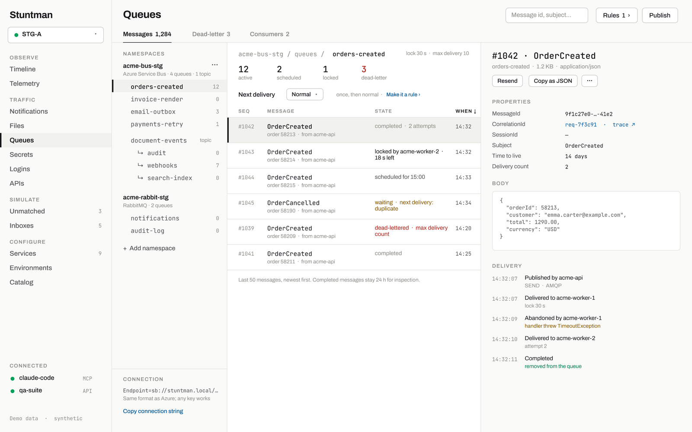

# Azure Service Bus

Stuntman answers Azure Service Bus over AMQP 1.0, the way the official SDKs speak it in emulator mode
(`UseDevelopmentEmulator=true`) or over TLS, plus the Atom/XML management API that `ServiceBusAdministrationClient`
calls. The app sends, receives (peek-lock or receive-and-delete), completes, abandons, defers, dead-letters, schedules,
peeks, renews locks and uses sessions with its normal SDK. Stuntman keeps every namespace as a YAML file, every
message with its full delivery history, and every connection that receives, with the locks it holds.

Service Bus shares one engine, one AMQP port and the same tools with [RabbitMQ](rabbitmq.md): the namespace's kind
(`azure-service-bus` or `rabbitmq`) decides which protocol a namespace speaks. One vocabulary covers both:
**namespace**, **entity** (a queue, a topic, or a subscription `<topic>/subscriptions/<name>`), **message**.



## At a glance

| | |
|---|---|
| **Stands in for** | Azure Service Bus (AMQP 1.0 messaging, `$cbs` SAS tokens, `$management` request/response operations, the Atom XML management REST API). Tested with Python `azure-servicebus` (messaging and `ServiceBusAdministrationClient` over HTTPS) and .NET `Azure.Messaging.ServiceBus` 7.21.0 (`ServiceBusClient` and `ServiceBusAdministrationClient` over HTTP). |
| **Ports** | AMQP `5673` (`STUNTMAN_AMQP_PORT`), AMQPS `5671` (`STUNTMAN_AMQPS_PORT`, a certificate from the Stuntman Test CA for the name the client asks). Management `5300` (`STUNTMAN_SERVICEBUS_MGMT_PORT`): plain HTTP, HTTPS and AMQP on one port, as the official emulator. `5673` and `5671` also answer management HTTP. |
| **Point your app at** | `Endpoint=sb://<namespace>.localhost:5673;SharedAccessKeyName=RootManageSharedAccessKey;SharedAccessKey=<any>;UseDevelopmentEmulator=true`. With `:5300` instead of `:5673`, the same string works for the admin client and the messaging client. |
| **It keeps** | Namespaces (`messaging/<namespace>.yaml`), queues, topics, subscriptions with their filter, every message with its properties, body and history (published, delivered, abandoned, completed, dead-lettered…), scheduled and deferred messages, session state, consumers (connected now and in the last day) with the locks they hold. |
| **You can provoke** | The next message (or every one) on an entity: lost lock, delivered twice, held, dropped, dead-lettered, out of order. Rules on send or receive (by entity, subject, property, session, size, sender, delivery count). Refusals on send: ServerBusy, quota exceeded, entity not found, unauthorized. A throughput limit. A whole namespace that refuses connections, never answers, rejects the key, is busy, or goes down. A consumer forced off. A consumer's locks expired. A missing entity (auto create off). |
| **Screen** | `/queues` (messages), `/queues/subscriptions`, `/queues/dead-letter`, `/queues/consumers`, `/queues/rules`, `/queues/settings` |
| **Tools** | `list_namespaces`, `create_account`, `get_account`, `add_entity`, `add_subscription`, `publish`, `list_queue_messages`, `get_queue_message`, `wait_for_message`, `set_next_delivery`, `create_rule`, `list_consumers`, `disconnect_consumer`, `expire_consumer_locks`, `set_namespace_reachability`, `set_throughput`, `set_auto_create`, `resubmit`, `list_messaging_warnings` |

## Connect your app

### The host name is the namespace

Service Bus finds the namespace by host name: the first DNS label of the host in the connection string is the
namespace, the rest names the environment.

| Host | Namespace and environment |
|---|---|
| `acme-bus.localhost` | namespace `acme-bus`, default environment. `*.localhost` resolves to loopback with no hosts entry. |
| `acme-bus.pr-5462.localhost` | namespace `acme-bus` in environment `pr-5462` |
| `acme-bus.<base domain>` | namespace `acme-bus` in the environment that owns that base domain (see [Environments](../environments.md#how-a-request-finds-its-environment)) |
| `localhost`, or an IP address | the first Service Bus namespace (by name) of the default environment |
| a name with no dot, e.g. `acme-bus` | namespace `acme-bus`, default environment |

A host that names a namespace that does not exist yet creates it (kind `azure-service-bus`), so an app works on day
zero. If the host names an [Event Hubs](eventhubs.md) namespace, the connection is an Event Hubs connection instead.

Make the namespace and its entities first when you want them declared (and visible to the admin client):

```text
create_account   {"service": "azure-service-bus", "account": "acme-bus"}
add_entity       {"namespace": "acme-bus", "entity": "orders", "kind": "queue", "max_delivery": 5, "lock": "1m"}
add_entity       {"namespace": "acme-bus", "entity": "payments", "kind": "queue", "sessions": true}
add_entity       {"namespace": "acme-bus", "entity": "order-events", "kind": "topic"}
add_subscription {"namespace": "acme-bus", "topic": "order-events", "subscription": "billing", "filter": "subject = OrderPaid"}
```

Namespace names: 3 to 50 lowercase letters, numbers or dashes, starting with a letter. Entity names: letters,
numbers, dots, dashes, underscores or colons, at most 260 characters.

`get_account {"service": "azure-service-bus", "account": "acme-bus"}` (or `list_namespaces`) returns `connection`
(the messaging string on `:5673`), `managementConnection` (the same on `:5300`), `managementPort`, the keys (masked),
the settings, the YAML and an `etag`.

### Connection strings

```text
# default environment
Endpoint=sb://acme-bus.localhost:5673;SharedAccessKeyName=RootManageSharedAccessKey;SharedAccessKey=<key>;UseDevelopmentEmulator=true
# environment pr-5462 (no base domain of its own)
Endpoint=sb://acme-bus.pr-5462.localhost:5673;SharedAccessKeyName=RootManageSharedAccessKey;SharedAccessKey=<key>;UseDevelopmentEmulator=true
# admin client and messaging client on one port
Endpoint=sb://acme-bus.localhost:5300;SharedAccessKeyName=RootManageSharedAccessKey;SharedAccessKey=<key>;UseDevelopmentEmulator=true
```

`UseDevelopmentEmulator=true` makes the SDKs speak plain AMQP (no TLS) on the string's port. Without it the SDKs use
AMQPS: Stuntman answers on `5671` with a certificate for the host the client asks, signed by the
[Stuntman Test CA](../configuration.md#the-stuntman-test-ca). Trust the CA in the app's runtime.

### Keys

By default the namespace accepts any key: any `SharedAccessKey`, any SAS token. A new namespace gets one policy,
`RootManageSharedAccessKey`, with a random 32-byte key (base64) stored in the environment's `secrets.yaml` as
`messaging.<namespace>.RootManageSharedAccessKey`. To check keys, turn "Accept any key" off:

```text
update_account {"service": "azure-service-bus", "account": "acme-bus", "patch": {"access": {"any_key": false}}}
```

Then a SAS token must be signed with a policy's key (HMAC-SHA256 of `<sr>\n<se>`, `skn` naming the policy) and not
expired, or `$cbs` answers 401 and the management API answers 401. With `access.managed_identity: true`, a
`Bearer …` token is accepted too. Policy rights (`manage`, `send`, `listen`) are kept in the YAML but not checked.

### .NET (`Azure.Messaging.ServiceBus`)

```csharp
using Azure.Messaging.ServiceBus;
using Azure.Messaging.ServiceBus.Administration;

var cs = "Endpoint=sb://acme-bus.localhost:5300;SharedAccessKeyName=RootManageSharedAccessKey;SharedAccessKey=any=;UseDevelopmentEmulator=true";

var admin = new ServiceBusAdministrationClient(cs);
if (!await admin.QueueExistsAsync("orders"))
    await admin.CreateQueueAsync(new CreateQueueOptions("orders") { MaxDeliveryCount = 5 });

// Identifier is sent as the AMQP container id: the Consumers tab shows it.
await using var client = new ServiceBusClient(cs, new ServiceBusClientOptions
{
    Identifier = $"orders-api pid {Environment.ProcessId} {Environment.CurrentDirectory}"
});
await using var sender = client.CreateSender("orders");
await sender.SendMessageAsync(new ServiceBusMessage("{\"orderId\":\"ORD-1042\"}") { Subject = "OrderCreated" });
```

### Python (`azure-servicebus`)

```python
from azure.servicebus import ServiceBusClient, ServiceBusMessage

cs = "Endpoint=sb://acme-bus.localhost:5673;SharedAccessKeyName=RootManageSharedAccessKey;SharedAccessKey=any=;UseDevelopmentEmulator=true"
with ServiceBusClient.from_connection_string(cs) as sb:
    with sb.get_queue_sender("orders") as s:
        s.send_messages(ServiceBusMessage('{"orderId": "ORD-1042"}', subject="OrderCreated", application_properties={"tenant": "globex"}))
    with sb.get_queue_receiver("orders", max_wait_time=5) as r:
        for m in r.receive_messages(max_message_count=10, max_wait_time=5):
            r.complete_message(m)
```

The Python admin client always uses HTTPS on the string's port (`443` when it has none). Point it at `:5300` and
trust the Test CA (`REQUESTS_CA_BUNDLE=stuntman-test-ca.pem`).

### Where the admin client sends management calls

`ServiceBusAdministrationClient` speaks HTTP, not AMQP. In emulator mode each SDK picks the scheme and port like this
(the management port answers plain HTTP and HTTPS, so every row works when the port is right):

| SDK | Scheme | Port |
|---|---|---|
| .NET `Azure.Messaging.ServiceBus` | `http` (`UseDevelopmentEmulator=true` turns TLS off) | the connection string's port; **`80` when it has none** |
| JavaScript `@azure/service-bus` | `http` with the emulator flag | the connection string's port; `80` when it has none |
| Python `azure-servicebus` | always `https` | the connection string's port; `443` when it has none |
| Java `azure-messaging-servicebus` | always `https` | always `443` |

So a connection string with no port (`Endpoint=sb://localhost;…`, as the official emulator's docs give for messaging)
calls management on `:80`. Either put `:5300` in the string the admin client uses, or map the port:

```sh
docker run … -p 127.0.0.1:80:5300 …     # .NET / JS admin client without a port
docker run … -p 127.0.0.1:443:5300 …    # Java admin client (and Python without a port), Test CA trusted
```

`docker-compose.yml` has the `80:5300` line, commented. Running Stuntman natively, `STUNTMAN_SERVICEBUS_MGMT_PORT=80`
does the same (on Linux, a port below 1024 needs root or `CAP_NET_BIND_SERVICE`).

### From a container

The host name must name the namespace, and `acme-bus.localhost` inside a container is the container itself. Give the
Stuntman service a network alias equal to the namespace:

```yaml
services:
  stuntman:
    image: stuntman:latest
    networks:
      default:
        aliases: [acme-bus]
  orders-api:
    environment:
      ServiceBus__ConnectionString: "Endpoint=sb://acme-bus:5673;SharedAccessKeyName=RootManageSharedAccessKey;SharedAccessKey=any=;UseDevelopmentEmulator=true"
```

A host with no dot names the namespace in the default environment. An IP address (`sb://172.17.0.1:5673`) picks the
first Service Bus namespace of the default environment. Do not use `sb://stuntman:5673` unless the namespace is
called `stuntman`: that host creates a namespace named `stuntman`.

### Tell the app's connections apart

The .NET SDK sends `ServiceBusClientOptions.Identifier` as the AMQP container id. Stuntman shows it, plus the
client's port, as the consumer's name (`orders-api pid 4120 /srv/orders-api :53122`). Without an identifier the SDKs
make one up; Stuntman then shows the SDK product name from the `user-agent` connection property and the port.

## What it supports

### AMQP 1.0 connection

| Item | Notes |
|---|---|
| SASL | `MSSBCBS`, `ANONYMOUS`, `PLAIN`, `EXTERNAL` offered; every SASL init is accepted (the key is checked on `$cbs`) |
| Open | `max-frame-size` from the client (4 KiB to 1 MiB); Stuntman offers 256 KiB, idle time-out 120 s, and sends empty frames at half the client's idle time-out |
| Sessions, links | any number; flow control by link credit, `drain` honoured |
| Message size | attach answers `max-message-size` 1 MiB; frames up to 64 MiB are read |
| Transfers | split to the peer's frame size; multi-frame incoming transfers joined |
| Settlement | peek-lock (unsettled) and receive-and-delete (`snd-settle-mode` settled) |

### `$cbs`

| Operation | Notes |
|---|---|
| `put-token` | SAS (`SharedAccessSignature sr=…&sig=…&se=…&skn=…`), checked only when "Accept any key" is off. `Bearer` tokens accepted when `managed_identity` is on. 202 Accepted or 401 `InvalidSignature: The token has an invalid signature.` The token's audience can name the namespace (when the host did not). |

### Links

| Address | Role | Notes |
|---|---|---|
| `<queue>` or `<topic>` | sender | publish; a topic copies to each subscription whose filter matches |
| `<topic>/subscriptions/<name>` | sender | straight into that subscription |
| `<queue>`, `<topic>/subscriptions/<name>` | receiver | peek-lock or receive-and-delete |
| `<entity>/$DeadLetterQueue` | receiver | the entity's dead-letter messages, with `DeadLetterReason` and `DeadLetterErrorDescription` application properties; abandoning one puts it back in dead-letter |
| receiver with `com.microsoft:session-filter` | receiver | a session receiver: the session asked for, or (filter empty) the next session with messages that nobody holds; waits up to 10 s; answers `com.microsoft:locked-until-utc` (.NET ticks) in the attach properties |
| `<entity>/$management` | request/response | the operations below |

Case of `Subscriptions` in the address does not matter.

### Sending

| Feature | Notes |
|---|---|
| Single message | `message-id`, `subject`, `content-type`, `correlation-id`, `reply-to`, `to`, `group-id` (session id), `reply-to-group-id`, header `ttl`, application properties, body (data sections, an AMQP value string or binary) |
| Batch | a transfer whose body is several data sections, each an encoded message: every message is published |
| Scheduled | `x-opt-scheduled-enqueue-time` annotation: kept as `scheduled` until that time |
| Partition key | `x-opt-partition-key` kept and returned on receive |
| Trace id | a `traceparent` or `Diagnostic-Id` application property links the message to its trace |
| Answer | `accepted`, or `rejected` with an AMQP error (see [Errors](#errors-and-troubleshooting)) |

### Receiving and settling

| Feature | Notes |
|---|---|
| Delivery | header (durable, `delivery-count` = attempts before this one, `ttl`), annotations `x-opt-sequence-number`, `x-opt-enqueue-sequence-number`, `x-opt-enqueued-time`, `x-opt-locked-until`, `x-opt-partition-key`, properties, application properties, body as one data section |
| Lock token | the delivery tag is the lock token's GUID in .NET byte order, as the SDKs expect |
| `accepted` | complete |
| `released` | abandon |
| `modified` with `undeliverable-here` | defer |
| `modified` (otherwise) | abandon |
| `rejected` | dead-letter; `DeadLetterReason` and `DeadLetterErrorDescription` from the error info |
| Answer | the service's echo of the outcome (`rejected` without an error for a dead-letter), or `rejected` with `com.microsoft:message-lock-lost` when the lock expired |

### `$management` operations

| Operation | Notes |
|---|---|
| `com.microsoft:renew-lock` | `lock-tokens` → `expirations`; 410 `MessageLockLost` for an expired lock |
| `com.microsoft:update-disposition` | `disposition-status` `completed`, `abandoned`, `suspended` (dead-letter, with `deadletter-reason` and `deadletter-description`), `defered`/`deferred` |
| `com.microsoft:schedule-message` | `messages` → `sequence-numbers` |
| `com.microsoft:cancel-scheduled-message` | `sequence-numbers`: the messages are deleted |
| `com.microsoft:peek-message` | `from-sequence-number`, `message-count` (default 1); completed messages are skipped; 204 when none; on `$DeadLetterQueue` only dead-letters |
| `com.microsoft:receive-by-sequence-number` | deferred messages by sequence number, locked for the caller |
| `com.microsoft:renew-session-lock` | `session-id` → `expiration` |
| `com.microsoft:get-session-state` / `set-session-state` | `session-id`, `session-state` (binary) |
| anything else | 501 `Stuntman does not do <operation> yet` |

### Management REST API (Atom XML)

On `:5300`, `:5673` and `:5671`, with the namespace from the `Host` header. An `Authorization` SAS header is checked
only when "Accept any key" is off.

| Request | Answer |
|---|---|
| `GET /` | `NamespaceInfo` (Messaging, Standard) |
| `GET /$Resources/queues`, `GET /$Resources/topics` | Atom feed of the queues or topics |
| `GET /<name>` | `QueueDescription` or `TopicDescription`; 404 when missing |
| `PUT /<name>` | creates a queue (`QueueDescription`: `LockDuration`, `MaxDeliveryCount`, `RequiresSession`, `DefaultMessageTimeToLive`, `DeadLetteringOnMessageExpiration`) or a topic (`TopicDescription`): 201; 409 `MessagingEntityAlreadyExists` when it exists; 400 for an invalid name. With `If-Match: *` (what `UpdateQueueAsync` / `UpdateTopicAsync` send) it updates: the same queue properties are applied (the ones left out stay), a topic keeps its subscriptions; 200 with the description; 404 when missing |
| `DELETE /<name>` | removes it and its messages: 200; 404 when missing |
| `GET /<topic>/Subscriptions` | feed of subscriptions; 404 when the topic is missing |
| `GET /<topic>/Subscriptions/<sub>` | `SubscriptionDescription`; 404 |
| `PUT /<topic>/Subscriptions/<sub>` | creates it (`LockDuration`, `MaxDeliveryCount`, `DefaultMessageTimeToLive`, `DeadLetteringOnMessageExpiration`): 201; 409; 404 when the topic is missing. With `If-Match: *` (`UpdateSubscriptionAsync`) it updates the same properties and keeps the filter: 200; 404 when missing |
| `DELETE /<topic>/Subscriptions/<sub>` | removes it and its messages |
| `GET /<topic>/Subscriptions/<sub>/Rules` | always the `$Default` rule (`TrueFilter`, `1=1`) |
| `PUT /<topic>/Subscriptions/<sub>/Rules/<rule>` | 201, but the rule is not stored (see [Not done](#not-done)) |
| anything else | 400 `Stuntman does not answer <method> /<path> yet` |

Descriptions carry fixed values for what Stuntman does not model: `MaxSizeInMegabytes` 1024, no duplicate
detection, no partitioning, `AutoDeleteOnIdle` forever, status `Active`. Entities made by the admin client are marked
`created by admin client`.

### Namespace settings (the YAML)

`messaging/<namespace>.yaml` holds everything; `update_account` patches it, the screen edits it, `get_account`
returns it with an `etag` (`if_match` refuses with 412 when the file changed).

| Key | Default | Meaning |
|---|---|---|
| `kind` | `azure-service-bus` | |
| `access.any_key` | `true` | any key or token; off: only the policies' keys |
| `access.policies.<name>.rights` | `RootManageSharedAccessKey: [manage, send, listen]` | kept, not checked |
| `access.managed_identity` | `false` | accept `Bearer` tokens |
| `entities.<name>.queue` | | `lock` (30s), `max_delivery` (10), `sessions`, `ttl` (a duration, or `never`), `dead_letter_on_expiration`, `created_by` |
| `entities.<name>.topic.subscriptions.<sub>` | | `lock`, `max_delivery`, `ttl`, `dead_letter_on_expiration`, `filter`, `created_by` |
| `behaviour.throughput` | `none` | messages a second before ServerBusy; `throttle_now`: every send |
| `behaviour.auto_create` | `true` | create queues the app sends to or receives from |
| `behaviour.keep_completed` | `24h` | completed messages are deleted after this |
| `behaviour.reachability` | `ok` | `ok`, `refuse`, `timeout`, `401`, `busy`, `down`, `close` |
| `behaviour.seed_on_reset` | `true` | load the seed folder on reset |
| `behaviour.latency` | `none` | accepted and validated, not applied |
| `seed` | `seed/messaging/<namespace>` | the seed folder |

### Subscription filters

`filter` on a subscription (from `add_subscription` or the YAML). Stuntman understands:

| Filter | Matches |
|---|---|
| empty, `1=1`, `true` | every message |
| `1=0`, `false` | none |
| `subject = OrderPaid` (or `label`, `sys.Label`) | the subject |
| `correlationId = …`, `messageId = …` | those system properties |
| `<property> = <value>` (`user.` prefix allowed) | an application property; quotes around the value optional |
| anything without `=` | every message |

## How it behaves

- **Entities created on first use.** With `auto_create` on (the default), a sender or receiver link to an entity
  that does not exist creates a **queue** of that name (lock 30 s, max delivery 10), marked "created on first use" by
  the connection's name. A link to a missing subscription is always refused. Azure Service Bus creates nothing: there
  the app gets `MessagingEntityNotFound`. `list_messaging_warnings` lists every such entity (`created_on_first_use`);
  `add_entity` on it ("Keep it in the YAML") clears the mark. Turn `auto_create` off to see the Azure behaviour.
- **Locks.** Peek-lock locks a message for the entity's `lock` (30 s by default). Renew-lock extends it by the same
  amount. A lock that expires puts the message back as `active` (history: "Lock lost"); the sweep runs every second.
  Settling after the lock expired fails with `com.microsoft:message-lock-lost` (`The lock supplied is invalid. Either
  the lock expired, or the message has already been removed from the queue.`).
- **Delivery count and dead-letter.** Each delivery counts. An abandon or an expired lock at or past `max_delivery`
  attempts moves the message to dead-letter with `DeadLetterReason` `MaxDeliveryCountExceeded` and description
  `Message could not be consumed after <n> delivery attempts.` A dead-letter by the app keeps the app's reason
  (`DeadLetteredByReceiver` when none) and description.
- **Time to live.** A message's header `ttl`, else the entity's `ttl`. When it passes while the message waits, the
  message is removed (state `completed`), or dead-lettered with `TTLExpiredException` when
  `dead_letter_on_expiration` is on. A queue with no `ttl` keeps messages for ever (Azure's default is 14 days).
- **Scheduled messages** become `active` at their time. **Deferred** messages wait until the app fetches them by
  sequence number.
- **Sessions.** A session receiver gets only its session's messages, in order. The session lock lasts the entity's
  lock duration. Session state is stored per entity and session id.
- **Order.** Messages are delivered in sequence-number order, except what a provocation holds back.
- **Topics.** A message to a topic gets one copy per matching subscription; with none, no copy and no error. The
  copies keep the sender's message id (Stuntman makes one per copy when the message has none) and get their own
  sequence numbers.
- **Clock.** Locks, scheduled times, time to live and `keep_completed` use the machine's clock, not the
  [environment clock](../clock.md): `advance_clock` does not move them.
- **Persistence.** Namespaces are YAML files; messages, history, sessions and consumers are in the environment's
  SQLite. Everything survives a restart; open connections do not (consumers are marked "Stuntman restarted").
- **Who sent it.** Messages from the app have `via: amqp` and the connection's name as `sender`. Messages from
  `publish` are recorded as sent by you or the agent ("not the app") and `wait_for_message` ignores them.

## Provoke failures

| Failure | How | What the app sees | Turn it off |
|---|---|---|---|
| Lost lock | `set_next_delivery {"namespace": "acme-bus", "entity": "orders", "behavior": "lose_lock"}` | the next message's lock expires 200 ms after delivery; its complete fails with `message-lock-lost`; the message comes again | once (default `times: 1`); `behavior: normal` |
| Delivered twice | `behavior: duplicate` | two copies of the next message | as above |
| Held | `behavior: hold` | the next message arrives 30 s late | as above |
| Dropped | `behavior: drop` | the next message is never delivered (kept as completed) | as above |
| Dead-lettered on arrival | `behavior: dead_letter` | the next message goes straight to dead-letter | as above |
| Out of order | `behavior: out_of_order` | the next message is held 3 s so the one after overtakes it | as above |
| Every time | add `"times": 0` (or `"times": 3` for three) | each matching message | `behavior: normal` |
| A rule | `create_rule {"service": "azure-service-bus", "name": "…", "when": {…}, "then": {…}, "how_often": {…}}` | see [Rules](#rules) | `set_rule_enabled`, `delete_rule` |
| ServerBusy on every send | `set_throughput {"namespace": "acme-bus", "per_second": "throttle_now"}` | send rejected `com.microsoft:server-busy`: `The request was terminated because the namespace acme-bus is being throttled. Retry after 1 s.` | `per_second: none` |
| Throughput limit | `set_throughput {"namespace": "acme-bus", "per_second": "10"}` | sends over 10 in the same second get ServerBusy | `none` |
| Namespace refuses | `set_namespace_reachability {"namespace": "acme-bus", "mode": "refuse"}` | new connections close right after the AMQP open, with no answer | `mode: ok` |
| Namespace never answers | `mode: timeout` | new connections get no open frame for 10 minutes; management requests hang | `ok` |
| Key rejected | `mode: 401` | `$cbs` answers 401 `InvalidSignature`; management answers 401 | `ok` |
| Busy | `mode: busy` | every send gets `com.microsoft:server-busy`; management answers 503 `ServerBusy` | `ok` |
| Broker killed | `mode: down` | open connections drop at once (TCP closed, no close frame); new ones are refused; management answers 503 | `ok` |
| Broker shut down | `mode: close` | open connections get `close` with `amqp:connection:forced` (`The service is shutting down`), then as `down` | `ok` |
| Consumer forced off | `disconnect_consumer {"namespace": "acme-bus", "id": "<consumer id>"}` | the receiver link is detached with `amqp:link:detach-forced` (`The link was closed by Stuntman (Disconnect it).`) | the app reattaches |
| Locks expired | `expire_consumer_locks {"namespace": "acme-bus", "id": "<consumer id>"}` | every lock the consumer holds expires now; its next complete fails with `message-lock-lost`; the messages come again | |
| Missing entity | `set_auto_create {"namespace": "acme-bus", "on": false}` | a link to a missing entity is refused `amqp:not-found` | `on: true` |

`set_next_delivery` works on a **holder**: a queue or `<topic>/subscriptions/<name>`. Set on a topic's name, it
does not reach the topic's subscriptions.

### Rules

Rules live in `messaging/rules/azure-service-bus.yaml`, one file for every Service Bus namespace of the environment.
The first enabled rule that matches answers.

| Part | Values |
|---|---|
| `when.op` | `send`, `schedule` (`send` matches it too), `receive`, `any` |
| `when.namespace`, `when.entity`, `when.subject` | exact, or a `*` pattern (`payments-*`, `Order*`); a topic's name matches its subscriptions |
| `when.only_when` | list of `{field, key, op, value}`: `property` (key equals value), `session` (`equals` or `starts_with`), `size` (over N KB), `sender` (the client name), `delivery_count` (at least N) |
| `then.delivery` | `lose_lock`, `duplicate`, `hold` (with `seconds`, default 30), `reorder` (3 s), `dead_letter`, `drop` |
| `then.refuse` (send only) | `server_busy` → `com.microsoft:server-busy`; `quota_exceeded` → `amqp:resource-limit-exceeded`; `entity_not_found` → `amqp:not-found`; `unauthorized` → `amqp:unauthorized-access` |
| `how_often` | `{"first": N}`, `{"random": P}` (percent), `{"every": true}` or `"every"` (the default) |

```text
create_rule {"service": "azure-service-bus", "name": "payments busy", "when": {"op": "send", "namespace": "acme-bus", "entity": "payments"}, "then": {"refuse": "server_busy"}, "how_often": {"first": 2}}
create_rule {"service": "azure-service-bus", "name": "big orders lose the lock", "when": {"op": "receive", "entity": "orders", "only_when": [{"field": "size", "value": "64"}]}, "then": {"delivery": "lose_lock"}}
test_rule   {"service": "azure-service-bus", "rule": "payments busy"}
```

`test_rule` shows which of the last 50 messages the rule would match and what the app would see per attempt, and
warns when a rule above answers the same messages. A rule beats the entity's "next delivery" setting.

## See what the app did

| Need | Tool | Route |
|---|---|---|
| Namespaces, entities, counts per state, connection strings | `list_namespaces` (`summary: true` for ports, strings and counts only) | `GET /api/messaging/namespaces[?summary=true]` |
| Messages of an entity | `list_queue_messages {"namespace", "entity", "state", "q", "last"}` | `GET /api/messaging/{namespace}/{entity}/messages` |
| One message with its history | `get_queue_message {"namespace", "seq"}` | `GET /api/messaging/{namespace}/{entity}/messages/{seq}` |
| Wait for the app's message | `wait_for_message {"namespace", "entity", "where", "timeout", "since"}` | `GET /api/messaging/{namespace}/{entity}/wait` |
| Who receives | `list_consumers {"namespace", "entity"}` (no entity, or `*`: all), `get_consumer {"namespace", "id"}` | `GET /api/messaging/{namespace}/{entity}/consumers`, `GET /api/messaging/{namespace}/consumers/{id}` |
| What would break in Azure | `list_messaging_warnings` | `GET /api/messaging/warnings` |
| The YAML | `get_account` | `GET /api/messaging/{namespace}/yaml` |

In a route, a subscription is `order-events%2Fsubscriptions%2Fbilling`. For another environment, prefix the route with
`/e/<env>` (`http://localhost:8025/e/pr-5462/api/messaging/namespaces`).

- `state`: `active`, `scheduled`, `locked`, `dead_letter`, `completed` (or `all`). `q`: message id, subject, `#seq` or
  text in the body. `last`: default 50, at most 1000. A topic lists its subscriptions' copies.
- A message has `seq`, `entity`, `messageId`, `subject`, `contentType`, `size`, `state`, `deliveryCount`,
  `enqueuedAt`, `availableAt`, `expiresAt`, `lockedUntil`, `lockedBy` (the consumer's name), `settledAt`,
  `deadLetterReason`, `deadLetterDescription`, `sender`, `via` (`amqp` for the app), `traceId`, `properties`,
  `system` (`correlationId`, `sessionId`, `replyTo`, `to`, `timeToLive`, `partitionKey`…), `origin` (the first copy of
  a duplicate). `get_queue_message` adds `body` (pretty JSON when it is JSON), `bodyIsJson` and `history`
  (`at`, `what`, `detail`, `tone`).
- `wait_for_message` returns the first message **the app** published (`via: amqp`) since `since` (default 2 s ago)
  that matches `where` (message fields, application properties or system properties, compared as text), with `body`
  parsed when JSON. 408 after `timeout` (default 30 s).
- A consumer has `id`, `client`, `link`, `mode` (`PeekLock` or `ReceiveAndDelete`), `since`, `until`, `reason`,
  `doneToday`, `remote`, `protocol` (`amqp1`), `entity`, `locks`, `state` (`receiving` or `disconnected`).
  `get_consumer` adds the locks it holds and its last messages.
- Warnings: `created_on_first_use` (entity, by whom) and `several_receivers` (an entity that more than one connection
  receives from: each gets part of the messages, often an old build or another worktree).

The [Timeline](../timeline.md), under Messaging, has a row for each message the app published (`<client> published
<subject> to <entity>`), completions folded per consumer, entity and minute, each abandon, each lock lost, and each
dead-letter. Rows a provocation caused say `provoked`. A message with a `traceparent` links to its trace.

## Recipes

1. **Check that the app publishes an order event.**
   ```text
   wait_for_message {"namespace": "acme-bus", "entity": "order-events", "where": {"subject": "OrderCreated", "tenant": "globex"}, "timeout": "20s"}
   ```
   The answer is the full message; `body` is parsed JSON.

2. **Make the consumer survive a lost lock.**
   ```text
   set_next_delivery {"namespace": "acme-bus", "entity": "orders", "behavior": "lose_lock"}
   publish           {"namespace": "acme-bus", "entity": "orders", "subject": "OrderCreated", "body": {"orderId": "ORD-1042"}}
   list_queue_messages {"namespace": "acme-bus", "entity": "orders", "q": "ORD-1042"}
   get_queue_message {"namespace": "acme-bus", "seq": 1042}
   ```
   The history shows "Its first delivery will lose the lock", the failed complete, and the second delivery.

3. **Test the dead-letter path, then replay.**
   ```text
   set_next_delivery {"namespace": "acme-bus", "entity": "orders", "behavior": "dead_letter", "times": 3}
   list_queue_messages {"namespace": "acme-bus", "entity": "orders", "state": "dead_letter"}
   resubmit {"namespace": "acme-bus", "entity": "orders", "all_dead_letters": true}
   ```
   `resubmit` puts them back as `active` with the delivery count reset.

4. **Throttle the namespace and watch the retries.**
   ```text
   set_throughput {"namespace": "acme-bus", "per_second": "throttle_now"}
   set_throughput {"namespace": "acme-bus", "per_second": "none"}
   ```

5. **Kill the broker while the app works.**
   ```text
   set_namespace_reachability {"namespace": "acme-bus", "mode": "down"}
   set_namespace_reachability {"namespace": "acme-bus", "mode": "ok"}
   list_consumers {"namespace": "acme-bus", "entity": "orders"}
   ```
   Locked messages stay locked until their lock expires, then come back. The consumer list shows the old receivers as
   disconnected and the new ones receiving.

6. **Find out what would fail in Azure.**
   ```text
   list_messaging_warnings
   set_auto_create {"namespace": "acme-bus", "on": false}
   ```
   Create the reported entities in the infrastructure code (or with the admin client), then
   `add_entity {"namespace": "acme-bus", "entity": "invoice-render"}` to keep them in the YAML.

7. **Send a scheduled message as another system would.**
   ```text
   publish {"namespace": "acme-bus", "entity": "payments", "body": {"paymentId": "pay_7781"}, "session_id": "acct-1", "schedule_at": "5m", "properties": {"tenant": "globex"}}
   ```
   `schedule_at` takes epoch ms or a delay; `publish` also takes `correlation_id`, `reply_to`, `message_id`,
   `content_type` (default `application/json`).

8. **Find a second copy of the app stealing messages.**
   ```text
   list_messaging_warnings                                   → kind several_receivers, with each client and address
   disconnect_consumer {"namespace": "acme-bus", "id": "sb-…"}
   ```

## Errors and troubleshooting

| Symptom or error text | Cause | Fix |
|---|---|---|
| `The messaging entity '<ns>:<entity>' could not be found.` (`amqp:not-found`) on attach | the entity does not exist and `auto_create` is off, or it is a subscription | `add_entity` / `add_subscription`, or create it with the admin client |
| `The messaging entity '<ns>/<entity>' could not be found.` on send | the entity disappeared after the link opened | create it again |
| The app sends to a topic, but nothing arrives in the subscription | the topic was never declared: the first send created a **queue** of that name | declare the topic and its subscriptions first (`add_entity kind: topic`, `add_subscription`, or the admin client) |
| `InvalidSignature: The token has an invalid signature.` (401) | "Accept any key" is off and the key is wrong or rotated, or the namespace is set to `401` | use the key from `get_account`; `set_namespace_reachability mode: ok` |
| `Put a token on $cbs first` (`amqp:unauthorized-access`) on send | no namespace was found for the connection: host `localhost` or an IP with no Service Bus namespace in the default environment | `create_account` first, or name the namespace in the host |
| A namespace you never made appears (`host`, `stuntman`…) | the connection string's host has that first label | use `<namespace>.localhost`, a network alias equal to the namespace, or an IP |
| `MessageLockLost: The lock supplied is invalid…` (410 on `$management`) or `com.microsoft:message-lock-lost` | the lock expired (slow handler, `lose_lock`, `expire_consumer_locks`) | renew the lock, or raise the entity's `lock` |
| `com.microsoft:server-busy` | throughput limit, `throttle_now`, reachability `busy`, or a rule | `set_throughput none`, `mode: ok`, disable the rule |
| `amqp:resource-limit-exceeded` `The maximum entity size has been reached or exceeded … (rule).` | a `quota_exceeded` rule | disable the rule |
| `No session is available: no message with a session id waits in this entity.` (`com.microsoft:timeout`) | a next-available session receiver found nothing in 10 s | send messages with a session id first |
| `The session '<id>' is locked by another receiver.` | another receiver holds that session | close the other receiver or wait for its session lock |
| `Stuntman does not do <operation> yet` (501) | a `$management` operation Stuntman lacks (rule management over AMQP, for example) | see [Not done](#not-done) |
| The admin client times out or gets connection refused on `:80` or `:443` | the connection string has no port; the SDK picked 80 or 443 | add `:5300`, or map `80:5300` / `443:5300` |
| Python or Java admin client: certificate error | HTTPS with the Stuntman Test CA not trusted | trust the [Test CA](../configuration.md#the-stuntman-test-ca) |
| `MessagingEntityAlreadyExists` (409) from `CreateQueueAsync` | the entity exists (an update must send `If-Match: *`, as `UpdateQueueAsync` does) | `QueueExistsAsync` first, or update it |
| A message never arrives and the history says "Dropped silently" / "Held" | a "next delivery" setting or a rule | `set_next_delivery behavior: normal`, `list_rules` |
| `bindError` / `managementBindError` in `list_namespaces` | the port was taken when Stuntman started | free the port or set `STUNTMAN_AMQP_PORT` / `STUNTMAN_SERVICEBUS_MGMT_PORT` |

## Not done

- Subscription rules: the admin client's `CreateRuleAsync` gets 201 but the rule is not stored; `GET …/Rules` always
  returns `$Default` (`1=1`). AMQP rule operations (`com.microsoft:add-rule`, `remove-rule`, `enumerate-rules`)
  answer 501. Set a subscription's filter with `add_subscription` or the YAML (`subject = X` or `key = value` only;
  no full SQL filters, correlation filters or rule actions).
- Runtime properties (`GetQueueRuntimePropertiesAsync` message counts): the description has no counts.
- `RequiresSession` is stored but not enforced: a plain receiver on a session queue gets session messages too.
- Duplicate detection, auto-forwarding, partitioned entities, message size quotas, and transactions (send-via,
  the AMQP transaction coordinator) are not offered.
- Policy rights (`manage`, `send`, `listen`) are not checked: a valid key of any policy can do everything.
- `behaviour.latency` is accepted and validated but not applied.
- Rules with `when.op` `complete` or `abandon` are accepted but never fire; `then.refuse` applies on send only.
- Locks, scheduled messages and time to live run on the machine's clock, not the environment clock.

Missing something? Tell the developer what the fix would be and offer a pull request — see [Contributing](../../CONTRIBUTING.md).

## Tools and routes

<!-- tools: messaging -->
_Generated by `tools/gen_tool_reference.py` from the engine source; each tool is an MCP tool and the HTTP route shown (under `/api`)._

| Tool | HTTP | Required | Optional | What it does |
|---|---|---|---|---|
| `list_namespaces` | `GET /api/messaging/namespaces` | — | summary | Namespaces with kind (azure-service-bus, rabbitmq), entities (queues, topics and their subscriptions or bindings), counters per state and the connection string. summary=true: only ports, connection strings and counts. |
| `trace_message_route` | `GET /api/messaging/route` | — | namespace, vhost, exchange, key, headers | Where a RabbitMQ message would go, without publishing it: every binding on the way (exchange to exchange, exchange to queue), whether its key matches, and the queues it reaches. |
| `list_messaging_warnings` | `GET /api/messaging/warnings` | — | — | What works here but would break on the real provider, or hides a bug: Service Bus entities the app created on first use (auto create; Azure answers MessagingEntityNotFound), queues or subscriptions that more than one connection receives from (each gets part of the messages), and RabbitMQ messages that reached no queue (unrouted: exchange and routing key). |
| `list_queue_messages` | `GET /api/messaging/{namespace}/{entity}/messages` | namespace, entity | state, q, last | Messages of a queue, topic or subscription, newest first; state = active \| scheduled \| locked \| dead_letter \| completed. |
| `get_queue_message` | `GET /api/messaging/{namespace}/{entity}/messages/{seq}` | namespace, seq | entity | One message: properties, body and the delivery history (published, delivered, abandoned, completed, dead-lettered…). |
| `publish` | `POST /api/messaging/{namespace}/{entity}/messages` | namespace, entity | body, subject, properties, schedule_at, correlation_id, session_id, routing_key, message_id | Publishes a message as a test (recorded as sent by you or the agent, never as the app). Topics fan out to their subscriptions. |
| `resubmit` | `POST /api/messaging/{namespace}/{entity}/resubmit` | namespace | entity, seq, all_dead_letters | Puts dead-lettered messages back on their queue, with a note in their history: one seq, or all_dead_letters. |
| `dead_letter_message` | `POST /api/messaging/{namespace}/{entity}/messages/{seq}/dead-letter` | namespace, seq | entity | Moves a waiting message to dead-letter by hand (“dead-lettered by you”). |
| `delete_queue_message` | `DELETE /api/messaging/{namespace}/{entity}/messages/{seq}` | namespace, seq | entity | Deletes one message and its history. |
| `purge` | `DELETE /api/messaging/{namespace}/{entity}/messages` | namespace, entity | state | Removes messages of an entity (a state, or all). People confirm on the screen; agents do not. |
| `list_consumers` | `GET /api/messaging/{namespace}/{entity}/consumers` | namespace | entity | Connections receiving from this entity: client id, link, receive mode, prefetch, locks held, completed today; disconnected ones of the last day. |
| `get_consumer` | `GET /api/messaging/{namespace}/consumers/{id}` | namespace, id | — | One consumer: connection, the locks it holds now and its last messages. |
| `disconnect_consumer` | `POST /api/messaging/{namespace}/consumers/{id}/disconnect` | namespace, id | — | Forces a consumer off (RabbitMQ: CONNECTION_FORCED; Service Bus: amqp:link:detach-forced). Its locks are released: tests the app's reconnect logic. |
| `expire_consumer_locks` | `POST /api/messaging/{namespace}/consumers/{id}/expire-locks` | namespace, id | — | Expires the locks a consumer holds now: its next complete fails with MessageLockLost and the messages are delivered again. |
| `set_namespace_reachability` | `PUT /api/messaging/{namespace}/reachability` | namespace, mode | — | The whole namespace: ok \| refuse (new connections refused) \| timeout (no answer) \| 401 (key rejected) \| busy (ServerBusy / connection.blocked) \| down (a dead broker: open connections drop without a word, new ones are refused, management answers 503) \| close (the same, but open connections get a forced close first). |
| `add_entity` | `POST /api/services/{name}/accounts/{account}/entities` | namespace, entity | kind, lock, max_delivery, sessions, exchange_type | Adds a queue or a topic to a namespace (or marks one the app created as declared: “Keep it in the YAML”). |
| `remove_entity` | `DELETE /api/services/{name}/accounts/{account}/entities/{entity}` | namespace, name | — | Removes a queue or a topic and its messages. |
| `add_subscription` | `POST /api/services/{name}/accounts/{account}/topics/{topic}/subscriptions` | namespace, topic, subscription | filter, lock, max_delivery | Adds a subscription to a topic (RabbitMQ: binds a queue to the exchange; filter is the binding key). |
| `rotate_policy_key` | `POST /api/services/{name}/accounts/{account}/policies/{policy}/rotate` | namespace, policy | — | Makes a new key for a shared access policy (RabbitMQ: a user's password); senders still using the old one get 401. |
| `set_throughput` | `PUT /api/messaging/{namespace}/throughput` | namespace, per_second | — | Messages a second the namespace takes before ServerBusy; none, a number, or throttle_now (every send ServerBusy). |
| `set_auto_create` | `PUT /api/messaging/{namespace}/auto-create` | namespace, on | — | On: queues and topics the app declares or sends to are created. Off: they answer 404 (test a missing entity). |
<!-- /tools -->
