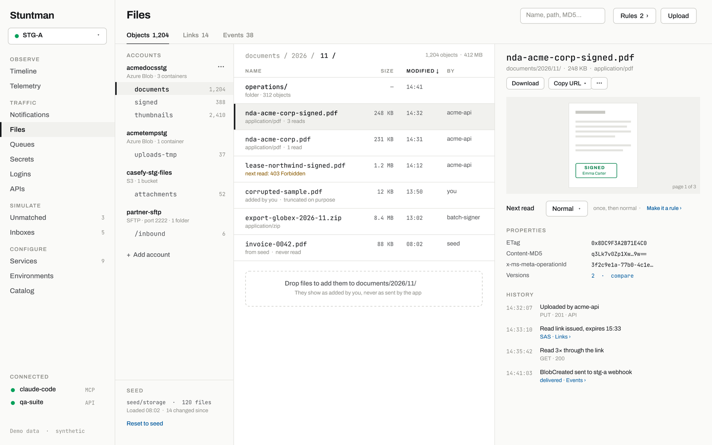
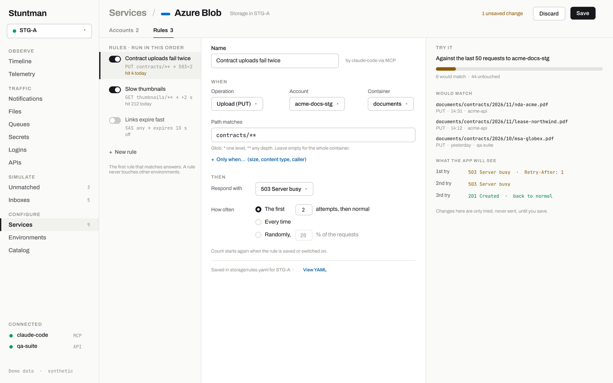

# Storage (Azure Blob and Amazon S3)

Stuntman answers the Azure Blob REST API and the Amazon S3 API (path style or virtual-host style, which is also what
Cloudflare R2 speaks) on two ports of their own. The app uploads, downloads, lists, copies and deletes with its normal
SDK. Stuntman keeps every object with its metadata and versions, every request the app made, every SAS or presigned
link it used, and the Event Grid or S3 notifications it would have received. Both protocols share one vocabulary:
**account**, **container** (an S3 bucket), **path**.



## At a glance

| | |
|---|---|
| **Stands in for** | Azure Blob Storage (REST version `2024-11-04` by default; the app's `x-ms-version` is echoed), Amazon S3 and Cloudflare R2 (SigV4). Tested with Microsoft's Python SDK (`azure-storage-blob`, also through the `az` CLI), .NET `Azure.Storage.Blobs` 12.30.1, and the AWS CLI (botocore). |
| **Ports** | Azure Blob `10000` (`STUNTMAN_BLOB_PORT`), S3 `9000` (`STUNTMAN_S3_PORT`). Plain HTTP/1.1 only, no TLS variant. A SAS link also works on the main port (`8025`, `STUNTMAN_PORT`) at `/blob/<account>/<container>/<blob>?<sas>`. |
| **Point your app at** | Azure: the connection string from `get_account`, e.g. `DefaultEndpointsProtocol=http;AccountName=acme-docs;AccountKey=…;BlobEndpoint=http://127.0.0.1:10000/acme-docs;`. S3: endpoint `http://127.0.0.1:9000`, path style, the access key id and secret from `get_account`, any region. |
| **It keeps** | Accounts (YAML per account), containers/buckets, objects with metadata and HTTP headers, old versions (when on), soft-deleted objects (when on), staged blocks, open multipart uploads, every request, links (SAS / presigned) and their uses, events and their delivery attempts. |
| **You can provoke** | A rule per operation and path glob (403, 404, 409, 412, 413, 503, timeout, connection reset, empty reply, slow, cut off halfway, wrong checksum, links that expire early), for the first N requests, a share, or every time. The next read(s) of one object. A link's next use (expired, bad signature, IP denied, permission, not yet valid, gone). A whole account unreachable (timeout, 503, 401). A full account (507). Account latency. Key rotation. An event held, duplicated, reordered, dropped or missing a field. |
| **Screen** | `/files` (objects), `/files/links`, `/files/events`, `/services/azure-blob` and `/services/s3` (accounts), `/services/azure-blob/rules` and `/services/s3/rules` |
| **Tools** | `create_account`, `get_account`, `list_storage_accounts`, `list_objects`, `get_object`, `put_object`, `wait_for_object`, `create_rule`, `set_next_read`, `set_account_reachability`, `create_link`, `list_links`, `set_next_use`, `create_subscription`, `list_events`, `wait_for_storage_delivery`, `reset_to_seed` |

## Connect your app

### Make an account first

The app cannot create an account; it can create containers and buckets inside one. Make the account with a tool
(or on the screen):

```
create_account {"service": "azure-blob", "account": "acme-docs", "containers": {"documents": {"access": "private"}, "thumbnails": {"access": "blob"}}}
create_account {"service": "s3", "account": "globex-files", "containers": ["attachments"]}
```

- Account names: 3 to 24 lowercase letters, numbers or dashes, not starting or ending with a dash (Azure itself
  allows no dashes; Stuntman does, so `acme-docs-stg` works).
- Container and bucket names: 3 to 63 lowercase letters, numbers, dashes and dots, not starting with a dash.
- Azure accounts get two keys, `key1` and `key2` (64 random bytes, base64). An S3 account gets one access key id,
  `STUNTMAN` plus the first 12 characters of the account name in upper case without dashes (`globex-files` →
  `STUNTMANGLOBEXFILES`), and a 40-character secret.
- Key values live in the environment's `secrets.yaml` as `storage.<account>.<key>`. `get_account` shows them masked
  and returns the full connection string; `rotate_key` returns a new value once.
- The account file is `storage/accounts/<account>.yaml` in the environment folder. The form, the API and MCP all read
  and write that file.

`get_account {"service": "azure-blob", "account": "acme-docs"}` returns `connection`, `endpoint`, `keys`, `settings`,
`yaml` and `etag`.

### Azure Blob

The connection string has the account in the path (`BlobEndpoint=http://127.0.0.1:10000/<account>`), Azurite style.

Python (`azure-storage-blob`):

```python
from azure.storage.blob import BlobServiceClient

conn = "DefaultEndpointsProtocol=http;AccountName=acme-docs;AccountKey=<key1>;BlobEndpoint=http://127.0.0.1:10000/acme-docs;"
svc = BlobServiceClient.from_connection_string(conn)
c = svc.get_container_client("documents")
c.upload_blob("2026/11/nda-acme-corp.pdf", b"%PDF-1.4 ...", overwrite=True, metadata={"operationId": "3f2c9e1a"})
```

.NET (`Azure.Storage.Blobs`):

```csharp
var service = new BlobServiceClient(Environment.GetEnvironmentVariable("AZURE_STORAGE_CONNECTION_STRING"));
var c = service.GetBlobContainerClient("documents");
await c.CreateIfNotExistsAsync(PublicAccessType.None);
await c.GetBlobClient("2026/11/nda-acme-corp.pdf").UploadAsync(BinaryData.FromString("%PDF-1.4"), overwrite: true);
```

Azure CLI:

```sh
export AZURE_STORAGE_CONNECTION_STRING='DefaultEndpointsProtocol=http;AccountName=acme-docs;AccountKey=<key1>;BlobEndpoint=http://127.0.0.1:10000/acme-docs;'
az storage blob upload -c documents -n 2026/11/nda.pdf -f nda.pdf --metadata operationId=3f2c9e1a
```

How Stuntman finds the account in a request:

1. The first path segment, if it names an account (`/<account>/<container>/<blob>`).
2. Otherwise the first label of the `Host` header (`acme-docs.blob.<anything>` → `acme-docs`), and the path is
   `/<container>/<blob>`.

Both styles work for every operation, nested blob names included. A request to an S3 account on the Blob port gets
400 `InvalidUri` ("is an S3 account: use the S3 port").

Which endpoint `get_account` gives:

| Situation | `BlobEndpoint` |
|---|---|
| Default environment, `STUNTMAN_HOST` is `localhost` or an IP | `http://127.0.0.1:10000/<account>` |
| Base domain is `localhost` or ends in `.localhost` | `http://<base domain>:10000/<account>` |
| Any other base domain, or `STUNTMAN_HOST` is a name | `http://<account>.blob.<base domain>:10000/<account>` |
| Same, but `STUNTMAN_BLOB_PORT` is not an emulator port | `http://<account>.blob.<base domain>:<port>` |

The account repeats in the path on the emulator ports (10000–10004, 10100–10104, 11000–11004, 11100–11104) because
the .NET and JavaScript SDKs read the account from the first path segment on those ports, whatever the host. Without
it they take the container for the account and drop the blob name.

### Amazon S3 and Cloudflare R2

`get_account` gives the S3 settings in one line: `ServiceUrl=http://127.0.0.1:9000;AccessKey=STUNTMANGLOBEXFILES;SecretKey=…;Region=auto;ForcePathStyle=true`.
This is not a format any SDK reads: split it into the client options.

AWS CLI:

```sh
export AWS_ACCESS_KEY_ID=STUNTMANGLOBEXFILES AWS_SECRET_ACCESS_KEY=<secret> AWS_DEFAULT_REGION=us-east-1
aws --endpoint-url http://127.0.0.1:9000 s3api put-object --bucket attachments --key 2026/11/invoice-0042.txt --body invoice.txt
aws --endpoint-url http://127.0.0.1:9000 s3 cp big.bin s3://attachments/exports/big.bin   # multipart
```

Python (boto3, botocore underneath):

```python
import boto3
from botocore.config import Config

s3 = boto3.client("s3", endpoint_url="http://127.0.0.1:9000",
                  aws_access_key_id="STUNTMANGLOBEXFILES", aws_secret_access_key="<secret>",
                  region_name="us-east-1", config=Config(s3={"addressing_style": "path"}))
s3.put_object(Bucket="attachments", Key="2026/11/invoice-0042.txt", Body=b"invoice 0042")
```

- Any region works: the signature is checked with the region in the credential scope. Links Stuntman signs use `auto`.
- Path style is `http://host:9000/<bucket>/<key>`. Virtual-host style (`<bucket>.<host>:9000/<key>`) works when the
  `Host` header has a dot and its first label is a bucket of this environment.
- The account is found by bucket name. Bucket names are looked up across all S3 accounts of the environment, so keep
  them unique.

### From Docker

| App runs | Azure `BlobEndpoint` | S3 endpoint |
|---|---|---|
| On the host | `http://127.0.0.1:10000/<account>` | `http://127.0.0.1:9000` |
| In a container, Stuntman on the host | `http://host.docker.internal:10000/<account>` | `http://host.docker.internal:9000` |
| In the same compose project | `http://stuntman:10000/<account>` | `http://stuntman:9000` |

The engine's `docker-compose.yml` publishes `10000` and `9000` on `127.0.0.1` by default (`BIND`). A host name
that is not under any environment's base domain goes to the default environment. Keep the account in the path on
port 10000, and keep S3 path style.

### Several environments

See [Environments](../environments.md). Each environment has its own accounts, objects, rules and events.

- Path prefix on the provider ports: `http://127.0.0.1:10000/e/<env>/<account>/<container>/<blob>` and
  `http://127.0.0.1:9000/e/<env>/<bucket>/<key>`. SharedKey and SigV4 are checked over the path as sent, prefix
  included. The S3 endpoint `get_account` gives for a non-default environment already ends in `/e/<env>`.
- Host name: a `Host` under the environment's base domain (or `<env>.localhost`) selects it, e.g.
  `http://acme-docs.blob.pr-7.stuntman.local:10000/acme-docs`. This needs a hosts entry unless the base domain is
  under `.localhost`.
- A copied environment loads its seed folders when it starts (see [Seeds](#seeds)).
- A paused environment answers 503 on both ports (`ServerBusy` / `ServiceUnavailable`, "… is paused in Stuntman").

### Keys and signatures

Every account has `access.any_key` (default `true`).

| `any_key` | Azure | S3 |
|---|---|---|
| `true` | Any `SharedKey` header and any `Bearer` token is accepted. A SAS needs no valid signature, but its expiry, start, IP and permissions still count. | Any `AWS4-HMAC-SHA256` header is accepted, and a request with no `Authorization` at all. A presigned URL needs no valid signature, but its expiry and permissions still count. |
| `false` | `SharedKey` must match `key1` or `key2` (else 403 `AuthenticationFailed`). A SAS must be signed with one of them. `Bearer` needs `access.managed_identity: true`. | SigV4 must match the secret of the access key id (403 `InvalidAccessKeyId` for an unknown id, 403 `SignatureDoesNotMatch` for a wrong secret). Presigned URLs must match too. |

Requests with no credentials see the container's access level: Azure `private` (404 `ResourceNotFound`), `blob`
(anonymous read of blobs), `container` (anonymous read and list); S3 `private` (403 `AccessDenied` when `any_key` is
off), `public-read` (anonymous GET and HEAD).

## What it supports

### Azure Blob operations

| Operation | Request | Notes |
|---|---|---|
| Get Account Information | `GET|HEAD /<account>?restype=account` | `x-ms-sku-name: Standard_LRS`, `x-ms-account-kind: StorageV2`, `x-ms-is-hns-enabled: false`. |
| Get Blob Service Properties | `GET /<account>?restype=service&comp=properties` | A fixed `StorageServiceProperties` body. |
| List Containers | `GET /<account>?comp=list` | `prefix` honoured. One page, no `marker`/`maxresults`. A private container has no `<PublicAccess>` element. |
| Create Container | `PUT /<account>/<container>?restype=container` | `x-ms-blob-public-access` sets the access level (default `private`). Saved in the account YAML. 409 `ContainerAlreadyExists`; 400 `InvalidResourceName`. |
| Delete Container | `DELETE …?restype=container` | 202. Removes the container and all its objects (versions included) at once. 404 `ContainerNotFound`. |
| Get Container Properties / Metadata | `GET|HEAD …?restype=container[&comp=metadata]` | 200 with a fixed ETag, `x-ms-lease-state: available`, `x-ms-blob-public-access` when not private. No metadata is kept. |
| Other container calls | e.g. `comp=acl`, `PUT comp=metadata` | 200, accepted and ignored. |
| List Blobs | `GET …?restype=container&comp=list` | `prefix` (a `\` becomes `/`), `delimiter` (gives `<BlobPrefix>`), `marker`, `maxresults` (default 5000), `include=metadata` in any case. Other `include` items are ignored. Results sorted by name; `NextMarker` is the next name. |
| Put Blob | `PUT /<account>/<container>/<blob>` | Body stored as a BlockBlob. `x-ms-blob-content-type` or `Content-Type` (default `application/octet-stream`), `x-ms-meta-*`, `x-ms-blob-cache-control`, `-content-disposition`, `-content-encoding`, `-content-language`. `Content-MD5` is checked (400 `Md5Mismatch`). 201 with `ETag`, `Last-Modified`, `Content-MD5`, `x-ms-version-id` when versions are on. |
| Put Block | `PUT …?comp=block&blockid=…` | Staged per blob. No rules, latency or limit at this step. 201. |
| Put Block List | `PUT …?comp=blocklist` | Joins the listed blocks in order (`<Latest>`, `<Committed>` and `<Uncommitted>` are treated alike). 400 `InvalidBlockList` when a block is missing. Staged blocks are then dropped. Metadata and `x-ms-blob-*` headers as Put Blob. |
| Get Block List | `GET …?comp=blocklist` | Always an empty `<BlockList>`. |
| Get Blob | `GET …/<blob>` | `Range` or `x-ms-range` (`bytes=a-b`, `bytes=a-`, `bytes=-n`) gives 206 with `Content-Range`; `x-ms-range-get-content-md5: true` adds `x-ms-blob-content-md5`. SAS `rscd`, `rsct`, `rscc`, `rsce`, `rscl` override the response headers. |
| Get Blob Properties | `HEAD …/<blob>`, `GET comp=properties`, `GET comp=metadata` | Headers only: `ETag`, `Last-Modified`, `x-ms-creation-time` (the last write), `x-ms-blob-type: BlockBlob`, `x-ms-access-tier: Hot`, `x-ms-lease-state: available`, `x-ms-server-encrypted: true`, `Content-MD5`, `Content-Length`, the stored headers and `x-ms-meta-*`. `x-ms-copy-status: success` on a copied blob. |
| Set Blob Metadata | `PUT …?comp=metadata` | Replaces the metadata; new ETag. No version, no event, no history row. Conditions are not checked. |
| Set Blob Properties | `PUT …?comp=properties` | Replaces the `x-ms-blob-*` headers and content type; as above. |
| Delete Blob | `DELETE …/<blob>` | 202 with `x-ms-delete-type-permanent` (`false` when soft delete is on). `x-ms-delete-snapshots` is accepted. 404 `BlobNotFound`. |
| Copy Blob | `PUT …/<blob>` with `x-ms-copy-source` | The source is any blob URL of this Stuntman (same or another account, host or path style, `/e/<env>` prefix allowed). It finishes at once: 202 with `x-ms-copy-id` and `x-ms-copy-status: success`. Metadata comes from the request, else from the source. Source access is not checked. 404 `CannotVerifyCopySource` when the source is missing or outside Stuntman. |
| Conditional requests | `If-Match`, `If-None-Match` | On writes, deletes, Put Block List and copy: `If-Match` miss → 412 `ConditionNotMet`; `If-None-Match: *` on an existing blob → 409 `BlobAlreadyExists`; `If-None-Match: <etag>` match → 412. On reads: `If-None-Match` match → 304; `If-Match` miss → 412. |

Query values `comp`, `restype` and the `include` items are matched in any case, as Azure does. A `\` in a blob name is
stored as `/` (Azure does the same), also in a copy source and a listing prefix. A blob request with no blob name
answers 400 `InvalidUri` instead of writing a blob named "". Any other account-level call answers 400
`InvalidQueryParameterValue` ("Unsupported account operation").

Every answer carries `x-ms-request-id`, `x-ms-version`, `Date` and `Server: Stuntman-Azure-Blob`. Errors carry
`x-ms-error-code` and the XML `<Error><Code>…</Code><Message>…\nRequestId:…\nTime:…</Message></Error>`.

### S3 operations

| Operation | Request | Notes |
|---|---|---|
| ListBuckets | `GET /` | Buckets of every S3 account in the environment. `CreationDate` is the current time. |
| HeadBucket | `HEAD /<bucket>` | 200 with `x-amz-bucket-region: auto`, or 404 with no body. |
| GetBucketLocation | `GET /<bucket>?location` | `auto`. |
| CreateBucket | `PUT /<bucket>` | Added to the account whose access key id signed the request (access `private`). 409 `BucketAlreadyOwnedByYou`; 400 `InvalidBucketName`. With an unknown access key id: 403 `AccessDenied` "Make an S3 account in Stuntman first". |
| DeleteBucket | `DELETE /<bucket>` | 204. 409 `BucketNotEmpty`; 404 `NoSuchBucket`. |
| ListObjects (v1) | `GET /<bucket>` | `prefix`, `delimiter` (gives `<CommonPrefixes>`), `marker`, `max-keys` (default 1000). `IsTruncated`, `NextMarker`. |
| ListObjectsV2 | `GET /<bucket>?list-type=2` | `prefix`, `delimiter`, `continuation-token` or `start-after`, `max-keys`. `KeyCount`, `NextContinuationToken` (the last key of the page). Each `<Contents>` has `Key`, `LastModified`, `ETag`, `Size`, `StorageClass: STANDARD`. No `Owner`. |
| PutObject | `PUT /<bucket>/<key>` | `Content-Type` (default `application/octet-stream`), `x-amz-meta-*`, `Cache-Control`, `Content-Disposition`, `Content-Encoding` (not `aws-chunked`), `Content-Language`. `Content-MD5` is checked (400 `BadDigest`), a hex `x-amz-content-sha256` is checked (400 `XAmzContentSHA256Mismatch`). `aws-chunked` / `STREAMING-*` bodies are decoded; chunk signatures and trailing checksums are not checked. 200 with `ETag` (quoted MD5 hex), `x-amz-version-id` when versions are on. |
| GetObject | `GET /<bucket>/<key>` | `Range` gives 206 with `Content-Range`. `response-content-disposition`, `-content-type`, `-cache-control`, `-content-encoding`, `-content-language`, `response-expires` override the headers. 404 `NoSuchKey`. |
| HeadObject | `HEAD /<bucket>/<key>` | `ETag`, `Last-Modified`, `Content-Type`, `Content-Length`, stored headers, `x-amz-meta-*`. 404 with no body. |
| CopyObject | `PUT /<bucket>/<key>` with `x-amz-copy-source` | Source `bucket/key` in any S3 account of the environment. `x-amz-metadata-directive: REPLACE` takes type, metadata and headers from the request; otherwise from the source. `<CopyObjectResult>`. 404 `NoSuchKey`. |
| DeleteObject | `DELETE /<bucket>/<key>` | Always 204, as S3. |
| DeleteObjects | `POST /<bucket>?delete` | Deletes each `<Key>`; `<Quiet>true</Quiet>` honoured. Never reports errors. Rules do not apply. |
| CreateMultipartUpload | `POST /<bucket>/<key>?uploads` | Keeps content type and `x-amz-meta-*`. |
| UploadPart | `PUT …?partNumber=N&uploadId=…` | `ETag` is the part's MD5. No minimum part size. No rules or limit at this step. |
| CompleteMultipartUpload | `POST …?uploadId=…` | Joins the parts listed in the body, in that order. 400 `InvalidPart` when one is missing; 404 `NoSuchUpload`. ETag is `"<md5 of the part MD5s>-<count>"`, as S3. |
| AbortMultipartUpload | `DELETE …?uploadId=…` | 204. |
| Conditional requests | `If-Match`, `If-None-Match` | On writes: miss on `If-Match` or a match (or `*`) on `If-None-Match` → 412 `PreconditionFailed`. On reads: `If-None-Match` match → 304; `If-Match` miss → 412. |

Every answer carries `x-amz-request-id`, `Date` and `Server: Stuntman-S3`. Errors are
`<Error><Code/><Message/><Resource/><RequestId/></Error>`.

### Links (SAS and presigned)

- Azure: service SAS (`sr=b`, `sr=c`) and account SAS (`ss=…`), including `ses` from version `2020-12-06`. Stuntman
  checks `se` (expiry), `st` (start, with 60 s of tolerance), `sip` (one IPv4 or a range `a-b`) and `sp` (`r` read;
  `w`, `c`, `a` write; `d` delete; `l` list). `spr` is recorded but not enforced.
- S3: presigned URLs (`X-Amz-Algorithm`, `X-Amz-Credential`, `X-Amz-Date`, `X-Amz-Expires`,
  `X-Amz-SignedHeaders`, `X-Amz-Signature`). Expiry is `X-Amz-Date + X-Amz-Expires`. The method decides what is
  needed: PUT/POST write, DELETE delete, GET on a bucket list, else read.
- A link the app signs itself is listed the first time it is used, with `issuedBy` "the app (seen at first use)" and
  `signedWith` naming the key that matches. A link with the same signature is one link.
- `create_link` signs one with the account's first key: a SAS (`sv=2024-11-04`, `sr=b`, start 1 minute ago) or a
  presigned GET (PUT when `allows` has `write`). An Azure link also gets `publicUrl` on the main port.
- The main port route `/blob/<account>/<container>/<blob>?<sas>` answers GET and HEAD only.

### Account settings

The account YAML (`storage/accounts/<account>.yaml`):

```yaml
kind: azure-blob            # or s3
account: acme-docs
access:
  any_key: true             # false: signatures checked
  keys: [key1, key2]        # S3: the access key id
  managed_identity: false   # Azure: accept Bearer tokens when any_key is off
containers:
  documents: {access: private}     # Azure: private | blob | container; S3: private | public-read
behaviour:
  latency: none             # none | same_region (20 ms ±5) | other_region (120 ms ±20) | slow_network (300 ms ±200) | a duration like 250ms
  limit: none               # none | full | a size like 100MB, 1GB, 500KB
  versions: false           # keep old versions
  soft_delete: "off"        # off | a duration like 7d
  seed_on_reset: true
seed: seed/storage/acme-docs
```

Change it with `update_account` (a JSON merge patch with the same keys; `null` removes a key). Pass the `etag` from
`get_account` as `if_match` to get 412 if someone changed the file meanwhile. Renaming an account is refused. A bare
number in `latency` is read as seconds; write `250ms`.

### Seeds

The seed folder (default `seed/storage/<account>`, relative to the environment folder) holds
`<container>/<path>` files. It is loaded:

- when the environment starts and the account has a seed folder but has never been seeded;
- on `reset_to_seed` (all accounts, or the ones named);
- when the environment is reset, for accounts with `seed_on_reset: true`.

Loading wipes every object of the account first, then writes each file as `by: seed`. Content types come from the
extension (`pdf`, `png`, `jpg`, `gif`, `svg`, `txt`, `log`, `csv`, `json`, `xml`, `zip`, `html`, else
`application/octet-stream`). Loading sends no events. `reset_to_seed` returns what was lost:
`{"account", "lost": {"app", "people", "deletes"}, "loaded"}`.

### Events

Subscriptions live in `storage/subscriptions.yaml`. Each one has `name`, `to` (`webhook` or `queue`), `url`,
`events` (`created`, `deleted`; default both), `under` (a glob over `container/path`; empty is everything),
`format` (`event_grid` or `s3`) and `account` (empty is every account).

| Caused by | Event Grid `eventType` and `data.api` | S3 `eventName` |
|---|---|---|
| Put Blob, PutObject, `put_object` | `Microsoft.Storage.BlobCreated`, `PutBlob` | `ObjectCreated:Put` |
| Put Block List, CompleteMultipartUpload | `Microsoft.Storage.BlobCreated`, `PutBlockList` | `ObjectCreated:CompleteMultipartUpload` |
| Copy Blob, CopyObject | `Microsoft.Storage.BlobCreated`, `CopyBlob` | `ObjectCreated:Copy` |
| Delete Blob, DeleteObject, DeleteObjects, `delete_object` | `Microsoft.Storage.BlobDeleted`, `DeleteBlob` | `ObjectRemoved:Delete` |

A delete of an object that did not exist sends nothing. Set Metadata, Set Properties, seeds and `remove_container`
send nothing.

- Event Grid payload: an array with one event: `topic`
  (`/subscriptions/00000000-…/resourceGroups/stuntman/providers/Microsoft.Storage/storageAccounts/<account>`),
  `subject` (`/blobServices/default/containers/<container>/blobs/<path>`), `eventType`, `id`, `eventTime`, and
  `data` with `api`, `eTag`, `contentType`, `contentLength`, `blobType: BlockBlob`, `url`, `sequencer`. Headers:
  `aeg-event-type: Notification`, `aeg-subscription-name` (the name in upper case), `aeg-delivery-count`,
  `aeg-data-version`, `aeg-metadata-version: 1`.
- Event Grid validation: on `create_subscription` (and `validate_subscription`) Stuntman posts a
  `Microsoft.EventGrid.SubscriptionValidationEvent` with `aeg-event-type: SubscriptionValidation`. The endpoint must
  answer 2xx with `{"validationResponse": "<validationCode>"}`.
- S3 payload: `{"Records": [{"eventVersion": "2.1", "eventSource": "aws:s3", "awsRegion": "auto", "eventName", "s3": {"bucket": {"name", "arn"}, "object": {"key", "size", "eTag", "sequencer"}}}]}`. No special headers.

## How it behaves

- **Order of checks** for each request: authorization (key, SAS, presigned, public access) → account latency →
  account reachability → storage limit (writes) → next read (GET/HEAD) → the first matching rule → the operation.
  So a bad key gets 403 even when the account is made unreachable. Container/bucket create and delete, List
  Containers, ListBuckets and HeadBucket skip the reachability, limit and rule checks.
- **ETags.** Azure: `"0x8DD…"`, new on every write. S3: the quoted MD5 hex of the content; multipart
  `"<md5>-<parts>"`.
- **Content-MD5.** Stored as the base64 MD5 of the whole content. Azure returns it as `Content-MD5` (not on a range read); S3 does not return it.
- **Overwrite.** A write replaces the current object. With `versions: true` the old one is kept as a version (shown by
  `get_object`); old versions are kept with no count limit. Versions cannot be read through either protocol.
  `x-ms-version-id` is the write time; S3 `x-amz-version-id` is a sequence number.
- **Soft delete.** With `soft_delete: 7d`, a delete hides the object and all its versions; they are purged when the
  retention ends. The sweep runs about every 5 minutes. There is no undelete.
- **Storage limit.** Used bytes are the current objects plus kept versions. A write that would pass the limit gets
  507 (`InsufficientAccountStorage` / `InsufficientStorage`). `full` refuses every write. A multipart upload is
  checked once, at Complete, without its size: only `full` stops it.
- **Request size.** A request body is read up to 1 GiB. A larger single request is read as empty. Use blocks or
  multipart for big files (tests upload 70 MB both ways).
- **Retry hints.** A 503 carries `Retry-After: 1`. Azure SDKs and botocore retry it on their own (the tests see
  `503, 503, 201`).
- **Time.** Link expiry, retention and event retries use the real clock, not the [environment clock](../clock.md).
- **Persistence.** Objects, requests, links and events are in the environment's SQLite file (`duble.sqlite`) and
  survive restarts. Account, rule and subscription settings are YAML files in the environment folder.
- **Event delivery.** A loop runs every second and delivers up to 20 due events, oldest first, with a 30 s timeout per
  attempt. 2xx is delivered. Otherwise retries follow Event Grid's schedule: 10 s, 30 s, 1 min, 5 min, 10 min, 30 min,
  1 h, then hourly; it gives up after 30 attempts or 24 hours (`given_up`). The same schedule is used for the `s3`
  format. Events are delivered even if the validation handshake failed; the subscription only shows
  `health: "not subscribed"`.
- **Queue subscriptions** (`to: queue`) are recorded with status `no_destination` and never delivered.
- **Caller name.** The `X-Stuntman-App` header names the caller; else the first product of the `User-Agent`;
  `browser` for a `Mozilla` agent. A W3C `traceparent` joins the request to a journey on the Timeline.

Differences from the real providers:

| Real provider | Stuntman |
|---|---|
| Azure account names have no dashes | Dashes allowed |
| Copy Blob can be asynchronous | Always finishes at once |
| A full account is not an Azure/S3 error | 507 `InsufficientAccountStorage` / `InsufficientStorage` |
| Bearer tokens are validated | Any Bearer is accepted (with `managed_identity` or `any_key`) |
| An invalid range is 416 | An invalid range returns the whole object with 200 |
| HTTPS | HTTP only |

## Provoke failures

| Failure | How | What the app sees | Turn it off |
|---|---|---|---|
| Uploads fail the first N times | `create_rule {"service": "azure-blob", "name": "Contract uploads fail twice", "when": {"op": "put", "container": "documents", "path": "contracts/**"}, "then": {"respond": "503"}, "how_often": {"first": 2}}` | 503 `ServerBusy` / `SlowDown` with `Retry-After: 1`, then normal | `first` ends it; `set_rule_enabled {"enabled": false}` or `delete_rule` |
| An error status | rule `then.respond`: `403`, `404`, `409`, `412`, `413`, `503` | Azure: `AuthorizationFailure`, `BlobNotFound`/`ContainerNotFound`, `BlobAlreadyExists`, `ConditionNotMet`, `RequestBodyTooLarge`, `ServerBusy`. S3: `AccessDenied`, `NoSuchKey`, `OperationAborted`, `PreconditionFailed`, `EntityTooLarge`, `SlowDown` | as above |
| No answer | rule `"respond": "timeout"`, or `set_account_reachability {"mode": "timeout"}` | Nothing for 600 s, then 504 (`OperationTimedOut` / `RequestTimeout`); the app's own timeout fires first | delete the rule; `mode: "ok"` |
| Connection reset | rule `"respond": "reset"` | TCP RST (curl exit 56) | delete the rule |
| Empty reply | rule `"respond": "empty"` | The socket closes with no bytes (curl exit 52) | delete the rule |
| Slow answer | rule `"respond": "slow", "seconds": 5`; `set_next_read {"result": "slow:5s"}`; account `behaviour.latency` | The normal answer, late | delete the rule; latency `none` |
| Download cut off halfway | rule `"respond": "truncate"` (GET); `set_next_read {"result": "truncate"}` | Full `Content-Length`, half the body, then the connection ends (curl exit 18) | |
| Wrong checksum | rule `"respond": "bad_md5"`; `set_next_read {"result": "bad_md5"}` | Azure: a wrong `Content-MD5`. S3: a wrong `ETag` | |
| One object's next read | `set_next_read {"account": "acme-docs", "container": "documents", "path": "invoices/0042.pdf", "result": "404", "times": 2}` (`403`, `404`, `503`, `slow:5s`, `truncate`, `bad_md5`) | That answer for the next N GET/HEAD of that object, then normal | `"result": "normal"` |
| Links expire early | rule `{"op": "link", …}, "then": {"respond": "expires", "seconds": 30}` | Uses of links older than 30 s: 403 (`AuthenticationFailed` / `AccessDenied`) "Signed expiry time has passed." | delete the rule |
| A link's next use | `set_next_use {"id": "lnk_3f2c9e1a", "result": "expired"}` (`expired`, `bad_signature`, `ip_denied`, `permission`, `not_yet_valid`, `gone`), `times` default 1 | 403 `AuthenticationFailed`, `AuthorizationSourceIPMismatch`, `AuthorizationPermissionMismatch` (S3: `AccessDenied`, `SignatureDoesNotMatch`), or 404 for `gone` | `"result": "normal"` |
| Revoked link | `revoke_link {"id": "lnk_…"}` | 403 "This link was revoked." on every use | none: make a new link |
| Old key stops working | `rotate_key {"service": "azure-blob", "account": "acme-docs", "key": "key1"}` (with `any_key: false`) | 403 `AuthenticationFailed` / `SignatureDoesNotMatch` for apps signing with the old value | give the app the new `connection` |
| Account unreachable | `set_account_reachability {"account": "acme-docs", "mode": "503"}` (`timeout`, `503`, `401`) | Every request to the account: that answer (401 is `InvalidAuthenticationInfo` / `InvalidAccessKeyId`) | `"mode": "ok"` |
| Account full | `update_account {"service": "s3", "account": "globex-files", "patch": {"behaviour": {"limit": "full"}}}` | 507 on every upload | `"limit": "none"` |
| Event held, duplicated, reordered, dropped, broken | `set_next_delivery {"id": "acme-api webhook", "behavior": "hold:30s"}` (`duplicate`, `reorder`, `drop`, `missing_field`) | The next event: late; twice; after the following one; never (`dropped`); without `data.contentLength` (Event Grid) or `s3.object.size` (S3) | applies once; `"behavior": "normal"` clears it |
| Webhook keeps failing | let the endpoint answer non-2xx | Retries on Event Grid's schedule, then `given_up` | answer 2xx; `resend_event` |

Rules:

- One file per service, `storage/rules/azure-blob.yaml` or `storage/rules/s3.yaml`; `put_rules_yaml` replaces it,
  `GET /api/services/{name}/rules.yaml` reads it.
- `when.op`: `put` (also copies), `get` (also HEAD), `delete`, `list`, `link`, `any`. `when.account`,
  `when.container`, `when.path` (glob: `*` one level, `**` any depth, `?` one character; empty is everything).
  `when.only_when`: `[{"field": "size", "op": "over"|"under", "value": "10 MB"}]`,
  `{"field": "content_type"|"caller", "op": "is"|"is_not"|"contains", "value": "…"}`.
- `how_often`: `{"first": N}`, `{"random": 1..100}` (percent), or nothing / `"every"` (every time).
- The first enabled rule that matches decides. A `first: N` rule that has used its N still takes the request and
  lets it through normally; rules below it are not tried.
- Saving, enabling or moving a rule restarts its `first` count.
- `test_rule` tries a draft against the last 50 app requests: `matched`, `wouldMatch`, `appWillSee` per attempt,
  `warnings` (a rule above answers the same requests), `nearMiss` (a path that almost matches, with a `fix`).



## See what the app did

| Question | Tool | Fields that matter |
|---|---|---|
| What is in a folder? | `list_objects {"account", "container", "prefix": "2026/11/", "by": "app"}` | `folders[]` (`name`, `path`, `objects`), `objects[]` (`path`, `size`, `ctype`, `etag`, `md5`, `meta`, `headers`, `at`, `by`, `via`, `reads`, `nextRead`), `totalObjects`, `totalBytes`. `by`: `app`, `you`, `seed`, `agent`, or a caller name. One level per call. |
| Did the app upload it? | `wait_for_object {"account", "container", "prefix", "timeout": "30s"}` | The newest object written since `since` (default 2 s ago). 408 when none. |
| Everything about one object | `get_object {"account", "container", "path"}` | `meta`, `headers`, `md5`, `versions[]`, `history[]` (`op`, `method`, `status`, `caller`, `via`, `linkId`, `provoked`, `size`, `remote`), `events[]`, `links[]`, `nextRead`, `url`, `contentUrl` |
| The bytes | `GET /api/storage/{account}/{container}/content/{path}` | Raw content with its content type |
| Which links did the app use? | `list_links {"state": "valid", "kind": "sas", "object": "nda"}`, `get_link {"id"}` | `allows`, `start`, `expiry`, `ips`, `signedWith`, `issuedBy`, `url`, `uses`, `refused`, `state` (`valid`, `expired`, `revoked`); `get_link` adds every use with its status |
| Wait for the app's link | `wait_for_link {"account", "container", "prefix"}` | The link with its full `url` (an app's link shows up at its first use) |
| Was the webhook called? | `wait_for_storage_delivery {"subscription": "acme-api webhook", "type": "BlobCreated", "path": "nda"}` | The event with `attempts`, `lastStatus`, `lastMs`, `history[]` (each attempt) |
| All events | `list_events {"subscription", "result": "retrying", "q": "nda"}`, `get_event {"id"}` | `status` (`pending`, `retrying`, `delivered`, `given_up`, `dropped`, `held`, `no_destination`), `payload`, `causedBy` (the request) |
| Did a rule fire? | `list_rules {"service": "s3"}` | `hitsToday`, `lastHit`, `meta` (e.g. `PUT contracts/** → 503×2`), `warnings` |
| Account state | `list_storage_accounts`, `get_account` | `containers[]` with counts, `reachability`, `seed` (`files`, `loadedAt`, `changes`), `endpoint`, `connection` |

Objects added by `put_object` are recorded as added by the caller (`via: mcp`, `api` or `ui`), never as the app. HTTP
callers name themselves with the `X-Stuntman-Client` header.

**Timeline** ([Timeline](../timeline.md)): every app write, delete, copy and failure is one row ("Upload of
nda.pdf", "Delete of …", "Read of x failed: 503"). Successful reads fold into one row per caller, container and
minute ("acme-api read 12 objects in documents"). A HEAD that finds nothing before an upload shows as "checked
nda.pdf: not there yet", not a failure. Provoked answers are marked as provoked. Rows link to
`/files?account=…&container=…`. Screen actions and seeds are not on the Timeline.

## Recipes

1. **Give the app an Azure account and check an upload.**
   ```
   create_account {"service": "azure-blob", "account": "acme-docs", "containers": {"documents": {"access": "private"}}}
   get_account {"service": "azure-blob", "account": "acme-docs"}          # copy "connection" into the app
   wait_for_object {"account": "acme-docs", "container": "documents", "prefix": "2026/11/", "timeout": "60s"}
   get_object {"account": "acme-docs", "container": "documents", "path": "2026/11/nda-acme-corp.pdf"}   # check meta, ctype, md5
   ```

2. **Make the app's upload retry survive two 503s.**
   ```
   create_rule {"service": "azure-blob", "name": "Contract uploads fail twice", "when": {"op": "put", "container": "documents", "path": "contracts/**"}, "then": {"respond": "503"}, "how_often": {"first": 2}}
   ```
   Run the upload, then `get_object` on the path: `history` should show `503, 503, 201`. `list_rules` shows
   `hitsToday: 2`. Finish with `delete_rule {"service": "azure-blob", "name": "Contract uploads fail twice"}`.

3. **Check that the app handles a corrupt or partial download.**
   ```
   set_next_read {"account": "globex-files", "container": "attachments", "path": "2026/11/invoice-0042.txt", "result": "truncate"}
   set_next_read {"account": "globex-files", "container": "attachments", "path": "2026/11/invoice-0042.txt", "result": "bad_md5", "times": 3}
   ```
   Or seed a file that is cut off on purpose:
   `put_object {"account": "acme-docs", "container": "documents", "path": "2026/11/corrupted-sample.pdf", "content": "%PDF-1.4 tru", "truncated": true}`.

4. **Test the app's SAS links (expired, wrong permission, revoked).**
   Let the app hand out its link, then:
   ```
   wait_for_link {"account": "acme-docs", "container": "documents", "prefix": "2026/11/"}     # -> id, url
   set_next_use {"id": "lnk_3f2c9e1a", "result": "expired"}
   revoke_link {"id": "lnk_3f2c9e1a"}
   get_link {"id": "lnk_3f2c9e1a"}                                                            # uses[] with each status
   ```
   To hand a link to a browser yourself:
   `create_link {"account": "acme-docs", "container": "documents", "path": "2026/11/nda.pdf", "allows": "read", "valid_for": "10m"}`.

5. **Turn on real signature checks and rotate a key.**
   ```
   update_account {"service": "azure-blob", "account": "acme-docs", "patch": {"access": {"any_key": false}}}
   rotate_key {"service": "azure-blob", "account": "acme-docs", "key": "key1"}     # returns the new "connection"
   ```
   The app still signing with the old key gets 403 `AuthenticationFailed`.

6. **Receive Event Grid notifications and test retries.**
   ```
   create_subscription {"name": "acme-api webhook", "url": "http://host.docker.internal:5000/hooks/blob", "under": "documents/**"}
   list_subscriptions                                                       # health must be "delivering"
   set_next_delivery {"id": "acme-api webhook", "behavior": "duplicate"}    # is the handler idempotent?
   send_event {"subscription": "acme-api webhook", "type": "created", "path": "documents/2026/11/nda.pdf"}
   wait_for_storage_delivery {"subscription": "acme-api webhook", "path": "nda.pdf"}
   ```
   For S3-style notifications add `"format": "s3"`.

7. **Make the whole account unreachable for a resilience test.**
   ```
   set_account_reachability {"account": "globex-files", "mode": "timeout"}
   set_account_reachability {"account": "globex-files", "mode": "ok"}
   ```

8. **Start every run from known files.** Put files under `<environment folder>/seed/storage/acme-docs/documents/…`,
   then `reset_to_seed {"accounts": ["acme-docs"]}`. The answer says how many app uploads, people's uploads and
   deletes were thrown away.

## Errors and troubleshooting

| Symptom or error text | Cause | Fix |
|---|---|---|
| 400 `InvalidUri` "No storage account “x” in <env>" | The first path segment and the host name name no account | `create_account`; check the account in `BlobEndpoint` |
| 400 `InvalidUri` "is an S3 account: use the S3 port 9000" | An S3 account on the Blob port | Use port 9000 |
| 400 `InvalidUri` "No blob name in the path" | The SDK took the container for the account (no account in the path on a non-emulator port) | Use the `BlobEndpoint` from `get_account`, account in the path |
| 404 `ResourceNotFound` on an Azure read | No credentials on a private container | Send SharedKey or SAS, or set the container access to `blob` |
| 403 `AuthenticationFailed` "The MAC signature is not the same…" | `any_key` is off and the key is wrong or rotated | Take the `connection` from `get_account` |
| 403 `AuthorizationFailure` "Managed identity tokens are off" | Bearer token with `any_key: false` | Set `access.managed_identity: true` |
| 403 `InvalidAccessKeyId` / `SignatureDoesNotMatch` | `any_key` is off; unknown key id or wrong secret | Use the key id and secret from `get_account` |
| 403 `AccessDenied` "Make an S3 account in Stuntman first" | CreateBucket signed with an access key id no S3 account has | `create_account` with `service: s3`, use its key id, or `add_container` |
| 404 `NoSuchBucket` | The bucket is in no S3 account of this environment | `add_container {"service": "s3", "account", "container"}` |
| 403 "Signed expiry time has passed" / "Signed start time is in the future" | The link's `se` / `X-Amz-Date + X-Amz-Expires` passed, or `st` is more than 60 s ahead (real clock) | Sign a new link; `extend_link`; check `set_next_use` and `expires` rules |
| 403 `AuthorizationPermissionMismatch` "The link does not allow write" | The SAS `sp` lacks the letter for the operation | Sign with `w`/`c`/`a` for writes, `d`, `l` |
| A presigned URL from Stuntman answers 403 under another host name | The host is part of the signature | Use the URL exactly as given |
| 409 `ContainerAlreadyExists` / `BucketAlreadyOwnedByYou` | Create on an existing container | Expected; SDK `CreateIfNotExists` handles it |
| 409 `BlobAlreadyExists` | `If-None-Match: *` on an existing blob | Expected (overwrite protection) |
| 412 `ConditionNotMet` / `PreconditionFailed` | Stale ETag in `If-Match` | Re-read the ETag |
| 400 `Md5Mismatch` / `BadDigest` / `XAmzContentSHA256Mismatch` | Body does not match the checksum header | Fix the checksum |
| 400 `InvalidBlockList` "The block … was not uploaded" | Put Block List names a block not staged (or re-commits committed blocks) | Stage every block again before committing |
| 507 `InsufficientAccountStorage` / `InsufficientStorage` | `behaviour.limit` reached or `full` | `update_account` with a higher `limit` or `none` |
| 503 "… is paused in Stuntman" | The environment is paused | Resume the environment |
| Answers that should not happen, `provoked` set in `history` | A rule, next read, or reachability is on | `list_rules`, `get_object` (`nextRead`), `get_account` (`reachability`) |
| Subscription `health: "not subscribed"` | The endpoint did not echo `validationCode` | Answer the handshake, then `validate_subscription` |
| Events stay `no_destination` | `to: queue` subscriptions are not delivered | Use `to: webhook` |
| "No storage service “x”: azure-blob or s3" | Wrong `service` | `azure-blob` or `s3` |
| Port in use at start ("Azure Blob: port 10000: …") | Another emulator (Azurite, MinIO) holds the port | Stop it, or set `STUNTMAN_BLOB_PORT` / `STUNTMAN_S3_PORT` |

## Not done

- No TLS on ports 10000 and 9000; HTTP only.
- Azure: no leases, snapshots, append or page blobs, access tiers, blob index tags, immutability, undelete, batch,
  user delegation keys, Data Lake (`dfs`) endpoints, or Queue/Table/File services. Calls such as `comp=lease` or
  `comp=snapshot` are not recognized and answer like a blob read.
- Azure: Get Block List is always empty; committed blocks cannot be re-used in a new block list. List Containers has
  no paging. Container metadata and ACLs are accepted and dropped.
- Azure: user delegation SAS signatures are not verified as such; they work only with `any_key: true`. `spr` is not
  enforced. Bearer tokens are not validated.
- S3: no ListObjectVersions, GetObject by `versionId`, object or bucket tagging, ACLs, policies, CORS, lifecycle,
  versioning configuration, Object Lock, SSE headers, browser POST uploads, ListParts, ListMultipartUploads or
  UploadPartCopy. Careful: a `PUT ?tagging` or `PUT ?acl` on an object is taken as PutObject and replaces the content
  with the request body; a `GET ?uploadId=…` (ListParts) is taken as CompleteMultipartUpload with no parts and writes
  an empty object. Bucket subresource GETs answer as ListObjects.
- S3: `x-amz-checksum-*` values and chunk signatures are not checked. DeleteObjects never reports per-key errors.
- Both: no `If-Modified-Since` / `If-Unmodified-Since`, no multi-range or 416. Old versions cannot be read through the
  protocol. A single request body over 1 GiB is read as empty.
- Link expiry and retention use the real clock, not the environment clock.
- Event subscriptions to a queue are stored but never delivered.

Missing something? Tell the developer what the fix would be and offer a pull request — see [Contributing](../../CONTRIBUTING.md).

## Tools and routes

<!-- tools: storage -->
_Generated by `tools/gen_tool_reference.py` from the engine source; each tool is an MCP tool and the HTTP route shown (under `/api`)._

| Tool | HTTP | Required | Optional | What it does |
|---|---|---|---|---|
| `list_storage_accounts` | `GET /api/storage/accounts` | — | — | Storage accounts (Azure Blob and S3) with containers, counts, endpoint, connection string, reachability and seed. |
| `list_objects` | `GET /api/storage/{account}/{container}/objects` | account, container | prefix, by | Objects and folders under a prefix (one level), newest first; by = app, you, seed, agent or a caller name. |
| `get_object` | `GET /api/storage/{account}/{container}/objects/{*path}` | account, container, path | — | An object: properties, metadata, versions, the next read armed on it and its history (requests, links, events). |
| `wait_for_object` | `GET /api/storage/{account}/{container}/wait` | account, container | prefix, timeout, since | Waits for the first new object under a prefix (what an agent waits for after the app uploads). |
| `put_object` | `PUT /api/storage/{account}/{container}/objects/{*path}` | account, container, path | content, content_base64, file, content_type, truncated | Adds or replaces an object, recorded as added by the caller (never as the app). content (text), content_base64 or file (a local path). |
| `delete_object` | `DELETE /api/storage/{account}/{container}/objects/{*path}` | account, container, path | — | Deletes an object; the delete stays in the history and sends BlobDeleted. |
| `set_next_read` | `PUT /api/storage/{account}/{container}/next-read/{*path}` | account, container, path, result | times | Arms how the next read(s) of an object answer: 403 \| 404 \| 503 \| slow:5s \| truncate \| bad_md5 \| normal. Once by default, then back to normal. |
| `set_account_reachability` | `PUT /api/storage/{account}/reachability` | account, mode | — | Makes a whole account unreachable: timeout (no answer), 503 or 401; ok brings it back. |
| `reset_to_seed` | `POST /api/storage/reset` | — | accounts, to | Every storage account (or the ones named) back to its seed folder; says what changed since the seed was loaded. |
| `list_links` | `GET /api/storage/links` | — | state, issued_by, object, kind | Links (Azure SAS, S3 presigned) with object, what they allow, validity, uses and refusals. state = valid \| expired \| revoked. |
| `get_link` | `GET /api/storage/links/{id}` | id | — | What a link allows, its full URL and every use with the answer given. |
| `wait_for_link` | `GET /api/storage/{account}/{container}/links/wait` | account, container | prefix, timeout, since | Waits for the first link to an object under a prefix (the app's own SAS shows up at its first use); returns the URL. |
| `create_link` | `POST /api/storage/{account}/{container}/links/{*path}` | account, container, path | allows, valid_for, ips | A URL signed by Stuntman (Azure SAS or S3 presigned, by the account's kind), recorded as created by the caller. allows: read, write, delete, list. |
| `set_next_use` | `PUT /api/storage/links/{id}/next-use` | id, result | times | How a link's next use answers: expired \| bad_signature \| ip_denied \| permission \| not_yet_valid \| gone \| normal. Once, then normal. |
| `revoke_link` | `POST /api/storage/links/{id}/revoke` | id | — | Its next use answers 403 AuthenticationFailed, like Azure after the signing key rotates. The app is not told. |
| `extend_link` | `POST /api/storage/links/{id}/extend` | id | by | Pushes a link's expiry (Stuntman then accepts it until the new time). |
| `remove_link` | `DELETE /api/storage/links/{id}` | id | — | Removes a link from the list (its URL keeps working as it would). |
| `list_subscriptions` | `GET /api/storage/subscriptions` | — | — | Where storage events go: webhook or queue topic, filters, format and delivery health. |
| `create_subscription` | `POST /api/storage/subscriptions` | — | name, to, url, entity, events, under, format, account | A subscription: to = webhook (url) or queue (entity), events created/deleted, under (glob over container/path), format event_grid \| s3. Event Grid's validation handshake runs first. |
| `validate_subscription` | `POST /api/storage/subscriptions/{id}/validate` | id | — | Runs the validation handshake again. |
| `delete_subscription` | `DELETE /api/storage/subscriptions/{id}` | id | — | Removes a subscription; its events stay listed. |
| `list_events` | `GET /api/storage/events` | — | subscription, result, last, q | Storage events with where they went and the answer. result = delivered \| retrying \| given_up \| pending \| dropped \| held. |
| `get_event` | `GET /api/storage/events/{id}` | id | — | An event: payload in the provider's schema, delivery attempts, and the request that caused it. |
| `send_event` | `POST /api/storage/events` | subscription, path | type | Sends an event by hand to one subscription: type created \| deleted, for a path (container/path); recorded as sent by you, the object is not changed. |
| `set_next_delivery` | `PUT /api/storage/subscriptions/{id}/next-delivery` | id, behavior | — | How the next event to a subscription is delivered: hold:30s \| duplicate \| reorder \| drop \| missing_field \| normal. Once. For a queue or topic, pass namespace (and entity). |
| `resend_event` | `POST /api/storage/events/{id}/resend` | id | to_all | Delivers an event again (to_all: to every subscription, as new events). |
| `wait_for_storage_delivery` | `GET /api/storage/events/wait` | subscription | type, path, timeout, since | Waits for a delivery to a subscription (optionally of a type and path) and returns it with the app's answer. |
| `list_rule_options` | `GET /api/services/{name}/rules/options` | service | — | The operations, “only when” fields and responses this service offers (the rule editor's lists). Also for messaging: service = azure-service-bus \| rabbitmq (accounts are namespaces). |
| `list_rules` | `GET /api/services/{name}/rules` | service | — | Rules in order (the first that matches answers): enabled or not, hits today, last hit, warnings. Also for messaging: service = azure-service-bus \| rabbitmq (accounts are namespaces). |
| `test_rule` | `POST /api/services/{name}/rules/test` | service | rule, when, then, how_often, last | Try it: what the rule would match among the last requests and what the app would see per attempt. Nothing is saved. Also for messaging: service = azure-service-bus \| rabbitmq (accounts are namespaces). |
| `create_rule` | `POST /api/services/{name}/rules` | service, name, then | when, how_often, enabled | A rule: when (op, account, container, path glob, only_when) → then (respond, seconds) → how_often (first N, random %, every time). Warns if a rule above answers the same requests. Also for messaging: service = azure-service-bus \| rabbitmq (accounts are namespaces). |
| `update_rule` | `PATCH /api/services/{name}/rules/{rule}` | service, name | when, then, how_often, enabled, new_name | Applies a patch to a rule (when, then, how_often, enabled, new_name). The “first N” count starts again. Also for messaging: service = azure-service-bus \| rabbitmq (accounts are namespaces). |
| `set_rule_enabled` | `PUT /api/services/{name}/rules/{rule}/enabled` | service, name, enabled | — | Switches a rule on or off; the “how often” count starts again. Also for messaging: service = azure-service-bus \| rabbitmq (accounts are namespaces). |
| `move_rule` | `PUT /api/services/{name}/rules/{rule}/position` | service, name, position | — | Moves a rule to a position (1 is first); order matters. Also for messaging: service = azure-service-bus \| rabbitmq (accounts are namespaces). |
| `delete_rule` | `DELETE /api/services/{name}/rules/{rule}` | service, name | — | Deletes a rule. Also for messaging: service = azure-service-bus \| rabbitmq (accounts are namespaces). |
| `put_rules_yaml` | `PUT /api/services/{name}/rules.yaml` | service, yaml | — | Replaces the whole rules file. Also for messaging: service = azure-service-bus \| rabbitmq (accounts are namespaces). |
| `get_service_schema` | `GET /api/services/{name}/schema` | service | — | The fields of a storage service's account form: types, limits, help (the form is drawn from it). Also for messaging: service = azure-service-bus \| rabbitmq (accounts are namespaces). |
| `list_service_accounts` | `GET /api/services/{name}/accounts` | service | — | Accounts of one storage service with endpoint, containers and counts. Also for messaging: service = azure-service-bus \| rabbitmq (accounts are namespaces). |
| `get_account` | `GET /api/services/{name}/accounts/{account}` | service, account | — | The settings as YAML and JSON, the connection string, keys (masked) and the file's etag for If-Match. Also for messaging: service = azure-service-bus \| rabbitmq (accounts are namespaces). |
| `create_account` | `POST /api/services/{name}/accounts` | service, account | containers, settings | A new account with its keys (Azure key1/key2, S3 one access key). settings: containers {name: {access}}, behaviour, access. Also for messaging: service = azure-service-bus \| rabbitmq (accounts are namespaces). |
| `update_account` | `PATCH /api/services/{name}/accounts/{account}` | service, account, patch | if_match | Applies a patch (same keys as the YAML); refused with 412 if the file changed since the etag you read (if_match). Also for messaging: service = azure-service-bus \| rabbitmq (accounts are namespaces). |
| `rotate_key` | `POST /api/services/{name}/accounts/{account}/keys/{key}/rotate` | service, account, key | — | Makes a new value for a key: apps signing with the old one now get 403. The new value is returned once. Also for messaging: service = azure-service-bus \| rabbitmq (accounts are namespaces). |
| `add_container` | `POST /api/services/{name}/accounts/{account}/containers` | service, account, container | access | Adds a container (bucket) to an account. |
| `remove_container` | `DELETE /api/services/{name}/accounts/{account}/containers/{container}` | service, account, container | — | Removes a container and its objects; says how many went with it. The seed is not changed, so a reset brings them back. |
| `delete_account` | `DELETE /api/services/{name}/accounts/{account}` | service, account | — | Deletes an account, its objects and links (people confirm on the screen; agents do not). Also for messaging: service = azure-service-bus \| rabbitmq (accounts are namespaces). |
<!-- /tools -->
