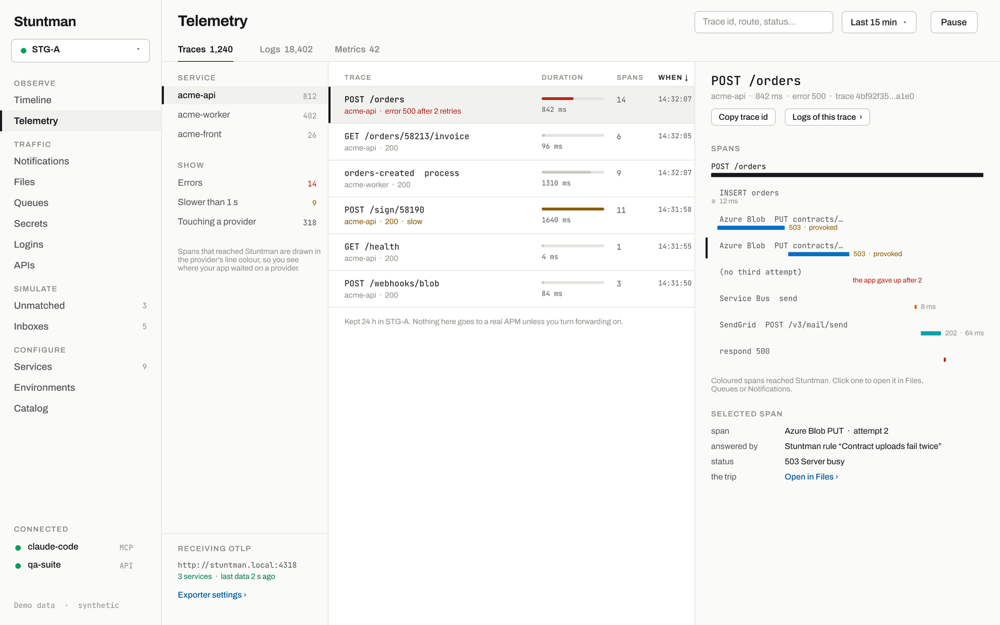

# Telemetry

Stuntman stands in for the APM or OpenTelemetry collector your app exports to in staging. It receives OTLP traces,
logs and metrics over HTTP and gRPC, GELF logs and StatsD/DogStatsD metrics, and keeps them in their own area. It
joins the app's spans to the provider calls Stuntman answered, so a trace shows where the app waited on a provider,
and it lists the hosts the app still calls directly. You can make the collector fail (401, 403, 429, 503, refused,
slow, drop half) and copy everything to a real APM.



## At a glance

| | |
|---|---|
| **Stands in for** | an OpenTelemetry collector or APM OTLP endpoint (OTLP/HTTP protobuf or JSON, gzip; OTLP/gRPC), Graylog GELF input (UDP and HTTP), StatsD / DogStatsD agent |
| **Ports** | `4318` OTLP/HTTP (`STUNTMAN_OTLP_HTTP_PORT`); `4317` OTLP/gRPC (`STUNTMAN_OTLP_GRPC_PORT`); `12201/udp` GELF (`STUNTMAN_GELF_PORT`); `8125/udp` StatsD (`STUNTMAN_STATSD_PORT`); `POST /gelf` on Stuntman's main port (`8025`). No TLS variant |
| **Point your app at** | `OTEL_EXPORTER_OTLP_ENDPOINT=http://localhost:4318` and `OTEL_EXPORTER_OTLP_PROTOCOL=http/protobuf` (or gRPC `http://localhost:4317`); a GELF UDP sink at `localhost:12201`; a StatsD client at `localhost:8125` |
| **It keeps** | spans, log lines (full-text indexed) and metric points, in `telemetry.sqlite` of the environment (its own file). Each signal for its `keep` (traces 24 h, logs 24 h, metrics 7 d by default), counted from when Stuntman received it, within `storage.max` (1 GB). Settings in `telemetry/<env>.yaml` |
| **You can provoke** | the collector answers 401, 403, 429, 503, refuses connections, takes 5 s per batch, or drops half the batches (`provoke_collector`); a signal turned off is answered 200 and dropped (`set_signal`) |
| **Screen** | `/telemetry/traces`, `/telemetry/logs`, `/telemetry/metrics`, `/telemetry/settings` (**Telemetry** at the top of the menu) |
| **Tools** | `telemetry_overview`, `list_traces`, `get_trace`, `wait_for_trace`, `trace_of`, `find_slow_spans`, `list_logs`, `get_log`, `wait_for_log`, `logs_of_trace`, `lines_around`, `count_logs`, `list_metrics`, `query_metric`, `compare_windows`, `metric_exemplars`, `top_series`, `why_it_jumped`, `get_telemetry_settings`, `put_telemetry_settings`, `set_signal`, `provoke_collector`, `stop_provoking`, `set_forwarding`, `clear_telemetry`, `real_provider_calls` |

## Connect your app

### OpenTelemetry SDKs

```sh
OTEL_EXPORTER_OTLP_ENDPOINT=http://localhost:4318
OTEL_EXPORTER_OTLP_PROTOCOL=http/protobuf
OTEL_SERVICE_NAME=acme-api
```

`get_telemetry_settings` (and `telemetry_overview`) returns `endpoints.env` with these lines filled in for the
environment. `get_connections` lists `OTEL_EXPORTER_OTLP_ENDPOINT` too.

For gRPC, `OTEL_EXPORTER_OTLP_ENDPOINT=http://localhost:4317` and `OTEL_EXPORTER_OTLP_PROTOCOL=grpc`.

| App runs | OTLP/HTTP | OTLP/gRPC | GELF / StatsD |
|---|---|---|---|
| On the host, Stuntman on the host or in Docker with the ports published | `http://localhost:4318` | `http://localhost:4317` | `localhost:12201`, `localhost:8125` |
| In a container of the same compose project | `http://stuntman:4318` | `http://stuntman:4317` | `stuntman:12201`, `stuntman:8125` |
| In a container, Stuntman on the host | `http://host.docker.internal:4318` | `http://host.docker.internal:4317` | `host.docker.internal:12201`, `host.docker.internal:8125` |

The Docker image publishes GELF and StatsD as UDP (`12201/udp`, `8125/udp`).

### API keys

An APM key setting in the app can stay: by default (`receive.anyApiKey: true`) any header or none is accepted. With
`anyApiKey: false`, an OTLP/HTTP batch without an `api-key`, `authorization` or `x-api-key` header answers 401. gRPC is
not checked.

### Environments

| Signal path | How the environment is chosen |
|---|---|
| OTLP/HTTP | `POST /e/<env>/v1/<signal>` picks the environment (so `OTEL_EXPORTER_OTLP_ENDPOINT=http://localhost:4318/e/stg-b`); otherwise the environment of the `Host` header (the default one for `localhost`). An unknown host or name answers 404 |
| OTLP/gRPC | the `x-stuntman-env` metadata (`OTEL_EXPORTER_OTLP_HEADERS=x-stuntman-env=stg-b`); otherwise the default environment. An unknown name answers `NOT_FOUND` |
| GELF over UDP | a `_stuntman_env` field in the message; otherwise the default environment |
| StatsD | a `stuntman_env` tag (`#stuntman_env:stg-b`); otherwise the default environment |
| GELF over HTTP | `POST /e/<env>/gelf` or the host name, like the rest of the main port |

The OTLP ports are shared: the default environment's settings (`receive.http`, `receive.grpc`) decide which ports
listen. See [Environments](../environments.md).

### GELF

Send GELF 1.1 JSON over UDP to `:12201` (plain, gzip or zlib; chunked messages up to 5 s apart are reassembled) or
`POST` it to `/gelf` on the main port (one message or an array; answers 202, or 400 `not GELF JSON: …`).

| GELF field | Becomes |
|---|---|
| `short_message` | the log body |
| `level` (syslog) | 0–2 `FATAL`, 3 `ERROR`, 4 `WARN`, 5–6 `INFO`, 7 `DEBUG`; 6 when missing |
| `timestamp` (seconds, may be fractional) | the line's time; now when missing |
| `_service`, `_app`, `_application`, `_service_name`, `facility`, `host` | the service name, first one set; `gelf` when none |
| `host` | also attribute `host.name` |
| `full_message` | attribute `full_message` |
| `_trace_id` / `_traceId` (hex) | the line's trace id |
| other `_x` fields | attribute `x` |

Resource attribute `telemetry.via` is `gelf`.

### StatsD and DogStatsD

Lines `name:value|type|@rate|#tag:value,tag2:value`, several per datagram.

| Type | Becomes |
|---|---|
| `c` | a monotonic counter point of `value / rate` |
| `ms`, `h`, `d` | a histogram point (count 1, sum, min, max = value), unit `ms` |
| `g`, `s`, anything else | a gauge |

Tag `service` sets the service name (`statsd` when missing); tag `stuntman_env` picks the environment; other tags
become attributes. DogStatsD events (`_e{`) and service checks (`_sc|`) are skipped. Resource attribute
`telemetry.via` is `statsd`.

## What it supports

### OTLP receiver

| Endpoint | Notes |
|---|---|
| `POST /v1/traces`, `/v1/logs`, `/v1/metrics` on `:4318` | `content-type` with `json` reads OTLP/JSON (64-bit integers as strings are fine; `{}` is an empty batch); anything else reads protobuf. `content-encoding: gzip` is read. Answers `{}` (JSON) or an empty protobuf body. A body Stuntman cannot read answers 400 with the reason |
| `TraceService/Export`, `LogsService/Export`, `MetricsService/Export` on `:4317` | OTLP/gRPC. Answers with no partial success |

| Signal | Kept |
|---|---|
| Traces | each span: trace id, span id, parent, name, service (`service.name` of the resource, `unknown_service` when missing), kind, start and end, status and message, attributes, events. Client (3) and producer (4) spans also get the host they called (`server.address`/`net.peer.name`/`http.host`, else from `url.full`/`http.url`) and whether that host is Stuntman |
| Logs | time (the record's time, else the observed time), service, severity number, level (`severity_text` upper-cased, `WARNING` → `WARN`, `ERR` → `ERROR`, `CRITICAL` → `FATAL`, `INFORMATION` → `INFO`; else from the severity number), body, trace and span id, attributes. Body and attributes are full-text indexed |
| Metrics | gauges, sums (monotonic → `counter`, else `updown`; cumulative or delta), histograms (bounds and bucket counts), exponential histograms and summaries (count and sum only); attributes, exemplars (trace and span id, value) |

### Joining traces to provider calls

Stuntman records the trace id of the app's calls it answers (the W3C `traceparent` the app sends). `get_trace` gives
each such call (a "trip") to a client span of the same trace: one whose name, host or attributes mention the trip's
host first, else one that reached Stuntman, the nearest in time winning (the app's clock and Stuntman's may differ).
Trips with no span are listed in `unmatchedTrips`. A span reached Stuntman when its host contains `stuntman`, or is
`localhost`/`127.0.0.1`/`::1`/`0.0.0.0` on one of Stuntman's ports (`STUNTMAN_PORT`, `STUNTMAN_HOOKS_PORT`,
`STUNTMAN_SMTP_PORT`, 8025, 8027, 2525), or when a trip was matched to it.

### Queries

| Tool | What it answers |
|---|---|
| `telemetry_overview` | per service the traces, counts of traces, logs and series, `lastData` (receipt time), batches dropped because a signal is off (spans, lines or points in the last 15 min), `refused`, `droppedHalf`, `lastForward`, `endpoints`, `listening` (a port bind error), `settings`, `usedBytes`. `since` default 15m |
| `list_traces` | newest first: `traceId`, `name` (root span), `service`, `services`, `durationMs`, `spans`, `statusCode`, `error` (status error, or HTTP ≥ 500), `trips`, `touchesProvider`, `at`. Filters `service`, `status` (`error`/`ok`), `slower_than`, `touching_provider`, `route` (part of the root span name), `since` (15m), `limit` (100, at most 500) |
| `get_trace` | the span tree depth first: `depth`, `offsetMs`, `durationMs`, `attributes`, `events`, `exception` (the `exception` event's attributes), `host`, `reachedStuntman`, `trip`; `unmatchedTrips`. A trace with no spans answers 404 with its `trips` |
| `wait_for_trace` | the first trace whose root span name contains `route` (or `span_name`), optional `status`; looks back 15 s; `timeout` 30 s (max 5 min), then 408 |
| `trace_of` | from a trip or message id (`msg_0412`, `dlv_0042`) back to the app's trace; 404 when the call came without a trace id |
| `find_slow_spans` | spans of a trace over `over_ms` (500) and every span that reached Stuntman, provider spans first |
| `list_logs` | newest first: `id` (`log_<n>`), `seq`, `at`, `timeNs`, `service`, `level`, `severity`, `message`, `traceId`, `spanId`, `attributes`; `total`; `facets` (counts per level and service). Filters `service` and `level` (lists), `text` (words, each a required prefix match in the message or attributes, or the start of a trace id), `trace_id`, `since` (15m), `limit` (100, at most 2000), `before_seq`/`after_seq` for paging |
| `get_log`, `lines_around` | one line; the `before`/`after` lines (20 each) around it, across services |
| `wait_for_log` | the first matching line (`text` or `level` required); looks back 15 s; `timeout` 30 s (max 5 min), then 408 |
| `logs_of_trace` | every line of one trace, oldest first (up to 2,000) |
| `count_logs` | `{count}` with the `list_logs` filters |
| `list_metrics` | `name`, `category`, `kind`, `unit`, `description`, `services`, `series`, `last`; filters `service`, `text` |
| `query_metric` | one value per `step` (1m) per breakdown value (`by`, an attribute) over `since` (15m). `stat`: `count`, `rate` (per minute), `sum`, `avg`, `p50`, `p95` (default), `p99` (from histogram buckets, interpolated), `last`, `errors`. Cumulative series become deltas; each start time is its own stream, so replicas never mix |
| `compare_windows` | the value in `before` and `after` windows (`30m-15m` ago, or `epoch-ms..epoch-ms`) and the relative change, per breakdown value |
| `metric_exemplars` | trace ids the app attached to points within `step` of `at`, highest value first |
| `top_series` | how many values an attribute has on a metric (distinct count and top 20) since `since` (1h) |
| `why_it_jumped` | steps where the stat is over twice its median; per `by` value (default `server.address`) the value during and before, calls and errors; the provider calls Stuntman answered with an error or a provoked status in that time, grouped by rule; the collector setting |
| `real_provider_calls` | hosts the app called directly (client spans whose host is not Stuntman, nor `localhost`, `127.0.0.1`), with `calls`, `services`, `last`, since `since` (1h) |

`since` takes a duration (`15m`, `1h`, `24h`) or epoch milliseconds (12 digits or more).

### Settings (`telemetry/<env>.yaml`)

```yaml
kind: telemetry
environment: stg-a
receive:
  http: 4318
  grpc: 4317
  anyApiKey: true
signals:
  traces: { on: true, keep: 24h }
  logs: { on: true, keep: 24h }
  metrics: { on: true, keep: 7d }
collector:
  answer: normal        # normal | 403 | 401 | 429 | 503 | refused | slow | drop_half
  onlyFor: all          # all, or a service.name
forward:
  enabled: false
  endpoint: ""
  headers:
    api-key: secret://apm-license-key
storage:
  max: 1GB
```

Read it with `get_telemetry_settings` (also `GET /api/telemetry/settings.yaml` for the raw file), replace it with
`put_telemetry_settings` (`settings` object or `yaml`). Validation: each `keep` a duration (`24h`, `7d`), `answer` one
of the list, a forward endpoint starting with `http://` or `https://` and including the port, `storage.max` a size
(`1GB`, `500MB`). The file is read on every batch, so edits by hand apply at once; port changes and the end of a
`refused` answer move the listeners within 15 s.

### Forwarding

`set_forwarding {"on": true, "endpoint": "https://otlp.example-apm.com:4318", "header_secret": "secret://apm-license-key", "header": "api-key"}`
copies every kept OTLP batch, as received, to `<endpoint>/v1/<signal>` with the headers (values resolved from
`secret://<name>` or `env:<VAR>`; a literal key is refused). Timeout 10 s. A failure never reaches the app;
`lastForward` shows the last status or error. Batches dropped (signal off, `drop_half`) or refused are not
forwarded. gRPC batches are forwarded as protobuf over HTTP.

## How it behaves

- **Retention by receipt time.** Each signal is deleted when it was received longer ago than its `keep`, checked
  every 15 s. An app with a frozen or skewed clock that sends timestamps days in the past keeps its data for the whole
  retention.
- **Time windows by event time.** `since` on every query, the screens' time windows, and `real_provider_calls` filter
  on the event's own time (span start, log time, point time). Data with old timestamps is kept but falls outside
  `since=15m`: ask with a wider `since` (or epoch ms).
- **Storage limit.** When `telemetry.sqlite` holds more than `storage.max`, the oldest rows are deleted in batches.
- **Order.** A signal turned off, a provoked answer and the API-key check apply to OTLP only. GELF and StatsD are
  always kept and never forwarded.
- **Paused environment.** OTLP batches answer 503 (gRPC `UNAVAILABLE`).
- **Clock.** Receipt times, retention and the collector's `for` use the wall clock; [`advance_clock`](../clock.md)
  does not affect telemetry.
- **Persistence.** The data and settings survive a restart. The counters (`refused`, `droppedHalf`, dropped
  batches, `lastForward`) are in memory.
- **Own database.** Telemetry writes to its own SQLite file per environment, so heavy log volume does not slow the
  other services.

## Provoke failures

`provoke_collector {"answer": "...", "only_for": "acme-api", "for": "10m"}` sets the collector's answer; it ends by
itself after `for` (10 min by default). `only_for` limits it to batches whose first resource has that
`service.name`. `stop_provoking` ends it now.

| Failure | How | What the app sees (HTTP / gRPC) | Turn it off |
|---|---|---|---|
| Bad license key | `provoke_collector {"answer": "403"}` | 403 / `PERMISSION_DENIED` `provoked by Stuntman` | `stop_provoking`, or `for` runs out |
| Unauthorized | `provoke_collector {"answer": "401"}` | 401 / `UNAUTHENTICATED` | same |
| Too many requests | `provoke_collector {"answer": "429"}` | 429 with `retry-after: 5` / `RESOURCE_EXHAUSTED` | same |
| Collector down | `provoke_collector {"answer": "503"}` | 503 with `retry-after: 5` / `UNAVAILABLE` | same |
| Connection refused | `provoke_collector {"answer": "refused"}` with `only_for: all` | the OTLP listeners really stop: connection refused on 4318 and 4317. With `only_for` a service, or in another environment, that service's batches get 503 / `UNAVAILABLE` instead | same; the listeners come back at once with `stop_provoking`, or when `for` runs out |
| Slow collector | `provoke_collector {"answer": "slow"}` | each batch answers after 5 s | same |
| Lost batches | `provoke_collector {"answer": "drop_half"}` | about half the batches are answered 200 and dropped | same |
| Signal off | `set_signal {"signal": "logs", "on": false}` | 200, nothing kept; counted as dropped in `telemetry_overview` | `set_signal {"signal": "logs", "on": true}` |
| API key required | `put_telemetry_settings` with `receive.anyApiKey: false` | OTLP/HTTP without a key header answers 401 | set it back to `true` |

## See what the app did

| Need | Tool | Route |
|---|---|---|
| Is anything arriving? | `telemetry_overview` | `GET /api/telemetry/overview` |
| The trace of a request | `wait_for_trace {"route": "POST /orders"}` then `get_trace` | `GET /api/telemetry/traces/wait`, `GET /api/telemetry/traces/{trace_id}` |
| Where the time went | `find_slow_spans {"trace_id": "…", "over_ms": 300}` | `GET /api/telemetry/traces/{trace_id}/slow` |
| From a provider call back to the app | `trace_of {"trip_id": "msg_0412"}` | `GET /api/telemetry/trips/{trip_id}/trace` |
| An error line | `wait_for_log {"level": "error", "text": "SHP-1042"}` | `GET /api/telemetry/logs/wait` |
| Is the error gone after a fix? | `count_logs {"level": "error", "since": "5m"}` | `GET /api/telemetry/logs/count` |
| A latency change | `compare_windows {"name": "http.client.request.duration", "before": "30m-15m", "after": "15m-0", "by": "server.address"}` | `GET /api/telemetry/metrics/{name}/compare` |
| Calls that escaped Stuntman | `real_provider_calls` | `GET /api/apis/real-provider-calls` |

On the [Timeline](../timeline.md), calls with the same trace id group together and open their trace. The screens
show the provoked answer as a strip until it ends.

## Recipes

### 1. Check the app exports at all

1. Set `OTEL_EXPORTER_OTLP_ENDPOINT=http://localhost:4318`, `OTEL_EXPORTER_OTLP_PROTOCOL=http/protobuf`,
   `OTEL_SERVICE_NAME=acme-api` and start the app.
2. `telemetry_overview`: `services` lists `acme-api`; `lastData` is recent.
3. If nothing: check `listening` (a port bind error) and the app's exporter logs.

### 2. Find which provider call made a request slow

1. Run the action in the app.
2. `wait_for_trace {"route": "POST /orders", "timeout": "20s"}`.
3. `find_slow_spans {"trace_id": "<traceId>"}`: provider spans come first, with the `trip` Stuntman answered.

### 3. Find calls that bypass Stuntman

1. Exercise the app.
2. `real_provider_calls {"since": "1h"}`: each `host` is a base URL still pointing at a real provider.
3. Point that client at Stuntman and repeat until the list is empty.

### 4. Make the app survive a collector outage

1. `provoke_collector {"answer": "503", "for": "5m"}`.
2. Run the app; check it keeps serving requests and its exporter retries (no crash, bounded memory).
3. `provoke_collector {"answer": "refused", "for": "2m"}` to test connection errors.
4. `stop_provoking`; `telemetry_overview` shows data again.

### 5. Assert an error was logged with its trace

1. Trigger the failure in the app.
2. `wait_for_log {"level": "error", "text": "payment declined"}`.
3. `logs_of_trace {"trace_id": "<traceId of the line>"}` to read the whole request.

### 6. Old timestamps from the app

1. The app runs with a fake clock (days in the past) and exports.
2. `list_traces` with the default `since=15m` shows nothing.
3. `list_traces {"since": "30d"}` (or epoch ms of the app's time) shows them; they stay for the whole `keep`.

### 7. Copy to a real APM while testing

1. Store the key as a secret (see [Secrets](secrets.md)), e.g. `apm-license-key`.
2. `set_forwarding {"on": true, "endpoint": "https://otlp.example-apm.com:4318", "header_secret": "secret://apm-license-key"}`.
3. `telemetry_overview`: `lastForward.status` is 2xx.

## Errors and troubleshooting

| Symptom or error text | Cause | Fix |
|---|---|---|
| Nothing arrives, `listening` shows `OTLP/HTTP port 4318: …` | another process holds the port | free it, or change `receive.http` in the default environment's settings |
| 404 `No Stuntman environment answers for this host` | the host name or `/e/<name>` names no environment | use `localhost` or a valid environment name |
| 401 from the collector, no provocation on | `receive.anyApiKey` is `false` and the exporter sends no key header | send `api-key`, or set `anyApiKey: true` |
| 400 with a decode error | protobuf sent with a JSON content type, or the reverse | match `OTEL_EXPORTER_OTLP_PROTOCOL` and the content type |
| Data arrives but `list_traces` is empty | the app's timestamps are outside `since` | widen `since` |
| Traces never show `trips` | the app does not propagate trace context on its calls to Stuntman | enable W3C `traceparent` propagation in the HTTP client instrumentation |
| gRPC batches go to the default environment | no `x-stuntman-env` metadata | `OTEL_EXPORTER_OTLP_HEADERS=x-stuntman-env=<env>` |
| GELF lines missing | sent over TCP (not offered), or not JSON | use UDP or `POST /gelf` |
| `Endpoint: start with https:// and include the port` | forward endpoint without a scheme or port | e.g. `https://otlp.example-apm.com:4318` |
| `header_secret: a reference like secret://apm-license-key, never the key itself` | a literal key was given | store it as a secret and pass the reference |
| `clear_telemetry` answers `Pass confirm=true` | the guard | `clear_telemetry {"confirm": true}` (settings stay) |

## Not done

- No TLS on the OTLP, GELF or StatsD ports.
- GELF over TCP.
- Exponential histograms and summaries keep only count and sum (no percentiles from them).
- OTLP partial success is never reported.
- Signal switches, provocations, API-key checks and forwarding do not apply to GELF and StatsD.
- The API-key check does not apply to gRPC.
- `refused` takes the listeners down only for the default environment and `only_for: all`.

Missing something? Tell the developer what the fix would be and offer a pull request — see [Contributing](../../CONTRIBUTING.md).

## Tools and routes

<!-- tools: telemetry -->
_Generated by `tools/gen_tool_reference.py` from the engine source; each tool is an MCP tool and the HTTP route shown (under `/api`)._

| Tool | HTTP | Required | Optional | What it does |
|---|---|---|---|---|
| `telemetry_overview` | `GET /api/telemetry/overview` | — | since | What the receiver got: services, counts, last data, dropped and refused batches, the provoked answer, endpoints. |
| `list_traces` | `GET /api/telemetry/traces` | — | service, status, slower_than, touching_provider, since, route, limit | Traces with duration, span count, status and how many spans reached Stuntman, newest first. |
| `get_trace` | `GET /api/telemetry/traces/{trace_id}` | trace_id | — | The span tree; provider spans carry the trip, what answered it, and a link. |
| `wait_for_trace` | `GET /api/telemetry/traces/wait` | — | route, span_name, status, timeout, since | The first matching trace: what an agent waits for after acting in the app. Looks back 15 s by default. |
| `trace_of` | `GET /api/telemetry/trips/{trip_id}/trace` | — | trip_id, message_id | From a trip, message or delivery back to the app trace that caused it. |
| `find_slow_spans` | `GET /api/telemetry/traces/{trace_id}/slow` | trace_id | over_ms | Where the time went: spans over the threshold, provider spans first. |
| `list_logs` | `GET /api/telemetry/logs` | — | service, level, text, trace_id, since, limit, before_seq | Newest first, with level, service, message, trace id and attributes; facets give counts per level and service. |
| `get_log` | `GET /api/telemetry/logs/{log_id}` | log_id | — | One log line. |
| `wait_for_log` | `GET /api/telemetry/logs/wait` | — | text, level, service, timeout, since | The first matching line: what an agent waits for after acting in the app. Looks back 15 s by default. |
| `logs_of_trace` | `GET /api/telemetry/traces/{trace_id}/logs` | trace_id | — | Every line the app wrote while serving one trace, in order. |
| `lines_around` | `GET /api/telemetry/logs/{log_id}/around` | log_id | before, after | The lines just before and after one line, across services. |
| `count_logs` | `GET /api/telemetry/logs/count` | — | level, service, text, since | Quick check that an error stopped happening after a fix. |
| `get_telemetry_settings` | `GET /api/telemetry/settings` | — | — | Endpoints, signals with keep, collector answer, forwarding, storage used. |
| `put_telemetry_settings` | `PUT /api/telemetry/settings` | — | settings, yaml | Replaces the settings (Save on T3): a settings object, or yaml with the whole file. |
| `set_signal` | `PUT /api/telemetry/signals/{signal}` | signal | on, keep | Turn traces, logs or metrics on or off; off means answered 200 and dropped. |
| `provoke_collector` | `POST /api/telemetry/collector/provoke` | answer | only_for, for | 403, 401, 429, 503, refused, slow or drop_half; ends by itself. |
| `stop_provoking` | `DELETE /api/telemetry/collector/provoke` | — | — | The collector answers normally again; the strip goes away. |
| `set_forwarding` | `PUT /api/telemetry/forwarding` | — | on, endpoint, header_secret, header | Copy everything to a real APM; the key is a Secrets reference, never a value. |
| `clear_telemetry` | `DELETE /api/telemetry/data` | confirm | — | Deletes traces, logs and metrics of the environment; settings stay. |
| `list_metrics` | `GET /api/telemetry/metrics` | — | service, text | Name, type, unit, category, services and number of series. |
| `query_metric` | `GET /api/telemetry/metrics/{name}` | name | stat, by, since, step | One value per step, per breakdown value. stat: count, rate, sum, avg, p50, p95, p99, last, errors. |
| `compare_windows` | `GET /api/telemetry/metrics/{name}/compare` | name, before, after | stat, by | The two values and the change, to say whether a fix or a rule made a difference. Windows: 30m-15m (ago) or epoch-ms..epoch-ms. |
| `metric_exemplars` | `GET /api/telemetry/metrics/{name}/exemplars` | name | at, by, by_value, step | The trace ids the app attached to points near a time; open them with get_trace. |
| `top_series` | `GET /api/telemetry/metrics/{name}/series` | name, attribute | since | How many values an attribute has: finds the attribute that will cost money in a real APM. |
| `why_it_jumped` | `GET /api/telemetry/metrics/{name}/why` | name | stat, by, since, step | Finds steps where a metric jumped (over twice its median) and says which breakdown value drove it, its errors, and what Stuntman answered then. |
<!-- /tools -->
