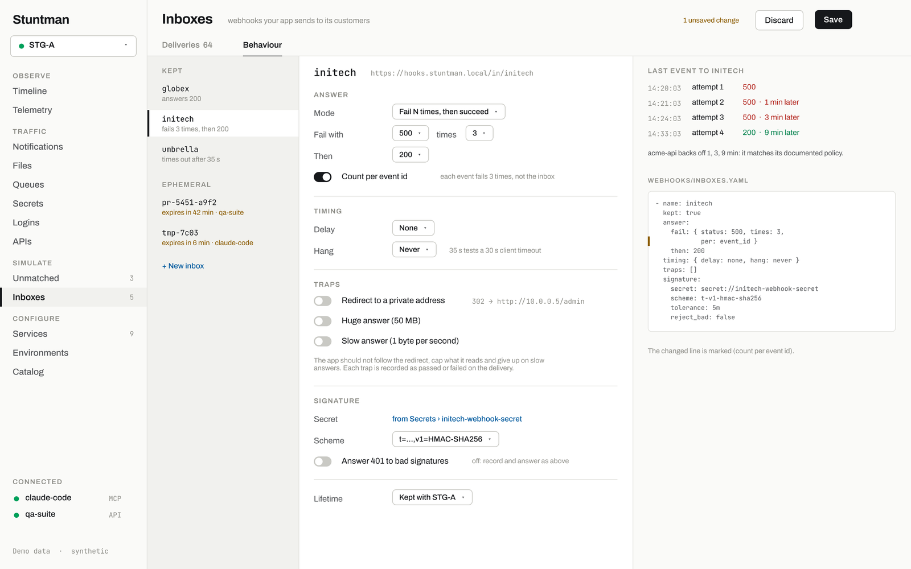

# Webhook inboxes

A webhook inbox is an endpoint **your app** sends its own webhooks to. It stands in for your customer's
receiving server, so you can test the sending side: retries, timeouts, signatures, replays and redirects. Each
inbox answers the way you configure it (200, an error, fail N times then succeed, hang, a TCP reset, an empty
reply, traps) and checks the signature the app sends. Stuntman keeps every delivery with its headers, body,
signature check, answer and all the attempts of the same event.



## At a glance

| | |
|---|---|
| **Stands in for** | Any HTTP server that receives webhooks (your customer's endpoint). Not a provider: the app is the sender |
| **Ports** | `8027` (`STUNTMAN_HOOKS_PORT`), plain HTTP/1.1 only, its own socket so resets and empty replies are real. The tools and routes are on `8025` (`STUNTMAN_PORT`) under `/api` |
| **Point your app at** | `http://localhost:8027/in/<inbox>`. Another environment: `http://localhost:8027/e/<env>/in/<inbox>`, or a host name of that environment |
| **It keeps** | Kept inboxes in `webhooks/inboxes.yaml`; ephemeral inboxes in SQLite; every delivery for 7 days: method, path, headers, body (first 256 KB), size, event type, event id, label, attempt number, duplicate of, signature check, answer, answer time, when the app gave up, trap results, remote address, user agent, trace id |
| **You can provoke** | `always_200`, `accept_202`, `error` (any status), `fail_then` (N failures, then a status), `fail_share` (a percent fails), `hang`, `reset`, `empty`; a `delay` before any answer; traps `redirect_private`, `huge`, `slow`; strict signatures (`reject_bad`: 401); `410 Gone` after removal or expiry |
| **Screen** | `/inboxes/webhooks` (deliveries), `/inboxes/webhooks/<name>` (one inbox), `/inboxes/webhooks/<name>/behaviour` |
| **Tools** | `create_webhook_inbox`, `set_inbox`, `get_webhook_inbox`, `list_webhook_inboxes`, `remove_inbox`, `list_deliveries`, `get_delivery`, `wait_for_delivery`, `put_webhooks_yaml` (also `create_inbox`, `get_inbox`, `delete_inbox`, shared with e-mail inboxes) |

## Connect your app

1. Create an inbox. Its URL comes back in `url`.

   ```text
   create_webhook_inbox {"name": "globex", "keep": true, "secret": "whsec_test"}
   → {"name": "globex", "url": "http://localhost:8027/in/globex", "expiresAt": null, "inbox": {...}}
   ```

2. Register that URL in your app as the customer's webhook endpoint (in its settings, its database, or its
   test fixture).

The URL is `http://<host>:8027[/e/<env>]/in/<inbox>`. `<host>` is the host part of `STUNTMAN_HOST`
(`localhost` by default). An environment with a base domain of its own gets a URL on that domain with no
`/e/<env>` prefix. Anything after `/in/<inbox>/` is accepted and kept in `path`: `/in/globex/orders/v2` is a
delivery to `globex`.

| App runs | URL to register |
|---|---|
| On the host | `http://localhost:8027/in/globex` |
| In Docker, Stuntman on the host | `http://host.docker.internal:8027/in/globex` |
| In the same compose file as Stuntman | `http://stuntman:8027/in/globex` (the service name) |
| Against another environment | `http://localhost:8027/e/pr-9/in/globex` |

The environment is picked in this order: the `/e/<env>/` path prefix, then the `Host` header (a host under the
environment's base domain, or `<anything>.<env>.localhost`), then the default environment. See
[Environments](../environments.md).

No authentication is needed to post to an inbox. Any method is accepted.

### Inbox names

Lowercase letters, digits and dashes, 1 to 48 characters (the name is part of the URL). `create_webhook_inbox`
without `name` makes a random one, `tmp-<4 hex digits>`.

### Kept or ephemeral

| Kind | Where | Lifetime |
|---|---|---|
| Kept (`keep: true`, or `expires: "never"`) | `webhooks/inboxes.yaml` in the environment's data folder, the source of truth for the screen and the tools | Until removed |
| Ephemeral (the default) | SQLite | `expires` (default `1h`; any duration such as `30m`, `1d`). Swept every 30 s |

An expired or removed inbox answers `410 Gone` for 24 hours, then `404`. `set_inbox` can move an inbox between
kept and ephemeral (`expires`, `keep`).

## What it supports

### The inbox port (`8027`)

| Request | Answer |
|---|---|
| `<any method> /in/<inbox>[/...]` | The inbox's behaviour (below). The delivery is recorded first, also for an unknown inbox |
| `/in/<unknown>` | `404 No such inbox` (recorded) |
| `/in/<removed or expired>` | `410 This inbox expired or was removed` (recorded), for 24 h after removal |
| Any other path | `404 Stuntman webhook inboxes: send to /in/<inbox>` |
| `/_trap/<delivery id>` | The redirect trap's target (see Traps) |
| Paused environment | `503 This environment is paused in Stuntman` |
| No environment for the host | `404 No Stuntman environment answers for this host` |

Request handling: `Content-Length` bodies and `Transfer-Encoding: chunked` bodies are read; `Expect:
100-continue` gets `100 Continue`. Headers are limited to 64 KB, bodies to 10 MB (a larger chunked body closes
the connection; a larger `Content-Length` body is cut). Every answer has `Content-Type: text/plain`, body `ok`
(below 300) or `error`, and `Connection: close`. There is no keep-alive and no HTTPS.

### Behaviour (`answer.mode`)

| Mode | What the app gets | Settings |
|---|---|---|
| `always_200` (default) | `200 ok` | none |
| `accept_202` | `202 ok` | none |
| `error` | `status` every time | `status` (default 500) |
| `fail_then` | `status` for the first `times` deliveries, then `then` | `status` (500), `times` (3, from 1 to 50), `per` (`event_id` or `inbox`), `then` (200) |
| `fail_share` | `status` for `share` percent of deliveries at random, `then` for the others | `status` (500), `share` (50, 0 to 100), `then` (200) |
| `hang` | No answer; the socket stays open for `hang` (default `35s`), then `200` | `timing.hang` |
| `reset` | A TCP reset (close with zero linger) | none |
| `empty` | The connection closes without a byte | none |

`timing.delay` (`none` or a duration, at most 5 minutes) waits before any mode answers. `timing.hang` is at most 5
minutes. If the app closes the connection during a delay or a hang, the delivery is recorded with answer `no
answer` and `gaveUpMs` (when it gave up).

`fail_then` counts per event: the event id is the value of the first header whose name contains `event-id`, else
the event id found in the delivery (see Event detection). With `per: inbox` every delivery shares one counter.
Deliveries with no event id at all also share one counter. The counters reset when `set_inbox` changes the
answer.

### Traps

`traps` is a list of `redirect_private`, `huge`, `slow`. With several, each delivery gets one, taking turns (by
delivery number). A trap replaces the mode for that delivery.

| Trap | What Stuntman sends | Result on the delivery |
|---|---|---|
| `redirect_private` (no `redirect_to`) | `302` with `Location: http://127.0.0.1:8027[/e/<env>]/_trap/<delivery id>` | `failed` ("followed the redirect to 127.0.0.1, a private address: an SSRF hole") if the app requests that URL; `passed` ("not followed") after 20 s; `pending` until then |
| `redirect_private` with `redirect_to` | `302` with `Location: <redirect_to>` (e.g. `http://10.0.0.5/admin`) | `unobserved`: Stuntman cannot see whether the app followed |
| `huge` | `200` with `Content-Length` 50 MB of `x` | `passed` ("stopped reading after N MB") if the app closed early, `failed` if it read all 50 MB |
| `slow` | `200` with `Content-Length: 60`, one byte per second | `passed` ("gave up after N s") if the app closed early, `failed` ("waited 60 s for 60 bytes") |

### Signature checks (`signature`)

| Key | Meaning | Default |
|---|---|---|
| `secret` | The shared secret: a literal, `env:NAME` (an environment variable of the Stuntman process), or `secret://name` (the environment's `secrets.yaml`). Empty: no check | empty |
| `scheme` | `t-v1-hmac-sha256`, `hmac-sha256-hex`, `hmac-sha256-base64`, `none` | `t-v1-hmac-sha256` |
| `header` | The header that carries the signature. Empty: the first header whose name contains `signature` (any case) | empty |
| `previous_secret` | The secret before rotation | empty |
| `tolerance` | A duration such as `5m`; validated and stored | `5m` |
| `reject_bad` | Answer `401 Invalid signature` to a signature that is `invalid`, `old_secret` or `missing` | `false` |

| Scheme | What must match |
|---|---|
| `t-v1-hmac-sha256` | Header value `t=<unix seconds>,v1=<hex>` (Stripe style): HMAC-SHA256 of `"<t>.<raw body>"`. Any of several `v1=` parts may match |
| `hmac-sha256-hex` | HMAC-SHA256 of the raw body, hex, case-insensitive; a `sha256=` prefix is accepted (GitHub style) |
| `hmac-sha256-base64` | HMAC-SHA256 of the raw body, base64 (Shopify style) |

Each delivery gets a `signature` object:

| Field | Values |
|---|---|
| `result` | `valid`, `invalid` (does not match), `old_secret` (matches `previous_secret`), `missing` (no signature header), `unchecked` (no secret, scheme `none`, or a `secret://` name not in `secrets.yaml`) |
| `detail` | e.g. `valid · HMAC-SHA256 over “t.body”`, `does not match · HMAC-SHA256 of the body, hex`, `signed with the old secret` |
| `header` | The header the signature was read from |
| `timestampAgeMs` | Now minus the timestamp: from `t=` for `t-v1-hmac-sha256`, else from the first header whose name contains `timestamp`. Seconds or milliseconds are both read |
| `warning` | With a body-only scheme and a timestamp header: "the timestamp is not signed: a replay with a new timestamp still passes" |

## How it behaves

### Event detection

Each delivery is labelled from its body (JSON keys in any case) and headers:

| Field | Taken from, in order |
|---|---|
| `eventType` | Body key `type`, `event`, `event_type`, `eventType`, `topic` or `action` (a number is replaced by `<key>Description` when present, e.g. `Action: 1` + `ActionDescription: "DocumentSigned"`); else a header whose name ends in `-event` or `-topic` |
| `eventId` | A header whose name contains `event-id`, `webhook-id`, `delivery-id` or `delivery`; else the body's `id` |
| `label` | In `data.object`, `data` or the body: `order`, `number`, `invoice`, `invoice_id`, `order_id`, `reference` or `id`. Numbers read `#58213` |

### Attempts and duplicates

- `attempt` is 1 plus the number of earlier deliveries to the same inbox with the same `eventId`.
- `duplicateOf` (`{id, at}`) is set when an earlier delivery of the same `eventId` was already answered 2xx: the
  app sent again after the inbox said yes.
- `get_delivery` returns every attempt of the same event, in order, in `attempts`.
- Deliveries without an event id have no attempts and are never duplicates.

### Timing and storage

- Times use the real clock, not the [environment's clock](../clock.md).
- Deliveries are deleted after 7 days. Kept inboxes survive restarts (YAML); ephemeral inboxes survive restarts
  until they expire.
- A delivery with a `traceparent` header appears on the [Timeline](../timeline.md) as `POST /in/<inbox>
  <event type>`, grouped with the app's trace. Deliveries without one are not on the Timeline; they are on the
  inbox's screen.
- A mode other than `always_200` and `accept_202` marks the delivery with the inbox's rule (e.g. `initech · fails 3
  times, then 200`).

## Provoke failures

| Failure | How | What the app sees | Turn it off |
|---|---|---|---|
| Server error every time | `set_inbox {"name": "globex", "mode": "error", "status": 503}` | `503` | `set_inbox {"name": "globex", "mode": "always_200"}` |
| Retries succeed after N tries | `set_inbox {"name": "globex", "mode": "fail_then", "times": 3, "status": 500, "then": 200}` | `500, 500, 500, 200` per event id | `mode: always_200` |
| A share fails | `set_inbox {"name": "globex", "mode": "fail_share", "share": 30, "status": 502}` | 30 % `502`, the rest `200` | `mode: always_200` |
| Slow customer | `set_inbox {"name": "globex", "delay": "8s"}` | The answer after 8 s | `delay: "none"` |
| Timeout | `set_inbox {"name": "globex", "mode": "hang", "hang": "35s"}` | No answer for 35 s | `mode: always_200` |
| Connection reset | `set_inbox {"name": "globex", "mode": "reset"}` | `ECONNRESET` / `ConnectionResetError` | `mode: always_200` |
| Empty reply | `set_inbox {"name": "globex", "mode": "empty"}` | `RemoteDisconnected` / "empty reply from server" | `mode: always_200` |
| Strict customer | `set_inbox {"name": "globex", "secret": "whsec_test", "reject_bad": true}` | `401 Invalid signature` for a bad, old-secret or missing signature | `reject_bad: false` |
| Secret rotation | `set_inbox {"name": "globex", "secret": "whsec_new", "previous_secret": "whsec_old"}` | `200`; deliveries signed with the old secret show `old_secret` | `previous_secret: ""` |
| SSRF check | `set_inbox {"name": "globex", "traps": ["redirect_private"]}` | `302` to a loopback URL | `traps: []` |
| Huge answer | `set_inbox {"name": "globex", "traps": ["huge"]}` | A 50 MB `200` body | `traps: []` |
| Slow-drip answer | `set_inbox {"name": "globex", "traps": ["slow"]}` | 60 bytes, one per second | `traps: []` |
| Customer gone | `remove_inbox {"name": "globex"}` | `410 Gone` for 24 h | `create_webhook_inbox` again (clears the gone mark) |

## See what the app did

| Need | Tool | HTTP |
|---|---|---|
| Deliveries, newest first | `list_deliveries {"inbox": "globex", "event": "order.completed", "since": "15m", "limit": 200}` | `GET /api/webhooks/deliveries?inbox=globex`, `GET /api/inboxes/globex/deliveries` |
| One delivery with body and all attempts | `get_delivery {"id": "dlv_0042"}` | `GET /api/webhooks/deliveries/dlv_0042`, `GET /api/inboxes/deliveries/dlv_0042` |
| Wait for the next answered delivery | `wait_for_delivery {"inbox": "globex", "event": "order.completed", "timeout": "20s"}` | `GET /api/inboxes/deliveries/wait?inbox=globex&timeout=20s` |
| The inbox and its last event's attempts | `get_webhook_inbox {"name": "globex"}` | `GET /api/webhooks/inboxes/globex` |
| All inboxes | `list_webhook_inboxes` | `GET /api/webhooks/inboxes` |
| The kept inboxes as YAML | | `GET /api/webhooks/inboxes.yaml` |

`event` filters by event type or event id. `since` takes `15m`, `1h`, `1d`. `list_deliveries` returns
`deliveries` and `total`.

`wait_for_delivery` returns the newest delivery the inbox has finished answering (`done: true`), with its
`attempts`. It looks back 15 s by default (`since` changes that), waits up to `timeout` (default `60s`, at most
`10m`), and answers `408` with the `pending` deliveries when nothing came. A delivery whose redirect trap is still
`pending` is returned as it is. With a `subscription` argument, `wait_for_delivery` is the storage tool instead.

Delivery fields that matter: `id` (`dlv_0042`), `inbox`, `at`, `method`, `path`, `headers` (list of `[name,
value]`), `body` (in `get_delivery`), `size`, `eventType`, `eventId`, `label`, `attempt`, `duplicateOf`,
`signature`, `answer` (`"200"`, `"500"`, `"302"`, `"401"`, `"404"`, `"410"`, `no answer`, `reset`, `empty`),
`answerMs`, `gaveUpMs`, `traps` (`[{trap, result, detail}]`), `remote`, `userAgent`, `traceId`, `done`.

`get_webhook_inbox` and `list_webhook_inboxes` return `inbox`, `url`, `summary` (e.g. `fails 3 times, then
200`), `kind` (`kept` or `ephemeral`), `deliveriesLastHour`, `expired`; `get_webhook_inbox` adds `lastEvent` and
`yaml`. `list_webhook_inboxes` returns `listening: true`, or the bind error when port 8027 could not be opened.

## Recipes

1. **Prove the app retries until it succeeds.**

   ```text
   create_webhook_inbox {"name": "initech", "fail": 3, "then": 200}
   # the app sends order.completed with X-Acme-Event-Id: evt_9 and retries
   wait_for_delivery {"inbox": "initech", "timeout": "2m"}
   get_delivery {"id": "<id>"}   → attempts[].answer == ["500", "500", "500", "200"]
   ```

   `fail` with `then` is a shortcut for `mode: fail_then, times: 3`. A new event id starts failing again.

2. **Check the app's signature.**

   ```text
   create_webhook_inbox {"name": "globex", "keep": true, "secret": "whsec_test", "scheme": "t-v1-hmac-sha256"}
   # the app sends with X-Acme-Signature: t=<ts>,v1=<hmac>
   list_deliveries {"inbox": "globex", "limit": 1}   → deliveries[0].signature.result == "valid"
   ```

   For GitHub style use `scheme: hmac-sha256-hex` (with or without `sha256=`); name the header with `header` when
   the app sends more than one header containing "signature".

3. **Test secret rotation.** Set `secret` to the new secret and `previous_secret` to the old one. Deliveries
   signed with the old one show `signature.result: old_secret`. Add `reject_bad: true` to make them fail with 401.

4. **Find out whether the app has a timeout.**

   ```text
   set_inbox {"name": "globex", "mode": "hang", "hang": "60s"}
   # the app sends one webhook
   list_deliveries {"inbox": "globex", "limit": 1}   → answer "no answer", gaveUpMs 10000 (the app's timeout)
   ```

   If `answer` is `200` and `answerMs` is about 60 000, the app waited the whole hang.

5. **Check that the app does not follow redirects to private addresses.**

   ```text
   set_inbox {"name": "globex", "traps": ["redirect_private"]}
   # the app sends one webhook
   # wait 20 s
   list_deliveries {"inbox": "globex", "limit": 1}   → traps[0].result "passed" or "failed"
   ```

6. **Detect duplicate sends.** After the app sends the same event id twice and the first got 2xx, the second
   delivery has `duplicateOf` and `attempt: 2`. Filter with `list_deliveries {"inbox": "globex", "event":
   "evt_3"}`.

7. **Keep inboxes in Git.** Read `GET /api/webhooks/inboxes.yaml`, commit it, and restore it with
   `put_webhooks_yaml {"yaml": "<file>"}` (it replaces all kept inboxes and validates each one):

   ```yaml
   - name: initech
     kept: true
     answer: { mode: fail_then, status: 500, times: 3, per: event_id, then: 200 }
     timing: { delay: none, hang: never }
     traps: []
     signature: { secret: secret://initech-webhook-secret, scheme: t-v1-hmac-sha256, tolerance: 5m, rejectBad: false }
   ```

## Errors and troubleshooting

| Symptom or error text | Cause | Fix |
|---|---|---|
| `404 No such inbox` | The inbox does not exist in this environment | `list_webhook_inboxes`; check the `/e/<env>` prefix or host |
| `410 This inbox expired or was removed` | An ephemeral inbox expired, or it was removed | `create_webhook_inbox` with the same name, or `keep: true` |
| `404 Stuntman webhook inboxes: send to /in/<inbox>` | The app posts to a path that does not start with `/in/` | Use the `url` the tool returned |
| `503 This environment is paused in Stuntman` | The environment is paused | Resume it ([Environments](../environments.md)) |
| Connection refused on 8027 | Port not published, or another process holds it (`list_webhook_inboxes` → `listening` shows the bind error) | Publish `-p 8027:8027`; set `STUNTMAN_HOOKS_PORT` |
| `signature.result: unchecked` | No `secret`, scheme `none`, or `secret://name` missing from `secrets.yaml` | Set `secret` |
| `signature.result: missing` | No header whose name contains `signature`, and no `header` set | Set `header` to the app's header name |
| `signature.result: invalid` though the secret is right | The app signs a re-serialised body, or another scheme, or the wrong header was read | Sign the exact bytes sent; set `scheme` and `header` |
| `400 Name: lowercase letters, digits and dashes (it is part of the URL)` | Bad inbox name | Use `a-z`, `0-9`, `-`, up to 48 characters |
| `409 An inbox “x” already exists` | `create_webhook_inbox` with an existing name | `set_inbox`, or another name |
| `400 mode: always_200 \| accept_202 \| ...` | Unknown mode | Use a mode from the table |
| `400 Delay and hang: at most 5 minutes` | `delay` or `hang` too long | 5 minutes or less |
| `create_inbox` made an e-mail inbox | No `name` and no webhook key | Use `create_webhook_inbox`, a `name` without `@`, or `kind: "webhook"` |
| `wait_for_delivery` returns `408` | Nothing answered within `timeout` (and `since`, default 15 s back) | Raise `timeout` or `since`; check the URL |
| `attempt` stays 1 on retries | The app sends no event id in a header or the body's `id` | Send an id header (`X-<Name>-Event-Id`, `Webhook-Id`) |

## Not done

- No HTTPS on the inbox port, and no keep-alive (every answer closes the connection).
- `signature.tolerance` is stored but not enforced: an old timestamp is reported in `timestampAgeMs`, never
  refused, even with `reject_bad`.
- Signature schemes are only the three HMAC-SHA256 forms. Svix (`v1,<base64>` over `id.timestamp.body`), Slack
  (`v0=`), Twilio (HMAC-SHA1) and asymmetric signatures (Ed25519, RSA) are not checked.
- `fail_share` picks at random each time; there is no seed.
- Deliveries are not shown on the Timeline unless they carry a `traceparent`.
- The inbox clock is the real clock; [advancing the environment's clock](../clock.md) does not age timestamps.
- Answer bodies are fixed (`ok` / `error`); custom answer bodies or headers are not configurable.

Missing something? Tell the developer what the fix would be and offer a pull request — see [Contributing](../../CONTRIBUTING.md).

## Tools and routes

<!-- tools: webhook -->
_Generated by `tools/gen_tool_reference.py` from the engine source; each tool is an MCP tool and the HTTP route shown (under `/api`)._

| Tool | HTTP | Required | Optional | What it does |
|---|---|---|---|---|
| `list_webhook_inboxes` | `GET /api/webhooks/inboxes` | — | — | Kept and ephemeral webhook inboxes, with how each answers and its URL. |
| `get_webhook_inbox` | `GET /api/webhooks/inboxes/{name}` | name | — | Behaviour, signature settings, lifetime, URL, and the attempts of its last event. |
| `create_webhook_inbox` | `POST /api/webhooks/inboxes` | — | name, expires, keep, mode, status, fail, then, traps, secret | An inbox the app can send webhooks to; ephemeral by default (expires="1h"), keep=true keeps it with the environment. Behaviour keys as in set_inbox; fail=3, then=200 is a shortcut. |
| `set_inbox` | `PUT /api/webhooks/inboxes/{name}` | name | mode, status, times, per, share, then, delay, hang, traps, redirect_to, secret, previous_secret, scheme, header, tolerance, reject_bad, expires, new_name, inbox | How the inbox answers: mode, status, times, per, share, then, delay, hang, traps, secret, previous_secret, scheme, header, tolerance, reject_bad, expires; or a whole inbox object. |
| `remove_inbox` | `DELETE /api/webhooks/inboxes/{name}` | name | — | Removes the inbox; later deliveries get 410 Gone. Its history is kept for 24 h. |
| `list_deliveries` | `GET /api/webhooks/deliveries` | — | inbox, event, since, limit | Event, attempt, signature result, answer and trap results, newest first. |
| `get_delivery` | `GET /api/webhooks/deliveries/{id}` | id | — | Headers, body, checks, and all attempts of the same event. |
| `wait_for_delivery` | `GET /api/webhooks/deliveries/wait` | inbox | event, timeout, since | Blocks until the inbox has answered a delivery (of this event type), then returns it with all its attempts. Looks back 15 s by default. |
| `put_webhooks_yaml` | `PUT /api/webhooks/inboxes.yaml` | yaml | — | Replaces webhooks/inboxes.yaml (the kept inboxes). |
<!-- /tools -->
