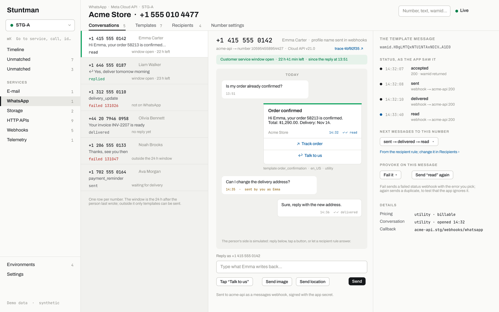

# WhatsApp (Meta Cloud API)

Stuntman stands in for Meta's WhatsApp Cloud API on the Graph API. The app sends to Stuntman as to
`graph.facebook.com`: template, text, media, interactive, location and reaction messages, template management and
media download. Stuntman answers with Meta's bodies and error codes, keeps the templates and their review status in
YAML, applies the 24-hour customer service window, the messaging tier, throughput and quality, and plays a person
behind each number: `sent` → `delivered` → `read`, failures, button taps, replies, images and locations. Every
change reaches the app as Meta's webhook, signed with the app secret.



## At a glance

| | |
|---|---|
| **Stands in for** | Meta WhatsApp Cloud API on Graph, any version by default (`/v21.0/…` in the tests): `POST /<phone-number-id>/messages`, `GET`/`POST`/`DELETE /<waba-id>/message_templates`, `GET /<media-id>` and the media URL; the `messages`, `message_template_status_update`, `template_category_update` and `phone_number_quality_update` webhooks with `X-Hub-Signature-256`, and the `hub.challenge` verification. Tested with plain HTTP clients sending Meta's JSON |
| **Ports** | the main HTTP port `8025` (`STUNTMAN_PORT`); `8445` is the same over TLS with the Test CA (`STUNTMAN_HTTPS_PORT`) |
| **Point your app at** | Graph base URL `http://localhost:8025/whatsapp` (the app adds `/v21.0/<phone-number-id>/messages`); phone number id `105954558954427`, WABA id `102290129340398`; any bearer token |
| **It keeps** | Messages both ways with status history (and each webhook's answer), template parameters, trace id, caller; templates (`whatsapp/templates.yaml`) with status and quality; templates the app asked for that are not declared; recipients (`whatsapp/recipients.yaml`); the number block (`whatsapp/number.yaml`); every webhook sent with its signature and the app's answer; media the person sent |
| **You can provoke** | `force_whatsapp_failure`: `500` (#131000), `400` (#100), `reset`, `empty`, `timeout`. `expire_whatsapp_tokens` (190/463). Template paused, disabled, pending, rejected, wrong parameter count, undeclared. Per number: not on WhatsApp (131026), blocks after N, fails with any code, never delivered, never read. 24 h window closed (131047). Tier (131056), throughput (130429), quality `restricted` (131048). Replies: text, button tap, image, location. Bad webhooks: wrong, missing or old signature, replay |
| **Screen** | `/whatsapp` (conversations), `/whatsapp/templates`, `/whatsapp/recipients`, `/whatsapp/number` |
| **Tools** | `list_whatsapp_messages`, `list_whatsapp_conversations`, `get_whatsapp_message`, `wait_for_whatsapp`, `reply_as_user`, `set_message_status`, `resend_status`, `get_window`, `list_whatsapp_webhooks`, `retry_whatsapp_webhooks`, `list_templates`, `add_template`, `update_template`, `set_template_status`, `remove_template`, `template_usage`, `undeclared_templates`, `list_recipients`, `set_recipient`, `remove_recipient`, `explain_number`, `get_whatsapp_number`, `set_whatsapp_number`, `force_whatsapp_failure`, `expire_whatsapp_tokens`, `restore_whatsapp_tokens`, `verify_whatsapp_webhook`, `send_bad_webhook` |

## Connect your app

| App runs | Graph base URL |
|---|---|
| On the host | `http://localhost:8025/whatsapp` |
| In a container, Stuntman on the host | `http://host.docker.internal:8025/whatsapp` |
| In the same compose project | `http://stuntman:8025/whatsapp` |
| Another environment | `http://localhost:8025/e/<env>/whatsapp`, or the environment's host name ([Environments](../environments.md)) |

`get_whatsapp_number` returns `graphBase`, the ids, the webhook URL in use and the last verification.

```sh
curl -s http://localhost:8025/whatsapp/v21.0/105954558954427/messages \
  -H 'Authorization: Bearer any' -H 'Content-Type: application/json' \
  -d '{"messaging_product": "whatsapp", "to": "+14155550142", "type": "template",
       "template": {"name": "order_confirmation", "language": {"code": "en_US"},
                    "components": [{"type": "body", "parameters": [{"type": "text", "text": "Emma"}, {"type": "text", "text": "58213"}]}]}}'
# {"messaging_product": "whatsapp", "contacts": [{"input": "+14155550142", "wa_id": "14155550142"}],
#  "messages": [{"id": "wamid.HBgL…", "message_status": "accepted"}]}
```

The templates file starts **empty**: declare the templates your app sends (`add_template`) or every template send
answers `132001`.

**Webhook.** Set where Meta's webhooks go: `set_whatsapp_number {"webhook_url":
"http://host.docker.internal:3000/webhooks/whatsapp"}`. Empty: the environment's default callback
(`set_environment` `callbacks`). Both empty: nothing is sent and the history notes `no webhook URL set`.

**Secrets.** The number's three secrets are made once, at random, in the environment's `secrets.yaml`
(`<data>/environments/<env>/secrets.yaml`): `whatsapp-app-secret` (signs webhooks), `whatsapp-verify-token` (the
`hub.verify_token`), `whatsapp-token` (the only token accepted with `any_token: false`). Give the app the first two.
A Key Vault created afterwards imports them as secrets ([Secrets](secrets.md)).

**Tokens.** Any non-empty `Authorization: Bearer <token>` works while `any_token` is `true` (the default).

## What it supports

### Graph endpoints

| Endpoint | Notes |
|---|---|
| `POST /whatsapp/{version}/{phone-number-id}/messages` | send; see below |
| `GET /whatsapp/{version}/{waba-id}/message_templates[?name=]` | `data[]` with one entry per template and language: `name`, `language`, `status` (`APPROVED`…), `category`, `id` (stable, numeric), `components` (`HEADER`, `BODY`, `FOOTER`, `BUTTONS`), `quality_score.score` (`GREEN`, `YELLOW`, `RED`). Only `name` filters; `paging.cursors` are empty |
| `POST /whatsapp/{version}/{waba-id}/message_templates` | `name`, `language` (default `en_US`), `category`, `components` (`HEADER`/`BODY`/`FOOTER` `text`, `BUTTONS` with `QUICK_REPLY` or `URL`). Answers `{"id", "status": "PENDING", "category"}`; approves itself after `approve_after` (default `5m`) and sends `message_template_status_update` `APPROVED`. A second language is added to the same name. Same name and language: `400` code 100, subcode `2388024` |
| `DELETE /whatsapp/{version}/{waba-id}/message_templates?name=` | removes every language of that name; unknown name: `400` code 100, subcode `2593002` |
| `GET /whatsapp/{version}/{media-id}` | `{messaging_product, url, mime_type: "image/png", sha256, file_size, id}` for media the person sent; else `400` code 100, subcode 33 |
| `GET /whatsapp/media/{media-id}/file` | the bytes (needs the bearer token), as the `url` above points |

On `/messages` the version must match `api_versions`: any (the default), one version (`v21.0`) or a range
(`v18.0-v21.0`); others get `400` code `2500` `Unknown path components`. The other endpoints take any version. A wrong phone number id or WABA id gets `400` code 100, subcode 33 (`Unsupported
post request. Object with ID '<id>' does not exist…`). Uploading media (`POST /<id>/media`), marking messages read
(`status: read`), the business profile, phone number and registration endpoints are not served.

### Message types

| `type` | What Stuntman keeps as the text | Window |
|---|---|---|
| `template` | the declared body with `{{1}}…` filled from the `body` component's parameters | sent outside the window too |
| `text` | `text.body` | needs an open window |
| `image`, `document`, `video`, `audio`, `sticker` | `caption`, else `link`, else `id` | needs an open window |
| `interactive` | `interactive.body.text` | needs an open window |
| `location` | `latitude, longitude` | needs an open window |
| `reaction` | `reaction.emoji` | needs an open window |
| anything else (`contacts`…) | `400` code 100, `Param type must be one of {TEXT, TEMPLATE, IMAGE, …}` | — |

Template parameters: `text`, `currency` (`fallback_value`, else `code` and `amount_1000`), `date_time`
(`fallback_value`); other types show as their value or `(<type>)`. Only the `body` component's parameters are
counted and rendered; `header` and `button` parameters are accepted and not checked. `to` may be `+14155550142`,
`14155550142` or a number; `wa_id` is the digits. `context` (reply-to) is accepted and not used.

### Templates

`whatsapp/templates.yaml`, one entry per name:

| Field | Values | Default |
|---|---|---|
| `name` | `lowercase_with_underscores` (`add_template` checks it) | — |
| `languages` | list, e.g. `[en_US, es_MX]` | `[en_US]` |
| `category` | `utility`, `marketing`, `authentication` | `utility` |
| `status` | `approved`, `pending`, `rejected` (with `reason`), `paused`, `disabled` | `approved` (`add_template`); `pending` (created over Graph) |
| `quality` | `high`, `medium`, `low` | `high` |
| `header`, `body`, `footer` | text; `body` uses `{{1}}`, `{{2}}`… | — |
| `buttons` | `[{text, url}]` or `[{text, quick_reply: PAYLOAD}]` | — |
| `variables` | what each `{{n}}` means, for the screen | — |

`update_template` changes `category` (sends `template_category_update`), `quality` (`low` pauses an approved
template and sends `PAUSED` with reason `LOW_QUALITY`), `body`, `header`, `footer`, `buttons`, `languages`,
`variables`. `set_template_status` sends `message_template_status_update` for each language (`event` in capitals,
`reason` `NONE` or yours); approving a `low` template raises it to `medium`. Templates the app sent but that are not
declared are counted in `undeclared_templates` (name, language, count, parameter count, last body, caller); declaring
the name clears it.

### Recipients: the person behind a number

`whatsapp/recipients.yaml` is matched in order; the first match wins. `number` is exact (`+14155550142`), a prefix
ending in `*` (`+1 312 555 01*`), or `*` (everyone else; always there). Digits are compared.

| Field / step | Meaning | Default |
|---|---|---|
| `whatsapp: false` | the number has no WhatsApp: `failed` 131026 | `true` |
| `profile_name` | sent as `contacts[0].profile.name` on the person's messages | empty |
| `delivered_after: 1s` | `delivered` this long after `sent` | `1s` |
| `read_after: 30s` | `read` this long after `sent` | `30s` |
| `never_read: true` | stays `delivered` | — |
| `stay_at_sent: true` | stays `sent` | — |
| `fail: 131049` | `failed` with this Meta code 0.5 s after `sent` | — |
| `block_after: 2` | the person blocked the business after 2 messages: later ones fail 131026 | — |
| `on_buttons: {tap, after}` | taps a quick-reply button (the one whose text is `tap`, else the first) | `after: 10s` |
| `on_text: {reply, after}` | replies with `reply` to a `text` message | `after: 20s` |
| `send_image: {caption, after}` | sends an image (a 1×1 PNG) | `after: 15s` |
| `send_location: {latitude, longitude, name, after}` | sends a location | `40.7484, -73.9857, "Home"`, `after: 15s` |

The default `*` has `delivered_after: 1s` and `read_after: 30s`. Reply steps run from `sent`, independently of
delivery and read. `set_recipient` keeps fields you do not pass; a new one goes before `*` (or at `position`).
`explain_number` says which recipient matches, which others also match, what the next message will do and the
window.

### Number block

`whatsapp/number.yaml`, changed with `set_whatsapp_number`:

| Key | Default |
|---|---|
| `phone_number_id`, `waba_id` | `105954558954427`, `102290129340398` |
| `display_number`, `display_name` | `+15550104477`, `Acme Store` (the webhook `metadata.display_phone_number`) |
| `api_versions` | `any` |
| `any_token` | `true` |
| `webhook_url`, `sign` | empty, `true` |
| `tier` | `1k` (`250`, `1k`, `10k`, `100k`, `unlimited`): distinct numbers per 24 h |
| `throughput` | `80` messages per second |
| `quality` | `green` (`green`, `yellow`, `red`, `flagged`, `restricted`); a change sends `phone_number_quality_update` |
| `approve_after` | `5m` |

`webhook.fields` in the file is kept but does not filter: every webhook kind is sent. `GET
/api/whatsapp/files/{number.yaml|templates.yaml|recipients.yaml}` downloads the files.

### Webhooks to your app

Statuses:

```json
{"object": "whatsapp_business_account", "entry": [{"id": "102290129340398", "changes": [{"field": "messages", "value": {
  "messaging_product": "whatsapp", "metadata": {"display_phone_number": "15550104477", "phone_number_id": "105954558954427"},
  "statuses": [{"id": "wamid.HBgL…", "status": "delivered", "timestamp": "1763712000", "recipient_id": "14155550142",
                "conversation": {"id": "conv_…", "origin": {"type": "utility"}},
                "pricing": {"billable": true, "pricing_model": "PMP", "category": "utility"}}]}}]}]}
```

`conversation` and `pricing` come with `sent` and `delivered` (category `service` for non-template messages). A
`failed` status carries `errors: [{code, title, message, error_data: {details}}]`.

The person's messages: `value.contacts: [{profile: {name}, wa_id}]` and `value.messages: [{from, id, timestamp,
type, …}]` with `type` `text` (`text.body`), `button` (`button.payload`, `button.text`, `context.from`,
`context.id` = the template's wamid), `image` (`image.id`, `mime_type`, `sha256`, `caption`) or `location`
(`latitude`, `longitude`, `name`). Template, category and quality webhooks use fields
`message_template_status_update` (`event`, `message_template_id`, `message_template_name`,
`message_template_language`, `reason`), `template_category_update` (`previous_category`, `new_category`) and
`phone_number_quality_update` (`event`: `DOWNGRADE`, `FLAGGED`, `UPGRADE`, `UNFLAGGED`; `current_limit` `TIER_1K`…).

Headers: `Content-Type: application/json`, `User-Agent: facebookexternalua`, and with `sign: true`
`X-Hub-Signature-256: sha256=<hex HMAC-SHA256 of the body with whatsapp-app-secret>`.

```python
good = sig == "sha256=" + hmac.new(app_secret.encode(), raw_body, hashlib.sha256).hexdigest()
```

Each webhook is tried up to 4 times, 20 s apart, until the app answers 2xx (10 s timeout).

## How it behaves

### Send checks, in order

| Check | Answer |
|---|---|
| version outside `api_versions` | `400` code `2500` |
| tokens expired (`expire_whatsapp_tokens`) | `401` code `190`, subcode `463`, `Error validating access token: Session has expired` |
| no bearer token | `401` code `190`, `Invalid OAuth access token - Cannot parse access token` |
| wrong token with `any_token: false` | `401` code `190`, `Invalid OAuth access token.` |
| wrong phone number id | `400` code 100, subcode 33 |
| body not JSON | `400` code 100, `(#100) Invalid parameter` |
| no `to` | `400` code 100, `(#100) The parameter to is required.` |
| a forced failure waiting | the forced answer |
| quality `restricted` | `400` code `131048` `Spam rate limit hit` |
| more than `throughput` accepted sends in the last second | `400` code `130429` `Rate limit hit` |
| a new number beyond the tier's distinct numbers in 24 h | `400` code `131056` |
| template not declared in that language | `404` code `132001` (and counted as undeclared) |
| template `pending` or `rejected` | `404` code `132001`, `… <name> is pending` |
| template `paused` / `disabled` | `400` code `132015` / `132016` |
| body parameter count differs | `400` code `132000`, `expected 4, got 3` |
| unknown `type` | `400` code 100 |

Error bodies are Meta's: `{"error": {"message", "type": "OAuthException", "code", "error_subcode"?, "error_data":
{"messaging_product": "whatsapp", "details"}, "fbtrace_id"}}`.

### Lifecycle (after `200`)

1. Status `accepted`. 0.3 s later:
2. No WhatsApp, or blocked (`block_after`): `failed` 131026, end.
3. Not a template and the window is closed: `failed` 131047 (`Re-engagement message`), end.
4. `sent`. The person's reply steps start counting.
5. `fail` step: `failed` with that code 0.5 s later, end.
6. `delivered` after `delivered_after` (unless `stay_at_sent`), then `read` at `read_after` from `sent` (unless
   `never_read`).

A status set by hand (`set_message_status`) stops the automatic steps that would follow from another status.

### The 24-hour window

The window opens when the person writes (any `reply_as_user` or reply step) and lasts 24 h from their last
message. Outside it, only templates go; other types are accepted with `200` and then fail 131047 by webhook, as Meta
does. `get_window` and every conversation show `open`, `since`, `until` / `closedAt` and `leftMs`.

### Persistence and time

- Messages, webhooks and undeclared templates are in the environment's database; the three YAML files are the
  configuration. All survive restarts.
- After a restart, outgoing messages of the last 24 h still `accepted` start again, and `sent` and `delivered` ones
  resume their delivered / read steps from where they should be. Reply steps of messages sent in the last hour
  resume too; a reply already sent is not sent twice.
- Pending templates created over Graph are checked every 5 s for `approve_after`.
- WhatsApp keeps real time; the environment clock ([Clock](../clock.md)) does not move the window or the steps.

### Differences from Meta

- Rate limit (130429), tier (131056) and quality (131048) answer `400` at once.
- Pricing and conversation objects are fixed (`PMP`, billable).
- Only images the person sent exist as media (PNG); media the app sends by `link` or `id` is not fetched.
- Template review is Stuntman's YAML status, not Meta's review.

## Provoke failures

| Failure | How | What the app sees | Turn it off |
|---|---|---|---|
| Graph 500 | `force_whatsapp_failure {"answer": "500", "count": 2}` | `500` code `131000` `(#131000) Something went wrong` | `force_whatsapp_failure {"answer": "normal"}` or the count runs out |
| Graph 400 | `force_whatsapp_failure {"answer": "400"}` | `400` code 100 `(#100) Invalid parameter` | same |
| Connection reset / empty / timeout | `force_whatsapp_failure {"answer": "reset"}` (`empty`, `timeout`) | TCP RST / closed without a byte / no answer for 10 minutes | same |
| Expired token | `expire_whatsapp_tokens {}` | every Graph call `401` code 190 subcode 463 | `restore_whatsapp_tokens {}` |
| Strict token | `set_whatsapp_number {"any_token": false}` | `401` code 190 for any token but `whatsapp-token` | `{"any_token": true}` |
| Not on WhatsApp | `set_recipient {"number": "+13125550110", "whatsapp": false}` | `200`, then `failed` 131026 | `remove_recipient {"number"}` |
| Blocked after N | `set_recipient {"number", "steps": [{"block_after": 2}]}` | the 3rd message on fails 131026 | remove the recipient |
| Fails with a code | `set_recipient {"number", "steps": [{"fail": 131049}]}`, or `set_message_status {"wamid", "status": "failed", "error_code": 131049}` | `sent`, then `failed` with that code | remove the recipient |
| Never delivered / never read | `steps: [{"stay_at_sent": true}]` / `[{"never_read": true}]` | stops at `sent` / `delivered` | remove the recipient |
| Window closed | send a non-template to a number that has not written in 24 h | `failed` 131047 | `reply_as_user {"number", "text": "hi"}` opens it |
| Template paused, disabled, pending, rejected | `set_template_status {"name", "status": "paused"}` (`reason` for rejected) | `132015` / `132016` / `132001`; a status webhook | `set_template_status … "approved"` |
| Low quality | `update_template {"name", "quality": "low"}` | template paused, `PAUSED` `LOW_QUALITY` webhook, sends `132015` | `set_template_status … "approved"` |
| Undeclared template | the app sends a name not in the file | `404` 132001 | `add_template` |
| Tier, throughput, quality | `set_whatsapp_number {"tier": "250"}`, `{"throughput": 1}`, `{"quality": "restricted"}` | `131056`, `130429`, `131048`; a quality webhook on change | set them back |
| The person replies | `reply_as_user {"number", "text": "…"}` / `{"button": "Talk to us"}` / `{"image": "Here is the receipt"}` / `{"location": {"latitude", "longitude", "name"}}` | the `messages` webhook | — |
| Duplicate status | `resend_status {"wamid", "status": "read"}` | the same status webhook again | — |
| Forged webhooks | `send_bad_webhook {"kind": "wrong_signature"}` (`missing_signature`, `old_secret`, `replay`) | a `delivered` status for the last message, badly signed; `replay` resends the last status webhook as it was | — |
| App's webhook down | point `webhook_url` at a failing URL | 4 attempts, 20 s apart | `retry_whatsapp_webhooks {}` |

`send_bad_webhook` returns `{"kind", "status", "rejected"}` (`rejected` is true for a 4xx/5xx answer); it is sent
once, recorded as `bad:<kind>` and never retried. Forced sends are kept as `refused` messages;
`get_whatsapp_number` shows a waiting one in `forced`.

## See what the app did

| Need | Tool | HTTP |
|---|---|---|
| Wait for the app's message | `wait_for_whatsapp {"number", "template", "text", "timeout": "10s", "since"}` | `GET /api/whatsapp/wait?number=%2B14155550142&template=order_confirmation&timeout=5s` |
| List | `list_whatsapp_messages` (`number`, `status`, `template`, `dir`, `text`, `q`, `since` default `1d`, `limit` default 200) | `GET /api/whatsapp/messages?number=%2B14155550142&since=5m` |
| One per number, with window | `list_whatsapp_conversations {"q"}` | `GET /api/whatsapp/conversations` |
| One message and the window | `get_whatsapp_message {"wamid"}` | `GET /api/whatsapp/messages/{wamid}` |
| Window | `get_window {"number"}` | `GET /api/whatsapp/numbers/{number}/window` |
| Webhooks and the app's answers | `list_whatsapp_webhooks {"limit": 100}` | `GET /api/whatsapp/webhooks` |
| Template use | `template_usage {"name", "since"}`, `list_templates` | `GET /api/whatsapp/templates/{name}/usage` |
| Webhook verification | `verify_whatsapp_webhook {}` | `POST /api/whatsapp/number/webhook/verify` |

`wait_for_whatsapp` looks back 60 s by default, ignores refused sends and returns the **oldest** match in that
window as `{message, wamid}`; `408 No WhatsApp message to <number> in 30s` on timeout. Pass a short `since` when the
app sends several messages to the same number.

Fields that matter: `id` (wamid), `dir`, `number`, `kind`, `template`, `lang`, `params`, `text` (rendered),
`status` (`accepted`, `sent`, `delivered`, `read`, `failed`, `refused`, `received`), `error` (Meta code),
`history[]` (`status`, `at`, `error`, `by`, `webhook` with the app's `status`, `ms`, `attempt`, `error`, `url`),
`body` (the app's request, or the webhook message for `in`), `contextId` (for a button tap), `traceId`, `caller`,
`category`. `template_usage` gives `sent`, `failed`, `read`, `buttonsTapped`, `failuresByCode`, `lastParams`,
`lastAt`, `lastBy`.

`verify_whatsapp_webhook` sends `GET <webhook>?hub.mode=subscribe&hub.verify_token=<whatsapp-verify-token>&hub.challenge=<9 digits>`
and is `ok` when the app answers `200` with the challenge as the body; the result is kept (`verification` in
`get_whatsapp_number`).

The [Timeline](../timeline.md) shows each send, refusal and status change (`order_confirmation to +14155550142`,
host `graph.facebook.com`); `timeline {"service": "whatsapp"}` filters it.

## Recipes

1. **Declare a template and check the app's send.**
   ```text
   add_template {"name": "order_confirmation", "body": "Hi {{1}}, your order {{2}} is confirmed.", "footer": "Acme Store",
                 "buttons": [{"text": "Track order", "url": "https://shop.example.com/track/{{1}}"}, {"text": "Talk to us", "quick_reply": "TALK_TO_US"}]}
   wait_for_whatsapp {"number": "+14155550142", "template": "order_confirmation", "timeout": "10s"}
     → message.text = "Hi Emma, your order 58213 is confirmed."
   ```
2. **The person taps a button; the app routes the reply.**
   ```text
   set_recipient {"number": "+14155550142", "profile_name": "Emma Carter",
                  "steps": [{"delivered_after": "300ms"}, {"read_after": "800ms"}, {"on_buttons": {"tap": "Talk to us", "after": "1s"}}]}
   ```
   Or by hand after the send: `reply_as_user {"number": "+14155550142", "button": "Talk to us"}`. The webhook has
   `button.payload: "TALK_TO_US"` and `context.id` = the template's wamid.
3. **Check the app falls back when a text is outside the window.** Send a `text` to a number that never wrote:
   `failed` 131047. Then `reply_as_user {"number", "text": "hi"}` and send again: it is delivered.
4. **Check the app rejects forged webhooks.**
   ```text
   send_bad_webhook {"kind": "wrong_signature"}    → {"status": 401, "rejected": true}
   send_bad_webhook {"kind": "replay"}             → the app should ignore the duplicate
   ```
5. **Token expired mid-run.** `expire_whatsapp_tokens {}` → the app gets 190/463 and should refresh;
   `restore_whatsapp_tokens {}`.
6. **Template creation flow.** Set `set_whatsapp_number {"approve_after": "1s"}`; the app `POST`s to
   `/<waba-id>/message_templates` and gets `PENDING`, then the `APPROVED` webhook a second later.
7. **The person sends a photo the app downloads.** `reply_as_user {"number": "+14155550142", "image": "Here is the
   receipt"}` → the app reads `image.id`, calls `GET /whatsapp/v21.0/<id>` for the URL, then downloads the PNG with
   its token.
8. **Graph is down, then back.** `force_whatsapp_failure {"answer": "500", "count": 2}`; the third send goes.

## Errors and troubleshooting

| Symptom or error text | Cause | Fix |
|---|---|---|
| `404 (#132001) Template name does not exist in the translation` | not declared, wrong language code, or `pending` / `rejected` | `add_template` with that `language`; `set_template_status … approved`; see `undeclared_templates` |
| `(#132000) … expected 4, got 3` | body parameter count differs from `{{n}}` in the body | send one parameter per placeholder |
| `400 Unsupported post request. Object with ID '<id>' does not exist…` | the URL's phone number id (or WABA id) is not the number's | use `phone_number_id` / `waba_id` from `get_whatsapp_number`, or set yours with `set_whatsapp_number` |
| `400` code `2500` `Unknown path components` | the version is outside `api_versions` | `set_whatsapp_number {"api_versions": "any"}` |
| `401` code 190 subcode 463 on every call | `expire_whatsapp_tokens` is still on | `restore_whatsapp_tokens` |
| Text messages always end `failed` 131047 | the number never wrote in the last 24 h | `reply_as_user` first, or send a template |
| App's signature check fails | the app uses another secret | use `whatsapp-app-secret` from `secrets.yaml`; or `set_whatsapp_number {"sign": false}` |
| No webhook at the app | no `webhook_url` and no default callback | `set_whatsapp_number {"webhook_url": "…"}` |
| `No callback URL: set it in Number settings` | `verify_whatsapp_webhook` / `send_bad_webhook` with no webhook URL | set `webhook_url` |
| `No template sent to <number> has a quick-reply button "<b>"` | `reply_as_user` `button` names no quick-reply button of a recent template to that number | use the button's text exactly; it must have `quick_reply` |
| `No webhook sent yet to replay` | `send_bad_webhook replay` before any status webhook | send a message first |
| `wait_for_whatsapp` returns an older message | it returns the oldest match since `since` (60 s) | pass `since: "5s"` or filter by `template` / `text` |

## Not done

- No media upload (`POST /<phone-number-id>/media`), no app-sent media download, no `status: read` marking, no
  typing indicators, no business profile, phone number, registration or two-step endpoints, no Flows.
- `contacts` messages are refused; `header` and button template parameters are not checked; `context` is ignored.
- Template list filters by `name` only and has no real paging.
- `webhook.fields` does not filter webhooks.
- The environment clock does not apply.

Missing something? Tell the developer what the fix would be and offer a pull request — see [Contributing](../../CONTRIBUTING.md).

## Tools and routes
<!-- tools: whatsapp -->
_Generated by `tools/gen_tool_reference.py` from the engine source; each tool is an MCP tool and the HTTP route shown (under `/api`)._

| Tool | HTTP | Required | Optional | What it does |
|---|---|---|---|---|
| `list_whatsapp_messages` | `GET /api/whatsapp/messages` | — | number, status, template, dir, q, since, limit | WhatsApp messages both ways (the app's sends and the person's replies), newest first, with status history and the window. |
| `list_whatsapp_conversations` | `GET /api/whatsapp/conversations` | — | q | One row per number: the last message, the 24 h window and the person's name. |
| `get_whatsapp_message` | `GET /api/whatsapp/messages/{wamid}` | wamid | — | One message with its status history (and what the app's webhook answered to each). |
| `wait_for_whatsapp` | `GET /api/whatsapp/wait` | number | template, text, timeout, since | Waits for the app to send a WhatsApp message to a number (optionally a template or a text containing…); returns it. |
| `reply_as_user` | `POST /api/whatsapp/numbers/{number}/reply` | number | text, button, image, location, by | The person writes back: a text, a tap on a template button, an image or a location. Stuntman sends Meta's messages webhook to the app; a reply opens the 24 h window. |
| `set_message_status` | `POST /api/whatsapp/messages/{wamid}/status` | wamid, status | error_code, by | Moves a message to sent, delivered, read or failed (with a Meta error code); the status webhook goes to the app. |
| `resend_status` | `POST /api/whatsapp/messages/{wamid}/resend` | wamid | status | Sends the same status webhook again, to test that the app ignores duplicates. |
| `get_window` | `GET /api/whatsapp/numbers/{number}/window` | number | — | The 24 h customer service window of a number: open or closed and until when (outside it only templates are delivered; texts fail with 131047). |
| `list_whatsapp_webhooks` | `GET /api/whatsapp/webhooks` | — | limit | The webhooks Stuntman sent to the app (statuses, messages, template and quality updates) with the app's answers. |
| `retry_whatsapp_webhooks` | `POST /api/whatsapp/webhooks/retry` | — | — | Sends again the webhooks the app did not take (non-2xx or no answer) in the last hour, the newest per message. |
| `list_templates` | `GET /api/whatsapp/templates` | — | status, category | WhatsApp templates (whatsapp/templates.yaml): languages, status, quality, category and today's use. |
| `set_template_status` | `PUT /api/whatsapp/templates/{name}/status` | name, status | reason | Approved, pending, rejected (with a reason), paused or disabled; Stuntman sends message_template_status_update to the app and sends follow the new status. |
| `update_template` | `PATCH /api/whatsapp/templates/{name}` | name | category, quality, body, header, footer, buttons, languages, variables | Changes a template's category (sends template_category_update), quality (low pauses it, as Meta does) or text. |
| `add_template` | `POST /api/whatsapp/templates` | name, body | language, category, status, header, footer, buttons | Declares a template (writes whatsapp/templates.yaml). |
| `remove_template` | `DELETE /api/whatsapp/templates/{name}` | name | — | Deletes a template from whatsapp/templates.yaml (sends with it then fail 132001). |
| `template_usage` | `GET /api/whatsapp/templates/{name}/usage` | name | since | Sends, failures by error code, reads and buttons tapped for a template, plus the values the app sent last. |
| `undeclared_templates` | `GET /api/whatsapp/templates/undeclared` | — | — | Templates the app asked for that are not declared; Stuntman answered them 132001. |
| `list_recipients` | `GET /api/whatsapp/recipients` | — | — | The simulated people behind numbers, in match order (the first match wins; * is everyone else), with their steps. |
| `set_recipient` | `PUT /api/whatsapp/recipients/{number}` | number | whatsapp, profile_name, steps, position | Creates or replaces a recipient (whatsapp/recipients.yaml): whether the number has WhatsApp, the profile name and the steps each message goes through. |
| `remove_recipient` | `DELETE /api/whatsapp/recipients/{number}` | number | — | Removes a recipient; the number falls back to the next match or “Everyone else”. |
| `explain_number` | `GET /api/whatsapp/recipients/explain` | number | — | Which recipient matches a number, which others also match, and what will happen to the next message. |
| `get_whatsapp_number` | `GET /api/whatsapp/number` | — | — | The number block (whatsapp/number.yaml): ids, access mode, webhook (URL, last verification), tier, throughput, quality. |
| `set_whatsapp_number` | `PUT /api/whatsapp/number` | — | any_token, tier, throughput, quality, webhook_url, sign, display_name, display_number, approve_after, api_versions, phone_number_id, waba_id | Changes the number block: any_token, tier, throughput, quality (sends its webhook), webhook_url, sign, display_name, approve_after, api_versions. |
| `force_whatsapp_failure` | `POST /api/whatsapp/force` | answer | count, by | The next sends (count, default 1) fail as Meta's Graph does: 500 (#131000), 400 (#100 Invalid parameter), or the connection: reset, empty, timeout. normal stops it. Each one is kept as a refused message. |
| `expire_whatsapp_tokens` | `POST /api/whatsapp/number/tokens/expire` | — | — | Every Graph call gets 190 “Session has expired” until restored. |
| `restore_whatsapp_tokens` | `POST /api/whatsapp/number/tokens/restore` | — | — | Tokens work again. |
| `verify_whatsapp_webhook` | `POST /api/whatsapp/number/webhook/verify` | — | — | Sends Meta's verification GET (hub.mode, hub.verify_token, hub.challenge) to the app's callback and checks it echoes the challenge. |
| `send_bad_webhook` | `POST /api/whatsapp/number/webhook/bad` | kind | — | Sends a status webhook the app must reject: wrong_signature, missing_signature, old_secret or replay (the last webhook again). Returns the app's status code. |
<!-- /tools -->
