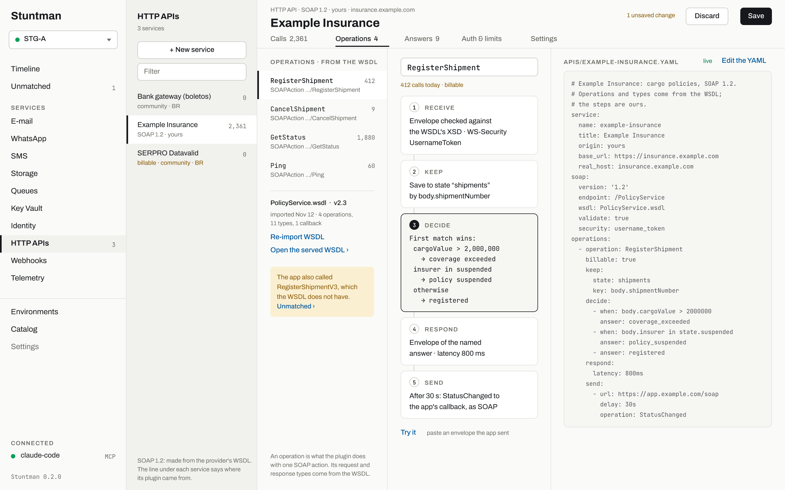

# SOAP services



Give Stuntman the provider's WSDL and it answers like the provider's SOAP endpoint. It does not need a recording
or a running copy of the provider. Each operation in the WSDL becomes an operation of the plugin, with the same
steps as a REST route: receive, keep, decide, respond and send. A fault is a named answer like any other.

What Stuntman does with each envelope:

- Picks the operation by its **SOAPAction** (the SOAP 1.1 header or the SOAP 1.2 `action` parameter). Without
  one, it uses the element inside `soap:Body`, and the call's steps note that the operation was
  picked from the body.
- Reads the body as fields for the steps: `body.cargoValue`, `body.destination.city`.
- Checks the body against the **types in the WSDL and its XSDs**. When a body breaks them, Stuntman answers with
  the provider's validation fault, as a real SOAP stack would.
- Checks the **WS-Security** UsernameToken when the service asks for one: that it is present, or that its user
  and password match.
- Checks the request's **XML signature** and signs its answers when the service asks for it, and requires an
  **ICP-Brasil style client certificate** (one with a CNPJ) on mTLS; see
  [XML signatures and ICP-Brasil certificates](#xml-signatures-and-icp-brasil-certificates).
- Answers in a **SOAP 1.1 or 1.2** envelope, or with a fault in that version's shape.
- Sends **callbacks** to your app as SOAP calls.
- Serves the WSDL back on `?wsdl`, with the XSDs it imports, so clients generated from it work unchanged.

## Create one from a WSDL

You can start from a URL, a file on the machine that runs Stuntman or the WSDL text. The examples use
[`PolicyService.wsdl`](../engine/tests/soap/PolicyService.wsdl), a synthetic cargo-insurance provider with four
operations, three faults and one callback.

**In the web UI:** go to **HTTP APIs › + New service** and use **From the provider's WSDL (SOAP)**. Paste the URL
or choose a file, name the service, and select **Create service**.

**From an agent (MCP):**

```text
import_wsdl(service="example-insurance", source="https://insurance.example.com/PolicyService?wsdl")
→ 4 operations, 3 faults, 1 callback
```

**Over HTTP:**

```sh
curl -X POST http://localhost:8025/api/plugins/wsdl -H 'Content-Type: application/json' \
  -d '{"service": "example-insurance", "source": "https://insurance.example.com/PolicyService?wsdl"}'
```

The result lists the operations, the faults, the callbacks (one-way operations that the provider sends to the
app) and any file that could not be read. If an imported XSD cannot be fetched, Stuntman still creates the service,
and fields of the types in that file answer as empty elements.

Stuntman then creates:

- one operation per WSDL operation, with its SOAPAction and its request and response elements;
- a default answer per operation, built from the response type in the XSD's order. A response field with the same
  name as a request field echoes what the app sent;
- one named answer per declared fault, with its detail element;
- the WSDL and its XSDs, kept in `apis/<service>.soap/` and served back.

Until you add rules, every operation gives its default answer.

## Point your app at it

| | |
|---|---|
| **Endpoint** | `http://localhost:8028/<service><endpoint>`, for example `http://localhost:8028/example-insurance/PolicyService` |
| **The WSDL** | the same address with `?wsdl` |
| **The real host** | the host from the WSDL's `soap:address`, over HTTPS on `:8443` with the [Test CA](configuration.md#the-stuntman-test-ca) trusted |

## The plugin

A SOAP plugin is a normal plugin file (`apis/<service>.yaml`) with a `soap:` block and `operations:` in place of
`routes:`.

```yaml
service:
  name: example-insurance
  title: Example Insurance
  origin: yours
  base_url: https://insurance.example.com
  real_host: insurance.example.com
soap:
  version: '1.2'              # '1.1', '1.2' or both (each call is answered in its own version)
  endpoint: /PolicyService
  wsdl: PolicyService.wsdl     # kept in apis/example-insurance.soap/
  source: https://insurance.example.com/PolicyService?wsdl
  validate: true               # check bodies against types
  security: username_token     # none | any | username_token
  users:
    acme-freight: secret://insurance-password
  namespace: urn:example:insurance
  types:
    RegisterShipmentRequest:
      shipmentNumber: string
      cargoValue: decimal
      insurer: string
      departure: date
      destination: Address
      notes?: string
    Address: {city: string, country: string}
    RegisterShipmentResponse:
      protocol: string
      status: enum(REGISTERED, ACTIVE, CANCELLED)
      insurer: string
operations:
  - operation: RegisterShipment
    action: urn:example:insurance/RegisterShipment
    input: RegisterShipmentRequest
    output: RegisterShipmentResponse
    billable: true
    keep:
      state: shipments
      key: body.shipmentNumber
    decide:
      - when: body.cargoValue > 2000000
        answer: coverage_exceeded
      - answer: registered
    respond:
      latency: 800ms
    send:
      - url: https://app.example.com/soap
        delay: 30s
        operation: StatusChanged
        body: |
          <StatusChanged xmlns="urn:example:insurance">
            <protocol>EXP-{{ body.shipmentNumber }}</protocol>
            <status>ACTIVE</status>
          </StatusChanged>
answers:
  - name: registered
    body: |
      <RegisterShipmentResponse xmlns="urn:example:insurance">
        <protocol>EXP-{{ body.shipmentNumber }}</protocol>
        <status>REGISTERED</status>
        <insurer>{{ body.insurer }}</insurer>
      </RegisterShipmentResponse>
    sentence: "{{ caller }} insured {{ body.shipmentNumber }} for {{ body.cargoValue }}"
  - name: coverage_exceeded
    fault:
      code: Sender
      reason: "Coverage exceeded: cargo value {{ body.cargoValue }}"
    body: |
      <CoverageExceeded xmlns="urn:example:insurance">
        <limit>2000000</limit>
        <requested>{{ body.cargoValue }}</requested>
      </CoverageExceeded>
```

**Types.** Each type lists its fields. A name that ends in `?` is optional, `*` is optional and repeated, and `+`
is required and repeated. A field type is either another type in the list or one of these: `string`, `decimal`,
`double`, `int`, `boolean`, `date`, `dateTime`, `time`, `base64` or `enum(A, B, C)`. The import writes this block
from the WSDL, and you can edit it like the rest of the file.

**Answers.** The `body` of an answer is the element that goes inside `soap:Body`. Stuntman adds the envelope in
the version of the call. With `fault:`, the answer is a fault instead: `code` is `Sender` or `Receiver` (SOAP 1.1
calls get `Client` and `Server`), `reason` is a template, and `body` is the fault's detail. Faults go out with HTTP 500 unless the answer sets another
status, as real SOAP stacks send them. Text from the request is escaped before it goes back into XML.

**Steps.** Operations take the same steps and expressions as REST routes; see [Plugins](plugins.md). Fields of
the request are `body.<field>`, and numbers that arrive as text compare as numbers.

**Callbacks.** A `send` entry with `operation` posts an envelope with that SOAPAction to `url`, in the version of
the call that triggered it. `send_callback` sends one on demand.

## How a call is answered

1. **The envelope.** A body that is not a SOAP envelope gets a `Sender` fault.
2. **The version.** A SOAP 1.1 envelope sent to a 1.2 service (or the reverse) gets a `VersionMismatch` fault.
3. **The operation.** The SOAPAction picks it, or the body's element does. A call for an operation that the WSDL does not have
   gets a `Sender` fault and goes to **Unmatched** with the whole envelope.
4. **WS-Security.** With `security: any`, a UsernameToken must be present. With `username_token`, the user and
   password must match `users`. When the check fails, the call gets a `Sender` fault: "The security token could not be authenticated
   or authorized".
5. **XML signature.** With `signature.check`, a missing or broken `ds:Signature` gets the answer named by
   `signature.invalid`, or a `Sender` fault.
6. **Types.** With `validate: true`, a missing required field, a value of the wrong type or an element that the
   type does not have gets a `Sender` fault that names the field.
7. **The steps** decide the answer, and Stuntman sends it in an envelope or as a fault.

Every call appears in **Calls** and on the timeline with its sentence, the steps it took and the raw envelopes
in and out.

## What you can provoke

| What | How |
|---|---|
| Any fault the WSDL declares | a rule in `decide`, or `force_answer` for the next calls |
| A fault the WSDL does not declare | a new answer with `fault:` |
| The provider's validation fault | send a body that breaks the types, or tighten them in `types` |
| Refused credentials | `security: username_token` and a wrong password |
| A refused XML signature | `signature.check` and a tampered or unsigned document |
| A refused client certificate | `client_certificate.icp` and no certificate, an e-CPF, an expired or an untrusted one (`new_test_certificate`) |
| A server fault | `force_answer` with `500` (sent as a `Receiver` fault) |
| Slow, reset, empty, timeout, 503, HTML | `force_answer`, `latency`, `fail`, as for any route |
| An operation the provider does not have | listed in Unmatched; re-import a WSDL that has it |

## XML signatures and ICP-Brasil certificates

Fiscal and government SOAP services (SEFAZ for NF-e and CT-e, for example) ask for two things the plain WS-Security
check does not cover: a client certificate on the TLS connection, and an XML signature (`ds:Signature`) inside the
document. Stuntman does both, with synthetic test certificates signed by its Test CA.

**Test certificates.** `new_test_certificate` makes an A1 certificate in the ICP-Brasil style: an e-CNPJ (`cnpj`)
or an e-CPF (`cpf`), with an RSA 2048 key. It returns the `.pfx` (base64) with its password, the certificate and the
key as PEM. `expired`, `not_yet_valid` and `untrusted` (signed by an unknown CA) make the broken ones. Holders must
be synthetic (Acme Transportes Ltda, Globex Logistica…); names of real public bodies and banks are refused.

```text
new_test_certificate {"holder": "Acme Transportes Ltda", "cnpj": "11.222.333/0001-81"}
→ id, pfx (base64), password, certificate and key (PEM), valid for a year
```

**mTLS with a CNPJ.** With `auth.client_certificate.required` and `icp: true`, the HTTPS port (`:8443`) refuses a
connection without a certificate, with a certificate the Test CA did not sign, with an expired one, or with one that
carries no CNPJ (OID 2.16.76.1.3.3), such as an e-CPF. The steps read the certificate's CNPJ as `client_cnpj`:

```yaml
service:
  name: example-fiscal
  real_host: hom.fiscal.example
  auth:
    client_certificate:
      required: true
      icp: true
soap:
  version: '1.2'
  endpoint: /ws/RecepcaoEvento
  signature:
    check: true                # each request must carry a valid ds:Signature
    invalid: signature_invalid # the answer for a missing or broken one (else a Sender fault)
    sign: infEvento            # sign this element of the answers (it needs an Id attribute)
operations:
  - operation: nfeRecepcaoEvento
    action: http://www.portalfiscal.inf.br/nfe/wsdl/NFeRecepcaoEvento4/nfeRecepcaoEvento
    decide:
      - when: client_cnpj == '11222333000181'
        answer: registered
      - answer: wrong_cnpj
```

**The request's signature.** With `signature.check`, Stuntman checks every enveloped `ds:Signature` in the body:
the digest of the signed element and the signature value, with the certificate in `KeyInfo`. RSA-SHA1 and
RSA-SHA256, inclusive and exclusive canonicalization. A tampered or unsigned document gets the `invalid` answer,
and the steps see the reason as `signature_error`.

**Signed answers.** With `signature.sign`, the answer's element of that name is signed with the service's own
certificate (an e-CNPJ made once and kept in `apis/<service>.files/`), RSA-SHA1 by default as NF-e and CT-e use,
RSA-SHA256 with `sha256: true`. Faults are not signed.

**Signing as the app.** `sign_xml` signs an element of a document (by its `Id`) with a test certificate, as your app
would sign an NF-e event before sending it; `place: inside` puts the signature inside the element, as SAML does.
`verify_xml_signature` checks every signature of a document and says what was signed and by which CNPJ.
`list_test_certificates` lists the certificates of the environment, without their keys.

The `sefaz-nfe` plugin in the catalog is a complete example.

## Re-import the WSDL

When the provider publishes a new WSDL, select **Re-import WSDL** on the Operations tab, or call `reimport_wsdl`.
New operations start with their default answer, and existing ones keep their steps. Answers, data, security and
service settings stay as they are. The result lists what was added and removed.

## Tools

| Tool | What it does |
|---|---|
| `import_wsdl` | creates a SOAP service from a WSDL (URL, file or text) |
| `reimport_wsdl` | reads the WSDL again and keeps your steps |
| `list_operations` | operations, SOAPActions, types and the served WSDL's URL |
| `set_operation` | replaces an operation's steps |
| `try_operation` | runs an envelope through the service without keeping, counting or sending anything |
| `send_callback` | calls your app's endpoint as the provider would |
| `set_answer` | with `fault`, makes an answer a fault |
| `set_service` | `client_certificate_icp`, `xml_signature_check`, `xml_signature_sign`, `xml_signature_invalid`, `xml_signature_sha256` |
| `new_test_certificate` | an ICP-Brasil style e-CNPJ or e-CPF test certificate (`.pfx` and PEM) |
| `list_test_certificates` | the test certificates of the environment |
| `sign_xml` | signs an element of an XML document with a test certificate |
| `verify_xml_signature` | checks every `ds:Signature` of a document |

Arguments are in the [tool reference](reference/tools.md#http-apis-plugins).

## Limits

- WSDL 1.1, document/literal. WSDL 2.0 and RPC/encoded services are not read.
- The type check covers required fields, numbers, booleans, dates, enumerations and unknown
  elements. `time` and `base64` values are not checked. It does not check
  element order or facets such as length and pattern.
- WS-Security covers UsernameToken with a plain-text password. It does not check WS-Security signatures,
  encryption or timestamps; `signature.check` covers enveloped `ds:Signature` elements in the body.
- No MTOM or SOAP attachments.
