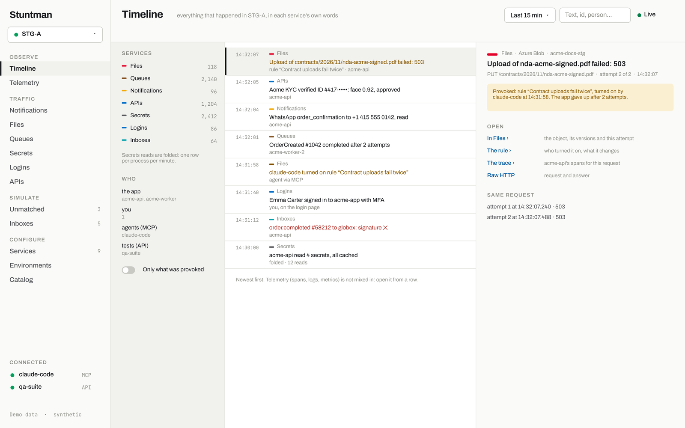
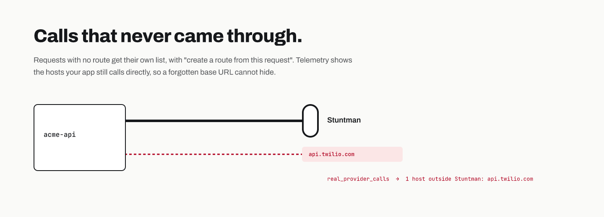
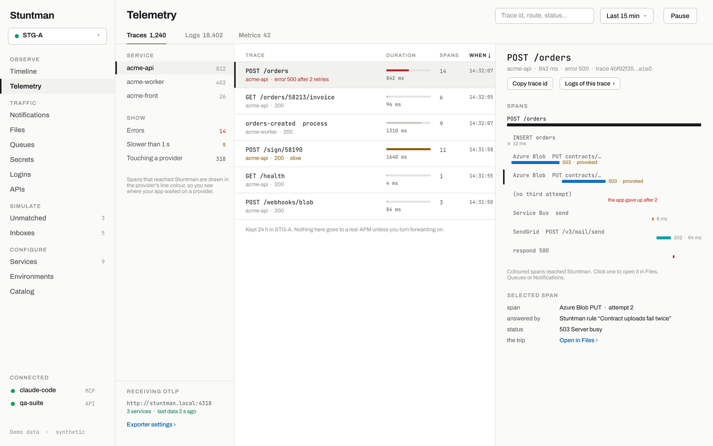

# Timeline and proof

Every call your app makes becomes one sentence, in the provider's words: who sent it, what came back, how long it
took. Raw HTTP is one click away when you need it.

## Reading a row

| Part | Example |
|---|---|
| **Sentence** | `Acme KYC verified ID 4417-••••: face 0.92, approved`, not a JSON body |
| **Service line** | the colour of the provider's line, the same everywhere |
| **Who** | the app (`acme-api`), you, an agent over MCP (`claude-code`), a test over HTTP (`qa-suite`) |
| **Provoked** | marked on the row, with the rule or forced answer that changed it |
| **Next** | the object, the rule, the trace, raw HTTP |

Filter by service, by who acted, or with the chips on top: **All**, **Provoked**, **Errors** and **Not answered**. Calls with the same trace ID group together, so one
order that touched five providers reads as one journey.

## Calls that never came through

Two things can escape a test:

- **Requests with no route: Not answered.** They reach Stuntman but no plugin answers them (404 "no route"). The
  Timeline shows them as amber rows on top, and its rail entry carries a "N not answered" badge; each one becomes a
  route with **Make a route from it** (`list_unmatched`, `route_from_request`). `list_unmatched` groups them by
  path, service, caller or host; `group=none` lists each call one by one: `request.path` is the full path received (with the service
  prefix), `request.servicePath` the part after it, and the query string, headers and body.
- **Both, in one list.** `list_api_traffic` (`GET /api/apis/traffic?after=<seq>`) gives answered and unmatched calls
  in the order they came, oldest first, each with `seq` and `matched`. Keep the answer's `next` and pass it as `after`
  at the next step: a test reads only the calls that step made, without cutting by time.
- **Hosts the app still calls directly.** Telemetry reveals them: `real_provider_calls` lists every host your app
  called that never went through Stuntman. A forgotten base URL cannot hide.

## A trip carries the trace

Stuntman takes your app's trace ID on the way in and sends it back on callbacks. Spans, logs and metrics live in
their own area and open from a row, so the timeline stays readable. Click a span and it opens right under itself:
who answered it, the status, the trip it caused and its attributes.

Point `OTEL_EXPORTER_OTLP_ENDPOINT` at `http://localhost:4318` (or gRPC `:4317`). See
[Telemetry](services/telemetry.md).

## For agents and tests

Read the same timeline over MCP or HTTP, and wait instead of sleeping:

| Need | Tools |
|---|---|
| Wait for the thing to happen | `wait_for_object`, `wait_for_api_call`, `wait_for_delivery`, `wait_for_storage_delivery`, `wait_for_link` |
| Read calls per line | `list_api_calls`, `list_api_traffic`, `list_sms`, `list_whatsapp_messages`, `list_events`, `list_deliveries`, `list_sign_ins` |
| Who forced what | `list_forced` |
| What escaped | `list_unmatched`, `real_provider_calls` |
| Which services the app uses | `usage` (calls today and in 7 days per service kind, last call, live) |
